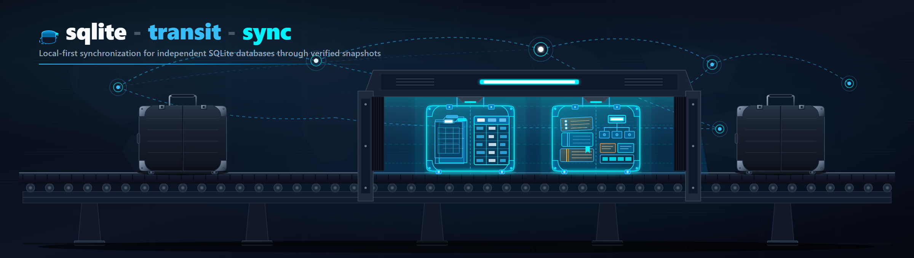
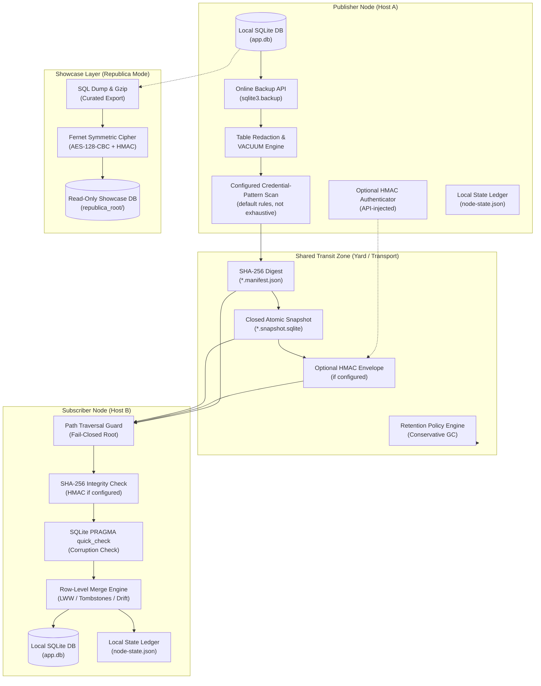
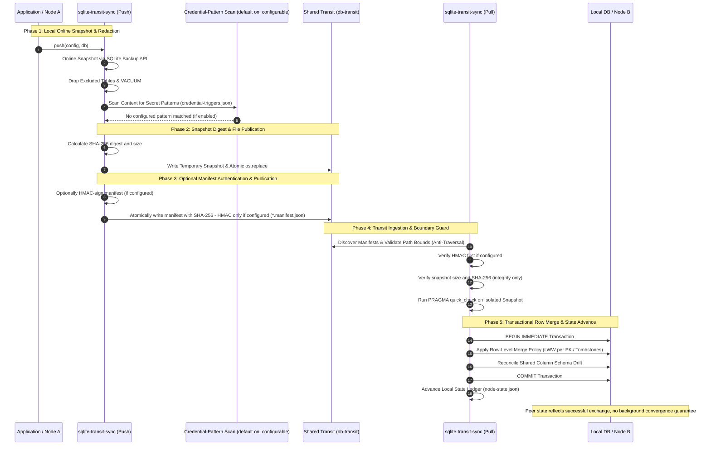

# sqlite-transit-sync



[](https://github.com/ellmos-ai/sqlite-transit-sync/actions/workflows/ci.yml)
[](CHANGELOG.md)
[](#tests)
[](#tests)
[](https://www.python.org/)
[](#)
[](#)
[](#governance-runtime-invariants-matrix)
[](SECURITY.md)
[](SECURITY.md)
[](CONTRIBUTING.md)
[](THIRD_PARTY_LICENSES.md)
[](THIRD_PARTY_LICENSES.txt)
[](NOTICE)
[](MARKETING-LOG.txt)
[](LICENSE)
[](https://github.com/ellmos-ai)
[](https://github.com/open-bricks)
[](llms.txt)

> [!NOTE]
> **سياق نماذج اللغة الكبيرة ووكلاء الذكاء الاصطناعي**: تتوفر خريطة موقع مهيكلة وقابلة للقراءة آلياً، ونظرة عامة على البنية المعمارية، ودليل لواجهة برمجة التطبيقات (API) في [`llms.txt`](llms.txt).

**🇬🇧 [English Version](README.md)** | **🇩🇪 [Deutsche Version](README_de.md)** | **🇪🇸 [Spanish Version](README_es.md)** | **🇫🇷 [French Version](README_fr.md)** | **🇯🇵 [Japanese Version](README_ja.md)** | **🇨🇳 [Simplified Chinese Version](README_zh.md)** | **🇵🇹 [Portuguese Version](README_pt.md)** | **🇷🇺 [Russian Version](README_ru.md)** | **🇸🇦 العربية** | **🇮🇳 [Hindi Version](README_hi.md)** | **🇧🇩 [Bengali Version](README_bn.md)** | **🤝 [Contributing](CONTRIBUTING.md)** | **🛡️ [Security Policy](SECURITY.md)** | **📝 [Changelog](CHANGELOG.md)** | **📋 [llms.txt](llms.txt)**

## 🧭 التنقل السريع

1. [ملخص تنفيذي والهوية الأساسية](#what-is-sqlite-transit-sync)
2. [طوبولوجيا البنية المعمارية المرئية والطبقات المنفصلة](#system-architecture-topology)
3. [دورة حياة اللقطات والمزامنة من البداية إلى النهاية](#end-to-end-snapshot-synchronization-lifecycle)
4. [الشخصيات المستهدفة واستعلامات تحسين محركات البحث عالية القصد](#marketing--target-personas)
5. [السلوك المنفذ والقيود](#comparison-with-distributed-sql)
6. [مصفوفة ثوابت الحوكمة ووقت التشغيل](#governance-runtime-invariants-matrix)
7. [القدرات الأساسية والميزات المنفصلة](#what-it-provides)
8. [إسقاطات التطبيق للقراءة فقط](#read-only-application-projections)
9. [التثبيت والمتطلبات الأساسية](#install)
10. [البدء السريع وسير العمل متعدد العقد](#quick-start)
11. [مرجع الإعدادات ومحفزات فحص بيانات الاعتماد](#configuration)
12. [واجهة عرض ريبوبليكا وطريقة التشفير](#republica-the-showcase-method)
13. [واجهة برمجة تطبيقات بايثون ونقاط التوسيع](#python-api)
14. [الأمان ونموذج التهديدات والحدود التشغيلية](#safety-and-limits)
15. [سجل تراخيص الأطراف الثالثة](#third-party-licenses--transparency)
16. [النظام البيئي والأدوات الشقيقة والحزم](#ecosystem--sibling-tools)
17. [الاختبار والتحقق ومصفوفة التكامل المستمر](#tests)
18. [الإشعار القانوني وتحديد المسؤولية والترخيص (المادة 521 من القانون المدني الألماني BGB)](#license)

---

<a id="what-is-sqlite-transit-sync"></a><a id="core-identity"></a><a id="executive-summary--core-identity"></a>
## 1. الملخص التنفيذي والهوية الأساسية

يتم تحديد سلطة الإصدار وحالة الوحدة والظهور وتاريخ التحقق في [`METADATA_CONTRACT.md`](METADATA_CONTRACT.md)؛ وهي لا تشكل موافقة على الإصدار أو النشر العام.

مزامنة محلية أولاً لقواعد بيانات SQLite المستقلة عبر لقطات تم التحقق من سلامتها وسياسات دمج قابلة للاختيار من جانب التطبيق. مصادقة المرسل اختيارية عبر مصادق HMAC يتم حقنه بواسطة واجهة برمجة التطبيقات (API). تم استخراجه من بنية BACH ProSync دون أي تبعيات لـ BACH أو OneDrive أو اسم المضيف أو مسار المستخدم.

هذا **ليس خادم SQL موزعاً**. كل عقدة تمتلك وتفتح قاعدة بياناتها المحلية فقط. يحمل مجلد مشترك أو نقطة توصيل تخزين كائنات أو محرك أقراص قابل للإزالة أو أي وسيلة نقل ملفات أخرى لقطات مغلقة بالإضافة إلى ملفات البيانات (manifests). تتحقق عملية السحب من تجزئة SHA-256 وأمر `PRAGMA quick_check` في SQLite قبل دمج اللقطة في قاعدة البيانات المحلية ضمن معاملة واحدة. يتم فحص مصادقة مرسل HMAC فقط عند تكوين مصادق.

يتكامل بشكل مثالي مع [sync-master](https://github.com/dev-bricks/sync-master) (من نفس عائلة الوحدات): تعد ساحة sync-master وسيلة نقل طبيعية لمسار النقل العابر — وجّه `--transit` إلى منطقة مملوكة للأداة `db-transit/<namespace>/` داخل الساحة (القاعدة R9 في بروتوكولها). يتولى sync-master نقل الملفات، بينما تتولى هذه الوحدة سلامة قاعدة البيانات والدمج؛ ويبقى كلاهما مستقلاً.

---

<a id="system-architecture-topology"></a><a id="system-architecture"></a>
## 2. طوبولوجيا البنية المرئية والطبقات المنفصلة

يوضح الرسم البياني التالي الطوبولوجيا المنفصلة متعددة العقد حيث يتم ربط قواعد بيانات SQLite المحلية حصرياً من خلال حزم لقطات مغلقة تم فحص سلامتها مقابل ملفات البيانات الخاصة بها:



### إسقاط معماري رباعي المناظر بترميز ASCII

```text
+-------------------------------------------------------------------------------------------------------------------+
|                               SQLITE-TRANSIT-SYNC: FOUR-VIEW ARCHITECTURAL TOPOLOGY                               |
+-------------------------------------------------------------------------------------------------------------------+
| [VIEW 1: PUBLISHER NODE]               [VIEW 2: SHARED TRANSIT YARD]              [VIEW 3: SUBSCRIBER NODE]       |
|                                                                                                                   |
| +-------------------------+              +-----------------------------+            +---------------------------+ |
| | Local SQLite Database   |              |  Closed Transit Zone        |            | Path Traversal Guard      | |
| | (app.db - Exclusive RW) |              |  (Folder / Sync-Master / S3)|            | (Canonical Bounds Check)  | |
| +------------+------------+              +--------------+--------------+            +-------------+-------------+ |
|              |                                          ^                                         |               |
|              v (sqlite3.backup)                         |                                         v               |
| +------------+------------+                             |                           +-------------+-------------+ |
| | Online Consistent Backup|                             |                           | SHA-256 Integrity Check   | |
| | (Closed Rollback-Journal|                             |                           | Optional HMAC if set      | |
| +------------+------------+                             |                           +-------------+-------------+ |
|              |                                          |                                         |               |
|              v                                          |                                         v               |
| +------------+------------+                             |                           +-------------+-------------+ |
| | Redaction & VACUUM      |                             |                           | SQLite PRAGMA quick_check | |
| | (Exclude Sensitive Data)|                             |                           | (Integrity Verification)  | |
| +------------+------------+                             |                           +-------------+-------------+ |
|              |                                          |                                         |               |
|              v                                          |                                         v               |
| +------------+------------+                             |                           +-------------+-------------+ |
| | Pattern Scan            |                             |                           | Transactional Row Merge   | |
| | (default rules; limited) |                             |                           | (Row-Level LWW / Drift)  | |
| +------------+------------+                             |                           +-------------+-------------+ |
|              |                                          |                                         |               |
|              v                                          |                                         v               |
| +------------+------------+              +--------------+--------------+            +-------------+-------------+ |
| | Optional HMAC Adapter   |              |  *.snapshot.sqlite (Atomic) |            | Local SQLite Database     | |
| | (API-injected if set)   |- - - - - - ->|  *.manifest.json   (Digest) |----------->| (app.db - Merged State)   | |
| +-------------------------+              |  Retention Engine  (Scoped) |            +-------------+-------------+ |
|                                          +-----------------------------+                          |               |
|                                                                                                   v               |
|                                                                                     +-------------+-------------+ |
|                                                                                     | Local State Ledger        | |
|                                                                                     | (node-state.json)         | |
|                                                                                     +---------------------------+ |
+-------------------------------------------------------------------------------------------------------------------+
| [VIEW 4: REPUBLICA SHOWCASE / COURIER ENVELOPE (OPTIONAL ZERO-TRUST TRANSPORT)]                                   |
|                                                                                                                   |
| Local Database ----> Curated SQL Dump ----> Gzip Compression ----> AES-128-CBC (Fernet) ----> Encrypted Outpost   |
| (Source Node)       (FTS Rebuilt on Dest)   (53MB -> 11MB)         (Pre-Shared Key)          (republica_root/)    |
|                                                                                                                   |
| Single Secret File -> Fernet Cipher Envelope -> Courier Transit -> Destination Directory (Mode 0600, Transit Clr) |
+-------------------------------------------------------------------------------------------------------------------+
```

---

<a id="end-to-end-snapshot-synchronization-lifecycle"></a><a id="lifecycle"></a>
## 3. دورة حياة اللقطات والمزامنة من البداية إلى النهاية

يبقي سير العمل ملفات قواعد البيانات الحية خارج نطاق مزامنة الملفات المباشرة. يقوم بالتحقق من بايتات اللقطة مقابل ملف بيان تجزئة SHA-256، ويشغل فحص أنماط بيانات الاعتماد المكوّن عند تمكينه (الافتراضي: قيد التشغيل)، ويدمج الصفوف المقبولة بشكل تعاملي. تتوفر مصادقة المرسل فقط عند تكوين مصادق HMAC يتم حقنه عبر واجهة برمجة التطبيقات. يرى النظراء التغييرات فقط بعد اكتمال تبادل ناجح للدفع والسحب:



---

<a id="marketing--target-personas"></a><a id="target-personas--discoverability-queries"></a><a id="target-personas"></a>
## 4. الفئات المستهدفة وعبارات البحث عالية القصد

تم تصميم `sqlite-transit-sync` للأنظمة البيئية اللامركزية والوحدات النمطية، وهو يخاطب 4 شخصيات رئيسية من أصحاب المصلحة:

- **`[PERSONA-01]` مهندسو وكلاء الذكاء الاصطناعي الذاتيون ومعماريو الأسراب متعددة المضيفين:**
  - *التحدي:* تتطلب أسراب الوكلاء المتعددين التي تعمل عبر محطات العمل وأجهزة الكمبيوتر المحمولة والخوادم استدامة الحالة المحلية دون حدوث تعارضات في قفل الملفات.
  - *الحل:* يمكن للفحص المُمكّن افتراضياً إيقاف النشر عند تطابق نمط بيانات اعتماد تم تكوينه. هذه شبكة أمان، وليست دليلاً على خلو اللقطة تماماً من الأسرار. يتلقى النظراء التغييرات بعد اكتمال عملية الدفع/السحب بنجاح.
- **`[PERSONA-02]` مطورو تطبيقات سطح المكتب والأجهزة الطرفية متعددة الأجهزة:**
  - *التحدي:* يعاني المستخدمون المتقدمون الذين يتبادلون الملاحظات الشخصية وقواعد بيانات المهام عبر مزامنة الملفات (مثل sync-master أو Syncthing أو Nextcloud) من تلف قواعد البيانات وأقفال ملفات `-wal`.
  - *الحل:* تبقي واجهة النسخ الاحتياطي لـ SQLite ونشر اللقطات لكل ملف على حدة ملفات قاعدة البيانات الحية بعيداً عن مسار مزامنة الملفات؛ وتكون لقطات النقل هي الملفات الوحيدة المتبادلة.
- **`[PERSONA-03]` بناة أدوات المعالجة المحلية أولاً ومسارات النقل القابلة للإعداد:**
  - *التحدي:* التطبيقات التي تتطلب سيادة البيانات لا يمكنها قبول الارتباط بالخدمات السحابية أو رسوم استضافة قواعد البيانات الدورية أو تسرب البيانات غير المنضبط في الخلفية.
  - *الحل:* تتبادل الوحدة ملفات اللقطات عبر مسار نظام ملفات تم تكوينه. قد يكون هذا المسار محلياً أو قابلاً للإزالة؛ وتبقى وسائل النقل المشتركة أو المثبتة عبر الشبكة خارج سيطرة الوحدة.
- **`[PERSONA-04]` مسؤولو الأمان والخصوصية والامتثال في المؤسسات:**
  - *التحدي:* تمنع متطلبات انعدام الثقة الصارمة المزامنة العرضية لبيانات الاعتماد والكائنات الثنائية غير المؤكدة والخدمات ذات الصلاحيات المرتفعة التي تعمل في الخلفية.
  - *الحل:* يتحقق الفحص المفعل افتراضياً من أنماط بيانات الاعتماد المكوّنة قبل النشر؛ وتتحقق تجزئة SHA-256 من سلامة اللقطة مقابل ملف البيان. يمكن تمكين مصادق HMAC يتم حقنه عبر واجهة برمجة التطبيقات لمصادقة المرسل. ترث العملية أذونات المستخدم الذي قام بتشغيلها.

### عبارات البحث عالية القصد (ثنائية اللغة EN و DE)

| فئة القصد | استعلامات البحث بالإنجليزية (EN) | مصطلحات البحث بالألمانية (DE) |
|:---|:---|:---|
| **المزامنة المحلية أولاً** | `sqlite synchronization python zero-dependency`, `local-first database snapshot sync`, `offline sqlite multi-device sync` | `lokale datenbank synchronisation offline snapshots`, `sqlite abgleich python ohne abhängigkeiten`, `lokale datenbank replikation dateibasiert` |
| **السلامة وفحص أنماط الاعتماد المكوّنة** | `configured credential-pattern scan sqlite sync`, `configured filesystem transit sqlite sync`, `optional hmac sqlite snapshot manifest` | `konfigurierter credential musterscan sqlite sync`, `dateipfad transit sqlite sync`, `optional hmac snapshot manifest` |
| **دمج الصفوف والتعارضات** | `row level merge lww sqlite offline`, `sqlite last write wins schema drift tolerance`, `tombstone merge policy sqlite` | `row level merge lww sqlite offline`, `last-write-wins datenbank abgleich zeitstempel`, `schema drift toleranz sqlite merge` |
| **البنية المعمارية المنفصلة** | `sqlite multi-node sync without distributed sql`, `sqlite over syncthing without corruption`, `sqlite transit yard architecture` | `sqlite synchronisation ohne verteilten server`, `sqlite über cloud sync ohne datenbankkorruption`, `transit yard sqlite synchronisation` |

للحصول على تفاصيل دقيقة للشخصيات المستهدفة واستعلامات البحث عالية القصد والتموضع التنافسي، يُرجى الرجوع إلى [MARKETING-LOG.txt](MARKETING-LOG.txt).

---

<a id="comparison-with-distributed-sql"></a><a id="comparative-matrix--alternatives"></a><a id="comparative-matrix"></a>
## 5. السلوك المُنفَّذ والحدود

يسجل هذا القسم السلوك المنفذ والقيود الحالية للمشروع. وهو ليس مقارنة تدقيقية مع المنتجات الأخرى.

| البعد | الثابت | السلوك المنفذ | الحد / النطاق |
|:---|:---|:---|:---|
| **1. المعالجة المحلية والنقل** | `INV-LOCAL-01` | يقرأ قواعد بيانات SQLite المحلية وينشر اللقطات إلى مسار نقل تم تكوينه؛ لا يلزم وجود خادم قاعدة بيانات مركزي. | قد يكون المسار المكوّن موقعاً مشتركاً أو مثبتاً على الشبكة. يظل الوصول إلى وسيلة النقل هذه وسلوكها خارج هذه الوحدة. |
| **2. نشر اللقطات** | `INV-SNAP-02` | يلتقط نسخة احتياطية مباشرة وينشر ملف اللقطة باستخدام ملف مؤقت وأمر `os.replace`. | استبدال كل ملف على حدة لا يجعل اللقطة وملف البيان معاملة واحدة ذرية متعددة الملفات. |
| **3. الملفات المرافقة ونطاق العملية** | `INV-ROLL-03` | يغلق اللقطات في وضع سجل التراجع (rollback-journal) ويفشل بأمان عند تعذر تنظيف الملفات المرافقة المؤقتة لـ SQLite. | قم بتشغيل عملية مزامنة واحدة لكل عقدة ما لم يضف التطبيق المستضيف قفل عملية. |
| **4. احتواء مسار النقل** | `INV-PATH-04` | يقصر مسارات ملفات البيان واللقطات على ملفات عادية مباشرة تحت جذر مسار النقل القانوني. | هذا لا يتحكم في من يمكنه الكتابة إلى موقع النقل. |
| **5. فحوصات السلامة** | `INV-VERIFY-05` | يقارن بايتات اللقطة مع تجزئة SHA-256 في ملف البيان ويشغل أمر SQLite `PRAGMA quick_check`. | التجزئة المتطابقة لا تصادق على المرسل أو وسيلة النقل. |
| **6. فحص أنماط بيانات الاعتماد** | `INV-SHIELD-06` | يتحقق افتراضياً من محتوى اللقطة مقابل الأنماط المكوّنة ويوقف النشر عند التطابق، مع الإبلاغ عن `table.column` دون إظهار القيمة. | القواعد ذات البادئات المحددة هي شبكة أمان وليست ضماناً. الفحص النظيف يعني عدم مطابقة أي نمط معروف؛ قد تمر الأسرار المخصصة أو التي لا تحمل بادئة. |
| **7. مصادقة المرسل** | `INV-HMAC-07` | يمكن للتطبيق الاشتراك اختيارياً في مصادقة HMAC-SHA256 عبر واجهة برمجة التطبيقات لملف البيان القانوني. | بدون تكوين مصادق، لا توجد مصادقة للمرسل. لا يعد HMAC ذو المفتاح المشترك بروتوكول حداثة أو توقيعاً بالمفتاح العام. |
| **8. دمج الصفوف** | `INV-MERGE-08` | يطبق سياسة دمج صفوف قابلة للتكوين، مع اعتماد الفوز للكتابة الأخيرة (LWW) المستندة إلى الطابع الزمني كخيار افتراضي للجداول المدعومة. | يتحمل التطبيق المدمج مسؤولية افتراضات الساعة، ودلالات الحذف، والترحيل، وقواعد تعارض النطاق. |
| **9. نطاق الاحتفاظ والحذف** | `INV-RET-09` | تكون عملية التنظيف تجريبية (dry-run) افتراضياً ومقتصرة على عناصر العقدة المحلية ما لم يتم تمكين الصلاحية عبر العقد صراحة. | تنظيف الاحتفاظ ليس خدمة نسخ احتياطي أو استرداد. |
| **10. أذونات العملية وسياسة الأمان** | `INV-SLA-10` | تستخدم العملية أذونات العملية التي قامت بتشغيلها. تحدد وثيقة `SECURITY.md` سياسة الإبلاغ: الإقرار خلال 48 ساعة والفرز خلال 5 أيام عمل. | لا تفرض الوحدة امتيازات المستخدم القياسي أو تطلب ترقية الصلاحيات. أوقات الاستجابة هي سياسة إبلاغ وليست ميزة وقت تشغيل. |

<a id="distributed-sql-detailed-comparison"></a>
### نموذج المعالجة وحدود النطاق

| الجانب | سلوك `sqlite-transit-sync` | الحد / النطاق |
|---|---|---|
| النموذج الأساسي | كل عقدة لها قاعدة بيانات SQLite المحلية الخاصة بها؛ تتحرك اللقطات عبر مسار نقل مكوّن. | لا توجد قاعدة بيانات واحدة ذات صلاحية عامة مطلقة. |
| عمليات الكتابة | تكتب التطبيقات محلياً؛ يقوم المتصل بتشغيل الدفع والسحب لتبادل اللقطات. | لا توجد مزامنة خلفية تلقائية. |
| الرؤية | يمكن للنظير رؤية التغييرات بعد اكتمال عملية التبادل والدمج بنجاح. | لا تضمن الوحدة الرؤية الفورية أو المتسقة عالمياً. |
| المعاملات العامة | غير متوفرة. | لا يمكن للتطبيق تثبيت معاملة واحدة عبر عقد متعددة. |
| العمل دون اتصال | يمكن استخدام قاعدة البيانات المحلية بشكل مستقل أثناء عدم اتصال العقدة. | ينتظر تبادل اللقطات حتى تصبح وسيلة النقل المكوّنة متاحة. |
| التعارضات | تحدد سياسة `MergePolicy` المكوّنة كيفية دمج الصفوف؛ ويعد LWW المستند إلى الطابع الزمني هو الخيار الافتراضي. | تظل ساعات التطبيق وقواعد الحذف ودلالات النطاق مسؤولية التكامل. |
| تغييرات المخطط | يدعم دمج الأعمدة المشتركة تفاوت المخطط المحدود. | تظل التطبيقات مسؤولة عن عمليات الترحيل وتوافق المخطط. |
| معالجة الفشل | يتم تخزين البيانات المحلية في SQLite ولقطات النقل عبارة عن ملفات منفصلة. | لا توفر الوحدة نسخاً متماثلاً تلقائياً أو تجاوزاً للفشل أو نسخاً احتياطية لمسار النقل. |

### المزايا والعيوب وحالات الاستخدام النموذجية

| النظام | المزايا | العيوب | حالات الاستخدام الجيدة | حالات الاستخدام غير المناسبة |
|---|---|---|---|---|
| `sqlite-transit-sync` | بصمة محلية صغيرة؛ لا يوجد خادم قاعدة بيانات مركزي؛ عمل محلي دون اتصال؛ وسيلة نقل ملفات قابلة للتكوين؛ سياسات دمج قابلة للاختيار من التطبيق. | تتطلب التغييرات الدفع/السحب للوصول إلى النظراء؛ لا توجد معاملات عامة أو تجاوز تلقائي للفشل؛ تحتاج الساعات والحذف والترحيل والتعارضات إلى قواعد يحددها التطبيق. | قواعد البيانات الشخصية أو الخاصة بالمهام؛ حالة الوكلاء المحليين؛ أجهزة الكمبيوتر المحمولة أو محطات العمل أو الأجهزة الطرفية المتصلة بشكل متقطع؛ الملاحظات البحثية. | أعباء العمل التي تتطلب معاملات مثبتة عالمياً، أو حالة مشتركة فورية، أو تجاوزاً تلقائياً للفشل، أو العديد من الكتاب المتزامنين. |

### دليل القرار السريع

| المتطلب | الملاءمة |
|---|---|
| تحتاج العقد إلى الاستمرار في استخدام قاعدة بياناتها المحلية أثناء عدم الاتصال | `sqlite-transit-sync` |
| يمكن للتحديثات أن تصل إلى النظراء بعد تبادل صريح للدفع/السحب | `sqlite-transit-sync` |
| يمكن للتطبيق تحديد قواعد الدمج والساعة والحذف والترحيل الخاصة به | `sqlite-transit-sync` |
| يجب أن تكون كل كتابة ذات صلاحية عامة فورية | استخدم بنية معمارية توفر هذا العقد من الاتساق |
| يلزم وجود معاملات عامة، أو تجاوز تلقائي للفشل، أو كتاب متزامنون متعددون | قم بتقييم بنية توفر تلك السلوكيات |

بالنسبة لعدد صغير من الأجهزة المتصلة بشكل متقطع، قد تكون هذه الوحدة مناسبة عند قبول التبادل المتأخر وقواعد الدمج المملوكة للتطبيق. إذا كان عبء العمل يتطلب معاملات عامة، أو حالة مشتركة فورية، أو تجاوزاً تلقائياً للفشل، فاختر تصميماً يفي عقده الموثق بتلك السلوكيات.

---

<a id="governance-runtime-invariants-matrix"></a><a id="governance--runtime-invariants"></a>
## 6. مصفوفة الحوكمة وثوابت وقت التشغيل

تسجل المصفوفة أدناه ثوابت الحوكمة ووقت التشغيل العشرة للمشروع، مع السلوك المنفذ والقيود ذات الصلة:

| # | الثابت | النطاق المعماري | السلوك الموثق والقيود |
|---|---|---|---|
| 1 | **INV-LOCAL-01: معالجة SQLite المحلية ومسار النقل المكوّن** | بنية النظام | يقرأ قواعد بيانات SQLite المحلية وينشر اللقطات عبر مسار النقل المكوّن. قد يكون المسار مشتركاً أو مثبتاً عبر الشبكة؛ سلوك المضيف والنقل خارج نطاق هذه الوحدة. |
| 2 | **INV-SNAP-02: ذرية اللقطات دون اتصال** | نشر النقل | لا تتم مشاركة ملفات قاعدة البيانات الحية أبداً عبر مزامنة الملفات. يتم أخذ اللقطات المباشرة عبر `sqlite3.backup` ونشرها عبر `os.replace` الذري. |
| 3 | **INV-ROLL-03: عزل نظيف لسجل التراجع** | منع الملفات المرافقة | يتم إغلاق النسخ الاحتياطية في وضع سجل التراجع (rollback-journal)؛ ويتم تنظيف جميع الملفات المرافقة المؤقتة لـ SQLite (`-wal`, `-shm`, `-journal`) مع الفشل بأمان قبل إنشاء ملف البيان. |
| 4 | **INV-PATH-04: احتواء صارم لمسار النقل** | حدود نظام الملفات | يجب أن تكون مسارات ملفات البيان واللقطات ملفات عادية مباشرة داخل جذر مسار النقل القانوني. تفشل محاولات اجتياز المسار (`../`) والروابط الرمزية ونقاط إعادة التحليل بأمان عند حدوثها. |
| 5 | **INV-VERIFY-05: تحقق ثنائي المرحلة من السلامة والصلاحية** | التحقق قبل الدمج | يجب أن تجتاز كل لقطة مستلمة مطابقة التجزئة التشفيرية SHA-256 وأمر `PRAGMA quick_check` في SQLite قبل فحص البيانات أو دمجها. |
| 6 | **INV-SHIELD-06: حماية بيانات الاعتماد قبل النشر** | فحص المحتوى | افتراضياً، يتم فحص محتوى اللقطة مقابل الأنماط المكوّنة؛ يؤدي أي تطابق إلى إلغاء النشر والإبلاغ عن `table.column` دون إظهار القيمة. الأنماط ذات البادئات المحددة هي شبكة أمان وليست ضماناً؛ عدم وجود تطابق لا يثبت خلو اللقطة من الأسرار. |
| 7 | **INV-HMAC-07: مصادقة HMAC اختيارية** | مصادقة المرسل | غلاف اختياري لـ HMAC-SHA256 يتم حقنه عبر واجهة برمجة التطبيقات فوق حمولة ملف البيان القانوني (البروتوكول، مساحة الاسم، معرف المرسل، اسم الملف، SHA-256، الحجم، قائمة الحجب). HMAC بالمفتاح المشترك ليس بروتوكول حداثة أو توقيعاً بالمفتاح العام؛ وبدونه، لا يثبت ملف البيان هوية المرسل. |
| 8 | **INV-MERGE-08: دمج صفوف حتمي** | تقارب البيانات | دمج تعاملي على مستوى الصفوف (LWW لكل مفتاح أساسي، اتحاد الأعمدة المشتركة لتفاوت المخطط، سياسة شواهد الحذف الصريحة). يضمن كسر التعادل عبر تجزئة المحتوى تقارباً حتمياً. |
| 9 | **INV-RET-09: احتفاظ متحفظ وتحديد الصلاحيات** | جمع المهملات | تنظيف اللقطات هو تشغيل تجريبي (dry-run) افتراضياً، ومقصور بشكل صارم على عناصر العقدة المحلية. يتطلب الحذف عبر العقد (`--all-nodes`) اشتراكاً إدارياً صريحاً. |
| 10 | **INV-SLA-10: أذونات العملية وسياسة الأمان** | سياق وقت التشغيل | ترث العملية أذونات المستخدم الذي قام بتشغيلها؛ لا تفرض هذه الوحدة صلاحيات المستخدم القياسي أو تطلب ترقية الامتيازات. تحدد وثيقة `SECURITY.md` الإقرار خلال 48 ساعة والفرز خلال 5 أيام عمل. |

---

<a id="what-it-provides"></a><a id="core-capabilities"></a><a id="part-of-the-ellmos-stack-family"></a>
## 7. القدرات الأساسية والميزات المنفصلة

تعتبر `sqlite-transit-sync` رفيقاً لـ [dev-bricks/sync-master](https://github.com/dev-bricks/sync-master) في نفس عائلة الوحدات: يمتلك sync-master نقل الملفات (`sync.files`)، بينما تمتلك هذه الوحدة سلامة قاعدة البيانات والدمج (`sync.database`). يعمل كلاهما بشكل مستقل أو مدمجاً في حزم من عائلة [ellmos-ai](https://github.com/ellmos-ai) — انظر دليل [ellmos-ai/stacks](https://github.com/ellmos-ai/stacks). دورها في تلك الحزمة: لا يتم تشغيل SQLite الحي عبر مزامنة الملفات — فقط اللقطات التي تجتاز فحوصات البيان وسلامة SQLite، بالإضافة إلى سياسات الدمج القابلة للاختيار من قبل التطبيق.

### القدرات الرئيسية

- لقطات مباشرة متسقة من خلال واجهة النسخ الاحتياطي الخاصة بـ SQLite؛
- نشر ذري باستخدام ملف مؤقت وأمر `os.replace`؛
- لقطات مغلقة في وضع سجل التراجع مع تنظيف صارم لكل ملف مرافق مؤقت لـ SQLite قبل النشر؛
- تقتصر مسارات ملفات البيان واللقطات على ملفات عادية مباشرة في دليل النقل القانوني؛ تفشل مسارات الاجتياز والمسارات المطلقة والروابط الرمزية ونقاط إعادة التحليل بأمان قبل إجراء التجزئة أو الدمج؛
- التحقق من ملف البيان عبر SHA-256 وأمر `PRAGMA quick_check`؛
- مصادقة HMAC-SHA256 اختيارية يتم حقنها عبر واجهة برمجة التطبيقات فوق ملف البيان القانوني وهوية المرسل وإصدار البروتوكول وتجزئة اللقطة، مع معرفات مفاتيح صريحة؛
- حالة سحب محلية لكل عقدة وإعادة تشغيل متطابقة النتائج (idempotent)؛
- الفوز للكتابة الأخيرة على مستوى الصفوف لكل مفتاح أساسي للجداول المزودة بطوابع زمنية؛
- محول مرجعي اختياري `TombstoneMergePolicy` لعمليات الحذف الصريحة؛
- دمج الأعمدة المشتركة للتسامح مع التغيرات الأساسية في المخطط؛
- استبعاد الجداول القابل للتكوين وتنقيح اللقطات مع تنفيذ VACUUM بعد الحذف؛
- فحص محتوى مفعّل افتراضياً يوقف النشر عند تطابق نمط بيانات اعتماد مكوّن (يبلغ عن `table.column`، ولا يكشف القيمة أبداً). القواعد ذات البادئات المحددة هي شبكة أمان؛ لا يثبت الفحص النظيف خلو اللقطة تماماً من الأسرار؛
- دعم `MergePolicy` مخصص لقواعد النطاق أو شواهد الحذف أو CRDTs؛
- تنظيف تم التحقق منه للقطات مع كونه تجريبياً افتراضياً ومقتصراً على العقدة المحلية، مع اشتراط موافقة صريحة للحذف وإدارة العقد الخارجية؛
- إمكانية سحب لقطات معلقة محددة لمحوّلات دورة حياة التطبيق الخفيفة دون تكرار منطق الدمج أو تقدم الحالة؛
- عقود إسقاطات صارمة للقراءة فقط ذات إصدارات محددة مع قوائم سماح دقيقة للمخطط والخصوصية، والتحقق من المصدر ونقاط التفتيش والحلقات وشواهد الحذف دون اتصال؛
- وضع عرض [Republica showcase mode](#republica-the-showcase-method) اختياري يوزع قاعدة البيانات في اتجاه واحد كحمولة مشفرة ويجسدها كواجهة عرض منفصلة للقراءة فقط، بدلاً من دمجها؛
- واجهة برمجة تطبيقات بايثون خالية من التبعيات وواجهة سطر أوامر تعتمد على JSON (يضيف وضع Republica مكتبة `cryptography`).

---

<a id="read-only-application-projections"></a><a id="projections"></a>
## 8. إسقاطات التطبيق للقراءة فقط

يقوم الأمر `verify-projection` بالتحقق من صحة إسقاط SQLite مغلق ومملوك للتطبيق دون نسخ أو دمج أو ترحيل أو جدولة أو دفع للحالة. يوفر التطبيق هوية المستهلك الخاصة به والحد الأقصى للفاصل الزمني دون اتصال الذي تمت مراجعته؛ ويرفض المحقق الحلقات ونقاط التفتيش القديمة وفترات الاحتفاظ غير الكافية بشواهد الحذف والجداول أو الأعمدة غير المدرجة ومراجع السجلات غير المبهمة.

تم تجميع ستة عقود دقيقة لملخصات أرصدة الحسابات، وحالة اشتراك AboTracker، ومواعيد تجديد مخزون HausLagerist، وحالة استحقاق الأدوية والتحذير من نفادها، وحالة استحقاق الروتين وإكماله، والمواعيد النهائية للتأمين. يعتبر عقد AboTracker مقتصراً على الحالة فقط لأن مخطط التصدير v1 لا يحتوي على تاريخ استحقاق أو تجديد مؤكد؛ ولا يشتق تذكيراً أبداً من تاريخ الدفع بالإضافة إلى دورة الفوترة. تُعد ملفات الاختبار نماذج JSON تركيبية، وتبقى هويات النطاق أو التفاصيل الخاصة خارج قوائم السماح.

الأسماء المضمنة هي `abotracker-subscription-status-projection.v1`، و`accounts-balance-projection.v1`، و`hauslagerist-replenishment-projection.v1`، و`mediplaner-reminder-projection.v1`، و`routinika-reminder-projection.v1`، و`versicherungsmanager-deadline-projection.v1`. انظر [Read-only projection contracts](PROJECTION_CONTRACTS.md) و[German companion](PROJECTION_CONTRACTS_de.md).

```bash
sqlite-transit-sync verify-projection \
  --contract mediplaner-reminder-projection.v1 \
  --database ./closed-projection.sqlite \
  --consumer-id reminder-consumer \
  --minimum-offline-seconds 2592000 \
  --previous-checkpoint 41
```

---

<a id="install"></a><a id="installation"></a>
## 9. التثبيت والمتطلبات الأساسية

```bash
python -m pip install -e .
```

---

<a id="quick-start"></a><a id="quickstart"></a>
## 10. البدء السريع وسير العمل متعدد العُقد

أنشئ ملف إعدادات على كل عقدة. تستخدم كل عقدة قاعدة بياناتها الخاصة وملف حالتها الخاص، ولكن بنفس دليل النقل ومساحة الاسم.

```bash
sqlite-transit-sync init \
  --config node.json \
  --database ./app.db \
  --transit ./shared-transit \
  --node-id laptop \
  --namespace my-app

sqlite-transit-sync push --config node.json
sqlite-transit-sync pull --config node.json --dry-run
sqlite-transit-sync pull --config node.json
sqlite-transit-sync status --config node.json
sqlite-transit-sync verify --config node.json
sqlite-transit-sync cleanup --config node.json
# Review the JSON plan, then explicitly apply it:
sqlite-transit-sync cleanup --config node.json --apply
```

يجب أن يكون مخطط التطبيق موجوداً بالفعل على كل عقدة. تم تعطيل النسخ الأولي التلقائي عمداً لأن وحدة برمجية عامة لا يمكنها تحديد المخطط أو الأسرار أو الجداول المحلية أو عمليات الترحيل التي تنتمي إلى أحد التطبيقات.

### مثال بايثون مستقل قابل للتشغيل (دون تبعيات خارجية)

يمكن للمطورين الذين يقومون بدمج `sqlite-transit-sync` مباشرة في أطر عمل الوكلاء أو برامج الخلفية الخفية تشغيل هذا النص البرمجي المستقل والقابل للنسخ واللصق للتحقق من المزامنة الشاملة متعددة العقد دون أي تبعيات خارجية:

```python
import sqlite3
from contextlib import closing
import tempfile
from pathlib import Path
from sqlite_transit_sync import SyncConfig, TransitSync

with tempfile.TemporaryDirectory() as tmp:
    root = Path(tmp)
    transit = root / "transit"
    transit.mkdir()

    # 1. Initialize Node A and record local data
    db_a = root / "node_a.db"
    with closing(sqlite3.connect(db_a)) as conn, conn:
        conn.execute("CREATE TABLE notes (id INTEGER PRIMARY KEY, title TEXT, updated_at TEXT)")
        conn.execute("INSERT INTO notes VALUES (1, 'Hello from Node A', '2026-10-18T08:00:00Z')")

    # 2. Publish atomic snapshot from Node A to shared transit
    cfg_a = SyncConfig(database=db_a, transit=transit, state=root / "state_a.json", node_id="node_a", namespace="demo")
    snapshot = TransitSync(cfg_a).push()
    print(f"Node A published snapshot: {snapshot.path.name} (SHA-256: {snapshot.sha256[:8]}...)")

    # 3. Initialize Node B with schema and pull snapshot
    db_b = root / "node_b.db"
    with closing(sqlite3.connect(db_b)) as conn, conn:
        conn.execute("CREATE TABLE notes (id INTEGER PRIMARY KEY, title TEXT, updated_at TEXT)")

    cfg_b = SyncConfig(database=db_b, transit=transit, state=root / "state_b.json", node_id="node_b", namespace="demo")
    reports = TransitSync(cfg_b).pull()

    # 4. Verify converged state in Node B
    with closing(sqlite3.connect(db_b)) as conn, conn:
        rows = conn.execute("SELECT id, title, updated_at FROM notes").fetchall()
        print(f"Node B converged records: {rows}")
        assert rows == [(1, "Hello from Node A", "2026-10-18T08:00:00Z")]
```

---

<a id="configuration"></a><a id="configuration-reference"></a>
## 11. مرجع الإعدادات ومحفزات كشف بيانات الاعتماد

```json
{
  "database": "./app.db",
  "transit": "./shared-transit",
  "state": "./node-state.json",
  "node_id": "laptop",
  "namespace": "my-app",
  "timestamp_columns": ["updated_at", "modified_at", "created_at"],
  "exclude_tables": ["secrets", "sqlite_sequence"],
  "snapshot_exclude_tables": ["secrets"],
  "scan_snapshot_for_secrets": true,
  "secret_scan_skip_tables": [],
  "secret_scan_extra_patterns": [],
  "secret_patterns_file": null
}
```

يتم حل المسارات النسبية انطلاقاً من ملف الإعدادات. يجب ألا تقع قاعدة البيانات الحية أبداً داخل دليل مسار النقل، كما يجب أن يكون ملف الحالة خارج شجرة مسار النقل. ترفض دوال `SyncConfig` و`from_file` و`from_bytes` وأمر سطر الأوامر `init` أي مسار حالة غير صالح قبل إنشاء مسار النقل أو أدلة الحالة؛ ولا يتم إجراء أي ترحيل تلقائياً.

يمكن للتطبيقات التي تحتاج إلى تجزئة تدقيق للإعدادات المحللة قراءة البايتات مرة واحدة واستخدام نفس المحلل النسبي للمصدر دون قراءة ثانية للملف:

```python
import hashlib
from pathlib import Path

from sqlite_transit_sync import SyncConfig

config_path = Path("node.json").resolve()
payload = config_path.read_bytes()
config = SyncConfig.from_bytes(payload, source_path=config_path)
config_sha256 = hashlib.sha256(payload).hexdigest()
```

### جميع المفاتيح وقيمها الافتراضية

| المفتاح | القيمة الافتراضية | المعنى |
|---|---|---|
| `database` | *(مطلوب)* | قاعدة بيانات SQLite الحية المملوكة لهذه العقدة |
| `transit` | *(مطلوب)* | الدليل المشترك الحامل للقطات وملفات البيانات |
| `state` | `./.sync-state.json` | حالة السحب الخاصة بكل عقدة؛ احتفظ بها خارج مسار النقل |
| `node_id` | اسم مضيف الجهاز | يحدد العقدة الناشرة في أسماء اللقطات |
| `namespace` | `"default"` | يفصل مجموعات البيانات غير المترابطة في مسار نقل واحد |
| `timestamp_columns` | `["updated_at","modified_at","created_at"]` | الأعمدة المعتمدة لتطبيق سياسة الفوز للكتابة الأخيرة (LWW) |
| `exclude_tables` | `["secrets","sqlite_sequence"]` | جداول لا يتم **دمجها** أبداً في قاعدة البيانات المحلية |
| `snapshot_exclude_tables` | `["secrets"]` | جداول يتم **حذف صفوفها من اللقطة** قبل النشر (ثم تنفيذ `VACUUM`) |
| `scan_snapshot_for_secrets` | `true` | إيقاف النشر عندما يبدو محتوى اللقطة مطابقاً لبيانات اعتماد |
| `secret_scan_skip_tables` | `[]` | جداول يتجاهلها الفحص — يُستخدم لجدول واحد يسبب تنبيهات غير صحيحة بدلاً من تعطيل الفحص كلياً |
| `secret_scan_extra_patterns` | `[]` | تعبيرات نمطية إضافية، تضاف إلى ملف المحفزات |
| `secret_patterns_file` | `null` (الملف المرفق) | مسار لملف المحفزات الخاص بك؛ **يستبدل** الأنماط المضمنة كلياً |
| `key_file` | `null`، وإلا `$SQLITE_TRANSIT_SYNC_KEY_FILE` | مفتاح Fernet لوضع Republica؛ يجب أن يظل خارج مسار النقل |
| `republica_root` | `~/.republica` | مكان كتابة واجهات العرض المستوردة؛ يجب أن يظل خارج مسار النقل |
| `allow_key_in_synced_folder` | `false` | يتجاوز الفحص الذي يرفض وجود مفتاح داخل مجلد مزامنة سحابي |

تنطبق القيمة الافتراضية لـ `state` في هذا الجدول عند تحميل تكوين JSON بدون هذا المفتاح. يكتب `sqlite-transit-sync init` بدلاً من ذلك `.<config-stem>-state.json` عند حذف `--state` (بالنسبة لـ `node.json`: `.node-state.json`).

### فحص بيانات الاعتماد وكيفية إيقافه

يمكن لـ `snapshot_exclude_tables` فقط إسقاط جدول توقعته مسبقاً. يجيب الفحص عن السؤال الذي لا تستطيع هذه القاعدة الإجابة عنه: *هل تم لصق بيانات اعتماد بطريق الخطأ في عمود نصي حر* — مثل ملاحظة أو سطر سجل أو ملخص جلسة؟ يتم تشغيله على نسخة اللقطة بعد التنقيح وقبل النشر. عند حدوث تطابق، يثير خطأ `SyncError` موضحاً `table.column`؛ ولا يتم تضمين القيمة المتطابقة أبداً، لذا لا تنتقل بيانات الاعتماد إلى السجلات أو تتبعات الأخطاء أو مخرجات CI. يتم التخلص من اللقطة الجزئية، وبالتالي لا يصل أي شيء إلى دليل النقل العابر.

**حدود الإعداد والنشر:** تعمل عمليات النسخ الاحتياطي الأولي، والتنقيح، والفحص في دليل مؤقت لكل استدعاء تحت الدليل الأصلي للحالة المحلية المكوّن، خارج مسار النقل العابر القانوني. يُعد Republica أيضاً ملفات SQL/gzip بنص صريح هناك ويشفرها قبل نسخ أي شيء إلى مسار النقل. حافظ على بقاء الدليل الأصلي للحالة محلياً وخاصاً وخارج المجلدات المشتركة أو المتزامنة؛ تقع جذور المزامنة الأخرى والعمليات التي تستخدم نفس حساب نظام التشغيل خارج نطاق هذا الضمان. فحص الأنماط الاختياري ليس كشفاً شاملاً للأسرار.

يتم فقط نسخ بايتات اللقطة التي تم التحقق منها (الدفع العادي) أو النص المشفر (Republica) إلى ملف نقل مؤقت تم إنشاؤه حصرياً، والتحقق منه من حيث الحجم والتجزئة، ثم إعادة تسميته داخل نظام الملفات المستهدف هذا. يتبع ذلك ملف البيان؛ ولا يشكل زوج الملفات معاملة ذرية واحدة. أخطاء التنظيف الخاص تنتشر للأعلى. قد تترك حالات الانهيار مساحات عمل خاصة؛ ولا يوجد مسح آمن للبيانات أو تنظيف تلقائي للقطع الأثرية التاريخية أو الأجنبية.

**إيقاف الفحص هو خيار مشروع**، وليس حلاً مؤقتاً. إذا كان مسار النقل الخاص بك موقع تخزين تتحكم فيه وتثق به — خادمك الخاص، أو وحدة تخزين مستضافة في الاتحاد الأوروبي بموجب عقدك، أو محرك أقراص مشفر قابل للإزالة — و*تريد* أن تنتقل بيانات الاعتماد مع البيانات، فقم بتعيين:

```json
{ "scan_snapshot_for_secrets": false }
```

يفضل استخدام `secret_scan_skip_tables` عندما ينتج جدول واحد فقط نتائج إيجابية كاذبة: الحفاظ على تشغيل الفحص في كل مكان آخر أفضل بكثير من تعطيله بالكامل.

### ضبط أنماط الكشف

توجد الأنماط في البيانات وليس في الكود البرمجي — `sqlite_transit_sync/credential-triggers.json` — بحيث يمكن تشديد قواعد الكشف بمرور الوقت دون انتظار إصدار جديد:

```json
{
  "version": 1,
  "patterns": [
    { "name": "github", "regex": "gh[pousr]_[A-Za-z0-9]{16,}", "prefilter": "gh" },
    { "name": "acme-internal", "regex": "ACME-[0-9]{4}", "prefilter": "ACME-" }
  ]
}
```

- `prefilter` عبارة عن نص اختياري يُستخدم كمرشح مسبق سريع لـ SQL `LIKE` حتى تظل اللقطات الكبيرة سريعة المعالجة. ويجب أن يظهر في كل قيمة يمكن أن يطابقها التعبير النمطي، وإلا فستفوت نتائج الفحص. احذفه عند عدم وجود مثل هذا النص — يقوم الماسح بعد ذلك بقراءة العمود بالكامل لضمان الدقة.
- وجّه `secret_patterns_file` إلى نسختك الخاصة لاستبدال الإعدادات الافتراضية بالكامل، أو استخدم `secret_scan_extra_patterns` للإضافة إليها.

تحمل الأنماط بادئات خاصة بموفري الخدمات عن قصد. إن قاعدة عامة تكتشف "سلسلة سداسية عشرية طويلة" ستضع علامة تحذير على المجموع الاختباري، ومعرفات UUID وتجزئات git SHA، وهي محتويات قاعدة بيانات مشروعة — ومحلل الفحص ذو المعدل المرتفع من الإيجابيات الكاذبة ينتهي به الأمر إلى إيقافه، وهو ما لا يحمي أي شيء. تعامل مع الفحص النظيف على أنه "لم يتطابق أي نمط معروف"، وليس أبداً على أنه "هذه اللقطة خالية من الأسرار".

### هذه الوحدة ليست مديراً للأسرار

يمكن للفحص إيقاف النشر عندما يتطابق نمط تم تكوينه؛ ولكنه لا يضمن اكتشاف كل بيانات الاعتماد، ولا يقوم بـ **توزيع** بيانات الاعتماد. إذا كانت مشكلتك الفعلية هي "تحتاج أجهزتي إلى نفس كلمات المرور أو مفاتيح API"، فإن هذه الوحدة هي الأداة الخاطئة — وكذلك أي مجلد لمزامنة المستندات. فكر في استخدام أداة أسرار مخصصة وراجع نموذج النشر والثقة الخاص بها:

| الأسلوب | مناسب لـ | ملاحظات |
|---|---|---|
| **Vaultwarden** (نسخة Bitwarden ذاتية الاستضافة) | البشر + سطر الأوامر على أجهزة متعددة | يعمل على جهاز صغير متصل دائماً؛ يمكن الوصول إليه عبر شبكة خاصة (WireGuard أو Tailscale) بدلاً من تعريضه للإنترنت. تعمل عملاء Bitwarden الرسمية وتوسيعات المتصفح وسطر الأوامر `bw` معه، حتى تتمكن البرامج النصية والوكلاء من جلب الأسرار أيضاً. |
| **SOPS + age** | الأسرار التي يجب أن ترافق الكود | الملفات المشفرة آمنة للنشر والإيداع في أي مجلد مزامنة، لأن النص المشفر فقط هو الذي ينتقل. مفاتيح لكل مستلم، وتعمل بشكل ممتاز مع مراجعة git. |
| **`pass`** (GPG) + git | مستخدم واحد بعقلية Unix أو فرق صغيرة | ملف واحد لكل سر، ومستودع git عادي، دون الحاجة إلى خادم على الإطلاق. |
| **قاعدة بيانات KeePassXC عبر Syncthing** | بدون خادم، بدون حساب سحابي | مزامنة الملفات من نظير إلى نظير؛ تظل الخزنة نفسها ملفاً مشفراً واحداً. |
| **Infisical / OpenBao (تفرع من Vault)** | الفرق، هويات الأجهزة، تدوير المفاتيح | خوادم أسرار حقيقية مع سجلات تدقيق وبيانات اعتماد ديناميكية — تحتوي على أجزاء تشغيلية تفوق حاجة الأفراد. |
| **مخازن المنصات الأصلية** | جهاز واحد، تطبيق واحد | macOS Keychain، أو Windows DPAPI/Credential Manager، أو `systemd-creds`، أو مخزن أسرار CI الخاص بك. لا توجد مزامنة، ولكن لا يوجد تعرض للخطر أيضاً. |

أياً كان اختيارك، فإن الفصل المهم يظل ثابتاً: **قناة واحدة للبيانات، وأخرى لبيانات الاعتماد.** يمكن لهذه الوحدة حظر اللقطة عند تطابق نمط تم تكوينه؛ لكنها لا تضمن اكتشاف كل سر.

---

<a id="republica-the-showcase-method"></a><a id="republica-showcase"></a>
## 12. عرض Republica وطريقة التشفير

يضع كل جهاز **واجهة عرض مشفرة** لقاعدة بياناته في منطقة ملفات مشتركة. يمكن لكل جهاز آخر الاطلاع عليها؛ ولا يمكن لأي جهاز تعديلها. ومن هنا جاء الاسم — إعادة نشر (re-publication) لقاعدة بيانات، لا يمكن قراءتها إلا لمن يحمل المفتاح.

استخدم Republica عندما لا يناسبك أسلوب `push`/`pull`: تريد قراءة بيانات عقدة أخرى دون دمجها في صفوفك، أو تشترك الأجهزة في مجلد فقط — بدون خادم أو منافذ مفتوحة أو نفق مخصص لـ Republica نفسه، على الرغم من أن مفتاح Fernet المشترك لا يزال مطلوباً — ويجب ألا يرى المجلد محتواك بنص صريح.

<a id="two-modes-deliberately-redundant"></a>
### وضعان عبر مسار نقل ملفات واحد مُكوَّن

باستخدام نفس `SyncConfig`، تستخدم عمليتا `push`/`pull` وRepublica نفس مسار `transit` المكوّن. تنشر `push`/`pull` اللقطات وتدمجها في قاعدة البيانات المحلية؛ بينما ينشر Republica نسخاً متماثلة مشفرة تحت دليل فرعي لكل عقدة في مسار النقل هذا ويستوردها كقواعد بيانات منفصلة للقراءة فقط تحت `republica_root`. يغير ذلك سلوك التشفير والدمج، وليس وسيلة النقل.

| الحالة | مزامنة نقل الملفات (`push`/`pull`) | Republica |
|---|---|---|
| جهاز النظير غير متصل | يمكن للعقدة النشر أثناء عدم اتصال النظراء؛ ويمكن لـ `pull` دمج اللقطات الموجودة بالفعل في مسار النقل. تنتظر البيانات الجديدة حتى تنشرها عقدة المصدر. | يمكن للناشر إعداد نسخة متماثلة مشفرة للاستيراد لاحقاً. تنتظر البيانات من مصدر غير متصل النشر بالمثل. |
| نفق VPN/SSH غير متاح | يتطلب بقاء مسار الملف المكوّن قابلاً للوصول؛ لا تفتح عمليتا `push`/`pull` أنفاقاً للنظراء. | نفس الاعتماد على مسار النقل؛ تهم شبكة VPN/SSH فقط إذا جعلت المسار المكوّن غير متاح. |
| مسار النقل المكوّن غير متاح | لا يمكن النشر أو الاسترداد عبر مسار مكوّن غير متاح. | الأمر نفسه؛ لا يمتلك Republica وسيلة نقل بديلة. |
| تدوير المفاتيح أو إعداد الثقة معلق | يعتبر HMAC اختيارياً. في حالة تكوين مصادق، يجب أن يتطابق إعداد المفتاح/الثقة الخاص به؛ وبدونه، يتحقق SHA-256 من السلامة ولكنه لا يصادق على المرسل. | يتطلب النشر والاستيراد مفتاح Fernet المشترك المتوافق؛ ويجب تنسيق عمليات التدوير. |
| لم يتم تكوين سياسة دمج خاصة بالتطبيق | يستخدم `MergePolicy` المكوّن، أو LWW المستند إلى الطابع الزمني افتراضياً؛ اختر سياسة خاصة بالنطاق إذا كان هذا الخيار الافتراضي لا يناسبك. | يستورد قاعدة بيانات منفصلة للقراءة فقط ولا يدمج الصفوف. |

يعد Republica مفيداً عند الحاجة إلى نسخ مشفرة ومنفصلة للقراءة فقط. ولا يوفر إمكانية تجاوز فشل النقل؛ ويتطلب ذلك مسارات نقل مكوّنة ومتاحة بشكل مستقل.

### تكلفة الإعداد: نقل مفتاح واحد

يجب أن يصل المفتاح المشترك إلى الأجهزة الأخرى من خلال **قناة لا تمثل وسيلة النقل نفسها** — نفق مشفر قائم، أو مدير كلمات مرور، أو وحدة تخزين USB، أو قراءته عبر الهاتف. مرة واحدة فقط. بعد ذلك، يكفي مجلد مشترك عادي إلى الأبد، حتى وإن كان مجلداً لا تثق به.

```text
republica_root/
  laptop/my-app.sqlite      <- read-only showcase of laptop's database
  workstation/my-app.sqlite <- read-only showcase of workstation's database
```

```bash
# Once per key, on local disk - never inside the transit, never in a synced folder.
# Then copy this file to the other machines out of band; do NOT run keygen there.
sqlite-transit-sync keygen --key-file ~/.keys/republica.key

sqlite-transit-sync init --config node.json \
  --database ./app.db --transit ./shared-transit \
  --node-id laptop --namespace my-app \
  --key-file ~/.keys/republica.key

sqlite-transit-sync republica-publish --config node.json   # encrypt and publish
sqlite-transit-sync republica-list    --config node.json   # what other nodes offer
sqlite-transit-sync republica-import  --config node.json   # materialise them locally
```

يتطلب التشفير الاختياري: `pip install 'sqlite-transit-sync[crypto]'`.

**ما ينتقل** ليس ملف قاعدة بيانات بل تفريغ SQL منقح ومضغوط بواسطة gzip ومشفر باستخدام Fernet. في قاعدة بيانات معرفية حقيقية بحجم 53.6 ميجابايت، يبلغ الحجم أثناء النقل 11.0 ميجابايت، لأنه يتم إعادة بناء هياكل الفهرس النصي الكامل عند الوصول بدلاً من شحنها (35370 من أصل 49636 عبارة تفريغ). يجتاز النشر نفس البوابة مثل لقطة الدمج — التنقيح، وفحص بيانات الاعتماد، و`quick_check`، وملف البيان.

**ما يحميه:** ترى وسيلة النقل نصاً مشفراً، ويكتشف HMAC الخاص بـ Fernet أي تعديل متعمد حتى لو تمت إعادة حساب تجزئة ملف البيان لتتطابق معه.

**ما لا يحميه:** يصادق Fernet على *المفتاح*، وليس على *المرسل* — يمكن لأي شخص يحمله نشر لقطة صالحة. وهذا هو بالضبط سبب الاحتفاظ بالنسخة المتماثلة منفصلة وعدم دمجها أبداً. احتفظ بالمفتاح بعيداً عن وسيلة النقل: يتم رفض وجود مفتاح داخل دليل النقل، وكذلك في مجلد يبدو متزامناً سحابياً (يمكن التجاوز باستخدام `allow_key_in_synced_folder`). تنطبق نفس القاعدة على `republica_root` — فإن وجود نسخة متماثلة مفكوكة التشفير داخل مسار النقل سيعيد توزيعها كنص صريح.

**الحدود:** لا يمكن إعادة بناء فهرس نصي كامل بدون محتواه الخاص (`content=''`)، لعدم وجود مصدر يعاد البناء منه. يتم الإبلاغ عن هذه الجداول في ملف البيان على أنها `contentless_fts` بدلاً من وصولها فارغة دون تنبيه.

### المظروف المختوم: ملف واحد عبر القناة نفسها دون قاعدة بيانات

مشكلة البداية: لا يشترك جهازان في أي قناة آمنة *حتى الآن*، وهذا هو بالضبط سبب وجوب نقل بيانات الاعتماد. يمكن للمفتاح نفسه والمجلد نفسه حمل ملف مشفر واحد.

```bash
sqlite-transit-sync envelope-send    --config node.json --file ./api-token.txt --label api-token
sqlite-transit-sync envelope-receive --config node.json --into ~/credentials
```

يصل الملف **كملف مستقل** (بوضع الصلاحيات `0600`)، باسم `<source-node>__<filename>`، ولا يدخل أبداً في قاعدة بيانات — فالسر الموجود في قاعدة البيانات يتم نسخه مع كل نسخة احتياطية وفهرس ومزامنة تلمسه. يجب أن تسجل الملاحظات مكان وجود السر، وليس السر نفسه.

تم عكس قاعدتين من قواعد واجهة العرض عن قصد: **لا ينطبق فحص بيانات الاعتماد** (لأنه سيحظر الحمولة ذاتها الجاري نقلها)، و**تتم إزالة المظروف من مسار النقل** بعد الاستلام، حتى لا يبقى السر عالقاً في مجلد مشترك. يتم رفض فك القفل في مسار النقل أو في مجلد يبدو متزامناً سحابياً، ويتم تطهير اسم الملف مجدداً عند الوصول حتى لا يتمكن بيان مصنوع خصيصاً من الكتابة خارج الدليل المستهدف.

هذه خدمة نقل سريع (courier)، وليست مدير كلمات مرور أو مزامنة ملفات — اجعل المظاريف قليلة وصغيرة الحجم.

---

<a id="python-api"></a><a id="api"></a>
## 13. واجهة Python API ونقاط التوسيع

```python
from sqlite_transit_sync import SyncConfig, TransitSync

sync = TransitSync(SyncConfig.from_file("node.json"))
snapshot = sync.push()
pending = sync.pending()
selected_reports = sync.pull_selected([pending[-1].path.name]) if pending else []
reports = sync.pull()
cleanup_plan = sync.cleanup()
print(
    snapshot.sha256,
    [report.as_dict() for report in reports],
    [report.as_dict() for report in selected_reports],
    cleanup_plan,
)
```

يقبل `pull_selected()` فقط اللقطات المحددة صراحة والتي تكون معلقة حالياً، ويعيد استخدام نفس بوابات التحقق والدمج والحالة مثل `pull()`. وبالتالي يمكن لمحول دورة حياة التطبيق البسيط اختيار لقطة واحدة مؤهلة دون نسخ آليات معالجة البيانات الخاصة بالناقل.

### ملفات البيان الموثقة اختيارياً والفحص المسبق للقراءة فقط

يمكن للتطبيق المدمج وصف المفاتيح بقيم `HMACKeyReference` غير السرية. يحصل `load_hmac_authenticator()` على البايتات فقط من خلال `SecretResolver` المحقون؛ و`OSKeyringSecretResolver` هو محول اختياري يعمل بشكل كسول لحزمة `keyring` المثبتة بشكل منفصل. لا يحمل تكوين JSON أو سطر الأوامر أي مادة مفتاحية أبداً:

```python
from sqlite_transit_sync import (
    HMACKeyReference,
    OSKeyringSecretResolver,
    load_hmac_authenticator,
    verify_authenticated_snapshot,
)

auth = load_hmac_authenticator(
    [HMACKeyReference(
        key_id="node-a-v2",
        service="ellmos-ocean-transit",
        account="node-a-v2",
        sender="node-a",
    )],
    active_key_id="node-a-v2",
    resolver=OSKeyringSecretResolver(),
    trusted_senders={"node-a"},
)
snapshot = verify_authenticated_snapshot(
    manifest_path,
    snapshot_path,
    authenticator=auth,
)
```

يستخدم المحول المرجعي HMAC-SHA256 بالمفتاح المشترك، وليس التوقيعات العامة غير القابلة للإنكار. تغطي حمولته القانونية البروتوكول ومساحة الاسم والعقدة واسم اللقطة وSHA-256 والحجم وقائمة التنقيح ورأس الخوارزمية/المفتاح/المرسل/مصدر الثقة. احتفظ بالمفاتيح القديمة في حلقة مفاتيح المحقق أثناء التدوير. يرفض المحقق المكوّن التوقيعات المفقودة أو المشوهة أو الأجنبية أو غير المتطابقة. يرفض الفحص المسبق الصريح أيضاً الملفات المفقودة والملفات المرافقة لـ SQLite قبل إجراء التجزئة؛ ولا يفتح SQLite أبداً أو يدمج الصفوف أو يقرأ/يكتب حالة المزامنة. يصادق نجاحه على بايتات الملف المحدد، وليس على مخطط SQLite أو دلالات التطبيق. يظل `TransitSync(..., authenticator=auth)` متاحاً للمتصلين الحاليين؛ وإعادة تشغيل ما تم سحبه بالفعل هي عملية غير مؤثرة مدعومة بالحالة، وليست ضماناً للحداثة. القارئ غير المكوّن لا يقدم أي ادعاء بالأصالة. تظل الحداثة وتخزين المفاتيح من مسؤوليات التطبيق.

### سياسة شواهد الحذف المرجعية (Tombstones)

بالنسبة للتطبيقات التي تحتاج إلى عمليات حذف، استدعِ `ensure_tombstone_table()` أثناء إعداد المخطط الخاص بها واستخدم `TombstoneMergePolicy`. يخزن الجدول المحجوز `table_name`، ومصفوفة JSON قانونية لقيم المفتاح الأساسي، و`deleted_at` كإصدار للحذف. يتفوق شاهد الحذف في حالات التعادل والصفوف الأقدم؛ وقد يؤدي الطابع الزمني للصف اللاحق إلى إحياء المفتاح. لا يستنتج المحول الحذف أبداً من صف مفقود ولا يقلص شواهد الحذف، لذا يجب أن يغطي الاحتفاظ الحد الأقصى للفاصل الزمني دون اتصال. تترك الجداول غير المعروفة وتناقضات المخطط محمية أو تفشل بأمان؛ ولا تتم محاولة أي ترحيل تلقائي.

مرر كائناً ينفذ `MergePolicy.merge(local, remote, snapshot)` إلى `TransitSync` عندما لا يكون LWW المستند إلى الطابع الزمني كافياً.

### الاحتفاظ الاختياري باللقطات

الاحتفاظ صريح وتجريبي (dry-run) افتراضياً. ولا يستنتج الحذف أبداً من اسم الملف: فقط اللقطة التي تم التحقق منها في مساحة الاسم المكوّنة، والمملوكة للعقدة الحالية، والتي لم تعد معلقة، والمقبولة بواسطة دالة رد الاتصال `acknowledge` الخاصة بالمتصل يمكن أن تكون مؤهلة للحذف. يتم الاحتفاظ بالعناصر الأجنبية وغير المعروفة وغير المكتملة وغير المتحقق منها وغير المقر بها. حدود العمر صارمة (`age > max_age`)؛ ويمكن الجمع بين `keep_latest` و`max_age`.

```python
from datetime import timedelta
from sqlite_transit_sync import SnapshotRetentionPolicy

policy = SnapshotRetentionPolicy(
    max_age=timedelta(days=30),
    keep_latest=3,
    acknowledge=lambda snapshot: application_has_acked(snapshot),
)
report = sync.apply_retention(policy, dry_run=True, audit_path="retention-report.json")
# Apply only after reviewing exact planned paths and reasons:
report = sync.apply_retention(policy, dry_run=False, audit_path="retention-report.json")
```

تعيد عملية التعديل قراءة كل زوج مخطط له والتحقق منه، وتحذف لقطته وبيانه الدقيقين فقط، وتسجل الأخطاء دون تنظيف عشوائي واسع، وهي آمنة للتكرار. تظل الملفات المرافقة والقطع الأثرية غير المكتملة محفوظة. هذا عقد أساسي محايد، وليس محول احتفاظ خاص بـ BACH.

### مقارنة التوافق المرجعية مع BACH

قبل أي محول لتوافق BACH، قم بتشغيل المقارنة الاصطناعية المعتمدة:

```bash
python scripts/compare_bach_golden.py --output golden/bach_compatibility_report.json
```

تغطي النماذج السبعة النسخ الاحتياطي المغلق، وفشل البيان/السلامة، وإلغاء التنقيح/بيانات الاعتماد، ودمج الطابع الزمني/المخطط، والإقرار بالسحب، والتراجع وملكية الاحتفاظ. يظل التقرير عمداً بحالة `blocked_no_authorized_bach_golden` حتى تتوفر نتيجة مرجعية معتمدة من BACH لكل سيناريو؛ ولا يتبع ذلك أي محول أو ادعاء بالتوافق.

---

<a id="safety-and-limits"></a><a id="threat-model"></a>
## 14. الأمان ونموذج التهديدات والحدود التشغيلية

- لا تفتح أبداً قاعدة بيانات SQLite حية من مجلد شبكة أو مجلد مزامنة سحابية.
- احتفظ بحالة كل عقدة خارج مسار النقل المشترك؛ ويتم رفض المسارات غير الصالحة المطابقة أو التابعة قبل أي كتابة للدليل أو الحالة.
- تقبل قراءة ملف البيان اسم ملف لقطة نسبي واحد فقط؛ وتحدث فحوصات احتواء المسار والروابط/إعادة التحليل قبل فحص SHA-256 أو التحقق من SQLite أو الدمج.
- يكشف SHA-256 التلف ولكنه لا يصادق على وسيلة نقل معادية.
- مصادقة HMAC هي فحص اختياري للهوية بالمفتاح المشترك، وليست خدمة توزيع مفاتيح أو بروتوكول حداثة أو توقيعاً بالمفتاح العام.
- يفترض LWW الافتراضي طوابع زمنية قابلة للمقارنة ولا يستنتج عمليات الحذف تلقائياً.
- يظل الاحتفاظ بشواهد الحذف والساعات وتخزين المفاتيح وترحيل التطبيقات مسؤوليات تقع على عاتق التكامل.
- تتقارب الطوابع الزمنية المتساوية من خلال أداة حتمية لكسر التعادل قائمة على المحتوى؛ وهذا حل تقني احتياطي، وليس بديلاً عن قواعد تعارض النطاق.
- يتم تخطي الجداول التي لا تحتوي على مفتاح أساسي أو عمود طابع زمني.
- يؤدي تنقيح اللقطة إلى حذف الجداول المدرجة وتنفيذ VACUUM للقطة، ولكن يجب أن يظل يسرد كل جدول يحتوي على بيانات اعتماد أو بيانات خاصة؛ لا يمكن للوحدة العامة اكتشاف أسرار النطاق بشكل موثوق.
- تظل عمليات ترحيل التطبيقات وسياسة الساعة ومعلمات الاحتفاظ ودلالات التعارض مع التطبيق المدمج. يوفر `cleanup` الآلية فقط: فهو يتحقق من كل زوج، ويجري تشغيلاً تجريبياً افتراضياً، ويحتفظ بأحدث عشر لقطات لكل عقدة، ولا يدير العقد الأجنبية إلا عند تحديد `--all-nodes` صراحة.
- قم بتشغيل عملية مزامنة واحدة فقط لكل عقدة ما لم يضف التطبيق المستضيف قفل عملية.

راجع [ARCHITECTURE.md](ARCHITECTURE.md)، و[README_de.md](README_de.md)، و[SECURITY.md](SECURITY.md).

---

<a id="third-party-licenses--transparency"></a><a id="level-1-sbom"></a>
## 15. سجل تراخيص الأطراف الثالثة

تعد `sqlite-transit-sync` حزمة مزامنة SQLite محلية أولاً. وهي تتبادل اللقطات عبر مسار نقل مكوّن لنظام الملفات؛ ويبقى سلوك المضيف والتركيب والنقل خارج هذه الوحدة. العمليات الأساسية ليس لها تبعيات تشغيل خارجية.

- **صفر تبعيات وقت التشغيل**: يتطلب محرك المزامنة الأساسي **فقط** مكتبة بايثون القياسية (`>=3.10`).
- **طبقة واجهة العرض الاختيارية**: يستخدم وضع واجهة عرض Republica المشفرة اختيارياً مكتبة [`cryptography`](https://github.com/pyca/cryptography) (بترخيص Apache-2.0 / BSD-3-Clause). ويستخدم البحث الاختياري في حلقة مفاتيح نظام التشغيل لـ HMAC مكتبة [`keyring`](https://github.com/jaraco/keyring) (بترخيص MIT).
- **سجل الحصر وسياسة الأمان**: يسجل الحصر الذي يحتفظ به المشروع معرفات تراخيص MIT وApache-2.0 وBSD-3-Clause وPSF وتاريخ تسجيل هو 2026-10-02؛ وهذا ليس تدقيقاً أو شهادة مستقلة. يشير **INV-SLA-10** إلى سياسة الإبلاغ الأمني (إقرار خلال 48 ساعة وفرز خلال 5 أيام عمل)؛ وتتبع أذونات وقت التشغيل العملية المستدعية، دون فرض امتيازات مدمجة.
- **سجل تراخيص يحتفظ به المشروع**: يسجل المستودع معرفات تراخيص الحزم ونصوص التراخيص في [THIRD_PARTY_LICENSES.md](THIRD_PARTY_LICENSES.md). هذا السجل ليس تدقيقاً أو شهادة مستقلة.
- **الإسناد الرسمي**: تم تسجيل إشعار الإسناد القانوني في [NOTICE](NOTICE).

---

<a id="ecosystem--sibling-tools"></a><a id="sibling-tools"></a>
## 16. المنظومة والأدوات الشقيقة والحزم

تعد `sqlite-transit-sync` جزءاً من النظام البيئي للبرمجيات المحلية أولاً **ellmos-ai** و**open-bricks**. وإلى جانب مستودعاتها الشقيقة، فإنها تشكل مجموعة معيارية للتطوير والتوثيق وتنسيق الوكلاء الصامدين والذين يعملون دون اتصال أولاً:

| المستودع | التركيز / النطاق | الوصف |
|---|---|---|
| [dev-bricks/sync-master](https://github.com/dev-bricks/sync-master) | ساحة مزامنة الملفات | رفيق قوي لنقل الملفات محلياً أولاً (`sync.files`) يدعم مناطق النقل. |
| [ellmos-ai/policy-registry](https://github.com/ellmos-ai/policy-registry) | سجل السياسات | تقييم السياسات التشفيرية وتنفيذ الوكلاء المرتبط بالقدرات. |
| [ellmos-ai/system-gap-master](https://github.com/ellmos-ai/system-gap-master) | طوبولوجيا النظام | فحص انحراف النظام، وتدقيق صحة ساحة المزامنة، والتحقق من الطوبولوجيا. |
| [ellmos-ai/lock-master](https://github.com/ellmos-ai/lock-master) | إدارة الأقفال | منسق التزامن متعدد الوكلاء مع القفل التعاوني واكتشاف الجمود. |
| [ellmos-ai/ticket-master](https://github.com/ellmos-ai/ticket-master) | تتبع المهام | تتبع التذاكر والمراحل الرئيسية محلياً أولاً دون تبعيات خوادم خارجية. |
| [ellmos-ai/clutch](https://github.com/ellmos-ai/clutch) | جسر العمليات | إدارة العمليات الفرعية، وعزل stdio، والإشراف على العمليات لأدوات نماذج اللغة. |
| [ellmos-ai/memoryhooker](https://github.com/ellmos-ai/memoryhooker) | الذاكرة طويلة المدى | خطافات ذاكرة وسياق دائمة لتفاعلات نماذج اللغة الكبيرة. |
| [ellmos-ai/workflowhooker](https://github.com/ellmos-ai/workflowhooker) | أتمتة سير العمل | اعتراض خطوط الأنابيب القائمة على الأحداث وخطافات دورة الحياة المؤتمتة. |
| [ellmos-ai/ellmos-controlcenter-mcp](https://github.com/ellmos-ai/ellmos-controlcenter-mcp) | مركز التحكم MCP | بوابة تنسيق موحدة للأدوات والنماذج والحزم والوكلاء الفرعيين. |
| [ellmos-ai/ellmos-filecommander-mcp](https://github.com/ellmos-ai/ellmos-filecommander-mcp) | قائد الملفات MCP | عمليات آمنة ومحصنة لنظام الملفات مع سجلات تدقيق وإنفاذ الحدود. |
| [ellmos-ai/ellmos-codecommander-mcp](https://github.com/ellmos-ai/ellmos-codecommander-mcp) | قائد الكود MCP | تحليل عالي المستوى للكود، وتحويلات شجرة الإعراب المجردة (AST)، وخادم MCP لتشخيص الاستيراد. |
| [dev-bricks/automation-master](https://github.com/dev-bricks/automation-master) | محرك الأتمتة | خط أنابيب أتمتة محلي قائم على الأحداث مع تنفيذ مستند إلى الإسقاطات. |
| [dev-bricks/DevCenter](https://github.com/dev-bricks/DevCenter) | مقصورة المطور | واجهة مستخدم رسومية لسطح المكتب لإدارة المشاريع والبيئات وسير العمل متعدد المستودعات. |
| [dev-bricks/CodeBox](https://github.com/dev-bricks/CodeBox) | إدارة الكود | مكتبة كود محلية أولاً وفهرس لأنماط شجرة الإعراب المجردة (AST). |
| [doc-bricks/PDFtoPDFocr](https://github.com/doc-bricks/PDFtoPDFocr) | التعرف الضوئي على المستندات | تحويل ملفات PDF إلى صيغة قابلة للبحث مع طبقة OCR؛ لا يقيّم هذا الدليل سلوك الشبكة أو الخصوصية الخاص به. |
| [open-bricks/open-bricks](https://github.com/open-bricks) | المظلة الجامعة | مستودع وصفي وتوثيق شامل لجميع لبنات البناء مفتوحة المصدر. |
| [ellmos-ai/coma](https://github.com/ellmos-ai/coma) | دورة حياة مهام وعمليات الوكلاء | يدير ملفات المهام المحلية ويبدأ أو يفحص حالة عمليات الوكيل؛ وهو شأن منفصل عن التحقق من لقطات SQLite ودمج الصفوف. |

<!-- BEGIN GENERATED ELLMOS BUNDLE DISCOVERY -->

### الحزم والشركاء

إسقاط الاستكشاف الذي تم إنشاؤه لـ `module:sqlite-transit-sync` من `catalog:v4-bundles` (`546290dafbaafd810df1d59ef5a3d7183738472b48cd5a8a81f1e8f2b64d852e`).
ظهور المستودع المستهدف: `public`. تظل بيانات الحزم هي سلطة العضوية؛ لا يثبت هذا القسم المكونات أو ينشطها.
الموافقة على الاستكشاف: سجل تسجيل الوحدة `public`، قائمة السماح بالحزم الصريحة مع الرفض افتراضياً.

#### `ellmos-sync-federation-bundle`

- ظهور وصفة الحزمة: `private`؛ الدور: `declared-component`؛ المتطلب: `recommended`.
- شركاء الوحدة: `module:cloud-safe-exporter`, `module:direct-beam`, `module:receipt-validator`, `module:sync`, `module:system-explorer-export`, `module:system-gap-master`.
- شركاء المهارة: `skill:agent-config-sync`, `skill:mcp-config-sync`, `skill:system-onboarding`.

تم حذف تفاصيل التكوين ووقت التشغيل عمداً.

<!-- END GENERATED ELLMOS BUNDLE DISCOVERY -->

### الفهرس القابل للقراءة آلياً

بالنسبة لوكلاء الذكاء الاصطناعي ونماذج اللغة الكبيرة والأدوات الآلية، تتوفر خريطة موقع مهيكلة وفهرس لواجهة برمجة التطبيقات في [llms.txt](llms.txt).

---

<a id="tests"></a><a id="testing--verification"></a>
## 17. الاختبار والتحقق ومصفوفة CI

```bash
python -m unittest discover -s tests -v
python -m pytest -q -ra
python -m pytest --collect-only -q
```

تستخدم المجموعة فقط قواعد بيانات اصطناعية وأدلة نقل مؤقتة. وتعد تعليمات سطر الأوامر، وعقد الاحتفاظ، والمقارنة المرجعية، واختبارات الدخان لـ init/status/push/list/verify/pull بتنسيق JSON جزءاً من مجموعة الاختبارات التي تم التحقق منها؛ ولا يتم استخدام أي قاعدة بيانات حية أو بيئة تشغيل BACH أو وسيلة نقل خارجية.

---

<a id="license"></a><a id="statutory-notice--liability-limitation"></a><a id="license--statutory-liability-limitation"></a>
## 18. الإشعار القانوني وتحديد المسؤولية والترخيص (§ 521 BGB)

### إخلاء المسؤولية القانوني (§ 521 BGB)

Dieses Open-Source-Softwareprodukt wird als **unentgeltliche Schenkung** im Sinne der §§ 516 ff. BGB bereitgestellt. Gemäß **§ 521 BGB** ist die Haftung des Urhebers und der Beitragenden auf **Vorsatz und grobe Fahrlässigkeit** beschränkt. Ergänzend gelten die nachstehenden Haftungsausschlüsse der MIT-Lizenz.

Nutzung auf eigenes Risiko. Keine Wartungsverpflichtung, keine Verfügbarkeitszusicherung, keine Gewähr für Fehlerfreiheit oder Eignung für einen bestimmten Einsatzzweck.

### ملخص بالإنجليزية

This project is an unpaid open-source donation. In accordance with § 521 of the German Civil Code (BGB), liability is restricted strictly to cases of intentional misconduct and gross negligence. Supplemental liability disclaimers are set forth in the MIT License below.

Use entirely at your own risk. No maintenance commitments, no availability guarantees, and no warranties regarding fitness for any particular purpose.

### الترخيص والإسناد

موزع بموجب شروط [MIT License](LICENSE).<br>
حقوق النشر (c) 2026 Lukas Geiger. انظر [LICENSE](LICENSE) و[NOTICE](NOTICE) للحصول على التفاصيل الكاملة.<br>
يوجد سجل حصر تراخيص/تبعيات الأطراف الثالثة ونسخة النص الصريح التي يحتفظ بها المشروع في [THIRD_PARTY_LICENSES.md](THIRD_PARTY_LICENSES.md) و[THIRD_PARTY_LICENSES.txt](THIRD_PARTY_LICENSES.txt).

### المصدر والأصل

تم استخراجه في عام 2026 من ملف BACH `system/hub/db_sync.py` (ProSync). تستبدل الوحدة المستقلة المسارات والمعالجات والأسرار وافتراضات الجداول الخاصة بـ BACH بواجهات تكوين وسياسات. كما تقوم أيضاً بالدمج وفق المفتاح الأساسي وتضيف ملفات بيانات تم التحقق منها.
