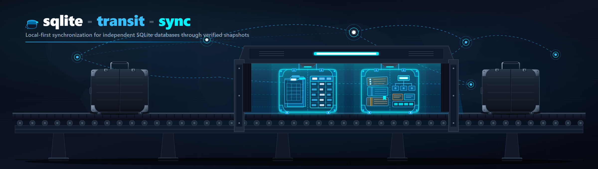
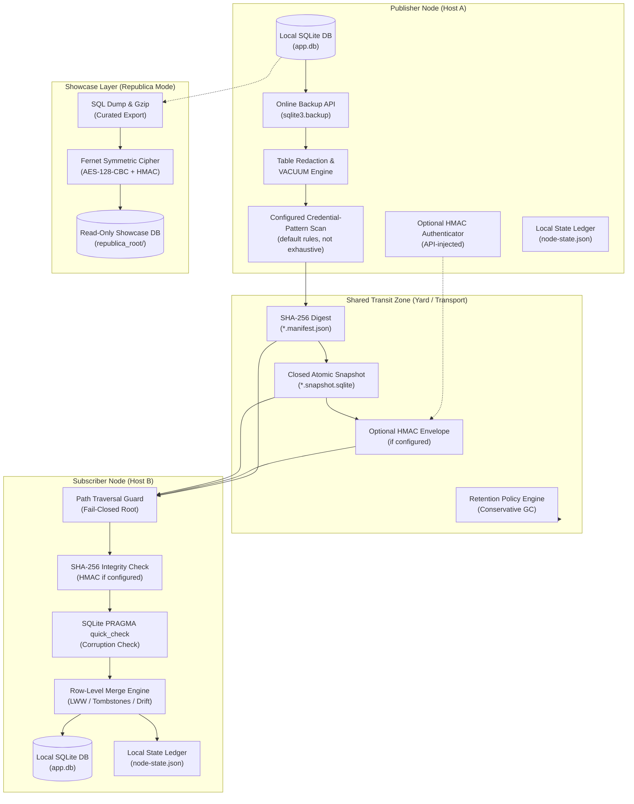
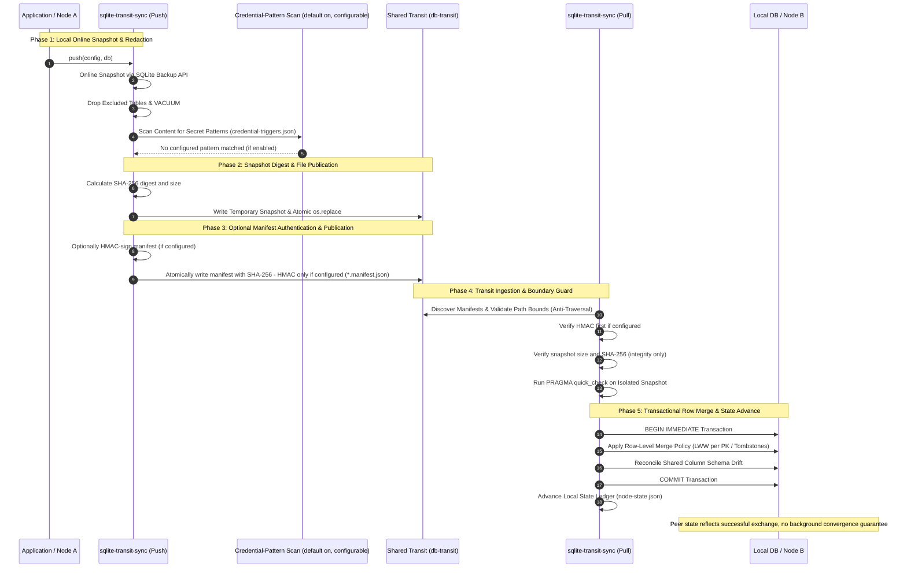

# sqlite-transit-sync



[](https://github.com/ellmos-ai/sqlite-transit-sync/actions/workflows/ci.yml)
[](CHANGELOG.md)
[](#tests)
[](#tests)
[](https://www.python.org/)
[](#)
[](#)
[](#governance-runtime-invariants-matrix)
[](SECURITY.md)
[](SECURITY.md)
[](CONTRIBUTING.md)
[](THIRD_PARTY_LICENSES.md)
[](THIRD_PARTY_LICENSES.txt)
[](NOTICE)
[](MARKETING-LOG.txt)
[](LICENSE)
[](https://github.com/ellmos-ai)
[](https://github.com/open-bricks)
[](llms.txt)

> [!NOTE]
> **LLM ও AI এজেন্ট প্রসঙ্গ**: একটি কাঠামোগত মেশিন-পাঠযোগ্য সাইটম্যাপ, আর্কিটেকচারাল ওভারভিউ এবং API নির্দেশিকা [`llms.txt`](llms.txt)-এ উপলব্ধ রয়েছে।

**🇬🇧 [English Version](README.md)** | **🇩🇪 [Deutsche Version](README_de.md)** | **🇪🇸 [Spanish Version](README_es.md)** | **🇫🇷 [French Version](README_fr.md)** | **🇯🇵 [Japanese Version](README_ja.md)** | **🇨🇳 [Simplified Chinese Version](README_zh.md)** | **🇵🇹 [Portuguese Version](README_pt.md)** | **🇷🇺 [Russian Version](README_ru.md)** | **🇸🇦 [Arabic Version](README_ar.md)** | **🇮🇳 [Hindi Version](README_hi.md)** | **🇧🇩 বাংলা** | **🤝 [Contributing](CONTRIBUTING.md)** | **🛡️ [Security Policy](SECURITY.md)** | **📝 [Changelog](CHANGELOG.md)** | **📋 [llms.txt](llms.txt)**

## 🧭 দ্রুত নেভিগেশন

1. [নির্বাহী সারসংক্ষেপ ও মূল পরিচয়](#what-is-sqlite-transit-sync)
2. [ভিজ্যুয়াল আর্কিটেকচার টপোলজি ও ডিকপলড স্তরসমূহ](#system-architecture-topology)
3. [এন্ড-টু-এন্ড স্ন্যাপশট ও সিঙ্ক্রোনাইজেশন জীবনচক্র](#end-to-end-snapshot-synchronization-lifecycle)
4. [টার্গেট পারসোনা ও উচ্চ-উদ্দেশ্যমূলক এসইও অনুসন্ধান](#marketing--target-personas)
5. [বাস্তবায়িত আচরণ ও সীমাবদ্ধতা](#comparison-with-distributed-sql)
6. [গভর্নেন্স ও রানটাইম ইনভেরিয়েন্টস ম্যাট্রিক্স](#governance-runtime-invariants-matrix)
7. [মূল সক্ষমতা ও ডিকপলড বৈশিষ্ট্যসমূহ](#what-it-provides)
8. [শুধুমাত্র-পাঠযোগ্য অ্যাপ্লিকেশন প্রজেকশন](#read-only-application-projections)
9. [ইনস্টলেশন ও পূর্বশর্ত](#install)
10. [দ্রুত সূচনা ও মাল্টি-নোড ওয়ার্কফ্লো](#quick-start)
11. [কনফিগারেশন রেফারেন্স ও ক্রেডেনশিয়াল ট্রিগার](#configuration)
12. [রিপাবলিকা শোকেস ও সাইফার পদ্ধতি](#republica-the-showcase-method)
13. [পাইথন API ও এক্সটেনশন পয়েন্ট](#python-api)
14. [নিরাপত্তা, থ্রেট মডেল ও অপারেশনাল সীমা](#safety-and-limits)
15. [তৃতীয় পক্ষের লাইসেন্স তালিকা](#third-party-licenses--transparency)
16. [ইকোসিস্টেম, সহোদর সরঞ্জাম ও বান্ডিল](#ecosystem--sibling-tools)
17. [পরীক্ষা, যাচাইকরণ ও সিআই ম্যাট্রিক্স](#tests)
18. [সংবিধিবদ্ধ বিজ্ঞপ্তি, দায়বদ্ধতার সীমাবদ্ধতা ও লাইসেন্স (§ 521 BGB)](#license)

---

<a id="what-is-sqlite-transit-sync"></a><a id="core-identity"></a><a id="executive-summary--core-identity"></a>
## 1. নির্বাহী সারসংক্ষেপ ও মূল পরিচয়

সংস্করণ, মডিউল স্থিতি, দৃশ্যমানতা এবং যাচাইকরণ-তারিখের কর্তৃত্ব [`METADATA_CONTRACT.md`](METADATA_CONTRACT.md)-এ সংজ্ঞায়িত করা হয়েছে; এগুলি কোনো প্রকাশ বা সর্বজনীন-আপলোড অনুমোদন গঠন করে না।

অখণ্ডতা-যাচাইকৃত স্ন্যাপশট এবং অ্যাপ্লিকেশন-নির্বাচনযোগ্য মার্জ নীতিগুলির মাধ্যমে স্বাধীন SQLite ডেটাবেসের জন্য লোকাল-ফার্স্ট সিঙ্ক্রোনাইজেশন। API-ইনজেক্টেড HMAC প্রমাণীকরণকারীর মাধ্যমে প্রেরক প্রমাণীকরণ ঐচ্ছিক। এটি BACH, OneDrive, হোস্ট-নাম বা ব্যবহারকারী-পাথ নির্ভরতা ছাড়াই BACH ProSync আর্কিটেকচার থেকে নিষ্কাশন করা হয়েছে।

এটি **কোনো ডিস্ট্রিবিউটেড SQL সার্ভার নয়**। প্রতিটি নোড শুধুমাত্র তার নিজস্ব স্থানীয় ডেটাবেসের মালিকানা বজায় রাখে এবং খোলে। একটি শেয়ার্ড ফোল্ডার, অবজেক্ট-স্টোর মাউন্ট, অপসারণযোগ্য ড্রাইভ বা অন্যান্য ফাইল পরিবহন বন্ধ স্ন্যাপশট এবং ম্যানিফেস্ট বহন করে। পুল (Pull) অপারেশন একক লেনদেনের মধ্যে স্থানীয় ডেটাবেসে একটি স্ন্যাপশট মার্জ করার আগে SHA-256 এবং SQLite `PRAGMA quick_check` পরীক্ষা করে। HMAC প্রেরক প্রমাণীকরণ কেবল তখনই পরীক্ষা করা হয় যখন কোনো প্রমাণীকরণকারী কনফিগার করা থাকে।

[sync-master](https://github.com/dev-bricks/sync-master) (একই মডিউল পরিবার)-এর সাথে চমৎকারভাবে কাজ করে: একটি sync-master ইয়ার্ড একটি স্বাভাবিক ট্রানজিট পরিবহন — ইয়ার্ডের ভিতরে একটি টুল-মালিকানাধীন `db-transit/<namespace>/` জোনে `--transit` নির্দেশ করুন (এর প্রোটোকল নিয়ম R9)। sync-master ফাইল পরিবহন করে, এই মডিউল ডেটাবেসের অখণ্ডতা ও মার্জিং পরিচালনা করে; উভয়ই স্বাধীন থাকে।

---

<a id="system-architecture-topology"></a><a id="system-architecture"></a>
## 2. দৃশ্যমান আর্কিটেকচার টপোলজি ও পৃথক স্তরসমূহ

নিম্নলিখিত চিত্রটি মাল্টি-নোড ডিকপলড টপোলজি প্রদর্শন করে যেখানে স্থানীয় SQLite ডেটাবেসগুলি শুধুমাত্র তাদের ম্যানিফেস্টের বিপরীতে অখণ্ডতা পরীক্ষা করা বন্ধ স্ন্যাপশট বান্ডিলগুলির মাধ্যমে সংযুক্ত থাকে:



### ASCII চার-দৃশ্য আর্কিটেকচারাল প্রজেকশন

```text
+-------------------------------------------------------------------------------------------------------------------+
|                               SQLITE-TRANSIT-SYNC: FOUR-VIEW ARCHITECTURAL TOPOLOGY                               |
+-------------------------------------------------------------------------------------------------------------------+
| [VIEW 1: PUBLISHER NODE]               [VIEW 2: SHARED TRANSIT YARD]              [VIEW 3: SUBSCRIBER NODE]       |
|                                                                                                                   |
| +-------------------------+              +-----------------------------+            +---------------------------+ |
| | Local SQLite Database   |              |  Closed Transit Zone        |            | Path Traversal Guard      | |
| | (app.db - Exclusive RW) |              |  (Folder / Sync-Master / S3)|            | (Canonical Bounds Check)  | |
| +------------+------------+              +--------------+--------------+            +-------------+-------------+ |
|              |                                          ^                                         |               |
|              v (sqlite3.backup)                         |                                         v               |
| +------------+------------+                             |                           +-------------+-------------+ |
| | Online Consistent Backup|                             |                           | SHA-256 Integrity Check   | |
| | (Closed Rollback-Journal|                             |                           | Optional HMAC if set      | |
| +------------+------------+                             |                           +-------------+-------------+ |
|              |                                          |                                         |               |
|              v                                          |                                         v               |
| +------------+------------+                             |                           +-------------+-------------+ |
| | Redaction & VACUUM      |                             |                           | SQLite PRAGMA quick_check | |
| | (Exclude Sensitive Data)|                             |                           | (Integrity Verification)  | |
| +------------+------------+                             |                           +-------------+-------------+ |
|              |                                          |                                         |               |
|              v                                          |                                         v               |
| +------------+------------+                             |                           +-------------+-------------+ |
| | Pattern Scan            |                             |                           | Transactional Row Merge   | |
| | (default rules; limited) |                             |                           | (Row-Level LWW / Drift)  | |
| +------------+------------+                             |                           +-------------+-------------+ |
|              |                                          |                                         |               |
|              v                                          |                                         v               |
| +------------+------------+              +--------------+--------------+            +-------------+-------------+ |
| | Optional HMAC Adapter   |              |  *.snapshot.sqlite (Atomic) |            | Local SQLite Database     | |
| | (API-injected if set)   |- - - - - - ->|  *.manifest.json   (Digest) |----------->| (app.db - Merged State)   | |
| +-------------------------+              |  Retention Engine  (Scoped) |            +-------------+-------------+ |
|                                          +-----------------------------+                          |               |
|                                                                                                   v               |
|                                                                                     +-------------+-------------+ |
|                                                                                     | Local State Ledger        | |
|                                                                                     | (node-state.json)         | |
|                                                                                     +---------------------------+ |
+-------------------------------------------------------------------------------------------------------------------+
| [VIEW 4: REPUBLICA SHOWCASE / COURIER ENVELOPE (OPTIONAL ZERO-TRUST TRANSPORT)]                                   |
|                                                                                                                   |
| Local Database ----> Curated SQL Dump ----> Gzip Compression ----> AES-128-CBC (Fernet) ----> Encrypted Outpost   |
| (Source Node)       (FTS Rebuilt on Dest)   (53MB -> 11MB)         (Pre-Shared Key)          (republica_root/)    |
|                                                                                                                   |
| Single Secret File -> Fernet Cipher Envelope -> Courier Transit -> Destination Directory (Mode 0600, Transit Clr) |
+-------------------------------------------------------------------------------------------------------------------+
```

---

<a id="end-to-end-snapshot-synchronization-lifecycle"></a><a id="lifecycle"></a>
## 3. এন্ড-টু-এন্ড স্ন্যাপশট ও সিঙ্ক্রোনাইজেশন জীবনচক্র

ওয়ার্কফ্লো লাইভ ডেটাবেস ফাইলগুলিকে ফাইল-লেভেল সিঙ্ক্রোনাইজেশনের বাইরে রাখে। এটি একটি SHA-256 ম্যানিফেস্টের বিপরীতে স্ন্যাপশট বাইট পরীক্ষা করে, সক্ষম থাকলে কনফিগার করা ক্রেডেনশিয়াল-প্যাটার্ন স্ক্যান চালায় (ডিফল্ট: চালু), এবং লেনদেনগতভাবে গৃহীত সারিগুলি মার্জ করে। প্রেরক প্রমাণীকরণ কেবল তখনই উপলব্ধ হয় যখন একটি API-ইনজেক্টেড HMAC প্রমাণীকরণকারী কনফিগার করা থাকে। সহকর্মীরা একটি সফল পুশ/পুল বিনিময়ের পরেই পরিবর্তন দেখতে পান:



---

<a id="marketing--target-personas"></a><a id="target-personas--discoverability-queries"></a><a id="target-personas"></a>
## 4. লক্ষ্য ব্যবহারকারী ও উচ্চ-উদ্দেশ্যমূলক অনুসন্ধান

মডুলার, বিকেন্দ্রীকৃত ইকোসিস্টেমের জন্য পরিকল্পিত, `sqlite-transit-sync` ৪টি মূল অংশীদার ব্যক্তিত্বের চাহিদা পূরণ করে:

- **`[PERSONA-01]` স্বায়ত্তশাসিত AI এজেন্ট প্রকৌশলী ও মাল্টি-হোস্ট সোয়ার্ম আর্কিটেক্ট:**
  - *চ্যালেঞ্জ:* ওয়ার্কস্টেশন, ল্যাপটপ এবং সার্ভার জুড়ে পরিচালিত মাল্টি-এজেন্ট সোয়ার্মের ফাইল-লক সংঘাত ছাড়া স্থানীয় অবস্থার ধারাবাহিকতা প্রয়োজন।
  - *সমাধান:* ডিফল্ট-অন স্ক্যান কোনো কনফিগার করা ক্রেডেনশিয়াল প্যাটার্ন মিলে গেলে প্রকাশনা বন্ধ করতে পারে। এটি একটি সুরক্ষা জাল, কোনো স্ন্যাপশটে কোনো গোপনীয়তা নেই তার প্রমাণ নয়। একটি সফল পুশ/পুল বিনিময়ের পরে সহকর্মীরা পরিবর্তনগুলি পান।
- **`[PERSONA-02]` মাল্টি-ডিভাইস ডেস্কটপ ও এজ অ্যাপ্লিকেশন ডেভেলপার:**
  - *চ্যালেঞ্জ:* ফাইল সিঙ্কের (যেমন sync-master, Syncthing, Nextcloud) মাধ্যমে ব্যক্তিগত নোট এবং কাজের ডেটাবেস বিনিময়কারী পাওয়ার ব্যবহারকারীরা ডেটাবেস নষ্ট হওয়া এবং `-wal` লক-আপের শিকার হন।
  - *সমাধান:* SQLite ব্যাকআপ API এবং প্রতি-ফাইল প্রকাশনা লাইভ SQLite ডেটাবেস ফাইলগুলিকে ফাইল-সিঙ্ক পাথ থেকে বাইরে রাখে; ট্রানজিট স্ন্যাপশট হলো সেই পরিবহনের মাধ্যমে বিনিময় করা ফাইল।
- **`[PERSONA-03]` লোকাল-ফার্স্ট ও কনফিগারেবল-ট্রানজিট টুল নির্মাতা:**
  - *চ্যালেঞ্জ:* ডেটা সার্বভৌমত্বের প্রয়োজনীয় অ্যাপ্লিকেশনগুলি ক্লাউড লক-ইন, পুনরাবৃত্ত ডেটাবেস হোস্টিং ফি বা অনিয়ন্ত্রিত ব্যাকগ্রাউন্ড নেটওয়ার্ক প্রস্থান সহ্য করতে পারে না।
  - *সমাধান:* মডিউলটি একটি কনফিগার করা ফাইল সিস্টেম পাথের মাধ্যমে স্ন্যাপশট ফাইল বিনিময় করে। সেই পাথটি স্থানীয় বা অপসারণযোগ্য হতে পারে; শেয়ার্ড বা নেটওয়ার্ক-মাউন্ট করা পরিবহন মডিউলের নিয়ন্ত্রণের বাইরে থাকে।
- **`[PERSONA-04]` এন্টারপ্রাইজ নিরাপত্তা, গোপনীয়তা ও কমপ্লায়েন্স অফিসার:**
  - *চ্যালেঞ্জ:* কঠোর শূন্য-বিশ্বাস নিয়মাবলী দুর্ঘটনাজনিত ক্রেডেনশিয়াল সিঙ্ক্রোনাইজেশন, অযাচাইকৃত বাইনারি ব্লব এবং বিশেষ সুবিধাপ্রাপ্ত ব্যাকগ্রাউন্ড পরিষেবা নিষিদ্ধ করে।
  - *সমাধান:* ডিফল্ট-অন স্ক্যান প্রকাশের আগে কনফিগার করা ক্রেডেনশিয়াল প্যাটার্ন পরীক্ষা করে; SHA-256 ম্যানিফেস্টের বিপরীতে স্ন্যাপশটের অখণ্ডতা যাচাই করে। প্রেরক প্রমাণীকরণের জন্য একটি API-ইনজেক্টেড HMAC প্রমাণীকরণকারী সক্ষম করা যেতে পারে। প্রক্রিয়াটি তার সূচনাকারীর অনুমতি উত্তরাধিকার সূত্রে লাভ করে।

### উচ্চ-উদ্দেশ্যমূলক অনুসন্ধান শব্দ (দ্বিভাষিক EN ও DE)

| উদ্দেশ্যের বিভাগ | ইংরেজি (EN) অনুসন্ধান প্রশ্ন | জার্মান (DE) অনুসন্ধানের পদ |
|:---|:---|:---|
| **লোকাল-ফার্স্ট সিঙ্ক্রোনাইজেশন** | `sqlite synchronization python zero-dependency`, `local-first database snapshot sync`, `offline sqlite multi-device sync` | `lokale datenbank synchronisation offline snapshots`, `sqlite abgleich python ohne abhängigkeiten`, `lokale datenbank replikation dateibasiert` |
| **অখণ্ডতা ও কনফিগার করা ক্রেডেনশিয়াল স্ক্যান** | `configured credential-pattern scan sqlite sync`, `configured filesystem transit sqlite sync`, `optional hmac sqlite snapshot manifest` | `konfigurierter credential musterscan sqlite sync`, `dateipfad transit sqlite sync`, `optional hmac snapshot manifest` |
| **সারি-স্তরের মার্জ ও দ্বন্দ্ব** | `row level merge lww sqlite offline`, `sqlite last write wins schema drift tolerance`, `tombstone merge policy sqlite` | `row level merge lww sqlite offline`, `last-write-wins datenbank abgleich zeitstempel`, `schema drift toleranz sqlite merge` |
| **ডিকপলড আর্কিটেকচার** | `sqlite multi-node sync without distributed sql`, `sqlite over syncthing without corruption`, `sqlite transit yard architecture` | `sqlite synchronisation ohne verteilten server`, `sqlite über cloud sync ohne datenbankkorruption`, `transit yard sqlite synchronisation` |

বিস্তারিত ব্যক্তিত্ব বিশ্লেষণ, উচ্চ-উদ্দেশ্যমূলক অনুসন্ধান প্রশ্ন এবং প্রতিযোগিতামূলক অবস্থানের জন্য [MARKETING-LOG.txt](MARKETING-LOG.txt) দেখুন।

---

<a id="comparison-with-distributed-sql"></a><a id="comparative-matrix--alternatives"></a><a id="comparative-matrix"></a>
## 5. বাস্তবায়িত আচরণ ও সীমাবদ্ধতা

এই বিভাগটি প্রকল্পের বাস্তবায়িত আচরণ এবং সীমাবদ্ধতাগুলি নথিভুক্ত করে। এটি অন্যান্য পণ্যের বর্তমান তুলনামূলক নিরীক্ষা নয়।

| মাত্রা | ইনভেরিয়েন্ট | বাস্তবায়িত আচরণ | সীমা / পরিধি |
|:---|:---|:---|:---|
| **1. স্থানীয় প্রক্রিয়াকরণ ও পরিবহন** | `INV-LOCAL-01` | স্থানীয় SQLite ডেটাবেস পড়ে এবং একটি কনফিগার করা ট্রানজিট পাথে স্ন্যাপশট প্রকাশ করে; কোনো কেন্দ্রীয় ডেটাবেস সার্ভারের প্রয়োজন নেই। | কনফিগার করা পাথটি একটি শেয়ার্ড বা নেটওয়ার্ক-মাউন্ট করা অবস্থান হতে পারে। সেই পরিবহনের অ্যাক্সেস এবং আচরণ এই মডিউলের বাইরে থাকে। |
| **2. স্ন্যাপশট প্রকাশনা** | `INV-SNAP-02` | একটি অনলাইন ব্যাকআপ নেয় এবং একটি অস্থায়ী ফাইল ও `os.replace` দিয়ে স্ন্যাপশট ফাইল প্রকাশ করে। | প্রতি-ফাইল প্রতিস্থাপন স্ন্যাপশট এবং ম্যানিফেস্টকে একটি একক মাল্টি-ফাইল লেনদেন করে তোলে না। |
| **3. সাইডকার ও প্রক্রিয়ার পরিধি** | `INV-ROLL-03` | রোলব্যাক-জার্নাল মোডে স্ন্যাপশট বন্ধ করে এবং অস্থায়ী SQLite সাইডকার পরিষ্কার করা না গেলে সুরক্ষিতভাবে ব্যর্থ (fail closed) হয়। | নোড প্রতি একটি সিঙ্ক প্রক্রিয়া চালান যদি না হোস্ট অ্যাপ্লিকেশন কোনো প্রক্রিয়া লক যুক্ত করে। |
| **4. ট্রানজিট পাথ ধারণ** | `INV-PATH-04` | ম্যানিফেস্ট এবং স্ন্যাপশট পাথগুলিকে ক্যানোনিকাল ট্রানজিট রুটের অধীনে সরাসরি নিয়মিত ফাইলে সীমাবদ্ধ করে। | এটি নিয়ন্ত্রণ করে না যে ট্রানজিট অবস্থানে কে লিখতে পারে। |
| **5. অখণ্ডতা পরীক্ষা** | `INV-VERIFY-05` | ম্যানিফেস্ট SHA-256-এর সাথে স্ন্যাপশট বাইটের তুলনা করে এবং SQLite `PRAGMA quick_check` চালায়। | একটি মিলযুক্ত ডাইজেস্ট প্রেরক বা পরিবহনকে প্রমাণীকরণ করে না। |
| **6. ক্রেডেনশিয়াল-প্যাটার্ন স্ক্যান** | `INV-SHIELD-06` | ডিফল্টরূপে, কনফিগার করা প্যাটার্নের বিপরীতে স্ন্যাপশট সামগ্রী পরীক্ষা করে এবং মিল পাওয়া গেলে প্রকাশনা বাতিল করে, কেবল `table.column` রিপোর্ট করে, মান নয়। | ভেন্ডর-উপসর্গযুক্ত নিয়মগুলি একটি সুরক্ষা জাল, কোনো গ্যারান্টি নয়। একটি পরিষ্কার স্ক্যানের অর্থ হলো কোনো পরিচিত প্যাটার্ন মেলেনি; কাস্টম গোপনীয়তা পাস হতে পারে। |
| **7. প্রেরক প্রমাণীকরণ** | `INV-HMAC-07` | একটি অ্যাপ্লিকেশন ক্যানোনিকাল ম্যানিফেস্টের জন্য API-ইনজেক্টেড HMAC-SHA256 প্রমাণীকরণের বিকল্প বেছে নিতে পারে। | একটি কনফিগার করা প্রমাণীকরণকারী ছাড়া কোনো প্রেরক প্রমাণীকরণ থাকে না। শেয়ার্ড-কী HMAC কোনো নতুনত্ব প্রোটোকল বা পাবলিক-কী স্বাক্ষর নয়। |
| **8. সারি মার্জ** | `INV-MERGE-08` | সমর্থিত টেবিলগুলির জন্য ডিফল্ট হিসেবে টাইমস্ট্যাম্প-ভিত্তিক LWW সহ একটি কনফিগারযোগ্য সারি-স্তরের মার্জ নীতি প্রয়োগ করে। | সংহত অ্যাপ্লিকেশন ঘড়ির অনুমান, মুছে ফেলার শব্দার্থবিদ্যা, মাইগ্রেশন এবং ডোমেন দ্বন্দ্বের নিয়মের মালিকানা বজায় রাখে। |
| **9. ধারণ ও মুছে ফেলার পরিধি** | `INV-RET-09` | ক্লিনআপ ডিফল্টরূপে ড্রাই-রান হয় এবং স্থানীয়-নোড আর্টিফ্যাক্টে সীমাবদ্ধ থাকে যদি না ক্রস-নোড কর্তৃত্ব স্পষ্টভাবে সক্ষম করা হয়। | ধারণ ক্লিনআপ কোনো ব্যাকআপ বা পুনরুদ্ধার পরিষেবা নয়। |
| **10. প্রক্রিয়া অনুমতি ও নিরাপত্তা নীতি** | `INV-SLA-10` | প্রক্রিয়াটি সূচনাকারী প্রক্রিয়ার অনুমতিগুলি ব্যবহার করে। `SECURITY.md` রিপোর্টিং নীতি উল্লেখ করে: ৪৮ ঘণ্টার মধ্যে স্বীকৃতি এবং ৫ কার্যদিবসের মধ্যে ট্রায়াজ। | মডিউলটি স্ট্যান্ডার্ড-ব্যবহারকারী সুবিধা প্রয়োগ করে না বা উচ্চতার অনুরোধ করে না। প্রতিক্রিয়ার সময় একটি রিপোর্টিং নীতি, কোনো রানটাইম বৈশিষ্ট্য নয়। |

<a id="distributed-sql-detailed-comparison"></a>
### প্রক্রিয়াকরণ মডেল ও সীমা

| দিক | `sqlite-transit-sync` আচরণ | সীমা / পরিধি |
|---|---|---|
| মৌলিক মডেল | প্রতিটি নোডের নিজস্ব স্থানীয় SQLite ডেটাবেস রয়েছে; স্ন্যাপশটগুলি একটি কনফিগার করা ট্রানজিট পাথের মাধ্যমে স্থানান্তরিত হয়। | কোনো একক বৈশ্বিকভাবে প্রামাণিক ডেটাবেস নেই। |
| লেখার ক্রিয়াকলাপ | অ্যাপ্লিকেশন স্থানীয়ভাবে লেখে; স্ন্যাপশট বিনিময় করতে কলার পুশ এবং পুল চালায়। | কোনো স্বয়ংক্রিয় ব্যাকগ্রাউন্ড সিঙ্ক্রোনাইজেশন নেই। |
| দৃশ্যমানতা | একটি সফল বিনিময় এবং মার্জের পরে একজন সহকর্মী পরিবর্তন দেখতে পারে। | মডিউল তাৎক্ষণিক বা বৈশ্বিকভাবে সামঞ্জস্যপূর্ণ দৃশ্যমানতার প্রতিশ্রুতি দেয় না। |
| গ্লোবাল লেনদেন | সরবরাহ করা হয় না। | অ্যাপ্লিকেশন একাধিক নোড জুড়ে একটি একক লেনদেন কার্যকর করতে পারে না। |
| অফলাইন অপারেশন | একটি নোড অফলাইনে থাকা অবস্থায় স্থানীয় ডেটাবেস স্বাধীনভাবে ব্যবহার করা যেতে পারে। | কনফিগার করা ট্রানজিট উপলব্ধ না হওয়া পর্যন্ত স্ন্যাপশট বিনিময় অপেক্ষা করে। |
| দ্বন্দ্ব | কনফিগার করা `MergePolicy` নির্ধারণ করে কীভাবে সারিগুলি একত্রিত হবে; টাইমস্ট্যাম্প LWW ডিফল্ট। | অ্যাপ্লিকেশন ঘড়ি, মুছে ফেলার নিয়ম এবং ডোমেন শব্দার্থবিদ্যা একীকরণ দায়িত্ব হিসেবে থেকে যায়। |
| স্কিমা পরিবর্তন | শেয়ার্ড-কলাম মার্জ সীমিত স্কিমা পরিবর্তন সমর্থন করে। | মাইগ্রেশন এবং স্কিমা সামঞ্জস্যের জন্য অ্যাপ্লিকেশনগুলি দায়ী থাকে। |
| ব্যর্থতা হ্যান্ডলিং | স্থানীয় ডেটা SQLite-এ সংরক্ষিত হয় এবং ট্রানজিট স্ন্যাপশটগুলি পৃথক ফাইল। | মডিউলটি স্বয়ংক্রিয় প্রতিলিপি, ফেইলওভার বা ট্রানজিট ব্যাকআপ সরবরাহ করে না। |

### সুবিধা, অসুবিধা ও সাধারণ ব্যবহারক্ষেত্র

| সিস্টেম | সুবিধা | অসুবিধা | ভালো ব্যবহারের ক্ষেত্র | অনুপযুক্ত ব্যবহারের ক্ষেত্র |
|---|---|---|---|---|
| `sqlite-transit-sync` | ছোট স্থানীয় পদচিহ্ন; কোনো কেন্দ্রীয় ডেটাবেস সার্ভার নেই; অফলাইন স্থানীয় কাজ; কনফিগারযোগ্য ফাইল পরিবহন; অ্যাপ্লিকেশন-নির্বাচনযোগ্য মার্জ নীতি। | পরিবর্তনগুলি সহকর্মীদের কাছে পৌঁছানোর জন্য পুশ/পুল প্রয়োজন; কোনো গ্লোবাল লেনদেন বা স্বয়ংক্রিয় ফেইলওভার নেই; ঘড়ি, মুছে ফেলা, মাইগ্রেশন এবং দ্বন্দ্বের জন্য অ্যাপ্লিকেশন নিয়মের প্রয়োজন। | ব্যক্তিগত বা টাস্ক ডেটাবেস; স্থানীয় এজেন্ট স্থিতি; বিরতিহীনভাবে সংযুক্ত ল্যাপটপ, ওয়ার্কস্টেশন বা এজ ডিভাইস; গবেষণার নোট। | বিশ্বব্যাপী প্রতিশ্রুতিবদ্ধ লেনদেন, তাৎক্ষণিক ভাগ করা অবস্থা, স্বয়ংক্রিয় ফেইলওভার বা বহু সমবর্তী লেখকের প্রয়োজনীয় কাজের চাপ। |

### দ্রুত সিদ্ধান্ত নির্দেশিকা

| প্রয়োজনীয়তা | উপযুক্ততা |
|---|---|
| অফলাইনে থাকা অবস্থায় নোডগুলিকে তাদের নিজস্ব স্থানীয় ডেটাবেস ব্যবহার চালিয়ে যেতে হবে | `sqlite-transit-sync` |
| স্পষ্ট পুশ/পুল বিনিময়ের পরে আপডেটগুলি সহকর্মীদের কাছে পৌঁছাতে পারে | `sqlite-transit-sync` |
| অ্যাপ্লিকেশন তার মার্জ, ঘড়ি, মুছে ফেলা এবং মাইগ্রেশনের নিয়ম সংজ্ঞায়িত করতে পারে | `sqlite-transit-sync` |
| প্রতিটি লেখা অবিলম্বে বিশ্বব্যাপী প্রামাণিক হতে হবে | সেই সামঞ্জস্যের চুক্তি প্রদানকারী আর্কিটেকচার ব্যবহার করুন |
| গ্লোবাল লেনদেন, স্বয়ংক্রিয় ফেইলওভার বা বহু সমবর্তী লেখক প্রয়োজন | সেই আচরণগুলি প্রদানকারী আর্কিটেকচার মূল্যায়ন করুন |

বিরতিহীনভাবে সংযুক্ত কয়েকটি ডিভাইসের জন্য, বিলম্বিত বিনিময় এবং অ্যাপ্লিকেশন-মালিকানাধীন মার্জ নিয়ম গ্রহণযোগ্য হলে এই মডিউলটি উপযুক্ত হতে পারে। যদি কাজের চাপের জন্য গ্লোবাল লেনদেন, তাৎক্ষণিক ভাগ করা অবস্থা বা স্বয়ংক্রিয় ফেইলওভার প্রয়োজন হয়, তবে এমন একটি নকশা চয়ন করুন যার নথিভুক্ত চুক্তি সেই আচরণগুলি সরবরাহ করে।

---

<a id="governance-runtime-invariants-matrix"></a><a id="governance--runtime-invariants"></a>
## 6. গভর্নেন্স ও রানটাইম ইনভেরিয়েন্ট ম্যাট্রিক্স

নিচের ম্যাট্রিক্সটি প্রকল্পের ১০টি গভর্নেন্স এবং রানটাইম ইনভেরিয়েন্টসকে বাস্তবায়িত আচরণ এবং প্রাসঙ্গিক সীমাবদ্ধতার সাথে নথিভুক্ত করে:

| # | ইনভেরিয়েন্ট | আর্কিটেকচারাল পরিধি | নথিভুক্ত আচরণ ও সীমাবদ্ধতা |
|---|---|---|---|
| 1 | **INV-LOCAL-01: স্থানীয় SQLite প্রক্রিয়াকরণ ও কনফিগার ট্রানজিট** | সিস্টেম আর্কিটেকচার | স্থানীয় SQLite ডেটাবেস পড়ে এবং কনফিগার করা ট্রানজিট পাথের মাধ্যমে স্ন্যাপশট প্রকাশ করে। পাথটি শেয়ার্ড বা নেটওয়ার্ক-মাউন্ট করা হতে পারে; হোস্ট এবং পরিবহন আচরণ এই মডিউলের বাইরে। |
| 2 | **INV-SNAP-02: অফলাইন স্ন্যাপশট পারমাণবিকতা** | ট্রানজিট প্রকাশনা | লাইভ ডেটাবেস ফাইল কখনোই ফাইল-সিঙ্কে শেয়ার করা হয় না। অনলাইন স্ন্যাপশটগুলি `sqlite3.backup`-এর মাধ্যমে নেওয়া হয় এবং পারমাণবিক `os.replace`-এর মাধ্যমে প্রকাশিত হয়। |
| 3 | **INV-ROLL-03: রোলব্যাক জার্নাল পরিষ্কার বিচ্ছিন্নতা** | সাইডকার প্রতিরোধ | ব্যাকআপগুলি রোলব্যাক-জার্নাল মোডে বন্ধ থাকে; ম্যানিফেস্ট তৈরির আগে সমস্ত অস্থায়ী SQLite সাইডকার (`-wal`, `-shm`, `-journal`) সুরক্ষিতভাবে পরিষ্কার করা হয়। |
| 4 | **INV-PATH-04: কঠোর ট্রানজিট পাথ ধারণ** | ফাইল সিস্টেম সীমা | ম্যানিফেস্ট এবং স্ন্যাপশট পাথ ক্যানোনিকাল ট্রানজিট রুটের মধ্যে সরাসরি নিয়মিত ফাইল হতে হবে। পাথ ট্রাভার্সাল (`../`), সিম্বলিক লিঙ্ক এবং রিপার্স পয়েন্ট সুরক্ষিতভাবে ব্যর্থ হয়। |
| 5 | **INV-VERIFY-05: দ্বি-পর্যায়ের অখণ্ডতা ও যথার্থতা যাচাইকরণ** | প্রি-মার্জ যাচাইকরণ | ডেটা পরিদর্শন বা মার্জ করার আগে প্রতিটি প্রাপ্ত স্ন্যাপশটকে SHA-256 ক্রিপ্টোগ্রাফিক ডাইজেস্ট ম্যাচিং এবং SQLite `PRAGMA quick_check` পাস করতে হবে। |
| 6 | **INV-SHIELD-06: প্রাক-প্রকাশনা ক্রেডেনশিয়াল সুরক্ষা** | বিষয়বস্তু পরিদর্শন | ডিফল্টরূপে, স্ন্যাপশট সামগ্রী কনফিগার করা ক্রেডেনশিয়াল প্যাটার্নের বিপরীতে পরীক্ষা করা হয়; মিল পাওয়া গেলে প্রকাশনা বাতিল হয় এবং কেবল `table.column` রিপোর্ট করা হয়, মান নয়। ভেন্ডর-উপসর্গযুক্ত প্যাটার্নগুলি একটি সুরক্ষা জাল, গ্যারান্টি নয়; কোনো মিল না থাকা প্রমাণ করে না যে স্ন্যাপশটটি গোপনীয়তামুক্ত। |
| 7 | **INV-HMAC-07: ঐচ্ছিক HMAC প্রমাণীকরণ** | প্রেরক প্রমাণীকরণ | ক্যানোনিকাল ম্যানিফেস্ট পেলোডের (প্রোটোকল, নেমস্পেস, প্রেরক ID, ফাইলের নাম, SHA-256, আকার, সম্পাদনা তালিকা) উপর ঐচ্ছিক API-ইনজেক্টেড HMAC-SHA256 খাম। শেয়ার্ড-কী HMAC কোনো নতুনত্ব প্রোটোকল বা পাবলিক-কী স্বাক্ষর নয়; এটি ছাড়া, ম্যানিফেস্ট প্রেরককে প্রমাণীকরণ করে না। |
| 8 | **INV-MERGE-08: নির্ণায়ক সারি-স্তরের মার্জ** | ডেটা অভিসরণ | লেনদেনমূলক সারি-স্তরের মার্জ (প্রতি PK LWW, স্কিমা পরিবর্তনের জন্য শেয়ার্ড কলাম ইউনিয়ন, স্পষ্ট টম্বস্টোন নীতি)। বিষয়বস্তু হ্যাশ টাই-ব্রেকার নির্ণায়ক অভিসরণ নিশ্চিত করে। |
| 9 | **INV-RET-09: রক্ষণশীল ধারণ ও কর্তৃত্বের পরিধি** | আবর্জনা সংগ্রহ | স্ন্যাপশট পরিচ্ছন্নতা ডিফল্টরূপে ড্রাই-রান হয় এবং স্থানীয় নোডের আর্টিফ্যাক্টে কঠোরভাবে সীমাবদ্ধ থাকে। ক্রস-নোড মুছে ফেলার (`--all-nodes`) জন্য স্পষ্ট প্রশাসনিক অনুমোদনের প্রয়োজন। |
| 10 | **INV-SLA-10: প্রক্রিয়া অনুমতি ও নিরাপত্তা নীতি** | রানটাইম প্রসঙ্গ | প্রক্রিয়াটি তার প্রবর্তকের অনুমতি উত্তরাধিকার সূত্রে পায়; এই মডিউলটি স্ট্যান্ডার্ড-ব্যবহারকারী সুবিধা প্রয়োগ করে না বা অধিকার বৃদ্ধির অনুরোধ করে না। `SECURITY.md` ৪৮ ঘণ্টার মধ্যে স্বীকৃতি এবং ৫ কার্যদিবসের মধ্যে ট্রায়াজ উল্লেখ করে। |

---

<a id="what-it-provides"></a><a id="core-capabilities"></a><a id="part-of-the-ellmos-stack-family"></a>
## 7. মূল সক্ষমতা ও পৃথক বৈশিষ্ট্যসমূহ

`sqlite-transit-sync` একই মডিউল পরিবারের [dev-bricks/sync-master](https://github.com/dev-bricks/sync-master)-এর একটি সহযোগী: sync-master ফাইল পরিবহন (`sync.files`)-এর মালিক, এই মডিউল ডেটাবেসের অখণ্ডতা ও মার্জিং (`sync.database`)-এর মালিক। উভয়ই স্বতন্ত্রভাবে কাজ করে বা [ellmos-ai](https://github.com/ellmos-ai) পরিবার থেকে স্ট্যাকে গঠিত হয় — [ellmos-ai/stacks](https://github.com/ellmos-ai/stacks) ক্যাটালগ দেখুন। সেই টুলকিটে এর ভূমিকা: ফাইল-সিঙ্কে কোনো লাইভ SQLite নেই — কেবল সেই স্ন্যাপশটগুলি যা ম্যানিফেস্ট এবং SQLite অখণ্ডতা পরীক্ষা পাস করে, সাথে অ্যাপ্লিকেশন-নির্বাচনযোগ্য মার্জ নীতি।

### প্রধান সক্ষমতাসমূহ

- SQLite-এর ব্যাকআপ API-এর মাধ্যমে সুসংগত অনলাইন স্ন্যাপশট;
- একটি অস্থায়ী ফাইল এবং `os.replace` ব্যবহার করে পারমাণবিক প্রকাশনা;
- প্রকাশের আগে প্রতিটি অস্থায়ী SQLite সাইডকার সুরক্ষিতভাবে পরিষ্কার করার সাথে বন্ধ, রোলব্যাক-জার্নাল স্ন্যাপশট;
- ম্যানিফেস্ট এবং স্ন্যাপশট পাথ ক্যানোনিকাল ট্রানজিট ডিরেক্টরিতে সরাসরি নিয়মিত ফাইলগুলিতে সীমাবদ্ধ; হ্যাশিং বা মার্জের আগে পাথ ট্রাভার্সাল, নিখুঁত পাথ, সিমলিঙ্ক এবং রিপার্স পয়েন্ট সুরক্ষিতভাবে ব্যর্থ হয়;
- SHA-256 ম্যানিফেস্ট এবং `PRAGMA quick_check` যাচাইকরণ;
- স্পষ্ট কী ID সহ ক্যানোনিকাল ম্যানিফেস্ট, প্রেরকের পরিচয়, প্রোটোকল সংস্করণ এবং স্ন্যাপশট হ্যাশের উপর ঐচ্ছিক API-ইনজেক্টেড HMAC-SHA256 প্রমাণীকরণ;
- প্রতি-নোড স্থানীয় পুল অবস্থা এবং আইডেমপোটেন্ট (idempotent) রিপ্লে;
- টাইমস্ট্যাম্পযুক্ত টেবিলের জন্য প্রাথমিক কী প্রতি সারি-স্তরের লাস্ট-রাইট-উইনস (LWW);
- স্পষ্ট মুছে ফেলার জন্য একটি ঐচ্ছিক `TombstoneMergePolicy` রেফারেন্স অ্যাডাপ্টার;
- মৌলিক স্কিমা পরিবর্তন সহনশীলতার জন্য শেয়ার্ড-কলাম মার্জ;
- পোস্ট-ডিলিট VACUUM সহ কনফিগারযোগ্য টেবিল বর্জন এবং স্ন্যাপশট সম্পাদন;
- একটি ডিফল্ট-অন বিষয়বস্তু স্ক্যান যা কনফিগার করা ক্রেডেনশিয়াল প্যাটার্ন মিলে গেলে প্রকাশনা বাতিল করে (`table.column` রিপোর্ট করে, কখনোই মান প্রকাশ করে না)। ভেন্ডর-উপসর্গযুক্ত নিয়মগুলি একটি সুরক্ষা জাল; একটি পরিষ্কার স্ক্যান প্রমাণ করে না যে স্ন্যাপশটে কোনো গোপনীয়তা নেই;
- ডোমেন নিয়ম, টম্বস্টোন বা CRDT-এর জন্য কাস্টম `MergePolicy` সমর্থন;
- ডিফল্টরূপে ড্রাই-রান, ডিফল্টরূপে স্থানীয়-নোড পরিধি এবং মুছে ফেলা ও বহিরাগত-নোড প্রশাসনের জন্য স্পষ্ট অনুমোদন সহ যাচাইকৃত স্ন্যাপশট পরিচ্ছন্নতা;
- মার্জ বা অবস্থা-অগ্রগতি যুক্তির প্রতিলিপি না করে পাতলা অ্যাপ্লিকেশন জীবনচক্র অ্যাডাপ্টারের জন্য নির্বাচিত মুলতুবি পুল;
- সঠিক স্কিমা/গোপনীয়তা অনুমতি তালিকা, উৎস, চেকপয়েন্ট, লুপ এবং অফলাইন-টম্বস্টোন যাচাইকরণ সহ কঠোর সংস্করণযুক্ত শুধুমাত্র-পাঠযোগ্য প্রজেকশন চুক্তি;
- একটি ঐচ্ছিক [Republica showcase mode](#republica-the-showcase-method) যা ডেটাবেসকে এনক্রিপ্ট করা পেলোড হিসেবে একতরফাভাবে বিতরণ করে এবং এটিকে মার্জ করার পরিবর্তে একটি পৃথক শুধুমাত্র-পাঠযোগ্য শোকেস হিসেবে বাস্তবায়ন করে;
- নির্ভরতা-মুক্ত পাইথন API এবং JSON CLI (রিপাবলিকা মোড `cryptography` যোগ করে)।

---

<a id="read-only-application-projections"></a><a id="projections"></a>
## 8. শুধুমাত্র-পাঠযোগ্য অ্যাপ্লিকেশন প্রজেকশন

`verify-projection` অনুলিপি, মার্জিং, মাইগ্রেটিং, শিডিউলিং বা অবস্থা অগ্রসর না করে একটি বন্ধ, অ্যাপ্লিকেশন-মালিকানাধীন SQLite প্রজেকশনকে বৈধতা দেয়। অ্যাপ্লিকেশনটি তার ভোক্তা পরিচয় এবং পর্যালোচিত সর্বাধিক অফলাইন ব্যবধান সরবরাহ করে; যাচাইকারী লুপ, পুরানো চেকপয়েন্ট, অপর্যাপ্ত টম্বস্টোন ধারণ, তালিকাহীন টেবিল বা কলাম এবং অ-অস্বচ্ছ রেকর্ড রেফারেন্স প্রত্যাখ্যান করে।

অ্যাকাউন্ট-ব্যালেন্স সারাংশ, AboTracker সাবস্ক্রিপশন স্থিতি, HausLagerist পুনঃপূরণ তারিখ, ওষুধের নির্ধারিত/ইনভেন্টরি-সতর্কতা স্থিতি, রুটিনের নির্ধারিত/সমাপ্তি স্থিতি এবং বীমা সময়সীমার জন্য ছয়টি সংকীর্ণ চুক্তি বান্ডিল করা হয়েছে। AboTracker চুক্তিটি কেবল স্থিতি-মাত্র কারণ রপ্তানি স্কিমা v1-এ কোনো নিশ্চিত পরবর্তী প্রদেয় বা পুনর্নবীকরণ তারিখ নেই; এটি কখনোই অর্থপ্রদানের তারিখ এবং বিলিং চক্র থেকে অনুস্মারক তৈরি করে না। পরীক্ষার ফিক্সচারগুলি কৃত্রিম JSON রেসিপি, এবং ডোমেন পরিচয় বা ব্যক্তিগত বিবরণ অনুমতি তালিকার বাইরে থাকে।

বান্ডিল করা নামগুলি হলো `abotracker-subscription-status-projection.v1`, `accounts-balance-projection.v1`, `hauslagerist-replenishment-projection.v1`, `mediplaner-reminder-projection.v1`, `routinika-reminder-projection.v1`, এবং `versicherungsmanager-deadline-projection.v1`। [Read-only projection contracts](PROJECTION_CONTRACTS.md) এবং [German companion](PROJECTION_CONTRACTS_de.md) দেখুন।

```bash
sqlite-transit-sync verify-projection \
  --contract mediplaner-reminder-projection.v1 \
  --database ./closed-projection.sqlite \
  --consumer-id reminder-consumer \
  --minimum-offline-seconds 2592000 \
  --previous-checkpoint 41
```

---

<a id="install"></a><a id="installation"></a>
## 9. ইনস্টলেশন ও পূর্বশর্ত

```bash
python -m pip install -e .
```

---

<a id="quick-start"></a><a id="quickstart"></a>
## 10. দ্রুত শুরু ও মাল্টি-নোড কর্মপ্রবাহ

প্রতিটি নোডে একটি কনফিগারেশন তৈরি করুন। প্রতিটি নোড নিজস্ব ডেটাবেস এবং স্টেট ফাইল ব্যবহার করে, কিন্তু একই ট্রানজিট ডিরেক্টরি এবং নেমস্পেস ব্যবহার করে।

```bash
sqlite-transit-sync init \
  --config node.json \
  --database ./app.db \
  --transit ./shared-transit \
  --node-id laptop \
  --namespace my-app

sqlite-transit-sync push --config node.json
sqlite-transit-sync pull --config node.json --dry-run
sqlite-transit-sync pull --config node.json
sqlite-transit-sync status --config node.json
sqlite-transit-sync verify --config node.json
sqlite-transit-sync cleanup --config node.json
# Review the JSON plan, then explicitly apply it:
sqlite-transit-sync cleanup --config node.json --apply
```

অ্যাপ্লিকেশন স্কিমা প্রতিটি নোডে ইতিমধ্যে বিদ্যমান থাকতে হবে। স্বয়ংক্রিয় প্রথম-অনুলিপি ইচ্ছাকৃতভাবে অক্ষম করা হয়েছে কারণ একটি জেনেরিক মডিউল সিদ্ধান্ত নিতে পারে না যে কোন স্কিমা, গোপনীয়তা, স্থানীয় টেবিল বা মাইগ্রেশন একটি অ্যাপ্লিকেশনের অন্তর্গত।

### স্বয়ংসম্পূর্ণ চালনাযোগ্য Python কুইকস্টার্ট (শূন্য বাহ্যিক নির্ভরতা)

যে ডেভেলপাররা সরাসরি এজেন্ট ফ্রেমওয়ার্ক, ডেমন বা ব্যাকগ্রাউন্ড কর্মীদের মধ্যে `sqlite-transit-sync` সংহত করছেন তারা শূন্য বাহ্যিক নির্ভরতা সহ এন্ড-টু-এন্ড মাল্টি-নোড সিঙ্ক্রোনাইজেশন যাচাই করতে এই স্বয়ংসম্পূর্ণ, কপি-পেস্টযোগ্য স্ক্রিপ্টটি চালাতে পারেন:

```python
import sqlite3
from contextlib import closing
import tempfile
from pathlib import Path
from sqlite_transit_sync import SyncConfig, TransitSync

with tempfile.TemporaryDirectory() as tmp:
    root = Path(tmp)
    transit = root / "transit"
    transit.mkdir()

    # 1. Initialize Node A and record local data
    db_a = root / "node_a.db"
    with closing(sqlite3.connect(db_a)) as conn, conn:
        conn.execute("CREATE TABLE notes (id INTEGER PRIMARY KEY, title TEXT, updated_at TEXT)")
        conn.execute("INSERT INTO notes VALUES (1, 'Hello from Node A', '2026-10-18T08:00:00Z')")

    # 2. Publish atomic snapshot from Node A to shared transit
    cfg_a = SyncConfig(database=db_a, transit=transit, state=root / "state_a.json", node_id="node_a", namespace="demo")
    snapshot = TransitSync(cfg_a).push()
    print(f"Node A published snapshot: {snapshot.path.name} (SHA-256: {snapshot.sha256[:8]}...)")

    # 3. Initialize Node B with schema and pull snapshot
    db_b = root / "node_b.db"
    with closing(sqlite3.connect(db_b)) as conn, conn:
        conn.execute("CREATE TABLE notes (id INTEGER PRIMARY KEY, title TEXT, updated_at TEXT)")

    cfg_b = SyncConfig(database=db_b, transit=transit, state=root / "state_b.json", node_id="node_b", namespace="demo")
    reports = TransitSync(cfg_b).pull()

    # 4. Verify converged state in Node B
    with closing(sqlite3.connect(db_b)) as conn, conn:
        rows = conn.execute("SELECT id, title, updated_at FROM notes").fetchall()
        print(f"Node B converged records: {rows}")
        assert rows == [(1, "Hello from Node A", "2026-10-18T08:00:00Z")]
```

---

<a id="configuration"></a><a id="configuration-reference"></a>
## 11. কনফিগারেশন রেফারেন্স ও ক্রেডেনশিয়াল ট্রিগার

```json
{
  "database": "./app.db",
  "transit": "./shared-transit",
  "state": "./node-state.json",
  "node_id": "laptop",
  "namespace": "my-app",
  "timestamp_columns": ["updated_at", "modified_at", "created_at"],
  "exclude_tables": ["secrets", "sqlite_sequence"],
  "snapshot_exclude_tables": ["secrets"],
  "scan_snapshot_for_secrets": true,
  "secret_scan_skip_tables": [],
  "secret_scan_extra_patterns": [],
  "secret_patterns_file": null
}
```

আপেক্ষিক পাথ কনফিগারেশন ফাইল থেকে সমাধান করা হয়। লাইভ ডেটাবেস কখনোই ট্রানজিট ডিরেক্টরির ভিতরে থাকা উচিত নয়, এবং স্টেট ফাইলটি ট্রানজিট ট্রির বাইরে থাকতে হবে। `SyncConfig`, `from_file`, `from_bytes` এবং CLI `init` ট্রানজিট বা স্টেট ডিরেক্টরি তৈরি করার আগে একটি অবৈধ স্টেট পাথ প্রত্যাখ্যান করে; কোনো মাইগ্রেশন স্বয়ংক্রিয়ভাবে সম্পাদিত হয় না।

যে অ্যাপ্লিকেশনগুলির পার্স করা কনফিগারেশনের জন্য একটি অডিট হ্যাশ প্রয়োজন তারা বাইটগুলি একবার পড়তে পারে এবং দ্বিতীয় ফাইল রিড ছাড়াই একই উৎস-আপেক্ষিক পার্সার ব্যবহার করতে পারে:

```python
import hashlib
from pathlib import Path

from sqlite_transit_sync import SyncConfig

config_path = Path("node.json").resolve()
payload = config_path.read_bytes()
config = SyncConfig.from_bytes(payload, source_path=config_path)
config_sha256 = hashlib.sha256(payload).hexdigest()
```

### সকল কী এবং তাদের ডিফল্ট মান

| কী | ডিফল্ট | অর্থ |
|---|---|---|
| `database` | *(প্রয়োজনীয়)* | এই নোডের মালিকানাধীন লাইভ SQLite ডেটাবেস |
| `transit` | *(প্রয়োজনীয়)* | স্ন্যাপশট এবং ম্যানিফেস্ট বহনকারী শেয়ার্ড ডিরেক্টরি |
| `state` | `./.sync-state.json` | প্রতি-নোড পুল অবস্থা; এটিকে ট্রানজিটের বাইরে রাখুন |
| `node_id` | মেশিনের হোস্টনাম | স্ন্যাপশটের নামে প্রকাশক নোড শনাক্ত করে |
| `namespace` | `"default"` | একটি ট্রানজিটে সম্পর্কহীন ডেটাসেট আলাদা করে |
| `timestamp_columns` | `["updated_at","modified_at","created_at"]` | লাস্ট-রাইট-উইনস এর জন্য পরামর্শ করা কলাম |
| `exclude_tables` | `["secrets","sqlite_sequence"]` | স্থানীয় ডেটাবেসে কখনোই **মার্জ না করা** টেবিল |
| `snapshot_exclude_tables` | `["secrets"]` | প্রকাশের আগে যে টেবিলগুলির সারি **স্ন্যাপশট থেকে মুছে ফেলা হয়** (তারপর `VACUUM`) |
| `scan_snapshot_for_secrets` | `true` | স্ন্যাপশট সামগ্রী ক্রেডেনশিয়ালের মতো দেখালে প্রকাশনা বাতিল করুন |
| `secret_scan_skip_tables` | `[]` | স্ক্যান উপেক্ষা করে এমন টেবিল — স্ক্যান অক্ষম করার পরিবর্তে একক গোলমালযুক্ত টেবিলের জন্য ব্যবহার করুন |
| `secret_scan_extra_patterns` | `[]` | ট্রিগার ফাইলের অতিরিক্ত রেগুলার এক্সপ্রেশন |
| `secret_patterns_file` | `null` (বান্ডিল করা ফাইল) | আপনার নিজস্ব ট্রিগার ফাইলের পাথ; অন্তর্নির্মিত প্যাটার্নগুলি **সম্পূর্ণরূপে প্রতিস্থাপন করে** |
| `key_file` | `null`, অন্যথায় `$SQLITE_TRANSIT_SYNC_KEY_FILE` | রিপাবলিকা মোডের জন্য Fernet কী; ট্রানজিটের বাইরে থাকতে হবে |
| `republica_root` | `~/.republica` | যেখানে আমদানিকৃত শোকেস লেখা হয়; ট্রানজিটের বাইরে থাকতে হবে |
| `allow_key_in_synced_folder` | `false` | ক্লাউড-সিঙ্ক ফোল্ডারের ভিতরের কী প্রত্যাখ্যানকারী পরীক্ষা মওকুফ করে |

এই টেবিলে `state` ডিফল্ট প্রযোজ্য হয় যখন সেই কী ছাড়া একটি JSON কনফিগারেশন লোড করা হয়। `--state` বাদ দিলে `sqlite-transit-sync init` এর পরিবর্তে `.<config-stem>-state.json` লেখে (`node.json`-এর জন্য: `.node-state.json`)।

### ক্রেডেনশিয়াল স্ক্যান এবং তা বন্ধ করার উপায়

`snapshot_exclude_tables` কেবল সেই টেবিলটি বাদ দিতে পারে যা আপনি ইতিমধ্যে অনুমান করেছিলেন। স্ক্যান সেই প্রশ্নের উত্তর দেয় যা সেই নিয়মটি সমাধান করতে পারে না: *একটি উন্মুক্ত-পাঠ্য কলামে কি কোনো ক্রেডেনশিয়াল পেস্ট করা হয়েছিল* — একটি নোট, একটি লগ লাইন, একটি সেশন সারাংশ? এটি সম্পাদনার পরে এবং প্রকাশের আগে স্ন্যাপশট অনুলিপিতে চলে। মিল পাওয়া গেলে এটি `table.column` উল্লেখ করে `SyncError` উত্থাপন করে; মিলযুক্ত মান কখনোই অন্তর্ভুক্ত করা হয় না, তাই ক্রেডেনশিয়াল লগ, ট্রেসব্যাক বা CI আউটপুটে প্রবেশ করে না। আংশিক স্ন্যাপশট বাতিল করা হয়, তাই ট্রানজিট ডিরেক্টরিতে কিছুই পৌঁছায় না।

**প্রস্তুতি ও প্রকাশনা সীমা:** কাঁচা ব্যাকআপ, সম্পাদন এবং স্ক্যানিং ক্যানোনিকাল ট্রানজিটের বাইরে, কনফিগার করা স্থানীয়-অবস্থা প্যারেন্টের অধীনে প্রতি-কল অস্থায়ী ডিরেক্টরিতে চলে। রিপাবলিকাও সেখানে তার প্লেইনটেক্সট SQL/gzip প্রস্তুত করে এবং ট্রানজিটে কিছু কপি করার আগে এনক্রিপ্ট করে। সেই স্টেট প্যারেন্টকে স্থানীয়, ব্যক্তিগত এবং শেয়ার্ড/সিঙ্ক্রোনাইজড ফোল্ডারের বাইরে রাখুন; একই OS অ্যাকাউন্ট ব্যবহারকারী অন্যান্য সিঙ্ক রুট এবং প্রক্রিয়া এই গ্যারান্টির বাইরে। ঐচ্ছিক প্যাটার্ন স্ক্যান সম্পূর্ণ গোপনীয়তা সনাক্তকরণ নয়।

কেবলমাত্র পরীক্ষিত স্ন্যাপশট বাইট (সাধারণ পুশ) বা সাইফারটেক্সট (রিপাবলিকা) একচেটিয়াভাবে তৈরি ট্রানজিট অস্থায়ী ফাইলে অনুলিপি করা হয়, আকার/হ্যাশ দ্বারা যাচাই করা হয়, তারপর সেই লক্ষ্য ফাইল সিস্টেমের মধ্যে পুনঃনামকরণ করা হয়। ম্যানিফেস্ট পরে আসে; ফাইল জোড়া একটি একক পারমাণবিক লেনদেন নয়। ব্যক্তিগত পরিচ্ছন্নতার ত্রুটিগুলি প্রচারিত হয়। ক্র্যাশ হলে ব্যক্তিগত কর্মক্ষেত্র অবশিষ্ট থাকতে পারে; ঐতিহাসিক/বিদেশী নিদর্শনগুলির কোনো নিরাপদ-মুছে ফেলা বা স্বয়ংক্রিয় পরিচ্ছন্নতা নেই।

**এটি বন্ধ করা একটি বৈধ পছন্দ**, কোনো সাময়িক সমাধান নয়। যদি আপনার ট্রানজিট এমন একটি স্টোরেজ অবস্থান হয় যা আপনি নিয়ন্ত্রণ করেন এবং বিশ্বাস করেন — আপনার নিজস্ব সার্ভার, আপনার চুক্তির অধীনে একটি ইউরোপীয় ইউনিয়নে হোস্ট করা ভলিউম, একটি এনক্রিপ্ট করা অপসারণযোগ্য ড্রাইভ — এবং আপনি *চান* যে ডেটার সাথে ক্রেডেনশিয়াল ভ্রমণ করুক, তবে সেট করুন:

```json
{ "scan_snapshot_for_secrets": false }
```

শুধুমাত্র একটি টেবিল মিথ্যা ইতিবাচক ফলাফল তৈরি করলে `secret_scan_skip_tables`-কে অগ্রাধিকার দিন: বিশ্বব্যাপী স্ক্যান বন্ধ করার চেয়ে অন্য সর্বত্র স্ক্যান চালু রাখা অনেক বেশি মূল্যবান।

### ট্রিগার প্যাটার্ন সমন্বয় করা

প্যাটার্নগুলি ডেটাতে থাকে, কোডে নয় — `sqlite_transit_sync/credential-triggers.json` — তাই কোনো রিলিজের জন্য অপেক্ষা না করে সময়ের সাথে সনাক্তকরণ কঠোর করা যেতে পারে:

```json
{
  "version": 1,
  "patterns": [
    { "name": "github", "regex": "gh[pousr]_[A-Za-z0-9]{16,}", "prefilter": "gh" },
    { "name": "acme-internal", "regex": "ACME-[0-9]{4}", "prefilter": "ACME-" }
  ]
}
```

- `prefilter` একটি ঐচ্ছিক আক্ষরিক পাঠ যা একটি সাশ্রয়ী SQL `LIKE` প্রি-ফিল্টার হিসেবে ব্যবহৃত হয় যাতে বড় স্ন্যাপশটগুলি দ্রুত প্রক্রিয়াজাত থাকে। রেজেক্স মেলাতে পারে এমন প্রতিটি মানে এটি উপস্থিত থাকা **আবশ্যক**, অন্যথায় ফলাফল মিস হতে পারে। যখন এই ধরনের কোনো আক্ষরিক পাঠ বিদ্যমান না থাকে তখন এটি বাদ দিন — স্ক্যানার তখন সঠিকতার জন্য কলামটি সম্পূর্ণ পড়ে।
- ডিফল্টগুলি সম্পূর্ণরূপে প্রতিস্থাপন করতে আপনার নিজস্ব অনুলিপিতে `secret_patterns_file` নির্দেশ করুন, বা সেগুলিতে যোগ করতে `secret_scan_extra_patterns` ব্যবহার করুন।

প্যাটার্নগুলি ইচ্ছাকৃতভাবে ভেন্ডর-উপসর্গযুক্ত। একটি জেনেরিক "দীর্ঘ হেক্সাডেসিমেল স্ট্রিং" নিয়ম চেকসাম, UUID এবং git SHA চিহ্নিত করবে, যা বৈধ ডেটাবেস সামগ্রী — এবং একটি উচ্চ মিথ্যা-ইতিবাচক হার বিশিষ্ট স্ক্যানার বন্ধ হয়ে যায়, যা কিছুই রক্ষা করে না। একটি পরিষ্কার স্ক্যানকে "কোনো পরিচিত প্যাটার্ন মেলেনি" হিসেবে বিবেচনা করুন, কখনোই "এই স্ন্যাপশটটি গোপনীয়তামুক্ত" হিসেবে নয়।

### এটি কোনো সিক্রেটস ম্যানেজার নয়

কনফিগার করা প্যাটার্ন মিলে গেলে স্ক্যান প্রকাশনা বন্ধ করতে পারে; এটি প্রতিটি ক্রেডেনশিয়াল সনাক্ত হবে এমন নিশ্চয়তা দেয় না এবং এটি ক্রেডেনশিয়াল **বিতরণ** করে না। যদি আপনার আসল সমস্যা হয় "আমার মেশিনে একই পাসওয়ার্ড বা API কী প্রয়োজন", তবে এই মডিউলটি ভুল সরঞ্জাম — এবং যেকোনো নথি-সিঙ্ক ফোল্ডারও ভুল। একটি উদ্দেশ্য-নির্মিত গোপনীয়তা সরঞ্জামের কথা বিবেচনা করুন এবং এর মোতায়েন এবং বিশ্বাস মডেল পর্যালোচনা করুন:

| পদ্ধতি | যার জন্য ভালো | মন্তব্য |
|---|---|---|
| **Vaultwarden** (সেলফ-হোস্টেড Bitwarden) | একাধিক মেশিনে মানুষ + CLI | একটি ছোট সর্বদা চালু বক্সে চলে; এটিকে উন্মুক্ত করার পরিবর্তে একটি ব্যক্তিগত নেটওয়ার্কে (WireGuard, Tailscale) অ্যাক্সেস করুন। অফিসিয়াল Bitwarden ক্লায়েন্ট, ব্রাউজার এক্সটেনশন এবং `bw` CLI এর বিপরীতে কাজ করে, তাই স্ক্রিপ্ট এবং এজেন্টরাও গোপনীয়তা আনতে পারে। |
| **SOPS + age** | কোডের পাশে থাকা গোপনীয়তা | এনক্রিপ্ট করা ফাইলগুলি কমিট করার জন্য নিরাপদ এবং যেকোনো সিঙ্ক ফোল্ডারে রাখার জন্য নিরাপদ, কারণ শুধুমাত্র সাইফারটেক্সট ভ্রমণ করে। প্রতি-প্রাপক কী, git পর্যালোচনার সাথে ভালো কাজ করে। |
| **`pass`** (GPG) + git | ইউনিক্স-মনোভাবাপন্ন একক ব্যবহারকারী ও ছোট দল | প্রতি গোপনীয়তায় একটি ফাইল, সাধারণ git রিমোট, কোনো সার্ভার প্রয়োজন নেই। |
| **Syncthing-এ KeePassXC ডেটাবেস** | কোনো সার্ভার নেই, কোনো ক্লাউড অ্যাকাউন্ট নেই | পিয়ার-টু-পিয়ার ফাইল সিঙ্ক; ভল্টটি নিজেই একটি একক এনক্রিপ্ট করা ফাইল হিসেবে থাকে। |
| **Infisical / OpenBao (Vault-এর ফর্ক)** | দল, মেশিনের পরিচয়, ঘূর্ণন | অডিট লগ এবং গতিশীল ক্রেডেনশিয়াল সহ বাস্তব গোপনীয়তা সার্ভার — একটি গৃহস্থালির প্রয়োজনের চেয়ে বেশি চলমান অংশ। |
| **প্ল্যাটফর্ম-নেটিভ স্টোর** | একটি মেশিন, একটি অ্যাপ | macOS Keychain, Windows DPAPI/Credential Manager, `systemd-creds`, বা আপনার CI-এর গোপনীয়তা স্টোর। কোনো সিঙ্ক নেই, তবে কোনো ঝুঁকিও নেই। |

আপনি যেটিই বেছে নিন না কেন, গুরুত্বপূর্ণ বিভাজন একই থাকে: **ডেটার জন্য একটি চ্যানেল, ক্রেডেনশিয়ালের জন্য অন্যটি।** কনফিগার করা প্যাটার্ন মিলে গেলে এই মডিউলটি একটি স্ন্যাপশট ব্লক করতে পারে; এটি প্রতিটি গোপনীয়তা সনাক্ত করার নিশ্চয়তা দিতে পারে না।

---

<a id="republica-the-showcase-method"></a><a id="republica-showcase"></a>
## 12. Republica শোকেস ও সাইফার পদ্ধতি

প্রতিটি মেশিন একটি শেয়ার্ড ফাইল এলাকায় তার ডেটাবেসের একটি **এনক্রিপ্ট করা শোকেস** রাখে। অন্য প্রতিটি মেশিন এটি দেখতে পারে; কেউ এটি পরিবর্তন করতে পারে না। তাই এই নাম — একটি ডেটাবেসের পুনঃপ্রকাশ (re-publication), যা কেবল সেই ব্যক্তি পড়তে পারে যার কাছে কী রয়েছে।

Republica ব্যবহার করুন যখন `push`/`pull` উপযুক্ত না হয়: আপনি অন্য নোডের ডেটা আপনার সারিতে মার্জ না করে পড়তে চান, অথবা মেশিনগুলি কেবল একটি ফোল্ডার ভাগ করে — Republica-এর নিজস্ব কোনো সার্ভার, খোলা পোর্ট বা ডেডিকেটেড পিয়ার টানেল নেই, যদিও একটি শেয়ার্ড Fernet কী এখনও প্রয়োজন — এবং ফোল্ডারটিতে আপনার সামগ্রী প্লেইনটেক্সটে দৃশ্যমান হওয়া উচিত নয়।

<a id="two-modes-deliberately-redundant"></a>
### দুটি মোড, একটি কনফিগারকৃত ফাইল ট্রানজিট

একই `SyncConfig` সহ, `push`/`pull` এবং Republica একই কনফিগার করা `transit` পাথ ব্যবহার করে। `push`/`pull` স্ন্যাপশট প্রকাশ করে এবং স্থানীয় ডেটাবেসে মার্জ করে; Republica সেই ট্রানজিটের একটি প্রতি-নোড সাবডিরেক্টরিতে এনক্রিপ্ট করা প্রতিলিপি প্রকাশ করে এবং `republica_root`-এর অধীনে পৃথক শুধুমাত্র-পাঠযোগ্য ডেটাবেস হিসেবে আমদানি করে। এটি এনক্রিপশন এবং মার্জ আচরণ পরিবর্তন করে, পরিবহন নয়।

| অবস্থা | ফাইল-ট্রানজিট সিঙ্ক (`push`/`pull`) | Republica |
|---|---|---|
| সহকর্মী মেশিন অফলাইনে আছে | সহকর্মীরা অফলাইনে থাকা অবস্থায় একটি নোড প্রকাশ করতে পারে; `pull` ইতিমধ্যে ট্রানজিটে থাকা স্ন্যাপশট মার্জ করতে পারে। নতুন ডেটা তার উৎস নোড প্রকাশ না করা পর্যন্ত অপেক্ষা করে। | প্রকাশক পরে আমদানির জন্য একটি এনক্রিপ্ট করা প্রতিলিপি মঞ্চস্থ করতে পারে। অফলাইন উৎস থেকে প্রাপ্ত ডেটাও একইভাবে প্রকাশের জন্য অপেক্ষা করে। |
| VPN/SSH টানেল অনুপলব্ধ | কনফিগার করা ফাইল পাথ পৌঁছনোর যোগ্য থাকা প্রয়োজন; `push`/`pull` পিয়ার টানেল খোলে না। | একই ট্রানজিট নির্ভরতা; VPN/SSH কেবল তখনই গুরুত্বপূর্ণ যদি এটি কনফিগার করা পাথটিকে অনুপলব্ধ করে তোলে। |
| কনফিগার করা ট্রানজিট অনুপলব্ধ | একটি অনুপলব্ধ কনফিগার করা পাথের মাধ্যমে প্রকাশ বা পুনরুদ্ধার করা যাবে না। | একই; Republica-এর কোনো বিকল্প পরিবহন নেই। |
| কী রোটেশন বা ট্রাস্ট সেটআপ মুলতুবি | HMAC ঐচ্ছিক। যদি একটি প্রমাণীকরণকারী কনফিগার করা থাকে, তবে তার কী/ট্রাস্ট সেটআপ অবশ্যই মিলতে হবে; এটি ছাড়া, SHA-256 অখণ্ডতা পরীক্ষা করে কিন্তু প্রেরককে প্রমাণীকরণ করে না। | প্রকাশনা এবং আমদানির জন্য সামঞ্জস্যপূর্ণ শেয়ার্ড Fernet কী প্রয়োজন; রোটেশন সমন্বিত হতে হবে। |
| কোনো অ্যাপ্লিকেশন-নির্দিষ্ট মার্জ নীতি কনফিগার করা নেই | কনফিগার করা `MergePolicy`, বা ডিফল্টরূপে টাইমস্ট্যাম্প LWW ব্যবহার করে; সেই ডিফল্ট উপযুক্ত না হলে একটি ডোমেন-নির্দিষ্ট নীতি বেছে নিন। | একটি পৃথক শুধুমাত্র-পাঠযোগ্য ডেটাবেস আমদানি করে এবং সারি মার্জ করে না। |

Republica তখন কার্যকর হয় যখন এনক্রিপ্ট করা, পৃথক শুধুমাত্র-পাঠযোগ্য কপির প্রয়োজন হয়। এটি পরিবহন ফেইলওভার প্রদান করে না; তার জন্য আলাদাভাবে কনফিগার করা, স্বাধীনভাবে উপলব্ধ ট্রানজিট পাথের প্রয়োজন হবে।

### সেটআপ খরচ: একবার কী স্থানান্তর

শেয়ার্ড কী অন্য মেশিনে পৌঁছাতে হবে **এমন কোনো চ্যানেলের মাধ্যমে যা নিজে সেই পরিবহন নয়** — একটি বিদ্যমান এনক্রিপ্ট করা টানেল, একটি পাসওয়ার্ড ম্যানেজার, একটি USB স্টিক, ফোনে এটি পড়ে শোনানো। মাত্র একবার। তারপরে একটি সাধারণ শেয়ার্ড ফোল্ডার চিরতরে যথেষ্ট, এমনকি এমন একটি ফোল্ডারও যা আপনি বিশ্বাস করেন না।

```text
republica_root/
  laptop/my-app.sqlite      <- read-only showcase of laptop's database
  workstation/my-app.sqlite <- read-only showcase of workstation's database
```

```bash
# Once per key, on local disk - never inside the transit, never in a synced folder.
# Then copy this file to the other machines out of band; do NOT run keygen there.
sqlite-transit-sync keygen --key-file ~/.keys/republica.key

sqlite-transit-sync init --config node.json \
  --database ./app.db --transit ./shared-transit \
  --node-id laptop --namespace my-app \
  --key-file ~/.keys/republica.key

sqlite-transit-sync republica-publish --config node.json   # encrypt and publish
sqlite-transit-sync republica-list    --config node.json   # what other nodes offer
sqlite-transit-sync republica-import  --config node.json   # materialise them locally
```

ঐচ্ছিক সাইফার প্রয়োজন: `pip install 'sqlite-transit-sync[crypto]'`।

**যা ভ্রমণ করে** তা কোনো ডেটাবেস ফাইল নয় বরং একটি পরিশীলিত SQL ডাম্প, gzip-সংকুচিত এবং Fernet-এনক্রিপ্ট করা। একটি বাস্তব 53.6 MB জ্ঞান ডেটাবেসে এটি ট্রানজিটে 11.0 MB হয়, কারণ ফুল-টেক্সট ইনডেক্স ইন্টারনাল পাঠানোর পরিবর্তে আগমনের সময় পুনর্নির্মাণ করা হয় (49636 ডাম্প স্টেটমেন্টের মধ্যে 35370)। প্রকাশনা মার্জ স্ন্যাপশটের মতো একই গেট অতিক্রম করে — সম্পাদন, ক্রেডেনশিয়াল স্ক্যান, `quick_check`, ম্যানিফেস্ট।

**এটি যা রক্ষা করে:** পরিবহন সাইফারটেক্সট দেখে, এবং Fernet-এর HMAC ইচ্ছাকৃত পরিবর্তন সনাক্ত করে এমনকি যখন ম্যানিফেস্ট হ্যাশ মিলানোর জন্য পুনরায় গণনা করা হয়েছিল।

**এটি যা করে না:** Fernet *কী*-কে প্রমাণীকরণ করে, *প্রেরক*-কে নয় — এটি ধারণকারী যে কেউ একটি বৈধ স্ন্যাপশট প্রকাশ করতে পারে। ঠিক এই কারণেই একটি প্রতিরূপ আলাদা রাখা হয় এবং কখনো মার্জ করা হয় না। কীটিকে পরিবহনের বাইরে রাখুন: ট্রানজিট ডিরেক্টরির ভিতরের একটি কী প্রত্যাখ্যান করা হয়, এবং ক্লাউড-সিঙ্ক ফোল্ডারের মতো দেখায় এমন একটি ফোল্ডারের ভিতরেও (`allow_key_in_synced_folder` দিয়ে ওভাররাইড করুন)। একই নিয়ম `republica_root`-এর ক্ষেত্রেও প্রযোজ্য — ট্রানজিটের ভিতরে একটি ডিক্রিপ্ট করা প্রতিরূপ প্লেইনটেক্সটে পুনরায় বিতরণ করা হবে।

**সীমাবদ্ধতা:** নিজস্ব বিষয়বস্তু ছাড়া একটি ফুল-টেক্সট ইনডেক্স (`content=''`) পুনর্নির্মাণ করা যায় না, কারণ এটি পুনর্নির্মাণের মতো কিছু নেই। এই ধরনের টেবিলগুলি নীরবে খালি আসার পরিবর্তে ম্যানিফেস্টে `contentless_fts` হিসেবে রিপোর্ট করা হয়।

### সিলযুক্ত খাম: একটি ফাইল, একই চ্যানেল, কখনোই ডেটাবেস নয়

বুটস্ট্র্যাপ সমস্যা: দুটি মেশিন *এখনও* কোনো সুরক্ষিত চ্যানেল ভাগ করে না, এবং ঠিক এই কারণেই একটি ক্রেডেনশিয়াল অতিক্রম করতে হবে। একই কী এবং একই ফোল্ডার একটি একক এনক্রিপ্ট করা ফাইল বহন করতে পারে।

```bash
sqlite-transit-sync envelope-send    --config node.json --file ./api-token.txt --label api-token
sqlite-transit-sync envelope-receive --config node.json --into ~/credentials
```

ফাইলটি **একটি ফাইল হিসেবে** (মোড `0600`), `<source-node>__<filename>` নামে আসে এবং কখনো কোনো ডেটাবেসে প্রবেশ করে না — ডেটাবেসের একটি গোপনীয়তা প্রতিটি ব্যাকআপ, ইনডেক্স এবং সিঙ্ক দ্বারা অনুলিপি করা হয় যা এটিকে স্পর্শ করে। নোটে রেকর্ড করা উচিত যে একটি গোপনীয়তা কোথায় থাকে, কখনো গোপনীয়তাটি নিজে নয়।

দুটি শোকেস নিয়ম ইচ্ছাকৃতভাবে উল্টানো হয়েছে: **ক্রেডেনশিয়াল স্ক্যান প্রযোজ্য নয়** (এটি স্থানান্তরিত পেলোডটিকেই ব্লক করবে), এবং প্রাপ্তির পরে খামটি **ট্রানজিট থেকে সরিয়ে দেওয়া হয়**, যাতে কোনো গোপনীয়তা একটি শেয়ার্ড ফোল্ডারে পড়ে না থাকে। ট্রানজিটে বা ক্লাউড-সিঙ্ক ফোল্ডারের মতো দেখায় এমন ফোল্ডারে খাম খোলা প্রত্যাখ্যান করা হয়, এবং আগমনের সময় ফাইলের নাম পুনরায় পরিচ্ছন্ন করা হয় যাতে একটি কারুকাজ করা ম্যানিফেস্ট লক্ষ্য ডিরেক্টরির বাইরে লিখতে না পারে।

এটি একটি কুরিয়ার, কোনো পাসওয়ার্ড ম্যানেজার নয় এবং ফাইল সিঙ্ক নয় — খামগুলি কম এবং ছোট রাখুন।

---

<a id="python-api"></a><a id="api"></a>
## 13. Python API ও এক্সটেনশন পয়েন্ট

```python
from sqlite_transit_sync import SyncConfig, TransitSync

sync = TransitSync(SyncConfig.from_file("node.json"))
snapshot = sync.push()
pending = sync.pending()
selected_reports = sync.pull_selected([pending[-1].path.name]) if pending else []
reports = sync.pull()
cleanup_plan = sync.cleanup()
print(
    snapshot.sha256,
    [report.as_dict() for report in reports],
    [report.as_dict() for report in selected_reports],
    cleanup_plan,
)
```

`pull_selected()` কেবল স্পষ্টভাবে নাম দেওয়া স্ন্যাপশটগুলি গ্রহণ করে যা বর্তমানে মুলতুবি রয়েছে এবং `pull()`-এর মতো একই যাচাইকরণ, মার্জ এবং স্টেট গেটগুলি পুনরায় ব্যবহার করে। একটি পাতলা জীবনচক্র অ্যাডাপ্টার তাই বাহকের ডেটা মেকানিক্স অনুলিপি না করে একটি যোগ্য স্ন্যাপশট বেছে নিতে পারে।

### ঐচ্ছিক প্রমাণীকৃত ম্যানিফেস্ট ও শুধুমাত্র-পাঠযোগ্য প্রিফ্লাইট

একটি সংহত অ্যাপ্লিকেশন অ-গোপন `HMACKeyReference` মান সহ কীগুলি বর্ণনা করতে পারে। `load_hmac_authenticator()` শুধুমাত্র একটি ইনজেক্টেড `SecretResolver`-এর মাধ্যমে বাইটগুলি গ্রহণ করে; `OSKeyringSecretResolver` আলাদাভাবে ইনস্টল করা `keyring` প্যাকেজের জন্য একটি ঐচ্ছিক, লেজি অ্যাডাপ্টার। JSON কনফিগারেশন এবং CLI কখনোই কী উপাদান বহন করে না:

```python
from sqlite_transit_sync import (
    HMACKeyReference,
    OSKeyringSecretResolver,
    load_hmac_authenticator,
    verify_authenticated_snapshot,
)

auth = load_hmac_authenticator(
    [HMACKeyReference(
        key_id="node-a-v2",
        service="ellmos-ocean-transit",
        account="node-a-v2",
        sender="node-a",
    )],
    active_key_id="node-a-v2",
    resolver=OSKeyringSecretResolver(),
    trusted_senders={"node-a"},
)
snapshot = verify_authenticated_snapshot(
    manifest_path,
    snapshot_path,
    authenticator=auth,
)
```

রেফারেন্স অ্যাডাপ্টার শেয়ার্ড-কী HMAC-SHA256 ব্যবহার করে, অ-প্রত্যাখ্যানযোগ্য পাবলিক স্বাক্ষর নয়। এর ক্যানোনিকাল পেলোড প্রোটোকল, নেমস্পেস, নোড, স্ন্যাপশটের নাম, SHA-256, আকার, সম্পাদন তালিকা এবং অ্যালগরিদম/কী/প্রেরক/ট্রাস্ট-উৎস হেডার কভার করে। রোটেশনের সময় যাচাইকারী কী রিংয়ে পুরানো কীগুলি রাখুন। একটি কনফিগার করা যাচাইকারী অনুপস্থিত, ত্রুটিপূর্ণ, বিদেশী বা অমিল স্বাক্ষর প্রত্যাখ্যান করে। স্পষ্ট প্রিফ্লাইট হ্যাশিংয়ের আগে অনুপস্থিত ফাইল এবং SQLite সাইডকারগুলিকেও প্রত্যাখ্যান করে; এটি কখনোই SQLite খোলে না, সারি মার্জ করে না, বা সিঙ্ক অবস্থা পড়ে/লেখে না। এর সাফল্য নির্দিষ্ট ফাইলের বাইটগুলিকে প্রমাণীকরণ করে, তাদের SQLite স্কিমা বা অ্যাপ্লিকেশন শব্দার্থবিদ্যাকে নয়। `TransitSync(..., authenticator=auth)` বিদ্যমান কলারদের জন্য উপলব্ধ থাকে; ইতিমধ্যে টানা একটি রিপ্লে একটি অবস্থা-সমর্থিত নো-অপ, কোনো নতুনত্বের গ্যারান্টি নয়। একটি আনকনফিগার করা পাঠক কোনো সত্যতার দাবি করে না। নতুনত্ব এবং কী স্টোরেজ অ্যাপ্লিকেশন উদ্বেগ হিসেবে থেকে যায়।

### টম্বস্টোন রেফারেন্স নীতি

যে অ্যাপ্লিকেশনগুলিতে মুছে ফেলার প্রয়োজন, তারা তাদের নিজস্ব স্কিমা সেটআপের সময় `ensure_tombstone_table()` কল করুন এবং `TombstoneMergePolicy` ব্যবহার করুন। সংরক্ষিত টেবিলটি `table_name`, প্রাথমিক-কী মানগুলির একটি ক্যানোনিকাল JSON অ্যারে এবং মুছে ফেলার সংস্করণ হিসেবে `deleted_at` সংরক্ষণ করে। একটি টম্বস্টোন টাই এবং পুরানো সারির ক্ষেত্রে জয়ী হয়; পরবর্তী সারির টাইমস্ট্যাম্প কীটিকে পুনরুজ্জীবিত করতে পারে। অ্যাডাপ্টার কখনোই কোনো অনুপস্থিত সারি থেকে মুছে ফেলার অনুমান করে না এবং কখনোই টম্বস্টোন ছাঁটাই করে না, তাই ধারণকে অবশ্যই সর্বোচ্চ অফলাইন ব্যবধান কভার করতে হবে। অজানা টেবিল এবং স্কিমা অমিলগুলি সুরক্ষিত থাকে বা নিরাপদে ব্যর্থ হয়; কোনো স্বয়ংক্রিয় মাইগ্রেশনের চেষ্টা করা হয় না।

টাইমস্ট্যাম্প LWW যথেষ্ট না হলে `TransitSync`-এ `MergePolicy.merge(local, remote, snapshot)` বাস্তবায়নকারী একটি বস্তু পাস করুন।

### ঐচ্ছিক স্ন্যাপশট সংরক্ষণ (Retention)

ধারণ স্পষ্ট এবং ডিফল্টরূপে ড্রাই-রান। এটি কখনোই ফাইলের নাম থেকে মুছে ফেলার অনুমান করে না: শুধুমাত্র কনফিগার করা নেমস্পেসে একটি যাচাইকৃত স্ন্যাপশট, বর্তমান নোডের মালিকানাধীন, আর মুলতুবি নেই, এবং কলারের `acknowledge` কলব্যাক দ্বারা গৃহীত হয়েছে, তা যোগ্য হতে পারে। বিদেশী, অজানা, অসম্পূর্ণ, অযাচাইকৃত এবং অস্বীকৃত নিদর্শনগুলি ধরে রাখা হয়। বয়সের সীমা কঠোর (`age > max_age`); `keep_latest` এবং `max_age` একত্রিত করা যেতে পারে।

```python
from datetime import timedelta
from sqlite_transit_sync import SnapshotRetentionPolicy

policy = SnapshotRetentionPolicy(
    max_age=timedelta(days=30),
    keep_latest=3,
    acknowledge=lambda snapshot: application_has_acked(snapshot),
)
report = sync.apply_retention(policy, dry_run=True, audit_path="retention-report.json")
# Apply only after reviewing exact planned paths and reasons:
report = sync.apply_retention(policy, dry_run=False, audit_path="retention-report.json")
```

রূপান্তরটি প্রতিটি পরিকল্পিত জোড়াকে পুনরায় পড়ে এবং যাচাই করে, শুধুমাত্র তার সঠিক স্ন্যাপশট এবং ম্যানিফেস্ট মুছে ফেলে, ব্যাপক পরিচ্ছন্নতা ছাড়াই ত্রুটি রেকর্ড করে এবং পুনরাবৃত্তি করা নিরাপদ। সাইডকার এবং অসম্পূর্ণ নিদর্শনগুলি ধরে রাখা হয়। এটি একটি নিরপেক্ষ কোর চুক্তি, কোনো BACH ধারণ অ্যাডাপ্টার নয়।

### BACH সামঞ্জস্যের রেফারেন্স তুলনা

যেকোনো BACH সামঞ্জস্য অ্যাডাপ্টারের আগে, প্রতিশ্রুতিবদ্ধ সিন্থেটিক তুলনা চালান:

```bash
python scripts/compare_bach_golden.py --output golden/bach_compatibility_report.json
```

সাতটি ফিক্সচার বন্ধ ব্যাকআপ, ম্যানিফেস্ট/অখণ্ডতা ব্যর্থতা, সম্পাদন/ক্রেডেনশিয়াল বাতিলকরণ, টাইমস্ট্যাম্প/স্কিমা মার্জ, পুল স্বীকৃতি, রোলব্যাক এবং ধারণ মালিকানা কভার করে। প্রতিটি পরিস্থিতির জন্য একটি অনুমোদিত BACH রেফারেন্স ফলাফল বিদ্যমান না হওয়া পর্যন্ত প্রতিবেদনটি ইচ্ছাকৃতভাবে `blocked_no_authorized_bach_golden` থাকে; কোনো অ্যাডাপ্টার বা সামঞ্জস্য দাবি অনুসরণ করে না।

---

<a id="safety-and-limits"></a><a id="threat-model"></a>
## 14. নিরাপত্তা, থ্রেট মডেল ও অপারেশনাল সীমা

- নেটওয়ার্ক বা ক্লাউড-সিঙ্ক ফোল্ডার থেকে কখনোই লাইভ SQLite ডেটাবেস খুলবেন না।
- শেয়ার্ড ট্রানজিটের বাইরে প্রতি-নোড স্টেট রাখুন; যেকোনো ডিরেক্টরি বা স্টেট লেখার আগে অবৈধ সমান/অধীনস্থ পাথ প্রত্যাখ্যান করা হয়।
- ম্যানিফেস্ট রিড শুধুমাত্র একটি আপেক্ষিক স্ন্যাপশট ফাইলের নাম গ্রহণ করে; পাথ ধারণ এবং লিঙ্ক/রিপার্স পরীক্ষা SHA-256, SQLite যাচাইকরণ বা মার্জের আগে ঘটে।
- SHA-256 ক্ষতি সনাক্ত করে কিন্তু প্রতিকূল পরিবহনকে প্রমাণীকরণ করে না।
- HMAC প্রমাণীকরণ হলো ঐচ্ছিক শেয়ার্ড-কী পরিচয় পরীক্ষা, কোনো কী বিতরণ পরিষেবা, নতুনত্ব প্রোটোকল বা পাবলিক-কী স্বাক্ষর নয়।
- ডিফল্ট LWW তুলনামূলক টাইমস্ট্যাম্প অনুমান করে এবং স্বয়ংক্রিয়ভাবে মুছে ফেলার অনুমান করে না।
- টম্বস্টোন ধারণ, ঘড়ি, কী স্টোরেজ এবং অ্যাপ্লিকেশন মাইগ্রেশন একীকরণের দায়িত্ব হিসেবে থাকে।
- সমান টাইমস্ট্যাম্প একটি নির্ণায়ক বিষয়বস্তু টাই-ব্রেকারের মাধ্যমে একত্রিত হয়; এটি একটি প্রযুক্তিগত ফলব্যাক, ডোমেন দ্বন্দ্ব নিয়মের বিকল্প নয়।
- প্রাথমিক কী বা টাইমস্ট্যাম্প কলাম ছাড়া টেবিলগুলি এড়িয়ে যাওয়া হয়।
- স্ন্যাপশট সম্পাদন তালিকাভুক্ত টেবিলগুলি মুছে ফেলে এবং স্ন্যাপশটটিকে VACUUM করে, তবে এটিকে অবশ্যই ক্রেডেনশিয়াল বা ব্যক্তিগত ডেটা ধারণকারী প্রতিটি টেবিল তালিকাভুক্ত করতে হবে; জেনেরিক মডিউল ডোমেন গোপনীয়তা নির্ভরযোগ্যভাবে আবিষ্কার করতে পারে না।
- অ্যাপ্লিকেশন মাইগ্রেশন, ঘড়ির নীতি, ধারণ পরামিতি এবং দ্বন্দ্বের শব্দার্থবিদ্যা সংহত অ্যাপ্লিকেশনের সাথে থাকে। `cleanup` কেবল প্রক্রিয়াটি সরবরাহ করে: এটি প্রতিটি জোড়া যাচাই করে, ডিফল্টরূপে একটি ড্রাই-রান সম্পাদন করে, প্রতি নোডে দশটি নতুন স্ন্যাপশট রাখে এবং বহিরাগত নোডগুলি কেবল তখনই পরিচালনা করে যখন `--all-nodes` স্পষ্ট থাকে।
- হোস্ট অ্যাপ্লিকেশন কোনো প্রক্রিয়া লক যুক্ত না করা পর্যন্ত প্রতি নোডে কেবল একটি সিঙ্ক প্রক্রিয়া চালান।

[ARCHITECTURE.md](ARCHITECTURE.md), [README_de.md](README_de.md) এবং [SECURITY.md](SECURITY.md) দেখুন।

---

<a id="third-party-licenses--transparency"></a><a id="level-1-sbom"></a>
## 15. তৃতীয় পক্ষের লাইসেন্স তালিকা

`sqlite-transit-sync` একটি লোকাল-ফার্স্ট SQLite সিঙ্ক্রোনাইজেশন প্যাকেজ। এটি একটি কনফিগার করা ফাইল সিস্টেম ট্রানজিট পাথের মাধ্যমে স্ন্যাপশট বিনিময় করে; হোস্ট, মাউন্ট এবং পরিবহন আচরণ এই মডিউলের বাইরে। মূল ক্রিয়াকলাপের কোনো বাহ্যিক রানটাইম নির্ভরতা নেই।

- **শূন্য রানটাইম নির্ভরতা**: মূল সিঙ্ক্রোনাইজেশন ইঞ্জিনের জন্য **কেবল** পাইথন স্ট্যান্ডার্ড লাইব্রেরি (`>=3.10`) প্রয়োজন।
- **ঐচ্ছিক শোকেস স্তর**: Republica এনক্রিপ্ট করা শোকেস মোড ঐচ্ছিকভাবে [`cryptography`](https://github.com/pyca/cryptography) (Apache-2.0 / BSD-3-Clause) ব্যবহার করে। HMAC-এর জন্য ঐচ্ছিক OS কী-রিং লুকআপ [`keyring`](https://github.com/jaraco/keyring) (MIT) ব্যবহার করে।
- **ইনভেন্টরি রেকর্ড ও নিরাপত্তা নীতি**: প্রকল্প-রক্ষণাবেক্ষণকৃত ইনভেন্টরি রেকর্ড MIT, Apache-2.0, BSD-3-Clause এবং PSF লাইসেন্স শনাক্তকারী এবং 2026-10-02 এর রেকর্ডের তারিখ; এটি কোনো স্বাধীন নিরীক্ষা বা শংসাপত্র নয়। **INV-SLA-10** নিরাপত্তা রিপোর্টিং নীতি নির্দেশ করে (৪৮ ঘণ্টার স্বীকৃতি এবং ৫ কার্যদিবসের ট্রায়াজ); রানটাইম অনুমতিগুলি আহ্বানকারী প্রক্রিয়া অনুসরণ করে, কোনো অন্তর্নির্মিত বিশেষাধিকার প্রয়োগ ছাড়াই।
- **প্রকল্প দ্বারা রক্ষণাবেক্ষণ করা লাইসেন্স ইনভেন্টরি**: রিপোজিটরিটি [THIRD_PARTY_LICENSES.md](THIRD_PARTY_LICENSES.md)-এ প্যাকেজ-লাইসেন্স শনাক্তকারী এবং লাইসেন্স পাঠ্য রেকর্ড করে। এই রেকর্ড কোনো স্বাধীন নিরীক্ষা বা শংসাপত্র নয়।
- **আনুষ্ঠানিক স্বীকৃতি**: আইনি স্বীকৃতির বিজ্ঞপ্তি [NOTICE](NOTICE)-এ রেকর্ড করা হয়েছে।

---

<a id="ecosystem--sibling-tools"></a><a id="sibling-tools"></a>
## 16. ইকোসিস্টেম, সহোদর টুল ও বান্ডেল

`sqlite-transit-sync` হলো **ellmos-ai** এবং **open-bricks** লোকাল-ফার্স্ট সফটওয়্যার ইকোসিস্টেমের অংশ। এর সহযোগী রিপোজিটরিগুলির সাথে, এটি স্থিতিস্থাপক, অফলাইন-প্রথম বিকাশ, ডকুমেন্টেশন এবং এজেন্ট অর্কেস্ট্রেশনের জন্য একটি মডুলার স্যুট গঠন করে:

| রিপোজিটরি | ফোকাস / ডোমেন | বিবরণ |
|---|---|---|
| [dev-bricks/sync-master](https://github.com/dev-bricks/sync-master) | ফাইল সিঙ্ক ইয়ার্ড | ট্রানজিট জোনে শক্তি প্রদানকারী শক্তিশালী লোকাল-ফার্স্ট ফাইল পরিবহন সহযোগী (`sync.files`)। |
| [ellmos-ai/policy-registry](https://github.com/ellmos-ai/policy-registry) | নীতি রেজিস্ট্রি | ক্রিপ্টোগ্রাফিক নীতি মূল্যায়ন এবং ক্ষমতা-আবদ্ধ এজেন্ট সম্পাদন। |
| [ellmos-ai/system-gap-master](https://github.com/ellmos-ai/system-gap-master) | সিস্টেম টপোলজি | সিস্টেম বিচ্যুতি পরিদর্শন, সিঙ্ক ইয়ার্ড স্বাস্থ্য নিরীক্ষা এবং টপোলজি যাচাইকরণ। |
| [ellmos-ai/lock-master](https://github.com/ellmos-ai/lock-master) | লক ব্যবস্থাপনা | সহযোগিতামূলক লকিং এবং ডেডলক সনাক্তকরণ সহ মাল্টি-এজেন্ট সমসাময়িক সমন্বয়কারী। |
| [ellmos-ai/ticket-master](https://github.com/ellmos-ai/ticket-master) | টাস্ক ট্র্যাকিং | বহিরাগত সার্ভার নির্ভরতা ছাড়া স্থানীয়-প্রথম টিকিট এবং মাইলফলক ট্র্যাকিং। |
| [ellmos-ai/clutch](https://github.com/ellmos-ai/clutch) | প্রসেস ব্রিজ | সাবপ্রসেস ব্যবস্থাপনা, stdio বিচ্ছিন্নতা, এবং LLM সরঞ্জামগুলির জন্য প্রক্রিয়া তদারকি। |
| [ellmos-ai/memoryhooker](https://github.com/ellmos-ai/memoryhooker) | দীর্ঘমেয়াদী মেমরি | LLM ইন্টারঅ্যাকশনের জন্য অবিচ্ছিন্ন মেমরি এবং প্রসঙ্গ হুক। |
| [ellmos-ai/workflowhooker](https://github.com/ellmos-ai/workflowhooker) | ওয়ার্কফ্লো অটোমেশন | ইভেন্ট-চালিত পাইপলাইন ইন্টারসেপশন এবং স্বয়ংক্রিয় জীবনচক্র হুক। |
| [ellmos-ai/ellmos-controlcenter-mcp](https://github.com/ellmos-ai/ellmos-controlcenter-mcp) | কন্ট্রোল সেন্টার MCP | সরঞ্জাম, মডেল, স্ট্যাক এবং সাব-এজেন্টদের জন্য একীভূত অর্কেস্ট্রেশন গেটওয়ে। |
| [ellmos-ai/ellmos-filecommander-mcp](https://github.com/ellmos-ai/ellmos-filecommander-mcp) | ফাইল কমান্ডার MCP | অডিট লগ এবং সীমানা প্রয়োগ সহ নিরাপদ, শক্তিশালী ফাইল সিস্টেম অপারেশন। |
| [ellmos-ai/ellmos-codecommander-mcp](https://github.com/ellmos-ai/ellmos-codecommander-mcp) | কোড কমান্ডার MCP | উচ্চ-স্তরের কোড বিশ্লেষণ, AST রূপান্তর এবং আমদানি ডায়াগনস্টিক MCP সার্ভার। |
| [dev-bricks/automation-master](https://github.com/dev-bricks/automation-master) | অটোমেশন ইঞ্জিন | প্রজেকশন-ভিত্তিক এক্সিকিউশন সহ স্থানীয় ইভেন্ট-সোর্সড অটোমেশন পাইপলাইন। |
| [dev-bricks/DevCenter](https://github.com/dev-bricks/DevCenter) | ডেভেলপার ককপিট | প্রকল্প, পরিবেশ এবং মাল্টি-রেপো ওয়ার্কফ্লো পরিচালনার জন্য ডেস্কটপ GUI। |
| [dev-bricks/CodeBox](https://github.com/dev-bricks/CodeBox) | কোড ম্যানেজমেন্ট | লোকাল-ফার্স্ট কোড লাইব্রেরি এবং AST প্যাটার্ন সূচক। |
| [doc-bricks/PDFtoPDFocr](https://github.com/doc-bricks/PDFtoPDFocr) | ডকুমেন্ট OCR | OCR স্তর সহ অনুসন্ধানযোগ্য PDF রূপান্তর; এই নির্দেশিকা এর নেটওয়ার্ক বা গোপনীয়তা আচরণ মূল্যায়ন করে না। |
| [open-bricks/open-bricks](https://github.com/open-bricks) | আমব্রেলা হাব | সমস্ত ওপেন-সোর্স ব্রিকের জন্য মেটা-রিপোজিটরি এবং ছাতা ডকুমেন্টেশন। |
| [ellmos-ai/coma](https://github.com/ellmos-ai/coma) | এজেন্ট কাজ ও প্রক্রিয়া জীবনচক্র | স্থানীয় কাজের ফাইল পরিচালনা করে এবং এজেন্ট প্রক্রিয়া স্থিতি শুরু বা পরীক্ষা করে; SQLite স্ন্যাপশট যাচাইকরণ এবং সারি-স্তরের মার্জ থেকে পৃথক উদ্বেগ। |

<!-- BEGIN GENERATED ELLMOS BUNDLE DISCOVERY -->

### বান্ডেল ও অংশীদার

`catalog:v4-bundles` (`546290dafbaafd810df1d59ef5a3d7183738472b48cd5a8a81f1e8f2b64d852e`) থেকে `module:sqlite-transit-sync`-এর জন্য তৈরি করা ডিসকভারি প্রজেকশন।
লক্ষ্য রিপোজিটরির দৃশ্যমানতা: `public`। বান্ডিল ম্যানিফেস্ট সদস্যতার কর্তৃত্ব বজায় রাখে; এই বিভাগটি উপাদান ইনস্টল বা সক্রিয় করে না।
ডিসকভারি অনুমোদন: `public` মডিউল-রেজিস্ট্রি রেকর্ড, স্পষ্ট ডিফল্ট-অস্বীকৃত বান্ডিল অনুমতি তালিকা।

#### `ellmos-sync-federation-bundle`

- বান্ডিল রেসিপির দৃশ্যমানতা: `private`; ভূমিকা: `declared-component`; প্রয়োজনীয়তা: `recommended`।
- মডিউল অংশীদার: `module:cloud-safe-exporter`, `module:direct-beam`, `module:receipt-validator`, `module:sync`, `module:system-explorer-export`, `module:system-gap-master`।
- দক্ষতা অংশীদার: `skill:agent-config-sync`, `skill:mcp-config-sync`, `skill:system-onboarding`।

গঠন এবং রানটাইম বিবরণ ইচ্ছাকৃতভাবে বাদ দেওয়া হয়েছে।

<!-- END GENERATED ELLMOS BUNDLE DISCOVERY -->

### মেশিনে-পাঠযোগ্য সূচি

AI এজেন্ট, LLM এবং স্বয়ংক্রিয় সরঞ্জামগুলির জন্য, [llms.txt](llms.txt)-এ একটি কাঠামোগত সাইটম্যাপ এবং API সূচক উপলব্ধ রয়েছে।

---

<a id="tests"></a><a id="testing--verification"></a>
## 17. পরীক্ষা, যাচাই ও CI ম্যাট্রিক্স

```bash
python -m unittest discover -s tests -v
python -m pytest -q -ra
python -m pytest --collect-only -q
```

স্যুটটি শুধুমাত্র কৃত্রিম ডেটাবেস এবং অস্থায়ী ট্রানজিট ডিরেক্টরি ব্যবহার করে। CLI সহায়তা, ধারণ চুক্তি, গোল্ডেন তুলনা এবং JSON init/status/push/list/verify/pull স্মোক যাচাইকৃত পরীক্ষার সংগ্রহের অংশ; কোনো লাইভ ডেটাবেস, BACH রানটাইম বা বাহ্যিক পরিবহন ব্যবহার করা হয় না।

---

<a id="license"></a><a id="statutory-notice--liability-limitation"></a><a id="license--statutory-liability-limitation"></a>
## 18. সংবিধিবদ্ধ বিজ্ঞপ্তি, দায়বদ্ধতার সীমা ও লাইসেন্স (§ 521 BGB)

### সংবিধিবদ্ধ দায়মুক্তি (§ 521 BGB Gefälligkeitsrecht)

Dieses Open-Source-Softwareprodukt wird als **unentgeltliche Schenkung** im Sinne der §§ 516 ff. BGB bereitgestellt. Gemäß **§ 521 BGB** ist die Haftung des Urhebers und der Beitragenden auf **Vorsatz und grobe Fahrlässigkeit** beschränkt. Ergänzend gelten die nachstehenden Haftungsausschlüsse der MIT-Lizenz.

Nutzung auf eigenes Risiko. Keine Wartungsverpflichtung, keine Verfügbarkeitszusicherung, keine Gewähr für Fehlerfreiheit oder Eignung für einen bestimmten Einsatzzweck.

### ইংরেজি সারসংক্ষেপ

This project is an unpaid open-source donation. In accordance with § 521 of the German Civil Code (BGB), liability is restricted strictly to cases of intentional misconduct and gross negligence. Supplemental liability disclaimers are set forth in the MIT License below.

Use entirely at your own risk. No maintenance commitments, no availability guarantees, and no warranties regarding fitness for any particular purpose.

### লাইসেন্স ও স্বীকৃতি

[MIT License](LICENSE)-এর শর্তাবলীর অধীনে বিতরণ করা হয়েছে।<br>
কপিরাইট (c) 2026 Lukas Geiger। সম্পূর্ণ বিবরণের জন্য [LICENSE](LICENSE) এবং [NOTICE](NOTICE) দেখুন।<br>
প্রকল্প-রক্ষণাবেক্ষণকৃত তৃতীয় পক্ষের নির্ভরতা/লাইসেন্স ইনভেন্টরি এবং প্লেইন-টেক্সট অনুলিপি [THIRD_PARTY_LICENSES.md](THIRD_PARTY_LICENSES.md) এবং [THIRD_PARTY_LICENSES.txt](THIRD_PARTY_LICENSES.txt)-এ রয়েছে।

### উৎস ও উৎপত্তি (Provenance)

BACH `system/hub/db_sync.py` (ProSync) থেকে 2026 সালে নিষ্কাশিত। স্বতন্ত্র মডিউলটি কনফিগারেশন এবং নীতি ইন্টারফেস দিয়ে BACH-নির্দিষ্ট পাথ, হ্যান্ডলার, গোপনীয়তা এবং টেবিল অনুমানগুলি প্রতিস্থাপন করে। এটি প্রাথমিক কী প্রতি মার্জ করে এবং যাচাইকৃত ম্যানিফেস্ট যোগ করে।
