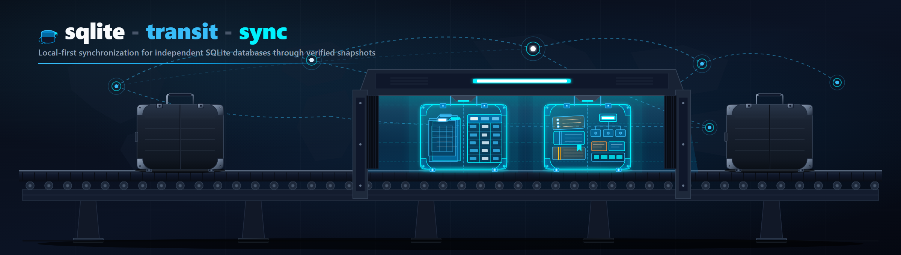
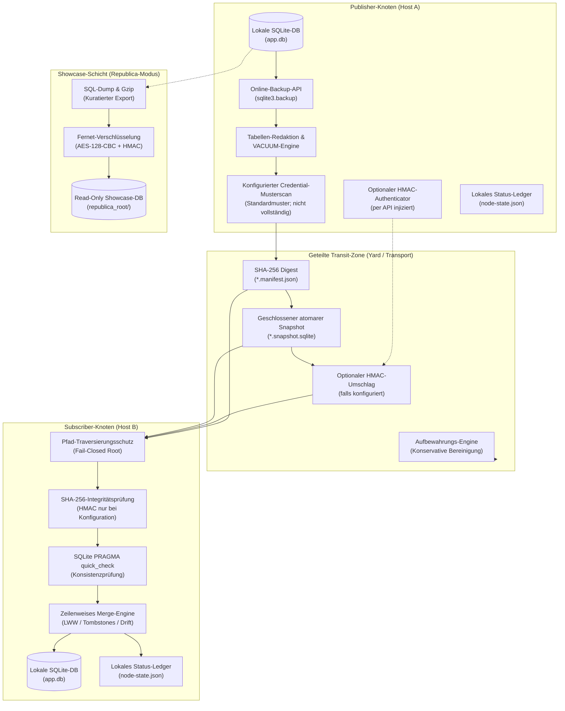

# sqlite-transit-sync



[](https://github.com/ellmos-ai/sqlite-transit-sync/actions/workflows/ci.yml)
[](CHANGELOG.md)
[](#tests-und-qualitaetssicherung)
[](#tests-und-qualitaetssicherung)
[](https://www.python.org/)
[](#)
[](#)
[](#governance--laufzeit-invarianten-matrix)
[](SECURITY.md)
[](SECURITY.md)
[](CONTRIBUTING.md)
[](THIRD_PARTY_LICENSES.md)
[](THIRD_PARTY_LICENSES.txt)
[](NOTICE)
[](MARKETING-LOG.txt)
[](LICENSE)
[](https://github.com/ellmos-ai)
[](https://github.com/open-bricks)
[](llms.txt)

> [!NOTE]
> **Kontext für LLMs und KI-Agenten**: Ein strukturierter maschinenlesbarer Verzeichnisbaum, ein Architekturüberblick und ein API-Leitfaden stehen unter [`llms.txt`](llms.txt) bereit.

**🇬🇧 [English Version](README.md)** | **🇩🇪 Deutsch** | **🇪🇸 [Spanische Version](README_es.md)** | **🇫🇷 [Französische Version](README_fr.md)** | **🇯🇵 [Japanische Version](README_ja.md)** | **🇨🇳 [Vereinfachtes Chinesisch](README_zh.md)** | **🇵🇹 [Portugiesische Version](README_pt.md)** | **🤝 [Mitwirken](CONTRIBUTING.md)** | **🛡️ [Sicherheitsrichtlinie](SECURITY.md)** | **📝 [Changelog](CHANGELOG.md)** | **📋 [llms.txt](llms.txt)**

## 🧭 Schnellnavigation

1. [Überblick & Kernidentität](#was-ist-sqlite-transit-sync)
2. [Visuelle Architekturtopologie & Entkoppelte Ebenen](#systemarchitektur-topologie)
3. [End-to-End Snapshot- und Synchronisations-Lebenszyklus](#end-to-end-snapshot--und-synchronisations-lebenszyklus)
4. [Zielgruppen & High-Intent Suchanfragen](#marketing--zielgruppen)
5. [Implementiertes Verhalten und Grenzen](#vergleich-mit-distributed-sql)
6. [Governance- & Laufzeit-Invarianten-Matrix](#governance--laufzeit-invarianten-matrix)
7. [Eigenschaften & Kernfähigkeiten](#eigenschaften)
8. [Schreibgeschützte Anwendungsprojektionen](#schreibgeschuetzte-anwendungsprojektionen)
9. [Installation & Voraussetzungen](#installation)
10. [Kurzstart & Multi-Knoten-Arbeitsablauf](#kurzstart)
11. [Konfigurationsreferenz & Secret-Erkennung](#konfiguration)
12. [Republica — die Schaufenster-Methode & Chiffrierung](#republica-die-schaufenster-methode)
13. [Python-API & Erweiterungspunkte](#python-api)
14. [Sicherheit, Bedrohungsmodell & Betriebsgrenzen](#sicherheit-und-grenzen)
15. [Drittanbieter-Lizenzinventar](#drittanbieter-lizenzen--transparenz)
16. [Ökosystem, Partner-Werkzeuge & Bündel](#oekosystem--partner-werkzeuge)
17. [Tests, Verifikation & CI-Matrix](#tests-und-qualitaetssicherung)
18. [Gesetzlicher Hinweis, Haftungsbeschränkung & Lizenz (§ 521 BGB)](#lizenz--gesetzliche-haftungsbeschraenkung)

---

<a id="was-ist-sqlite-transit-sync"></a><a id="ueberblick--kernidentitaet"></a><a id="kernidentitaet"></a>
## 1. Überblick & Kernidentität

Die Autorität für Version, Modulstatus, Sichtbarkeit und Prüfdatum steht in
[`METADATA_CONTRACT.md`](METADATA_CONTRACT.md); daraus folgt keine Freigabe
für Veröffentlichung oder Upload.

Local-first-Synchronisierung für unabhängige SQLite-Datenbanken mit Integritätsprüfungen der Snapshots und von der Anwendung wählbaren Merge-Policies. Eine Absenderauthentifizierung per HMAC ist optional und wird über einen von der Anwendung injizierten Authenticator aktiviert. Das Modul wurde aus der
BACH-ProSync-Architektur extrahiert und enthält keine Abhängigkeiten von BACH,
OneDrive, Rechnernamen oder Benutzerpfaden.

Dies ist **kein verteilter SQL-Server**. Jeder Knoten besitzt und öffnet nur seine
lokale Datenbank. Ein gemeinsamer Ordner, ein eingebundener Object Store, ein
Wechseldatenträger oder ein anderer Dateitransport überträgt geschlossene Snapshots
mit Manifesten. Beim Pull werden SHA-256 und SQLite `PRAGMA quick_check` geprüft, bevor ein Snapshot innerhalb einer Transaktion in die lokale Datenbank zusammengeführt wird. Eine HMAC-Absenderauthentifizierung wird nur geprüft, wenn ein Authenticator konfiguriert ist.

Passt gut zu [sync-master](https://github.com/dev-bricks/sync-master) aus derselben
Modulfamilie: Ein sync-master-Yard ist ein natürlicher Transit-Transport. Dazu wird
`--transit` auf eine werkzeugeigene Zone `db-transit/<namespace>/` im Yard gesetzt
(dort Protokollregel R9). sync-master transportiert die Dokumente, dieses Modul
verantwortet Datenbankintegrität und Merge; beide bleiben unabhängig.

---

<a id="systemarchitektur-topologie"></a><a id="systemarchitektur"></a>
## 2. Visuelle Architekturtopologie & Entkoppelte Ebenen

Das folgende Diagramm visualisiert die entkoppelte Multi-Knoten-Architektur, bei der lokale SQLite-Datenbanken ausschließlich über geschlossene Snapshot-Bündel mit Manifest-Integritätsprüfung im Transitspeicher synchronisiert werden:



### ASCII Vier-Ansichten-Architekturprojektion

```text
+-------------------------------------------------------------------------------------------------------------------+
|                               SQLITE-TRANSIT-SYNC: VIER-ANSICHTEN-ARCHITEKTURTOPOLOGIE                            |
+-------------------------------------------------------------------------------------------------------------------+
| [VIEW 1: PUBLISHER NODE]               [VIEW 2: SHARED TRANSIT YARD]              [VIEW 3: SUBSCRIBER NODE]       |
| [ANSICHT 1: PUBLISHER-KNOTEN]          [ANSICHT 2: GEMEINSAMER TRANSIT-ORDNER]    [ANSICHT 3: SUBSCRIBER-KNOTEN]  |
|                                                                                                                   |
| +-------------------------+              +-----------------------------+            +---------------------------+ |
| | Lokale SQLite-Datenbank |              |  Geschlossene Transitzone   |            | Path-Traversal-Schutz     | |
| | (app.db - Exklusiv RW)  |              |  (Ordner / Sync-Master / S3)|            | (Kanonische Grenzen)      | |
| +------------+------------+              +--------------+--------------+            +-------------+-------------+ |
|              |                                          ^                                         |               |
|              v (sqlite3.backup)                         |                                         v               |
| +------------+------------+                             |                           +-------------+-------------+ |
| | Konsistentes Backup     |                             |                           | SHA-256-Integritätscheck  | |
| | (Rollback-Journal-Modus)|                             |                           | HMAC nur falls gesetzt    | |
| +------------+------------+                             |                           +-------------+-------------+ |
|              |                                          |                                         |               |
|              v                                          |                                         v               |
| +------------+------------+                             |                           +-------------+-------------+ |
| | Reduktion & VACUUM      |                             |                           | SQLite PRAGMA quick_check | |
| | (Sensible Daten tilgen) |                             |                           | (Integritätsprüfung)      | |
| +------------+------------+                             |                           +-------------+-------------+ |
|              |                                          |                                         |               |
|              v                                          |                                         v               |
| +------------+------------+                             |                           +-------------+-------------+ |
| | Credential-Musterscan   |                             |                           | Transaktionaler Merge     | |
| | (Standard; begrenzt)    |                             |                           | (Row-Level LWW / Drift)   | |
| +------------+------------+                             |                           +-------------+-------------+ |
|              |                                          |                                         |               |
|              v                                          |                                         v               |
| +------------+------------+              +--------------+--------------+            +-------------+-------------+ |
| | Optionaler HMAC-Adapter |              |  *.snapshot.sqlite (Atomar) |            | Lokale SQLite-Datenbank   | |
| | (per API injiziert)     |- - - - - - ->|  *.manifest.json   (Digest) |----------->| (app.db - Merge-Ergebnis) | |
| +-------------------------+              |  Retention-Engine  (Lokal)  |            +-------------+-------------+ |
|                                          +-----------------------------+                          |               |
|                                                                                                   v               |
|                                                                                     +-------------+-------------+ |
|                                                                                     | Lokales Status-Ledger     | |
|                                                                                     | (node-state.json)         | |
|                                                                                     +---------------------------+ |
+-------------------------------------------------------------------------------------------------------------------+
| [VIEW 4: REPUBLICA SHOWCASE / COURIER ENVELOPE (OPTIONAL ZERO-TRUST TRANSPORT)]                                   |
| [ANSICHT 4: REPUBLICA-SCHAUFENSTER / KURIER-UMSCHLAG (OPTIONALER ZERO-TRUST TRANSPORT)]                           |
|                                                                                                                   |
| Lokale Datenbank ----> SQL-Dump-Extrakt ----> Gzip-Kompression ----> AES-128-CBC (Fernet) ----> Verschlüsselt     |
| (Quell-Knoten)        (FTS lokal neu gebaut)  (53MB -> 11MB)         (Pre-Shared Key)        (republica_root/)    |
|                                                                                                                   |
| Einzelnes Secret ----> Fernet-Chiffre-Umschlag ----> Kurier-Transit ----> Zielverzeichnis (0600, Transit geleert) |
+-------------------------------------------------------------------------------------------------------------------+
```

---

<a id="end-to-end-snapshot--und-synchronisations-lebenszyklus"></a><a id="lebenszyklus"></a>
## 3. End-to-End Snapshot- und Synchronisations-Lebenszyklus

Der Ablauf hält Live-Datenbanken aus der dateibasierten Synchronisierung heraus. Er vergleicht Snapshot-Bytes mit einem SHA-256-Manifest, führt den konfigurierten Credential-Musterscan bei aktivierter Option (Standard: an) aus und führt akzeptierte Zeilen transaktional zusammen. Eine Absenderauthentifizierung gibt es nur mit einem per API injizierten HMAC-Authenticator. Andere Knoten sehen Änderungen erst nach einem erfolgreichen Push/Pull-Austausch:

```mermaid
sequenceDiagram
    autonumber
    participant App as Anwendung / Knoten A
    participant CoreA as sqlite-transit-sync (Push)
    participant Shield as Credential-Musterscan (standardmäßig aktiv; konfigurierbar)
    participant Transit as Shared Transit (db-transit)
    participant CoreB as sqlite-transit-sync (Pull)
    participant Target as Lokale DB / Knoten B

    Note over App,CoreA: Phase 1: Lokaler Online-Snapshot & Redaktion
    App->>CoreA: push(config, db)
    CoreA->>CoreA: Online-Snapshot via SQLite Backup API
    CoreA->>CoreA: Ausgeschlossene Tabellen leeren & VACUUM
    CoreA->>Shield: Inhalts-Scan auf Secret-Muster (credential-triggers.json)
    Shield-->>CoreA: Kein konfiguriertes Muster gefunden (wenn aktiv)

    Note over CoreA,Transit: Phase 2: Snapshot-Digest & Dateiveröffentlichung
    CoreA->>CoreA: SHA-256-Digest und Größe berechnen
    CoreA->>Transit: Temporären Snapshot schreiben und atomar per os.replace veröffentlichen

    Note over CoreA,Transit: Phase 3: Optionale Manifest-Authentifizierung & Veröffentlichung
    CoreA->>CoreA: Manifest optional per HMAC signieren (falls konfiguriert)
    CoreA->>Transit: Manifest mit SHA-256 atomar schreiben; HMAC nur bei Konfiguration (*.manifest.json)

    Note over Transit,CoreB: Phase 4: Transit-Aufnahme & Pfadgrenzen-Wächter
    CoreB->>Transit: Manifeste erkennen & Pfadgrenzen prüfen (Anti-Traversierung)
    CoreB->>CoreB: HMAC zuerst prüfen, falls konfiguriert
    CoreB->>CoreB: Snapshot-Größe und SHA-256 prüfen (nur Integrität)
    CoreB->>CoreB: PRAGMA quick_check auf isoliertem Snapshot ausführen

    Note over CoreB,Target: Phase 5: Transaktionaler Zeilen-Merge & Status-Fortschreibung
    CoreB->>Target: BEGIN IMMEDIATE Transaktion
    CoreB->>Target: Zeilen-Merge-Policy anwenden (LWW je PK / Tombstones)
    CoreB->>Target: Schema-Drift über gemeinsame Spaltenmenge auflösen
    CoreB->>Target: COMMIT Transaktion
    CoreB->>CoreB: Lokales Status-Ledger fortschreiben (node-state.json)
    Note over Target: Knoten sehen den Stand nach erfolgreichem Austausch; keine Konvergenz im Hintergrund zugesagt
```

---

<a id="marketing--zielgruppen"></a><a id="zielgruppen--high-intent-suchanfragen"></a><a id="zielgruppen"></a>
## 4. Zielgruppen & High-Intent Suchanfragen

`sqlite-transit-sync` wurde für modulare, dezentrale Ökosysteme entwickelt und adressiert 4 Kern-Zielgruppen:

- **`[PERSONA-01]` Entwickler autonomer KI-Agenten & Multi-Host-Schwärme:**
  - *Herausforderung:* Multi-Agenten-Schwärme auf Laptops, Workstations und Servern benötigen lokale Zustandsspeicherung ohne Dateisperren-Kollisionen.
  - *Lösung:* Der standardmäßig aktive Scan kann die Veröffentlichung bei einem Treffer in konfigurierten Credential-Mustern abbrechen. Er ist ein Sicherheitsnetz und kein Nachweis, dass ein Snapshot geheimnisfrei ist. Andere Knoten erhalten Änderungen nach einem erfolgreichen Push/Pull-Austausch.
- **`[PERSONA-02]` Multi-Device-Desktop- & Edge-Entwickler:**
  - *Herausforderung:* Entwickler persönlicher Notizen- und Task-Tools über File-Sync (z. B. sync-master, Syncthing, Nextcloud) leiden unter Dateikorruption und hängenden `-wal`-Sperren.
  - *Lösung:* Die SQLite Backup-API und die Veröffentlichung einzelner Dateien halten aktive SQLite-Datenbanken aus dem Datei-Sync-Pfad heraus. Übertragen werden Transit-Snapshots.
- **`[PERSONA-03]` Entwickler lokaler Tools mit konfigurierbarem Transitpfad:**
  - *Herausforderung:* Anwendungen mit strikter Datenhoheit sollen Cloud-Lock-in, monatliche Hosting-Gebühren und unkontrollierte Hintergrundverbindungen vermeiden.
  - *Lösung:* Das Modul tauscht Snapshot-Dateien über einen konfigurierten Dateisystempfad aus. Dieser kann lokal oder auf einem Wechseldatenträger liegen; freigegebene oder netzwerkgestützte Transporte liegen außerhalb des Moduls.
- **`[PERSONA-04]` Enterprise-Sicherheits-, Datenschutz- & Compliance-Verantwortliche:**
  - *Herausforderung:* Strikte Zero-Trust-Richtlinien verbieten versehentliche Secret-Synchronisierung, unkontrollierte Binärdateien und privilegierte Hintergrunddienste.
  - *Lösung:* Der standardmäßig aktive Scan prüft vor der Veröffentlichung konfigurierte Credential-Muster; SHA-256 vergleicht die Snapshot-Integrität mit dem Manifest. Eine Anwendung kann einen per API injizierten HMAC-Authenticator für die Absenderauthentifizierung aktivieren. Der Prozess übernimmt die Rechte seines Aufrufers.

### High-Intent Suchanfragen (Bilingual EN & DE)

| Kategorie | Englische (EN) Suchbegriffe | Deutsche (DE) Suchanfragen |
|:---|:---|:---|
| **Local-First Synchronisation** | `sqlite synchronization python zero-dependency`, `local-first database snapshot sync`, `offline sqlite multi-device sync` | `lokale datenbank synchronisation offline snapshots`, `sqlite abgleich python ohne abhängigkeiten`, `lokale datenbank replikation dateibasiert` |
| **Integrität & konfigurierter Credential-Musterscan** | `configured credential-pattern scan sqlite sync`, `configured filesystem transit sqlite sync`, `optional hmac sqlite snapshot manifest` | `konfigurierter credential musterscan sqlite sync`, `dateipfad transit sqlite sync`, `optional hmac snapshot manifest` |
| **Zeilen-Merge & Konflikte** | `row level merge lww sqlite offline`, `sqlite last write wins schema drift tolerance`, `tombstone merge policy sqlite` | `row level merge lww sqlite offline`, `last-write-wins datenbank abgleich zeitstempel`, `schema drift toleranz sqlite merge` |
| **Entkoppelte Topologie** | `sqlite multi-node sync without distributed sql`, `sqlite over syncthing without corruption`, `sqlite transit yard architecture` | `sqlite synchronisation ohne verteilten server`, `sqlite über cloud sync ohne datenbankkorruption`, `transit yard sqlite synchronisation` |

Ausführliche Zielgruppenanalysen, Suchbegriffe und Wettbewerbsvergleiche sind in [MARKETING-LOG.txt](MARKETING-LOG.txt) dokumentiert.

---

<a id="vergleich-mit-distributed-sql"></a><a id="vergleichsmatrix-gegenueber-alternativen"></a><a id="vergleichsmatrix"></a>
## 5. Implementiertes Verhalten und Grenzen

Dieser Abschnitt beschreibt die implementierten Funktionen und Grenzen des Projekts. Er ist kein aktueller Direktvergleich anderer Produkte.

| Dimension | Invariante | Implementiertes Verhalten | Grenze / Einschränkung |
|:---|:---|:---|:---|
| **1. Lokale Verarbeitung und Transport** | `INV-LOCAL-01` | Liest lokale SQLite-Datenbanken und veröffentlicht Snapshots in einem konfigurierten Transitpfad; ein zentraler Datenbankserver ist nicht erforderlich. | Der konfigurierte Pfad kann ein freigegebener oder netzwerkgestützter Speicherort sein. Zugriff und Verhalten dieses Transports liegen außerhalb des Moduls. |
| **2. Snapshot-Veröffentlichung** | `INV-SNAP-02` | Erstellt ein Online-Backup und veröffentlicht die Snapshot-Datei über eine temporäre Datei und `os.replace`. | Der Austausch einer einzelnen Datei macht Snapshot und Manifest nicht zu einer gemeinsamen Transaktion über mehrere Dateien. |
| **3. Sidecars und Prozessumfang** | `INV-ROLL-03` | Schließt Snapshots im Rollback-Journal-Modus und bricht fail-closed ab, wenn temporäre SQLite-Sidecars nicht bereinigt werden können. | Pro Knoten nur einen Synchronisationsprozess ausführen, sofern die Host-Anwendung keine Prozesssperre ergänzt. |
| **4. Begrenzung der Transitpfade** | `INV-PATH-04` | Beschränkt Manifest- und Snapshotpfade auf direkte reguläre Dateien unterhalb des kanonischen Transit-Roots. | Wer in den Transitpfad schreiben darf, wird durch dieses Modul nicht kontrolliert. |
| **5. Integritätsprüfungen** | `INV-VERIFY-05` | Vergleicht die Snapshot-Bytes mit dem SHA-256-Wert im Manifest und führt SQLite `PRAGMA quick_check` aus. | Ein passender Digest authentifiziert weder Absender noch Transport. |
| **6. Scan konfigurierter Credential-Muster** | `INV-SHIELD-06` | Prüft Snapshot-Inhalte standardmäßig anhand konfigurierter Muster und bricht die Veröffentlichung bei einem Treffer ab. Gemeldet wird `table.column`, nicht der Wert. | Die präfixbasierten Regeln sind ein Sicherheitsnetz, keine Garantie. Ein sauberer Scan bedeutet nur, dass kein bekanntes Muster passte; individuelle oder nicht präfixierte Geheimnisse können unentdeckt bleiben. |
| **7. Absenderauthentifizierung** | `INV-HMAC-07` | Eine Anwendung kann die HMAC-SHA256-Authentifizierung des kanonischen Manifests per API opt-in aktivieren. | Ohne konfigurierten Authenticator wird kein Absender authentifiziert. Shared-Key-HMAC ist weder ein Frischeprotokoll noch eine Public-Key-Signatur. |
| **8. Zeilen-Merge** | `INV-MERGE-08` | Wendet eine konfigurierbare Merge-Policy auf Zeilen an; für unterstützte Tabellen ist zeitstempelbasiertes LWW die Standardregel. | Die integrierende Anwendung verantwortet Uhrenannahmen, Löschsemantik, Migrationen und fachliche Konfliktregeln. |
| **9. Aufbewahrung und Löschumfang** | `INV-RET-09` | Die Bereinigung startet standardmäßig als Dry-Run und ist auf lokale Knotenartefakte beschränkt, sofern die knotenübergreifende Berechtigung nicht ausdrücklich aktiviert wird. | Die Bereinigung ist kein Sicherungs- oder Wiederherstellungsdienst. |
| **10. Prozessrechte und Sicherheitsrichtlinie** | `INV-SLA-10` | Der Prozess verwendet die Rechte seines aufrufenden Prozesses. `SECURITY.md` nennt die Meldefristen: Bestätigung innerhalb von 48 Stunden und Triage-Einschätzung innerhalb von 5 Werktagen. | Das Modul erzwingt keinen Standardbenutzermodus und fordert keine Rechteerhöhung an. Die Fristen betreffen die Meldungsbearbeitung, nicht eine Laufzeitfunktion. |

<a id="ausführlicher-vergleich-mit-distributed-sql"></a><a id="ausfuehrlicher-vergleich-mit-distributed-sql"></a>
### Verarbeitungsmodell und Abgrenzungen

| Aspekt | Verhalten von `sqlite-transit-sync` | Grenze / Einschränkung |
|---|---|---|
| Grundmodell | Jeder Knoten hat eine eigene lokale SQLite-Datenbank; Snapshots werden über einen konfigurierten Transitpfad ausgetauscht. | Es gibt keine global maßgebliche Einzeldatenbank. |
| Schreibvorgänge | Anwendungen schreiben lokal; ein Aufrufer startet Push und Pull zum Snapshot-Austausch. | Es gibt keine automatische Synchronisierung im Hintergrund. |
| Sichtbarkeit | Ein Knoten sieht Änderungen nach einem erfolgreichen Austausch und Merge. | Das Modul verspricht weder sofortige noch global konsistente Sichtbarkeit. |
| Globale Transaktionen | Werden nicht bereitgestellt. | Eine Transaktion kann nicht gemeinsam über mehrere Knoten festgeschrieben werden. |
| Offline-Betrieb | Eine lokale Datenbank kann unabhängig weiterverwendet werden, während ein Knoten offline ist. | Der Snapshot-Austausch wartet, bis der konfigurierte Transit verfügbar ist. |
| Konflikte | Die konfigurierte `MergePolicy` bestimmt den Zeilen-Merge; zeitstempelbasiertes LWW ist die Standardregel. | Uhren, Löschregeln und fachliche Semantik bleiben Integrationsaufgaben. |
| Schemaänderungen | Der Merge gemeinsamer Spalten toleriert begrenzte Schemaabweichungen. | Migrationen und Schema-Kompatibilität bleiben Aufgabe der Anwendung. |
| Fehlerbehandlung | Lokale Daten liegen in SQLite; Transit-Snapshots sind separate Dateien. | Das Modul bietet keine automatische Replikation, kein Failover und keine Transit-Backups. |

### Vor- und Nachteile sowie typische Einsatzbereiche

| System | Vorteile | Nachteile | Geeignet für | Weniger geeignet für |
|---|---|---|---|---|
| `sqlite-transit-sync` | Geringer lokaler Ressourcenbedarf; kein zentraler Datenbankserver; lokale Offline-Arbeit; konfigurierbarer Datei-Transport; anwendungsspezifische Merge-Policies. | Änderungen erreichen andere Knoten erst über Push/Pull; keine globale Transaktion oder automatisches Failover; Uhren, Löschungen, Migrationen und Konflikte brauchen Anwendungsregeln. | Persönliche oder aufgabenbezogene Datenbanken; lokaler Agentenzustand; zeitweise getrennte Laptops, Workstations oder Edge-Geräte; Forschungsnotizen. | Workloads mit global festgeschriebenen Transaktionen, sofort gemeinsamem Zustand, automatischem Failover oder vielen konkurrierenden Schreibern. |

### Schnelle Entscheidungshilfe

| Anforderung | Einschätzung |
|---|---|
| Knoten müssen ihre lokale Datenbank auch offline weiterverwenden können | `sqlite-transit-sync` |
| Updates dürfen andere Knoten erst nach einem expliziten Push/Pull-Austausch erreichen | `sqlite-transit-sync` |
| Die Anwendung kann Merge-, Uhr-, Lösch- und Migrationsregeln festlegen | `sqlite-transit-sync` |
| Jeder Schreibvorgang muss sofort global maßgeblich sein | Architektur mit einem passenden Konsistenzvertrag wählen |
| Globale Transaktionen, automatisches Failover oder viele konkurrierende Schreiber sind erforderlich | Eine Architektur prüfen, die diese Eigenschaften vertraglich bereitstellt |

Für wenige, zeitweise getrennte Geräte kann das Modul passen, wenn verzögerter Austausch und anwendungseigene Merge-Regeln akzeptabel sind. Erfordert der Workload globale Transaktionen, sofort gemeinsam sichtbare Daten oder automatisches Failover, sollte eine Architektur gewählt werden, deren dokumentierter Vertrag diese Eigenschaften bietet.

---

<a id="governance--laufzeit-invarianten-matrix"></a><a id="governance--laufzeit-invarianten"></a>
## 6. Governance- & Laufzeit-Invarianten-Matrix

Die folgende Matrix beschreibt zehn Architektur- und Laufzeit-Invarianten mit ihrem implementierten Verhalten und den jeweiligen Grenzen:

| # | Invariante | Architekturbereich | Dokumentiertes Verhalten und Grenzen |
|---|---|---|---|
| 1 | **INV-LOCAL-01: Lokale SQLite-Verarbeitung & konfigurierter Transit** | Systemarchitektur | Liest lokale SQLite-Datenbanken und veröffentlicht Snapshots über den konfigurierten Transitpfad. Dieser kann freigegeben oder netzwerkgestützt sein; Host und Transport liegen außerhalb des Moduls. |
| 2 | **INV-SNAP-02: Offline Snapshot-Atomarität** | Transit-Publikation | Live-Datenbanken werden niemals über File-Sync geteilt. Online-Snapshots erfolgen über `sqlite3.backup` und werden per atomarem `os.replace` bereitgestellt. |
| 3 | **INV-ROLL-03: Saubere Rollback-Journal-Isolation** | Sidecar-Schutz | Snapshots werden im Rollback-Journal-Modus geschlossen; alle temporären Sidecars (`-wal`, `-shm`, `-journal`) werden vor Manifest-Erzeugung fail-closed bereinigt. |
| 4 | **INV-PATH-04: Strikte Transit-Pfadgrenzen** | Dateisystemgrenzen | Manifest- und Snapshot-Pfade müssen reguläre Dateien im kanonischen Transit-Root sein. Traversierung (`../`), absolute Pfade, Symlinks und Reparse-Points werden abgewiesen. |
| 5 | **INV-VERIFY-05: Zweistufige Integritäts- & Konsistenzprüfung** | Vorab-Validierung | Jeder empfangene Snapshot muss vor Datenzugriff oder Merge den kryptografischen SHA-256-Abgleich und SQLite `PRAGMA quick_check` fehlerfrei bestehen. |
| 6 | **INV-SHIELD-06: Secret-Scan vor Veröffentlichung** | Inhaltsprüfung | Konfigurierte Credential-Muster werden standardmäßig im Snapshot geprüft; bei einem Treffer wird die Veröffentlichung abgebrochen und `table.column`, nicht der Wert, gemeldet. Die präfixbasierten Muster sind ein Sicherheitsnetz, keine Garantie; ein Treffer-freier Scan beweist nicht, dass der Snapshot keine Geheimnisse enthält. |
| 7 | **INV-HMAC-07: Optionale HMAC-Authentifizierung** | Absenderauthentifizierung | Optionaler, per API injizierter HMAC-SHA256-Umschlag über die kanonische Manifest-Nutzlast (Protokoll, Namespace, Sender-ID, Dateiname, SHA-256, Größe, Redaktionsliste). Shared-Key-HMAC ist kein Frischeprotokoll und keine Public-Key-Signatur; ohne diese Option authentifiziert das Manifest den Absender nicht. |
| 8 | **INV-MERGE-08: Deterministischer Zeilen-Merge** | Datenkonvergenz | Transaktionaler Zeilen-Merge (LWW je PK, gemeinsame Spaltenmenge bei Schema-Drift, explizite Tombstones). Inhalts-Hash als Tie-Breaker garantiert Konvergenz. |
| 9 | **INV-RET-09: Konservative Aufbewahrungs- & Bereinigungslogik** | Garbage Collection | Snapshot-Bereinigung ist standardmäßig ein Dry-Run und auf lokale Knoten-Artefakte beschränkt. Knotenübergreifende Löschung (`--all-nodes`) erfordert explizite Bestätigung. |
| 10 | **INV-SLA-10: Prozessrechte & Sicherheitsrichtlinie** | Ausführungskontext | Der Prozess übernimmt die Rechte seines Aufrufers; das Modul erzwingt keinen Standardbenutzermodus und fordert keine Rechteerhöhung an. `SECURITY.md` nennt die Meldefristen: Bestätigung innerhalb von 48 Stunden und Triage-Einschätzung innerhalb von 5 Werktagen. |

---

<a id="eigenschaften"></a><a id="kernfaehigkeiten"></a><a id="teil-der-ellmos-stack-familie"></a>
## 7. Eigenschaften & Kernfähigkeiten

`sqlite-transit-sync` ist der Begleiter zu
[dev-bricks/sync-master](https://github.com/dev-bricks/sync-master) aus
derselben Modulfamilie: sync-master verantwortet den Dateitransport
(`sync.files`), dieses Modul verantwortet Datenbankintegrität und Merge
(`sync.database`). Beide funktionieren eigenständig oder zusammengestellt in
Stacks der [ellmos-ai](https://github.com/ellmos-ai)-Familie – siehe den
Katalog [ellmos-ai/stacks](https://github.com/ellmos-ai/stacks). Die Rolle in
diesem Baukasten: kein offenes SQLite über Datei-Sync, sondern nur geprüfte
Snapshots mit anwendungsspezifischen Merge-Policies.

### Kernfähigkeiten im Überblick

- Konsistente Online-Snapshots über die SQLite Backup-API;
- Atomare Veröffentlichung über temporäre Dateien und `os.replace`;
- Geschlossene Snapshots im Rollback-Journal-Modus mit Bereinigung temporärer
  SQLite-Dateien vor der Veröffentlichung;
- Pfadprüfung für Manifeste und Snapshots auf direkte reguläre Dateien im
  Transit-Ordner (Traversierung, absolute Pfade, Symlinks und Reparse Points
  schlagen fehl);
- Prüfung über SHA-256-Manifeste und `PRAGMA quick_check`;
- Optionale API-injizierte HMAC-SHA256-Authentifizierung über das kanonische
  Manifest, Sender-Identität, Protokollversion und Snapshot-Hash;
- Knotenlokaler Pull-Status und idempotente Wiederholung;
- Last-Write-Wins auf Zeilenebene je Primärschlüssel für tabellarische Daten mit
  Zeitstempel;
- Optionale `TombstoneMergePolicy` als Referenzadapter für explizite Löschungen;
- Merge über gemeinsame Spalten bei einfachem Schema-Drift;
- Konfigurierbarer Tabellenausschluss und Snapshot-Redaktion mit abschließendem `VACUUM`;
- Standardmäßig aktiver Inhalts-Scan, der die Veröffentlichung abbricht, wenn ein
  konfiguriertes Credential-Muster passt (meldet `table.column`, niemals den Wert).
  Die präfixbasierten Regeln sind ein Sicherheitsnetz; ein sauberer Scan beweist nicht,
  dass der Snapshot keine Geheimnisse enthält;
- Unterstützung für eigene `MergePolicy`-Implementierungen;
- Geprüfte Snapshot-Bereinigung mit standardmäßigem Dry-Run und Beschränkung auf
  den lokalen Knoten;
- Gezieltes Nachholen einzelner Snapshots über `pull_selected()`;
- Strikte versionierte Projektionsverträge für schreibgeschützte Auswertungen;
- Optionaler [Republica-Schaufenstermodus](#republica-die-schaufenster-methode)
  zur verschlüsselten Einweg-Bereitstellung;
- Abhängigkeitsfreie Python-API und JSON-CLI (Republica-Modus ergänzt `cryptography`).

---

<a id="schreibgeschuetzte-anwendungsprojektionen"></a><a id="projektionen"></a>
## 8. Schreibgeschützte Anwendungsprojektionen

`verify-projection` prüft eine geschlossene, anwendungseigene SQLite-Projektion,
ohne zu kopieren, zu mergen, zu migrieren, einen Scheduler zu starten oder
Zustand fortzuschreiben. Die Anwendung übergibt ihre Consumer-Identität und das
geprüfte maximale Offline-Intervall. Der Verifier weist Loops, veraltete
Checkpoints, zu kurze Tombstone-Aufbewahrung, nicht erlaubte Tabellen oder
Spalten sowie nicht opake Datensatzreferenzen zurück.

Mitgeliefert werden sechs enge Verträge für Kontostandsübersichten,
AboTracker-Abozustände, HausLagerist-Nachfülltermine, Medikamenten-Fälligkeiten
und Bestandswarnungen, Routinen-Fälligkeiten und Abschlussstatus sowie
Versicherungsfristen. Der
AboTracker-Vertrag ist nur eine Statusprojektion, weil Exportschema v1 kein
bestätigtes nächstes Fälligkeits- oder Verlängerungsdatum enthält; aus
Zahlungsdatum und Abrechnungszyklus wird kein Reminder abgeleitet. Die
Test-Fixtures sind synthetische JSON-Rezepte, fachliche Identitäten und private
Details bleiben außerhalb der Allowlists.

Die mitgelieferten Namen sind
`abotracker-subscription-status-projection.v1`,
`accounts-balance-projection.v1`, `hauslagerist-replenishment-projection.v1`,
`mediplaner-reminder-projection.v1`,
`routinika-reminder-projection.v1` und
`versicherungsmanager-deadline-projection.v1`. Siehe
[Read-only-Projektionsverträge](PROJECTION_CONTRACTS_de.md) und die
[englische Begleitdatei](PROJECTION_CONTRACTS.md).

```bash
sqlite-transit-sync verify-projection \
  --contract mediplaner-reminder-projection.v1 \
  --database ./closed-projection.sqlite \
  --consumer-id reminder-consumer \
  --minimum-offline-seconds 2592000 \
  --previous-checkpoint 41
```

---

<a id="installation"></a><a id="voraussetzungen"></a>
## 9. Installation & Voraussetzungen

```bash
python -m pip install -e .
```

---

<a id="kurzstart"></a><a id="arbeitsablauf"></a>
## 10. Kurzstart & Multi-Knoten-Arbeitsablauf

Auf jedem Knoten eine Konfiguration anlegen. Jeder Knoten nutzt eine eigene
Datenbank- und Statusdatei, aber denselben Transit-Ordner und denselben Namespace.

```bash
sqlite-transit-sync init \
  --config node.json \
  --database ./app.db \
  --transit ./shared-transit \
  --node-id laptop \
  --namespace my-app

sqlite-transit-sync push --config node.json
sqlite-transit-sync pull --config node.json --dry-run
sqlite-transit-sync pull --config node.json
sqlite-transit-sync status --config node.json
sqlite-transit-sync verify --config node.json
sqlite-transit-sync cleanup --config node.json
# Bereinigungsplan prüfen und anschließend explizit anwenden:
sqlite-transit-sync cleanup --config node.json --apply
```

Das Anwendungsschema muss auf jedem Knoten bereits existieren. Automatisches
Anlegen der Erstkopie ist bewusst deaktiviert.

### Eigenständiger ausführbarer Python-Kurzstart (Null externe Abhängigkeiten)

Entwickler, die `sqlite-transit-sync` direkt in Agenten-Frameworks, Hintergrunddienste oder Desktop-Tools einbinden, können diesen in sich geschlossenen Beispielcode direkt ausführen, um die Multi-Knoten-Synchronisation ohne jede externe Abhängigkeit zu verifizieren:

```python
import sqlite3
from contextlib import closing
import tempfile
from pathlib import Path
from sqlite_transit_sync import SyncConfig, TransitSync

with tempfile.TemporaryDirectory() as tmp:
    root = Path(tmp)
    transit = root / "transit"
    transit.mkdir()

    # 1. Knoten A initialisieren und Datensatz eintragen
    db_a = root / "node_a.db"
    with closing(sqlite3.connect(db_a)) as conn, conn:
        conn.execute("CREATE TABLE notes (id INTEGER PRIMARY KEY, title TEXT, updated_at TEXT)")
        conn.execute("INSERT INTO notes VALUES (1, 'Hello from Node A', '2026-10-18T08:00:00Z')")

    # 2. Atomaren Snapshot von Knoten A in den Transit-Bereich publizieren
    cfg_a = SyncConfig(database=db_a, transit=transit, state=root / "state_a.json", node_id="node_a", namespace="demo")
    snapshot = TransitSync(cfg_a).push()
    print(f"Knoten A Snapshot publiziert: {snapshot.path.name} (SHA-256: {snapshot.sha256[:8]}...)")

    # 3. Knoten B mit Schema bereitstellen und Snapshot abrufen
    db_b = root / "node_b.db"
    with closing(sqlite3.connect(db_b)) as conn, conn:
        conn.execute("CREATE TABLE notes (id INTEGER PRIMARY KEY, title TEXT, updated_at TEXT)")

    cfg_b = SyncConfig(database=db_b, transit=transit, state=root / "state_b.json", node_id="node_b", namespace="demo")
    reports = TransitSync(cfg_b).pull()

    # 4. Konvergierten Zustand auf Knoten B prüfen
    with closing(sqlite3.connect(db_b)) as conn, conn:
        rows = conn.execute("SELECT id, title, updated_at FROM notes").fetchall()
        print(f"Knoten B konvergierte Datensätze: {rows}")
        assert rows == [(1, "Hello from Node A", "2026-10-18T08:00:00Z")]
```

---

<a id="konfiguration"></a><a id="konfigurationsreferenz"></a>
## 11. Konfigurationsreferenz & Secret-Erkennung

```json
{
  "database": "./app.db",
  "transit": "./shared-transit",
  "state": "./node-state.json",
  "node_id": "laptop",
  "namespace": "my-app",
  "timestamp_columns": ["updated_at", "modified_at", "created_at"],
  "exclude_tables": ["secrets", "sqlite_sequence"],
  "snapshot_exclude_tables": ["secrets"],
  "scan_snapshot_for_secrets": true,
  "secret_scan_skip_tables": [],
  "secret_scan_extra_patterns": [],
  "secret_patterns_file": null
}
```

Relative Pfade werden relativ zur Konfigurationsdatei aufgelöst. Die
aktive Datenbank darf niemals im Transit-Ordner liegen, und die Statusdatei muss
außerhalb des Transit-Baums bleiben.

```python
import hashlib
from pathlib import Path

from sqlite_transit_sync import SyncConfig

config_path = Path("node.json").resolve()
payload = config_path.read_bytes()
config = SyncConfig.from_bytes(payload, source_path=config_path)
config_sha256 = hashlib.sha256(payload).hexdigest()
```

### Schlüssel und Standardwerte

| Schlüssel | Standard | Bedeutung |
|---|---|---|
| `database` | *(Pflichtfeld)* | Lokale SQLite-Datenbank dieses Knotens |
| `transit` | *(Pflichtfeld)* | Gemeinsamer Ordner für Snapshots und Manifeste |
| `state` | `./.sync-state.json` | Knotenlokaler Status; gehört nicht in den Transit |
| `node_id` | Hostname der Maschine | Identifiziert den veröffentlichenden Knoten |
| `namespace` | `"default"` | Trennt unabhängige Datensätze im selben Transit |
| `timestamp_columns` | `["updated_at","modified_at","created_at"]` | Spalten für Last-Write-Wins |
| `exclude_tables` | `["secrets","sqlite_sequence"]` | Tabellen, die niemals lokal zusammengeführt werden |
| `snapshot_exclude_tables` | `["secrets"]` | Tabellen, deren Zeilen vor Veröffentlichung gelöscht werden (danach `VACUUM`) |
| `scan_snapshot_for_secrets` | `true` | Veröffentlichung abbrechen, wenn noch Secrets erkannt werden |
| `secret_scan_skip_tables` | `[]` | Tabellen, die der Scan ignoriert |
| `secret_scan_extra_patterns` | `[]` | Zusätzliche reguläre Ausdrücke |
| `secret_patterns_file` | `null` (mitgeliefert) | Eigene Triggerdatei; ersetzt die mitgelieferten Muster vollständig |
| `key_file` | `null`, sonst `$SQLITE_TRANSIT_SYNC_KEY_FILE` | Fernet-Schlüssel für Republica; gehört nicht in den Transit |
| `republica_root` | `~/.republica` | Zielordner importierter Schaufenster; gehört nicht in den Transit |
| `allow_key_in_synced_folder` | `false` | Hebt die Prüfung auf, die Schlüssel in Sync-Ordnern abweist |

### Der Credential-Scan und wie man ihn abschaltet

`snapshot_exclude_tables` kann nur Tabellen leeren, die vorher bekannt waren.
Der Scan beantwortet die Frage, die diese Regel nicht abdeckt: *Wurden Zugangsdaten
in eine Freitextspalte eingefügt?* — eine Notiz, ein Logfile, eine Sitzungszusammenfassung?
Er wird auf der Snapshot-Kopie nach der Schwärzung und vor der Veröffentlichung ausgeführt.
Bei einem Treffer wird `SyncError` ausgelöst und `table.column` benannt; der Wert selbst
taucht nirgendwo in Logs, Tracebacks oder CI-Ausgaben auf. Der unvollständige Snapshot wird
verworfen, sodass nichts den Transit-Ordner erreicht.

Das Abschalten ist eine legitime Option, wenn der Transit vollständig vertrauenswürdig ist:

```json
{ "scan_snapshot_for_secrets": false }
```

Bevorzugen Sie `secret_scan_skip_tables`, wenn nur eine einzelne Tabelle Fehlalarme erzeugt:
Den Scan überall sonst aktiv zu halten, bietet mehr Schutz als ein globales Deaktivieren.

### Trigger anpassen

Muster liegen in Daten, nicht in Code — `sqlite_transit_sync/credential-triggers.json` —
sodass die Erkennung im Laufe der Zeit geschärft werden kann, ohne auf ein neues Release zu warten:

```json
{
  "version": 1,
  "patterns": [
    { "name": "github", "regex": "gh[pousr]_[A-Za-z0-9]{16,}", "prefilter": "gh" },
    { "name": "acme-internal", "regex": "ACME-[0-9]{4}", "prefilter": "ACME-" }
  ]
}
```

- `prefilter` ist ein optionales Literal, das als günstiger SQL-`LIKE`-Vorfilter dient,
  damit auch große Snapshots performant bleiben. Es **muss** in jedem Wert vorkommen,
  auf den der Regex zutreffen kann, da sonst Fundstellen übersehen werden. Fehlt ein
  solches Literal, entfällt der Vorfilter — der Scanner liest die Spalte dann zur Korrektheit
  vollständig aus.
- Setzen Sie `secret_patterns_file` auf Ihre eigene Datei, um die Standardmuster vollständig
  zu ersetzen, oder nutzen Sie `secret_scan_extra_patterns`, um zusätzliche Muster zu ergänzen.

Die Muster sind bewusst herstellerbezogen mit Präfixen versehen. Eine allgemeine Regel wie
„lange hexadezimale Zeichenkette“ würde Prüfsummen, UUIDs und Git-SHAs fälschlich markieren,
die legitime Datenbankinhalte darstellen — und ein Scanner mit hoher Falsch-Positiv-Rate
wird in der Praxis deaktiviert, was jeglichen Schutz zunichtemacht. Behandeln Sie einen
sauberen Scan als „kein bekanntes Muster hat angeschlagen“, niemals als „dieser Snapshot
ist garantiert frei von Geheimnissen“.

### Dies ist kein Secrets-Manager

Der Scan kann die Veröffentlichung bei einem Treffer in einem konfigurierten Muster abbrechen. Er garantiert nicht, dass jedes Geheimnis erkannt wird, und **verteilt** keine Zugangsdaten. Wenn das eigentliche Problem darin besteht, dass mehrere Rechner dieselben Passwörter oder API-Schlüssel benötigen, ist dieses Modul das falsche Werkzeug — ebenso wie jeder Cloud-Dokumentenordner. Prüfen Sie stattdessen ein geeignetes Secrets-Werkzeug und dessen Bereitstellungs- und Vertrauensmodell:

| Ansatz | Geeignet für | Hinweise |
|---|---|---|
| **Vaultwarden** (selbst gehostetes Bitwarden) | Menschen + CLI auf mehreren Rechnern | Läuft auf einem kleinen Always-On-Gerät; Zugriff über privates Netzwerk (WireGuard, Tailscale) statt öffentlicher Freigabe. Offizielle Bitwarden-Clients, Browser-Erweiterungen und CLI `bw` funktionieren direkt. |
| **SOPS + age** | Geheimnisse direkt neben dem Code | Verschlüsselte Dateien können sicher committet und synchronisiert werden, da nur Chiffretext transportiert wird. Empfängerspezifische Schlüssel, ideal für Git-Reviews. |
| **`pass`** (GPG) + Git | Einzelanwender und kleine Teams mit Unix-Fokus | Eine Datei pro Geheimnis, gewöhnlicher Git-Remote, keinerlei Server erforderlich. |
| **KeePassXC über Syncthing** | Ohne Server, ohne Cloud-Konto | Peer-to-Peer Dateisynchronisation; der Tresor bleibt eine einzelne verschlüsselte Datei. |
| **Infisical / OpenBao (Vault-Fork)** | Teams, Maschinen-Identitäten, Rotation | Ausgewachsene Secrets-Server mit Audit-Logs und dynamischen Credentials — oft mehr Infrastruktur als im Heimbereich nötig. |
| **Plattform-native Speicher** | Ein Rechner, eine Anwendung | macOS Keychain, Windows DPAPI / Credential Manager, `systemd-creds` oder CI-Secret-Stores. Keine Synchronisation, aber auch keine Exposition. |

Unabhängig von der Wahl gilt die zentrale Trennung: **Ein Kanal für Daten, ein separater Kanal für Zugangsdaten.**
Der Scan dieses Moduls kann die Veröffentlichung bei einem konfigurierten Muster stoppen, garantiert aber nicht, dass jedes Geheimnis erkannt wird.

---

<a id="republica-die-schaufenster-methode"></a><a id="republica-schaufenster"></a>
## 12. Republica — die Schaufenster-Methode & Chiffrierung

Jeder Rechner legt ein **verschlüsseltes Schaufenster** seiner Datenbank in
einem gemeinsamen Dateibereich ab. Alle anderen Rechner können hineinsehen;
keiner kann Änderungen zurückschreiben. Daher der Name — eine Wiederveröffentlichung
(Re-Publication) einer Datenbank, die ausschließlich von Inhabern des Schlüssels
gelesen werden kann.

Nutzen Sie Republica, wenn `push`/`pull` nicht passt: Sie möchten Daten eines anderen Knotens *lesen*, ohne sie in Ihre eigenen Zeilen zusammenzuführen, oder die Rechner teilen nur einen Ordner — ohne Server, offene Ports oder dedizierten Peer-Tunnel für Republica selbst, aber weiterhin mit einem gemeinsamen Fernet-Schlüssel — und dieser Ordner darf Ihre Inhalte nicht im Klartext sehen.

<a id="zwei-bewusst-redundante-betriebsmodi"></a>
### Zwei Modi, ein gemeinsamer Dateitransit

Bei derselben `SyncConfig` verwenden `push`/`pull` und Republica denselben konfigurierten `transit`-Pfad. `push`/`pull` veröffentlichen Snapshots und führen sie in die lokale Datenbank zusammen; Republica veröffentlicht verschlüsselte Replikate in einem Knoten-Unterverzeichnis dieses Transits und importiert sie als separate schreibgeschützte Datenbanken unter `republica_root`. Der Unterschied liegt in Verschlüsselung und Merge-Verhalten, nicht im Transport.

| Bedingung | Dateitransit (`push`/`pull`) | Republica |
|---|---|---|
| Ein Peer-Knoten ist offline | Ein Knoten kann Snapshots veröffentlichen, während andere Knoten offline sind; `pull` kann bereits im Transit liegende Snapshots zusammenführen. Neue Daten warten, bis der Quellknoten sie veröffentlicht. | Ein Knoten kann ein verschlüsseltes Replikat zur späteren Abholung veröffentlichen. Daten eines Offline-Knotens gibt es ebenfalls erst nach dessen Veröffentlichung. |
| VPN/SSH-Tunnel nicht verfügbar | Der konfigurierte Dateipfad muss erreichbar bleiben; `push`/`pull` bauen keine Peer-Tunnel auf. | Dieselbe Transitabhängigkeit; ein VPN/SSH-Ausfall ist nur relevant, wenn dadurch der konfigurierte Pfad nicht erreichbar ist. |
| Konfigurierter Transit nicht verfügbar | Über einen nicht verfügbaren Pfad können keine Snapshots veröffentlicht oder abgerufen werden. | Ebenso; Republica hat keinen alternativen Transport. |
| Schlüsselrotation oder Vertrauenskonfiguration ausstehend | HMAC ist optional. Ist ein Authenticator konfiguriert, müssen Schlüssel und Vertrauenskonfiguration passen; ohne ihn prüft SHA-256 die Integrität, nicht den Absender. | Veröffentlichung und Import benötigen denselben kompatiblen Fernet-Schlüssel; Rotationen müssen abgestimmt werden. |
| Keine anwendungsspezifische Merge-Policy konfiguriert | Es gilt die konfigurierte `MergePolicy` oder standardmäßig zeitstempelbasiertes LWW; passt der Standard nicht zu den Daten, sollte die Anwendung eine Domänen-Policy konfigurieren. | Importiert eine separate schreibgeschützte Datenbank und führt keine Zeilen zusammen. |

Republica ist sinnvoll, wenn verschlüsselte, separate schreibgeschützte Kopien benötigt werden. Es bietet keine Transport-Ausfallsicherung; dafür müsste die Anwendung getrennte, unabhängig verfügbare Transitpfade konfigurieren.

### Einrichtungsaufwand: Einmalige Schlüsselübertragung

Der gemeinsame Schlüssel muss die anderen Rechner über **einen Kanal erreichen, der
nicht der Dateitransport selbst ist** — ein bestehender verschlüsselter Tunnel, ein
Passwortmanager, ein USB-Stick oder das Vorlesen am Telefon. Einmalig. Danach genügt
dauerhaft ein einfacher gemeinsamer Ordner, selbst wenn dieser nicht vertrauenswürdig ist.

```text
republica_root/
  laptop/my-app.sqlite      <- schreibgeschütztes Schaufenster der Laptop-Datenbank
  workstation/my-app.sqlite <- schreibgeschütztes Schaufenster der Workstation-Datenbank
```

```bash
# Einmalig pro Schlüssel auf lokaler Festplatte - niemals im Transit, niemals im Cloud-Sync-Ordner.
# Datei anschließend out-of-band auf andere Rechner kopieren; dort KEIN keygen ausführen.
sqlite-transit-sync keygen --key-file ~/.keys/republica.key

sqlite-transit-sync init --config node.json \
  --database ./app.db --transit ./shared-transit \
  --node-id laptop --namespace my-app \
  --key-file ~/.keys/republica.key

sqlite-transit-sync republica-publish --config node.json   # verschlüsseln und veröffentlichen
sqlite-transit-sync republica-list    --config node.json   # Angebote anderer Knoten einsehen
sqlite-transit-sync republica-import  --config node.json   # lokal als schreibgeschützte Ansicht materialisieren
```

Erfordert das optionale Krypto-Paket: `pip install 'sqlite-transit-sync[crypto]'`.

**Was übertragen wird:** Nicht die Datenbankdatei selbst, sondern ein kuratierter
SQL-Dump, gzip-komprimiert und mit Fernet verschlüsselt. Bei einer 53,6 MB großen
Wissensdatenbank sind dies lediglich 11,0 MB im Transit, da interne FTS-Volltextindizes
bei Ankunft lokal neu aufgebaut statt übertragen werden (35.370 von 49.636 Dump-Befehlen).
Die Veröffentlichung durchläuft dieselben Gates wie ein Merge-Snapshot — Schwärzung,
Secret-Scan, `quick_check` und Manifest-Prüfung.

**Was geschützt ist:** Der Transportweg sieht ausschließlich Chiffretext, und Fernets
HMAC erkennt gezielte Manipulationen selbst dann, wenn der Hash des Manifests angepasst wurde.

**Was nicht geschützt ist:** Fernet authentifiziert den *Schlüssel*, nicht den *Absender* —
jeder Besitzer des Schlüssels kann gültige Snapshots veröffentlichen. Genau deshalb
wird das Schaufenster separat gehalten und niemals automatisch in die lokale Datenbank
zusammengeführt. Halten Sie den Schlüssel aus dem Transit fern: Ein Schlüssel im
Transit-Verzeichnis wird abgewiesen, ebenso wie in synchronisierten Ordnern (außer Kraft
setzbar mit `allow_key_in_synced_folder`). Dasselbe gilt für `republica_root` — eine
entschlüsselte Replik im Transit würde unverschlüsselt verteilt.

**Einschränkung:** Ein Volltextindex ohne eigenen Inhalt (`content=''`) kann nicht neu
aufgebaut werden, da die Quelldaten fehlen. Solche Tabellen werden im Manifest als
`contentless_fts` ausgewiesen, statt stillschweigend leer zu bleiben.

### Versiegelter Umschlag: Eine Datei, derselbe Kanal, niemals eine Datenbank

Das Bootstrap-Problem: Zwei Rechner teilen *noch* keinen sicheren Kanal, und genau
deshalb muss ein Secret übertragen werden. Derselbe Schlüssel und derselbe Ordner
können eine einzelne verschlüsselte Datei transportieren:

```bash
sqlite-transit-sync envelope-send    --config node.json --file ./api-token.txt --label api-token
sqlite-transit-sync envelope-receive --config node.json --into ~/credentials
```

Die Datei kommt **als Datei** mit Dateirechten `0600` an, benannt als
`<quell-knoten>__<dateiname>`, und gelangt niemals in eine Datenbank — ein Geheimnis
in einer Datenbank wird von jedem Backup, Index und Sync weiterkopiert. Notizen
sollten festhalten, wo ein Secret liegt, niemals das Secret selbst.

Zwei Schaufenster-Regeln sind hier bewusst invertiert: Der **Credential-Scan greift nicht**
(er würde den Transport des eigentlichen Secrets blockieren), und der Umschlag wird
nach Empfang **aus dem Transit gelöscht**, damit kein Geheimnis im gemeinsamen Ordner
verbleibt. Das Entsiegeln in den Transit oder in Cloud-Sync-Ordner wird verweigert,
und der Dateiname wird bei Ankunft re-sanitisiert, um Path-Traversal zu verhindern.

Dies ist ein Kurierdienst, kein Passwortmanager und keine Dateisynchronisation —
halten Sie Umschläge selten und klein.

---

<a id="python-api"></a><a id="erweiterungspunkte"></a>
## 13. Python-API & Erweiterungspunkte

```python
from sqlite_transit_sync import SyncConfig, TransitSync

sync = TransitSync(SyncConfig.from_file("node.json"))
snapshot = sync.push()
pending = sync.pending()
selected_reports = sync.pull_selected([pending[-1].path.name]) if pending else []
reports = sync.pull()
cleanup_plan = sync.cleanup()
print(
    snapshot.sha256,
    [report.as_dict() for report in reports],
    [report.as_dict() for report in selected_reports],
    cleanup_plan,
)
```

`pull_selected()` akzeptiert ausschließlich explizit benannte Snapshots, die aktuell ausstehend sind, und nutzt dieselben Verifikations-, Merge- und Status-Gates wie `pull()`. Ein schlanker Lifecycle-Adapter kann so gezielt einen berechtigten Snapshot auswählen, ohne die Datenmechanik des Trägers zu duplizieren.

### Optionale authentifizierte Manifeste und Vorabprüfung

Eine integrierende Anwendung kann Schlüssel mit nicht-geheimen `HMACKeyReference`-Werten beschreiben. `load_hmac_authenticator()` bezieht die Schlüsselbytes ausschließlich über einen injizierten `SecretResolver`; `OSKeyringSecretResolver` ist ein optionaler, träge ladender Adapter für das separat installierbare `keyring`-Paket. JSON-Konfiguration und CLI transportieren niemals Schlüsselmaterial:

```python
from sqlite_transit_sync import (
    HMACKeyReference,
    OSKeyringSecretResolver,
    load_hmac_authenticator,
    verify_authenticated_snapshot,
)

auth = load_hmac_authenticator(
    [HMACKeyReference(
        key_id="node-a-v2",
        service="ellmos-ocean-transit",
        account="node-a-v2",
        sender="node-a",
    )],
    active_key_id="node-a-v2",
    resolver=OSKeyringSecretResolver(),
    trusted_senders={"node-a"},
)
snapshot = verify_authenticated_snapshot(
    manifest_path,
    snapshot_path,
    authenticator=auth,
)
```

Der Referenz-Adapter nutzt Shared-Key HMAC-SHA256, keine nicht-abstreitbaren asymmetrischen Signaturen. Seine kanonische Nutzlast umfasst Protokoll, Namespace, Knoten, Snapshot-Name, SHA-256, Dateigröße, Schwärzungsliste und den Algorithmus-/Schlüssel-/Absender-/Vertrauensquellen-Header. Behalten Sie alte Schlüssel während einer Rotation im Schlüsselbund des Verifizierers. Ein konfigurierter Verifizierer weist fehlende, ungültige, fremde oder nicht übereinstimmende Signaturen ab. Der explizite Preflight prüft vor dem Hashen auch auf fehlende Dateien und SQLite-Sidecars; er öffnet niemals SQLite, führt keine Zeilen zusammen und verändert keinen Synchronisationsstatus. Sein Erfolg authentifiziert die benannten Dateibytes, nicht deren SQLite-Schema oder Anwendungssemantik. `TransitSync(..., authenticator=auth)` steht bestehenden Aufrufern weiterhin zur Verfügung; ein bereits verarbeiteter Replay ist ein statusgestützter No-Op, keine Frischegarantie. Frische und Schlüsselspeicherung bleiben Aufgaben der Anwendung.

### Tombstone-Referenz-Richtlinie

Für Anwendungen, die Löschungen abbilden müssen, rufen Sie `ensure_tombstone_table()` während der eigenen Schema-Einrichtung auf und nutzen Sie `TombstoneMergePolicy`:

```python
from sqlite_transit_sync import TombstoneMergePolicy, ensure_tombstone_table

# Bei der Schema-Initialisierung der Anwendung:
ensure_tombstone_table(db_connection)
```

Die reservierte Tabelle speichert `table_name`, ein kanonisches JSON-Array der Primärschlüssel-Werte und `deleted_at` als Löschzeitstempel. Ein Tombstone gewinnt bei Gleichstand und gegen ältere Zeilen; ein späterer Zeilen-Zeitstempel kann den Schlüssel wieder auferstehen lassen (Resurrection). Der Adapter leitet Löschungen niemals aus fehlenden Zeilen ab und bereinigt Tombstones niemals eigenmächtig, sodass die Aufbewahrungsdauer das maximale Offline-Intervall abdecken muss. Unbekannte Tabellen und Schema-Abweichungen bleiben geschützt oder schlagen fehl; es wird keine automatische Migration versucht.

Übergeben Sie ein Objekt, das `MergePolicy.merge(local, remote, snapshot)` implementiert, an `TransitSync`, wenn das standardmäßige Zeitstempel-LWW nicht ausreicht.

### Opt-in Snapshot-Aufbewahrung (Retention)

Die Bereinigung veralteter Snapshots ist explizit und standardmäßig ein Dry-Run. Sie leitet Löschungen niemals aus Dateinamen ab: Nur ein verifizierter Snapshot im konfigurierten Namespace, der dem aktuellen Knoten gehört, nicht mehr ausstehend ist und durch die `acknowledge`-Callback der Anwendung bestätigt wurde, kommt infrage. Fremde, unbekannte, unvollständige, unbestätigte oder nicht verifizierte Artefakte bleiben unangetastet erhalten. Altersgrenzen sind strikt (`age > max_age`); `keep_latest` und `max_age` können kombiniert werden:

```python
from datetime import timedelta
from sqlite_transit_sync import SnapshotRetentionPolicy

policy = SnapshotRetentionPolicy(
    max_age=timedelta(days=30),
    keep_latest=3,
    acknowledge=lambda snapshot: application_has_acked(snapshot),
)
report = sync.apply_retention(policy, dry_run=True, audit_path="retention-report.json")
# Erst nach Prüfung der geplanten Pfade und Begründungen anwenden:
report = sync.apply_retention(policy, dry_run=False, audit_path="retention-report.json")
```

Die Anwendung liest und verifiziert jedes geplante Paar erneut, löscht ausschließlich den exakten Snapshot und sein Manifest, protokolliert Fehler ohne pauschale Bereinigung und kann sicher wiederholt werden. Sidecars und unvollständige Artefakte bleiben erhalten. Dies ist ein neutraler Kernvertrag, kein spezifischer BACH-Retention-Adapter.

### Synthetischer BACH-Goldstandard-Vergleich

Vor jedem BACH-Kompatibilitätsadapter kann der hinterlegte synthetische Vergleichslauf ausgeführt werden:

```bash
python scripts/compare_bach_golden.py --output golden/bach_compatibility_report.json
```

Die sieben Test-Szenarien decken geschlossene Backups, Manifest-/Integritätsfehler, Schwärzungs-/Secret-Abbruch, Zeitstempel-/Schema-Merge, Pull-Bestätigung, Rollback und Aufbewahrungs-Ownership ab. Der Bericht verbleibt bewusst im Zustand `blocked_no_authorized_bach_golden`, bis autorisierte BACH-Referenzergebnisse für jedes Szenario vorliegen.

---

<a id="sicherheit-und-grenzen"></a><a id="bedrohungsmodell"></a>
## 14. Sicherheit, Bedrohungsmodell & Betriebsgrenzen

- **Keine Netzwerk-Datenbanken**: Eine aktive SQLite-Datenbank niemals aus einem Netzwerk- oder Cloud-Synchronisierungsordner öffnen.
- **Isolierter lokaler Status**: Zustandsdateien bleiben außerhalb des gemeinsamen Transits; gleiche oder untergeordnete Pfade werden vor jedem Schreibzugriff abgewiesen.
- **Strikte Pfad-Begrenzung**: Manifeste dürfen nur einen einzelnen relativen Snapshot-Dateinamen nennen; Containment- und Link-/Reparse-Prüfungen laufen vor SHA-256, SQLite-Verifikation und Merge.
- **Integrität vs. Authentizität**: SHA-256 erkennt Beschädigungen, authentifiziert aber keinen feindlichen Transport.
- **HMAC-Geltungsbereich**: HMAC ist eine optionale Shared-Key-Identitätsprüfung, kein Secrets-Manager, kein Frischeprotokoll und keine asymmetrische Signatur.
- **LWW-Voraussetzungen**: Standard-LWW setzt vergleichbare Zeitstempel voraus und leitet keine Löschungen ab.
- **Verbindliche Primärschlüssel**: Tabellen ohne Primärschlüssel oder Zeitstempelspalte werden beim Merge übersprungen.
- **Deterministische Tie-Breaker**: Gleiche Zeitstempel konvergieren über einen deterministischen Inhalts-Hash-Tie-Breaker; dies ist ein technischer Fallback, kein Ersatz für fachliche Domänenregeln.
- **Schwärzung & Reduktion**: Die Snapshot-Schwärzung löscht gelistete Tabellen und führt ein `VACUUM` aus. Sie muss dennoch alle sensiblen Tabellen explizit nennen; das generische Modul kann Domänengeheimnisse nicht erraten.
- **Verantwortungsbereich der Anwendung**: Anwendungsmigrationen, Uhrensynchronisation, Retention-Parameter und Konfliktsemantik verbleiben bei der integrierenden Anwendung. `cleanup` stellt ausschließlich die Mechanismen bereit.
- **Prozess-Serialisierung**: Pro Knoten darf ohne zusätzlichen Prozess-Lock der Host-Anwendung nur ein Synchronisierungsprozess laufen.

Siehe [ARCHITECTURE.md](ARCHITECTURE.md), [README.md](README.md) und [SECURITY.md](SECURITY.md).

---

<a id="drittanbieter-lizenzen--transparenz"></a><a id="level-1-sbom-de"></a>
## 15. Drittanbieter-Lizenzinventar

`sqlite-transit-sync` ist eine lokale SQLite-Synchronisationsbibliothek. Sie tauscht Snapshot-Dateien über einen konfigurierten Dateisystempfad aus; Host-, Mount- und Transportverhalten liegen außerhalb des Moduls. Die Kernfunktionen benötigen keine externen Laufzeitabhängigkeiten.

- **Keine externen Laufzeitabhängigkeiten**: Der Kern-Synchronisationsmotor benötigt **ausschließlich** die Python-Standardbibliothek (`>=3.10`).
- **Optionaler Schaufenster-Layer**: Der verschlüsselte Republica-Schaufenstermodus nutzt optional [`cryptography`](https://github.com/pyca/cryptography) (Apache-2.0 / BSD-3-Clause). Optionaler OS-Keyring-Support nutzt [`keyring`](https://github.com/jaraco/keyring) (MIT).
- **Inventarstand und Sicherheitsrichtlinie**: Das projektgepflegte Lizenzinventar vermerkt MIT-, Apache-2.0-, BSD-3-Clause- und PSF-Lizenzkennzeichen sowie den Erfassungsstand 2026-10-02; dies ist keine unabhängige Prüfung oder Zertifizierung. **INV-SLA-10** verweist auf die Sicherheits-Meldepolitik (Bestätigung innerhalb von 48 Stunden, Triage-Einschätzung innerhalb von 5 Werktagen); zur Laufzeit gelten die Rechte des Aufrufers, eine Privilegien-Durchsetzung ist nicht integriert.
- **Projektgepflegtes Lizenzinventar**: Das Repository dokumentiert Paket-Lizenzkennzeichen und Lizenztexte in [THIRD_PARTY_LICENSES.md](THIRD_PARTY_LICENSES.md). Dies ist keine unabhängige Prüfung oder Zertifizierung.
- **Formelle Namensnennung**: Die rechtliche Urheberrechtsnotiz ist in [NOTICE](NOTICE) hinterlegt.

---

<a id="oekosystem--partner-werkzeuge"></a><a id="partner-werkzeuge"></a>
## 16. Ökosystem, Partner-Werkzeuge & Bündel

`sqlite-transit-sync` ist Teil des lokalen **ellmos-ai**- und **open-bricks**-Software-Ökosystems. Zusammen mit den Schwester-Repositories bildet es einen modularen Baukasten für resiliente, offline-fähige Softwareentwicklung, Dokumentenverwaltung und Agenten-Orchestrierung:

| Repository | Fokus / Domäne | Beschreibung |
|---|---|---|
| [dev-bricks/sync-master](https://github.com/dev-bricks/sync-master) | Datei-Sync-Yard | Robuster Begleiter für lokalen Dateitransport (`sync.files`) und Bereitstellung von Transit-Zonen. |
| [ellmos-ai/policy-registry](https://github.com/ellmos-ai/policy-registry) | Policy Registry | Kryptografische Richtlinienprüfung und berechtigungsbasierte Agenten-Ausführung. |
| [ellmos-ai/system-gap-master](https://github.com/ellmos-ai/system-gap-master) | Systemtopologie | Drift-Inspektion, Sync-Yard-Integritätsaudit und Validierung der Systemtopologie. |
| [ellmos-ai/lock-master](https://github.com/ellmos-ai/lock-master) | Lock-Management | Multi-Agenten-Gleichzeitigkeitskoordination mit kooperativer Sperrung und Deadlock-Erkennung. |
| [ellmos-ai/ticket-master](https://github.com/ellmos-ai/ticket-master) | Aufgabenverwaltung | Lokales Ticket- und Meilenstein-Tracking ohne externe Server-Abhängigkeiten. |
| [ellmos-ai/clutch](https://github.com/ellmos-ai/clutch) | Prozessbrücke | Subprozess-Verwaltung, Stdio-Isolation und Prozessüberwachung für LLM-Tools. |
| [ellmos-ai/memoryhooker](https://github.com/ellmos-ai/memoryhooker) | Langzeitgedächtnis | Persistente Speicher- und Kontexthooks für wiederkehrende LLM-Interaktionen. |
| [ellmos-ai/workflowhooker](https://github.com/ellmos-ai/workflowhooker) | Workflow-Automatisierung | Ereignisgesteuerte Pipeline-Interzeption und automatisierte Lebenszyklus-Hooks. |
| [ellmos-ai/ellmos-controlcenter-mcp](https://github.com/ellmos-ai/ellmos-controlcenter-mcp) | Control Center MCP | Zentrales MCP-Gateway für Werkzeuge, KI-Modelle, Stacks und Subagenten. |
| [ellmos-ai/ellmos-filecommander-mcp](https://github.com/ellmos-ai/ellmos-filecommander-mcp) | File Commander MCP | Gehärtete Dateisystem-Operationen mit Audit-Logs und strenger Pfadgrenzen-Durchsetzung. |
| [ellmos-ai/ellmos-codecommander-mcp](https://github.com/ellmos-ai/ellmos-codecommander-mcp) | Code Commander MCP | MCP-Server für Quellcode-Analyse, AST-Transformationen und Import-Diagnostik. |
| [dev-bricks/automation-master](https://github.com/dev-bricks/automation-master) | Automations-Engine | Lokale, ereignisbasierte Automatisierungs-Pipeline mit projektionsbasierter Ausführung. |
| [dev-bricks/DevCenter](https://github.com/dev-bricks/DevCenter) | Entwickler-Cockpit | Desktop-GUI zur Verwaltung lokaler Projekte, Laufzeitumgebungen und Repositories. |
| [dev-bricks/CodeBox](https://github.com/dev-bricks/CodeBox) | Snippet-Verwaltung | Lokale Code-Bibliothek und AST-basierter Quellcode-Index. |
| [doc-bricks/PDFtoPDFocr](https://github.com/doc-bricks/PDFtoPDFocr) | Dokumenten-OCR | Konvertierung in durchsuchbare PDFs mit OCR-Schicht; Netzwerk- und Datenschutzverhalten werden hier nicht bewertet. |
| [open-bricks/open-bricks](https://github.com/open-bricks) | Dachorganisation | Dach-Repository und zentrale Dokumentation aller quelloffenen Bricks. |
| [ellmos-ai/coma](https://github.com/ellmos-ai/coma) | Agenten-Job- und Prozesslebenszyklus | Verwaltet lokale Jobdateien und startet Agentenprozesse bzw. fragt ihren Status ab; ein eigener Aufgabenbereich neben SQLite-Snapshot-Prüfung und zeilenbasiertem Merge. |

<!-- BEGIN ELLMOS BUNDLE DISCOVERY DE -->

### Bundles und Partner

Geprüfte Discovery-Projektion für `module:sqlite-transit-sync` aus
`catalog:v4-bundles`
(`546290dafbaafd810df1d59ef5a3d7183738472b48cd5a8a81f1e8f2b64d852e`).
Das Ziel-Repository ist `public`. Die Bundle-Manifeste bleiben die Autorität
für Mitgliedschaften; dieser Abschnitt installiert oder aktiviert keine
Komponenten. Die Freigabe beruht auf einem öffentlichen Modul-Registry-Eintrag
und einer ausdrücklichen Default-deny-Allowlist für Bundles.

#### `ellmos-sync-federation-bundle`

- Sichtbarkeit des Bundle-Rezepts: `private`; Rolle: `declared-component`;
  Anforderung: `recommended`.
- Modulpartner: `module:cloud-safe-exporter`, `module:direct-beam`,
  `module:receipt-validator`, `module:sync`, `module:system-explorer-export`,
  `module:system-gap-master`.
- Skill-Partner: `skill:agent-config-sync`, `skill:mcp-config-sync`,
  `skill:system-onboarding`.

Kompositions- und Runtime-Details werden bewusst nicht offengelegt.

<!-- END ELLMOS BUNDLE DISCOVERY DE -->

### Maschinenlesbarer Index

Für KI-Agenten, LLMs und automatisierte Werkzeuge steht unter [llms.txt](llms.txt)
ein strukturierter Verzeichnisbaum mit API-Index bereit.

---

<a id="tests-und-qualitaetssicherung"></a><a id="tests-de"></a>
## 17. Tests, Verifikation & CI-Matrix

```bash
python -m unittest discover -s tests -v
python -m pytest -q -ra
python -m pytest --collect-only -q
```

Die Suite verwendet ausschließlich synthetische Datenbanken und temporäre
Transit-Verzeichnisse. Hilfe, Retention-Vertrag, Golden-Vergleich sowie der
JSON-Smoke für init/status/push/list/verify/pull gehören zur geprüften Sammlung
der Testsuite; keine echte Datenbank, BACH-Laufzeit oder externer Transport
werden verwendet.

---

<a id="lizenz--gesetzliche-haftungsbeschraenkung"></a><a id="gesetzlicher-hinweis--haftungsbeschraenkung"></a><a id="lizenz"></a>
## 18. Gesetzlicher Hinweis, Haftungsbeschränkung & Lizenz (§ 521 BGB)

### Statutory Disclaimer (§ 521 BGB Gefälligkeitsrecht)

Dieses Open-Source-Softwareprodukt wird als **unentgeltliche Schenkung** im Sinne der §§ 516 ff. BGB bereitgestellt. Gemäß **§ 521 BGB** ist die Haftung des Urhebers und der Beitragenden auf **Vorsatz und grobe Fahrlässigkeit** beschränkt. Ergänzend gelten die nachstehenden Haftungsausschlüsse der MIT-Lizenz.

Nutzung auf eigenes Risiko. Keine Wartungsverpflichtung, keine Verfügbarkeitszusicherung, keine Gewähr für Fehlerfreiheit oder Eignung für einen bestimmten Einsatzzweck.

### English Summary

This project is an unpaid open-source donation. In accordance with § 521 of the German Civil Code (BGB), liability is restricted strictly to cases of intentional misconduct and gross negligence. Supplemental liability disclaimers are set forth in the MIT License below.

Use entirely at your own risk. No maintenance commitments, no availability guarantees, and no warranties regarding fitness for any particular purpose.

### Lizenz & Namensnennung

Veröffentlicht unter den Bedingungen der [MIT-Lizenz](LICENSE).<br>
Copyright (c) 2026 Lukas Geiger. Siehe [LICENSE](LICENSE) und [NOTICE](NOTICE) für vollständige Details.<br>
Das projektgepflegte Inventar der Drittanbieter-Abhängigkeiten und Lizenzangaben sowie dessen Textfassung stehen in [THIRD_PARTY_LICENSES.md](THIRD_PARTY_LICENSES.md) und [THIRD_PARTY_LICENSES.txt](THIRD_PARTY_LICENSES.txt).

### Herkunft

Das Modul wurde 2026 aus BACH `system/hub/db_sync.py` (ProSync) extrahiert. Die
eigenständige Fassung ersetzt BACH-spezifische Pfade, Handler, Secrets und
Tabellenannahmen durch Konfigurations- und Policy-Schnittstellen. Sie führt den
Merge außerdem je Primärschlüssel aus und ergänzt geprüfte Manifeste.
