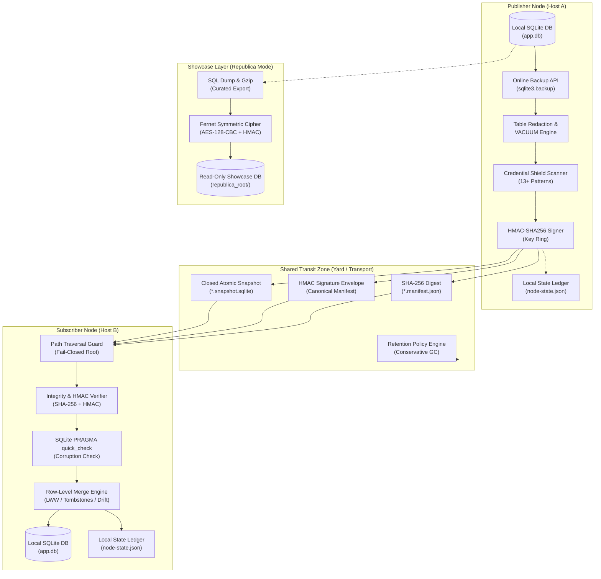
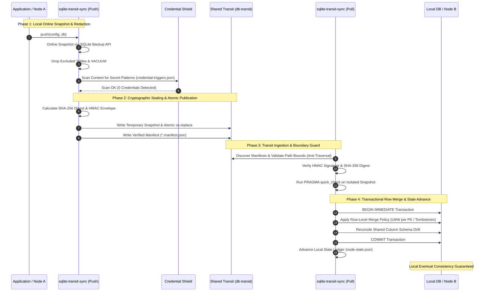

# sqlite-transit-sync


[](https://github.com/ellmos-ai/sqlite-transit-sync/actions/workflows/ci.yml)
[](CHANGELOG.md)
[](#tests)
[](#tests)
[](https://www.python.org/)
[](#)
[](#)
[](THIRD_PARTY_LICENSES.md)
[](SECURITY.md)
[](SECURITY.md)
[](CONTRIBUTING.md)
[](THIRD_PARTY_LICENSES.md)
[](THIRD_PARTY_LICENSES.txt)
[](NOTICE)
[](MARKETING-LOG.txt)
[](LICENSE)
[](https://github.com/ellmos-ai)
[](https://github.com/open-bricks)
[](llms.txt)

> [!NOTE]
> **Contexto para LLM y agentes de IA**: El índice estructurado y legible por máquinas, la descripción general de la arquitectura y la guía de la API están disponibles en [`llms.txt`](llms.txt).

**🇬🇧 [Versión en inglés](README.md)** | **🇩🇪 [Versión en alemán](README_de.md)** | **🇪🇸 Español** | **🤝 [Contribuir](CONTRIBUTING.md)** | **🛡️ [Política de seguridad](SECURITY.md)** | **📝 [Registro de cambios](CHANGELOG.md)** | **📋 [llms.txt](llms.txt)**

<a id="-quick-navigation"></a>
## 🧭 Navegación rápida

1. [Resumen ejecutivo e identidad principal](#what-is-sqlite-transit-sync)
2. [Topología visual de la arquitectura y capas desacopladas](#system-architecture-topology)
3. [Ciclo de vida integral de instantáneas y sincronización](#end-to-end-snapshot-synchronization-lifecycle)
4. [Perfiles de usuario objetivo y consultas SEO de alta intención](#marketing--target-personas)
5. [Matriz comparativa de alternativas](#comparison-with-distributed-sql)
6. [Matriz de gobernanza e invariantes de ejecución](#governance-runtime-invariants-matrix)
7. [Capacidades básicas y funciones desacopladas](#what-it-provides)
8. [Proyecciones de aplicaciones de solo lectura](#read-only-application-projections)
9. [Instalación y requisitos previos](#install)
10. [Inicio rápido y flujo de trabajo multinodo](#quick-start)
11. [Referencia de configuración y activadores de credenciales](#configuration)
12. [Exhibición de Republica y método de cifrado](#republica-the-showcase-method)
13. [API de Python y puntos de extensión](#python-api)
14. [Seguridad, modelo de amenazas y límites operativos](#safety-and-limits)
15. [Licencias de terceros y SBOM de nivel 1](#third-party-licenses--transparency)
16. [Ecosistema, herramientas relacionadas y paquetes](#ecosystem--sibling-tools)
17. [Pruebas, verificación y matriz de CI](#tests)
18. [Aviso legal, limitación de responsabilidad y licencia (§ 521 BGB)](#license)

---

<a id="what-is-sqlite-transit-sync"></a><a id="core-identity"></a><a id="executive-summary--core-identity"></a>
<a id="1-executive-summary--core-identity"></a>
## 1. Resumen ejecutivo e identidad principal

La versión, el estado del módulo, la visibilidad y la autoridad de la fecha de verificación se definen en [`METADATA_CONTRACT.md`](METADATA_CONTRACT.md); no constituyen una aprobación para publicar una versión ni para cargarla públicamente.

Sincronización local primero de bases de datos SQLite independientes mediante instantáneas verificadas y políticas de combinación seleccionables por la aplicación. Se extrajo de la arquitectura ProSync de BACH sin dependencias de BACH, OneDrive, nombres de host ni rutas de usuario.

Esto **no es un servidor SQL distribuido**. Cada nodo es propietario de su propia base de datos local y solo la abre allí. Una carpeta compartida, un montaje de almacenamiento de objetos, una unidad extraíble u otro medio de transporte de archivos lleva instantáneas cerradas junto con sus manifiestos. Al importar una instantánea, se verifica y se combina con la base de datos local dentro de una sola transacción.

Se complementa bien con [sync-master](https://github.com/dev-bricks/sync-master) (de la misma familia de módulos): un área de sync-master es un medio de transporte natural; configura `--transit` para que apunte a una zona `db-transit/<namespace>/` administrada por la herramienta dentro del área (su regla de protocolo R9). sync-master transporta los documentos; este módulo se ocupa de la integridad y la combinación de bases de datos. Ambos siguen siendo independientes.

---

<a id="system-architecture-topology"></a><a id="system-architecture"></a>
<a id="2-visual-architecture-topology--decoupled-layers"></a>
## 2. Topología visual de la arquitectura y capas desacopladas

El siguiente diagrama muestra la topología desacoplada de varios nodos, en la que las bases de datos SQLite locales se conectan exclusivamente mediante paquetes de instantáneas cerradas y verificadas en el almacenamiento de tránsito:



<a id="ascii-four-view-architectural-projection"></a>
### Proyección arquitectónica ASCII de cuatro vistas

```text
+-------------------------------------------------------------------------------------------------------------------+
|                               SQLITE-TRANSIT-SYNC: FOUR-VIEW ARCHITECTURAL TOPOLOGY                               |
+-------------------------------------------------------------------------------------------------------------------+
| [VIEW 1: PUBLISHER NODE]               [VIEW 2: SHARED TRANSIT YARD]              [VIEW 3: SUBSCRIBER NODE]       |
|                                                                                                                   |
| +-------------------------+              +-----------------------------+            +---------------------------+ |
| | Local SQLite Database   |              |  Closed Transit Zone        |            | Path Traversal Guard      | |
| | (app.db - Exclusive RW) |              |  (Folder / Sync-Master / S3)|            | (Canonical Bounds Check)  | |
| +------------+------------+              +--------------+--------------+            +-------------+-------------+ |
|              |                                          ^                                         |               |
|              v (sqlite3.backup)                         |                                         v               |
| +------------+------------+                             |                           +-------------+-------------+ |
| | Online Consistent Backup|                             |                           | SHA-256 Digest & HMAC     | |
| | (Closed Rollback-Journal|                             |                           | Signature Verification    | |
| +------------+------------+                             |                           +-------------+-------------+ |
|              |                                          |                                         |               |
|              v                                          |                                         v               |
| +------------+------------+                             |                           +-------------+-------------+ |
| | Redaction & VACUUM      |                             |                           | SQLite PRAGMA quick_check | |
| | (Exclude Sensitive Data)|                             |                           | (Integrity Verification)  | |
| +------------+------------+                             |                           +-------------+-------------+ |
|              |                                          |                                         |               |
|              v                                          |                                         v               |
| +------------+------------+                             |                           +-------------+-------------+ |
| | Credential Shield       |                             |                           | Transactional Merge Engine| |
| | (13+ Vendor Regex Scan) |                             |                           | (Row-Level LWW / Drift)   | |
| +------------+------------+                             |                           +-------------+-------------+ |
|              |                                          |                                         |               |
|              v                                          |                                         v               |
| +------------+------------+              +--------------+--------------+            +-------------+-------------+ |
| | HMAC-SHA256 Signer      |              |  *.snapshot.sqlite (Atomic) |            | Local SQLite Database     | |
| | (Keyring Authenticator) |------------->|  *.manifest.json   (Digest) |----------->| (app.db - Merged State)   | |
| +-------------------------+              |  Retention Engine  (Scoped) |            +-------------+-------------+ |
|                                          +-----------------------------+                          |               |
|                                                                                                   v               |
|                                                                                     +-------------+-------------+ |
|                                                                                     | Local State Ledger        | |
|                                                                                     | (node-state.json)         | |
|                                                                                     +---------------------------+ |
+-------------------------------------------------------------------------------------------------------------------+
| [VIEW 4: REPUBLICA SHOWCASE / COURIER ENVELOPE (OPTIONAL ZERO-TRUST TRANSPORT)]                                   |
|                                                                                                                   |
| Local Database ----> Curated SQL Dump ----> Gzip Compression ----> AES-128-CBC (Fernet) ----> Encrypted Outpost   |
| (Source Node)       (FTS Rebuilt on Dest)   (53MB -> 11MB)         (Pre-Shared Key)          (republica_root/)    |
|                                                                                                                   |
| Single Secret File -> Fernet Cipher Envelope -> Courier Transit -> Destination Directory (Mode 0600, Transit Clr)|
+-------------------------------------------------------------------------------------------------------------------+
```

---

<a id="end-to-end-snapshot-synchronization-lifecycle"></a><a id="lifecycle"></a>
<a id="3-end-to-end-snapshot--synchronization-lifecycle"></a>
## 3. Ciclo de vida integral de instantáneas y sincronización

El flujo de sincronización integral garantiza que las bases de datos activas nunca queden expuestas a bloqueos de sincronización a nivel de archivo, y que todos los datos que cruzan los límites entre nodos se autentiquen criptográficamente, se analicen en busca de credenciales y se combinen transaccionalmente:



---

<a id="marketing--target-personas"></a><a id="target-personas--discoverability-queries"></a><a id="target-personas"></a>
<a id="4-target-personas--high-intent-seo-queries"></a>
## 4. Perfiles de usuario objetivo y consultas SEO de alta intención

Diseñado para ecosistemas modulares y descentralizados, `sqlite-transit-sync` se dirige a cuatro perfiles principales de partes interesadas:

- **`[PERSONA-01]` Ingenieros de agentes autónomos de IA y arquitectos de enjambres multinodo:**
  - *Problema:* Los enjambres multiagente que funcionan en estaciones de trabajo, portátiles y servidores necesitan persistencia del estado local sin colisiones entre bloqueos de archivos.
  - *Solución:* Las instantáneas de tránsito desacopladas con protección de credenciales evitan que los tokens se filtren al almacenamiento compartido y, a la vez, mantienen la convergencia asíncrona.
- **`[PERSONA-02]` Desarrolladores de aplicaciones de escritorio multidispositivo y de edge:**
  - *Problema:* Los usuarios avanzados que intercambian notas personales y bases de datos de tareas mediante sincronización de archivos (por ejemplo, sync-master, Syncthing o Nextcloud) sufren daños en las bases de datos y bloqueos de `-wal`.
  - *Solución:* La publicación atómica mediante la API de copia de seguridad de SQLite y la combinación transaccional a nivel de fila garantizan que los archivos SQLite locales nunca queden expuestos directamente a demonios de sincronización en la nube.
- **`[PERSONA-03]` Creadores de herramientas local-first, zero-egress y aisladas de redes:**
  - *Problema:* Las aplicaciones que requieren verdadera soberanía de los datos no pueden aceptar la dependencia de un proveedor de nube, tarifas recurrentes de alojamiento de bases de datos ni tráfico de red en segundo plano.
  - *Solución:* Sincronización con capacidad totalmente fuera de línea mediante directorios del sistema de archivos local, puntos de montaje o unidades extraíbles, sin dependencias externas.
- **`[PERSONA-04]` Responsables de seguridad empresarial, privacidad y cumplimiento:**
  - *Problema:* Los requisitos estrictos de zero-trust prohíben la sincronización accidental de credenciales, los blobs binarios sin verificar y los servicios en segundo plano con privilegios elevados.
  - *Solución:* Análisis de regex antes de la publicación para más de 13 familias de secretos (`credential-triggers.json`), sellado de manifiestos con HMAC, verificación de integridad SHA-256 y ejecución sin privilegios en modo de usuario mediante `RunAsInvoker`.

<a id="high-intent-search-queries-bilingual-en--de"></a>
### Consultas de búsqueda de alta intención (bilingües EN y DE)

| Categoría de intención | Consultas de búsqueda en inglés (EN) | Términos de búsqueda en alemán (DE) |
|:---|:---|:---|
| **Sincronización local primero** | `sqlite synchronization python zero-dependency`, `local-first database snapshot sync`, `offline sqlite multi-device sync` | `lokale datenbank synchronisation offline snapshots`, `sqlite abgleich python ohne abhaengigkeiten`, `lokale datenbank replikation dateibasiert` |
| **Integridad y protección de credenciales** | `credential shielded sqlite transfer zero-egress`, `hmac verified sqlite snapshot manifest`, `anti-traversal sqlite transit sync` | `zero egress datenbank replikation snapshot`, `geheimsichere sqlite synchronisation regex`, `integritaetsgepruefte datenbank snapshote` |
| **Combinación a nivel de fila y conflictos** | `row level merge lww sqlite offline`, `sqlite last write wins schema drift tolerance`, `tombstone merge policy sqlite` | `row level merge lww sqlite offline`, `last-write-wins datenbank abgleich zeitstempel`, `schema drift toleranz sqlite merge` |
| **Arquitectura desacoplada** | `sqlite multi-node sync without distributed sql`, `sqlite over syncthing without corruption`, `sqlite transit yard architecture` | `sqlite synchronisation ohne verteilten server`, `sqlite ueber cloud sync ohne datenbankkorruption`, `transit yard sqlite synchronisation` |

Para consultar el desglose detallado de los perfiles, las consultas de búsqueda de alta intención y el posicionamiento frente a alternativas, véase [MARKETING-LOG.txt](MARKETING-LOG.txt).

---

<a id="comparison-with-distributed-sql"></a><a id="comparative-matrix--alternatives"></a><a id="comparative-matrix"></a>
<a id="5-comparative-matrix-vs-alternatives"></a>
## 5. Matriz comparativa de alternativas

La tabla siguiente compara `sqlite-transit-sync` con cuatro enfoques arquitectónicos habituales para sincronizar bases de datos entre nodos, según diez dimensiones técnicas básicas e invariantes de ejecución:

| Dimensión técnica | Invariante | `sqlite-transit-sync` | SQL distribuido (Cockroach/TiDB) | Litestream / LiteFS | SQLite directo sobre sincronización en la nube | Scripts ad hoc de volcados/JSON |
|:---|:---|:---|:---|:---|:---|:---|
| **1. Privacidad de ejecución y egreso** | `INV-LOCAL-01` | **100% local-first / zero-egress** | Requiere una red de clúster multinodo | Replicación en flujo a S3/nube | Depende de un servicio de sincronización en la nube de terceros | Sin verificar / manual |
| **2. Atomicidad de las instantáneas** | `INV-SNAP-02` | **API de copia de seguridad en línea + `os.replace` atómico** | Consenso distribuido Raft/Paxos | Transmisión continua de marcos WAL | Sincronización parcial de archivos mientras la base está activa | Copia descoordinada de la base mientras está bloqueada |
| **3. Contención de bloqueos y archivos auxiliares** | `INV-ROLL-03` | **Eliminación fail-closed de `-wal`/`-shm`** | Gestor de bloqueos distribuido / MVCC | Requiere supervisión activa de WAL | Errores de bloqueo de SQLite fatales y conflictos de archivos | Tiempos de espera de bloqueos sin gestionar |
| **4. Protección de límites del sistema de archivos** | `INV-PATH-04` | **Contención estricta en la raíz y protección contra recorridos de rutas** | Límite del protocolo de sockets de red | Ruta de clave del almacén de objetos | Sincronización de rutas del sistema de archivos del host | Rutas de archivos sin restricciones |
| **5. Verificación de integridad y estado** | `INV-VERIFY-05` | **SHA-256 + `PRAGMA quick_check` de SQLite** | Sumas de comprobación del registro Raft | Sumas de comprobación de segmentos WAL | Ninguna (se basa en tamaño/hash del archivo) | Ninguna o análisis JSON frágil |
| **6. Protección de credenciales** | `INV-SHIELD-06` | **Análisis antes de publicar (más de 13 familias de secretos)** | RBAC de roles de base de datos | Ninguna (replica todos los bytes) | Ninguna (exfiltra secretos a la nube) | Ninguna |
| **7. Autenticidad y sobre de datos** | `INV-HMAC-07` | **Firma HMAC-SHA256 sobre el manifiesto** | TLS mutuo (mTLS) | IAM en la nube / AWS SigV4 | Token del proveedor de nube | Ninguna |
| **8. Combinación de filas y divergencia del esquema** | `INV-MERGE-08` | **LWW transaccional por PK + tombstones** | Transacciones ACID serializables globales | Restauración de la réplica completa (sin combinación de filas) | Copias binarias de conflicto (sin combinación de filas) | Scripts SQL personalizados frágiles |
| **9. Retención y ámbito multinodo** | `INV-RET-09` | **Simulación por defecto, limpieza limitada al nodo** | TTL automatizado / compactación de tablas | Ciclo de vida del bucket S3 | Papelera de reciclaje de la nube / historial de versiones | Crecimiento de disco sin control |
| **10. No elevación de privilegios y SLA de plataforma** | `INV-SLA-10` | **RunAsInvoker sin privilegios, SLA de 48 h** | Configuración compleja de demonios en varios servidores | Demonio dedicado en segundo plano | Demonio de sistema en segundo plano | Ejecución sin verificar |

<a id="distributed-sql-detailed-comparison"></a>
### Comparación detallada con SQL distribuido

| Aspecto | `sqlite-transit-sync` | SQL distribuido, por ejemplo CockroachDB o YugabyteDB |
|---|---|---|
| Modelo básico | Cada nodo es propietario de una base SQLite local independiente | Todos los servidores forman una única base de datos SQL lógica |
| Escrituras | Primero locales y sincronizadas más tarde | Coordinadas directamente por el clúster |
| Sincronización | Importación asíncrona de instantáneas y combinación de filas | Replicación continua entre nodos del clúster |
| Consistencia | Consistencia eventual tras el intercambio correcto | Normalmente consistencia fuerte o serializable |
| Consenso y quórum | No requiere ninguno | Normalmente consenso mayoritario basado en Raft |
| Transacciones globales | No | Sí, incluidas transacciones que abarcan nodos o fragmentos |
| Gestión de conflictos | `MergePolicy` específico de la aplicación; LWW por marca temporal es el valor predeterminado | Transacciones, MVCC, bloqueos y consenso |
| Operación sin conexión | El nodo puede seguir leyendo y escribiendo de forma independiente | Las escrituras normalmente requieren un quórum accesible |
| Interrupción de red | El trabajo local continúa; la sincronización espera | Las particiones minoritarias pueden perder la disponibilidad de escritura |
| Gestión de fallos | Las bases de datos locales siguen disponibles; el tránsito y las copias de seguridad necesitan protección aparte | Replicación y conmutación por error automáticas mientras haya quórum |
| Visibilidad de los datos | Los cambios se comparten después de publicarlos e importarlos | Los cambios confirmados son autoritativos de inmediato en el clúster |
| Cambios de esquema | La aplicación migra cada base de datos local | Migraciones SQL para todo el clúster |
| Eliminaciones | Requieren tombstones o una política personalizada | Eliminaciones SQL transaccionales normales |
| Infraestructura | Python, SQLite y un transporte de archivos configurable | Varios servidores de bases de datos permanentes, TLS, supervisión y copias de seguridad |
| Mínimo de servidores siempre activos | Ninguno; basta con un nodo | Normalmente al menos tres para tolerancia a fallos |
| Fortaleza principal | Simplicidad offline-first, bajo coste y reglas de combinación específicas del dominio | Consistencia fuerte, escritores simultáneos y alta disponibilidad |
| Limitación principal | No ofrece transacciones ACID globales ni una verdad compartida inmediata | Complejidad operativa y consumo de recursos considerablemente mayores |

<a id="advantages-disadvantages-and-typical-use-cases"></a>
### Ventajas, desventajas y casos de uso típicos

| Sistema | Ventajas | Desventajas | Buenos casos de uso | Malos casos de uso |
|---|---|---|---|---|
| `sqlite-transit-sync` | Muy ligero; funciona sin conexión; no necesita servidor central; privacidad local; independiente del transporte; las reglas de combinación se adaptan al dominio de la aplicación | Visibilidad con retraso; la aplicación define la gestión de conflictos, eliminaciones, relojes y migraciones; no ofrece ACID global ni conmutación por error basada en quórum | Bases de datos personales de conocimiento y tareas; agentes de IA locales; intercambio entre portátiles, estaciones de trabajo y servidores; aplicaciones de campo y edge; software de escritorio con sincronización opcional; notas de investigación | Pagos, inventario escaso, reservas de asientos, colaboración en tiempo real sobre los mismos registros o muchos escritores simultáneos |
| SQL distribuido | Base de datos compartida y autoritativa; consistencia fuerte; transacciones globales; escrituras concurrentes coordinadas; replicación y conmutación por error automáticas; escalado horizontal | Requiere servidores permanentes, redes, certificados, supervisión y actualizaciones; el quórum puede reducir la disponibilidad de escritura durante particiones; mayor latencia y coste | Sistemas financieros y de reservas; plataformas SaaS; inventario de comercio electrónico; cuentas globales; backends multijugador; servicios empresariales de alta disponibilidad | Herramientas personales pequeñas, dispositivos conectados de forma intermitente, aplicaciones de escritorio monousuario o cargas de trabajo que SQLite local ya resuelve de forma fiable |

<a id="quick-decision-guide"></a>
### Guía rápida para decidir

| Requisito | Preferir |
|---|---|
| Los nodos deben seguir funcionando sin conexión | `sqlite-transit-sync` |
| Las actualizaciones pueden hacerse visibles después de un paso de sincronización | `sqlite-transit-sync` |
| Los datos deben permanecer locales y los conflictos son poco frecuentes | `sqlite-transit-sync` |
| Muchos clientes modifican simultáneamente los mismos registros | SQL distribuido |
| Cada confirmación debe ser autoritativa globalmente de inmediato | SQL distribuido |
| Son obligatorias las transacciones globales o la conmutación por error automática del clúster | SQL distribuido |

Para un número reducido de dispositivos personales o edge conectados de forma intermitente, `sqlite-transit-sync` suele ser la opción más sencilla. Un servicio PostgreSQL centralizado suele ser el siguiente paso cuando aparecen escritores realmente concurrentes. SQL distribuido resulta atractivo cuando también se necesita que la consistencia fuerte sobreviva a fallos de servidores en varios nodos operados permanentemente.

---

<a id="governance-runtime-invariants-matrix"></a><a id="governance--runtime-invariants"></a>
<a id="6-governance--runtime-invariants-matrix"></a>
## 6. Matriz de gobernanza e invariantes de ejecución

`sqlite-transit-sync` cumple estrictamente diez invariantes básicos de gobernanza y ejecución para garantizar la integridad de los datos, el aislamiento de límites y la seguridad:

| # | Invariante | Ámbito arquitectónico | Garantía y mecanismo de verificación |
|---|---|---|---|
| 1 | **INV-LOCAL-01: local-first al 100% y zero-egress** | Arquitectura del sistema | Opera exclusivamente sobre archivos locales de bases de datos SQLite (`app.db`). Sin telemetría, sin llamadas HTTP/API salientes y sin dependencias de nube. |
| 2 | **INV-SNAP-02: atomicidad de instantáneas offline** | Publicación al tránsito | Los archivos de bases de datos activas nunca se comparten mediante sincronización de archivos. Las instantáneas en línea se obtienen con `sqlite3.backup` y se publican mediante `os.replace` atómico. |
| 3 | **INV-ROLL-03: aislamiento limpio del diario de reversión** | Prevención de archivos auxiliares | Las copias de seguridad se cierran en modo de diario de reversión; todos los archivos auxiliares temporales de SQLite (`-wal`, `-shm`, `-journal`) se limpian de forma fail-closed antes de crear el manifiesto. |
| 4 | **INV-PATH-04: contención estricta de las rutas de tránsito** | Límite del sistema de archivos | Las rutas de manifiestos e instantáneas deben ser archivos regulares directos dentro de la raíz canónica de tránsito. El recorrido de rutas (`../`), los enlaces simbólicos y los puntos de reanálisis fallan de forma cerrada. |
| 5 | **INV-VERIFY-05: verificación de integridad y estado en dos etapas** | Validación antes de combinar | Cada instantánea recibida debe superar la coincidencia del resumen criptográfico SHA-256 y `PRAGMA quick_check` de SQLite antes de inspeccionar o combinar datos. |
| 6 | **INV-SHIELD-06: protección de credenciales antes de publicar** | Inspección del contenido | El contenido se analiza sistemáticamente para detectar patrones de credenciales de más de 13 familias de secretos (`credential-triggers.json`). Si un activador coincide, la publicación se cancela de forma fail-closed y se indica `table.column`. |
| 7 | **INV-HMAC-07: sobre de autenticidad HMAC** | Identidad y no repudio | Sobre de firma HMAC-SHA256 opcional y conectable sobre la carga canónica del manifiesto (protocolo, espacio de nombres, ID del remitente, nombre de archivo, SHA-256, tamaño y lista de redacción). |
| 8 | **INV-MERGE-08: combinación determinista a nivel de fila** | Convergencia de datos | Combinación transaccional a nivel de fila (LWW por PK, unión de columnas compartidas para tolerar divergencias del esquema y política explícita de tombstones). El desempate por hash de contenido garantiza una convergencia determinista. |
| 9 | **INV-RET-09: retención conservadora y ámbito de autoridad** | Recolección de basura | La limpieza de instantáneas es una simulación por defecto y se limita estrictamente a los artefactos del nodo local. La eliminación entre nodos (`--all-nodes`) requiere habilitación administrativa explícita. |
| 10 | **INV-SLA-10: sin elevación de privilegios y paridad entre sistemas operativos** | Entorno de ejecución | Se ejecuta sin privilegios, en modo de usuario (`RunAsInvoker`). Paridad operativa estricta entre Linux, Microsoft Windows y macOS, sin dependencias nativas externas y con un SLA de seguridad de 48 h. |

---

<a id="what-it-provides"></a><a id="core-capabilities"></a><a id="part-of-the-ellmos-stack-family"></a>
<a id="7-core-capabilities--decoupled-features"></a>
## 7. Capacidades básicas y funciones desacopladas

`sqlite-transit-sync` complementa a [dev-bricks/sync-master](https://github.com/dev-bricks/sync-master) dentro de la misma familia de módulos: sync-master se ocupa del transporte de archivos (`sync.files`); este módulo, de la integridad y combinación de bases de datos (`sync.database`). Ambos pueden funcionar por separado o componerse en stacks de la familia [ellmos-ai](https://github.com/ellmos-ai); véase el catálogo de [ellmos-ai/stacks](https://github.com/ellmos-ai/stacks). Su función en ese conjunto de herramientas: no transmitir bases SQLite activas mediante sincronización de archivos, sino únicamente instantáneas verificadas y políticas de combinación seleccionables por la aplicación.

<a id="key-capabilities"></a>
### Capacidades clave

- instantáneas coherentes en línea mediante la API de copia de seguridad de SQLite;
- publicación atómica mediante un archivo temporal y `os.replace`;
- instantáneas cerradas en modo de diario de reversión, con limpieza fail-closed de todos los archivos auxiliares temporales de SQLite antes de publicar;
- las rutas de manifiestos e instantáneas se limitan a archivos regulares directos del directorio canónico de tránsito; el recorrido de rutas, las rutas absolutas, los enlaces simbólicos y los puntos de reanálisis fallan de forma cerrada antes de calcular hashes o combinar datos;
- verificación de manifiestos con SHA-256 y `PRAGMA quick_check`;
- autenticación HMAC-SHA256 opcional, inyectada mediante la API, sobre el manifiesto canónico, la identidad del remitente, la versión del protocolo y el hash de la instantánea, con ID de clave explícito;
- estado de importación local por nodo y repetición idempotente;
- last-write-wins a nivel de fila por clave primaria para tablas con marcas temporales;
- adaptador de referencia `TombstoneMergePolicy` opcional para eliminaciones explícitas;
- combinación de columnas compartidas para tolerar divergencias básicas del esquema;
- exclusión de tablas configurable y redacción de instantáneas con VACUUM después de eliminar filas;
- análisis de credenciales a nivel de contenido que cancela la publicación si la instantánea aún contiene valores con aspecto de credencial (activado por defecto; informa `table.column`, nunca el valor);
- compatibilidad con `MergePolicy` personalizada para reglas de dominio, tombstones o CRDT;
- limpieza verificada de instantáneas, con simulación por defecto, ámbito del nodo local por defecto y habilitación explícita para eliminar datos o administrar nodos externos;
- importaciones pendientes seleccionadas para adaptadores ligeros del ciclo de vida de aplicaciones, sin duplicar la lógica de combinación ni de avance del estado;
- contratos de proyección de solo lectura, versionados y estrictos, con listas exactas de esquemas y privacidad, procedencia, puntos de control, bucles y verificación de tombstones offline;
- un [modo de exhibición Republica](#republica-the-showcase-method) opcional que distribuye una base de datos en una sola dirección como carga cifrada y la materializa como una exhibición independiente de solo lectura, en lugar de combinarla;
- API de Python y CLI JSON sin dependencias (el modo Republica añade `cryptography`).

---

<a id="read-only-application-projections"></a><a id="projections"></a>
<a id="8-read-only-application-projections"></a>
## 8. Proyecciones de aplicaciones de solo lectura

`verify-projection` valida una proyección SQLite cerrada y propiedad de la aplicación sin copiar, combinar, migrar, programar ni avanzar el estado. La aplicación proporciona la identidad de su consumidor y el intervalo máximo sin conexión que ha revisado; el verificador rechaza bucles, puntos de control obsoletos, retención insuficiente de tombstones, tablas o columnas no incluidas en la lista permitida y referencias de registros que no sean opacas.

Se incluyen seis contratos acotados para resúmenes de saldos de cuentas, estado de suscripciones de AboTracker, fechas de reposición de HausLagerist, estado de vencimientos y avisos de inventario de medicamentos, estado de vencimiento y finalización de rutinas y plazos de seguros. El contrato de AboTracker solo incluye el estado, porque el esquema de exportación v1 no tiene una fecha siguiente de vencimiento o renovación confirmada; nunca calcula un recordatorio sumando la fecha de pago y el ciclo de facturación. Los casos de prueba son recetas JSON sintéticas, y las identidades de dominio y los datos privados quedan fuera de las listas permitidas.

Los nombres incluidos son `abotracker-subscription-status-projection.v1`, `accounts-balance-projection.v1`, `hauslagerist-replenishment-projection.v1`, `mediplaner-reminder-projection.v1`, `routinika-reminder-projection.v1` y `versicherungsmanager-deadline-projection.v1`. Véanse los [contratos de proyección de solo lectura](PROJECTION_CONTRACTS.md) y su [versión en alemán](PROJECTION_CONTRACTS_de.md).

```bash
sqlite-transit-sync verify-projection \
  --contract mediplaner-reminder-projection.v1 \
  --database ./closed-projection.sqlite \
  --consumer-id reminder-consumer \
  --minimum-offline-seconds 2592000 \
  --previous-checkpoint 41
```

---

<a id="install"></a><a id="installation"></a>
<a id="9-installation--prerequisites"></a>
## 9. Instalación y requisitos previos

```bash
python -m pip install -e .
```

---

<a id="quick-start"></a><a id="quickstart"></a>
<a id="10-quickstart--multi-node-workflow"></a>
## 10. Inicio rápido y flujo de trabajo multinodo

Crea una configuración en cada nodo. Cada uno usa su propia base de datos y archivo de estado, pero todos comparten el mismo directorio de tránsito y espacio de nombres.

```bash
sqlite-transit-sync init \
  --config node.json \
  --database ./app.db \
  --transit ./shared-transit \
  --node-id laptop \
  --namespace my-app

sqlite-transit-sync push --config node.json
sqlite-transit-sync pull --config node.json --dry-run
sqlite-transit-sync pull --config node.json
sqlite-transit-sync status --config node.json
sqlite-transit-sync verify --config node.json
sqlite-transit-sync cleanup --config node.json
# Review the JSON plan, then explicitly apply it:
sqlite-transit-sync cleanup --config node.json --apply
```

El esquema de la aplicación debe existir ya en cada nodo. La copia inicial automática está deshabilitada deliberadamente, porque un módulo genérico no puede decidir qué esquema, secretos, tablas locales o migraciones corresponden a una aplicación.

<a id="standalone-runnable-python-quickstart-zero-external-dependencies"></a>
### Inicio rápido ejecutable de Python independiente (sin dependencias externas)

Los desarrolladores que integren `sqlite-transit-sync` directamente en marcos de agentes, demonios o procesos de trabajo en segundo plano pueden ejecutar este script autónomo, listo para copiar y pegar, para verificar la sincronización multinodo integral sin dependencias externas:

```python
import sqlite3
from contextlib import closing
import tempfile
from pathlib import Path
from sqlite_transit_sync import SyncConfig, TransitSync

with tempfile.TemporaryDirectory() as tmp:
    root = Path(tmp)
    transit = root / "transit"
    transit.mkdir()

    # 1. Initialize Node A and record local data
    db_a = root / "node_a.db"
    with closing(sqlite3.connect(db_a)) as conn, conn:
        conn.execute("CREATE TABLE notes (id INTEGER PRIMARY KEY, title TEXT, updated_at TEXT)")
        conn.execute("INSERT INTO notes VALUES (1, 'Hello from Node A', '2026-10-18T08:00:00Z')")

    # 2. Publish atomic snapshot from Node A to shared transit
    cfg_a = SyncConfig(database=db_a, transit=transit, state=root / "state_a.json", node_id="node_a", namespace="demo")
    snapshot = TransitSync(cfg_a).push()
    print(f"Node A published snapshot: {snapshot.path.name} (SHA-256: {snapshot.sha256[:8]}...)")

    # 3. Initialize Node B with schema and pull snapshot
    db_b = root / "node_b.db"
    with closing(sqlite3.connect(db_b)) as conn, conn:
        conn.execute("CREATE TABLE notes (id INTEGER PRIMARY KEY, title TEXT, updated_at TEXT)")

    cfg_b = SyncConfig(database=db_b, transit=transit, state=root / "state_b.json", node_id="node_b", namespace="demo")
    reports = TransitSync(cfg_b).pull()

    # 4. Verify converged state in Node B
    with closing(sqlite3.connect(db_b)) as conn, conn:
        rows = conn.execute("SELECT id, title, updated_at FROM notes").fetchall()
        print(f"Node B converged records: {rows}")
        assert rows == [(1, "Hello from Node A", "2026-10-18T08:00:00Z")]
```

---

<a id="configuration"></a><a id="configuration-reference"></a>
<a id="11-configuration-reference--credential-triggers"></a>
## 11. Referencia de configuración y activadores de credenciales

```json
{
  "database": "./app.db",
  "transit": "./shared-transit",
  "state": "./node-state.json",
  "node_id": "laptop",
  "namespace": "my-app",
  "timestamp_columns": ["updated_at", "modified_at", "created_at"],
  "exclude_tables": ["secrets", "sqlite_sequence"],
  "snapshot_exclude_tables": ["secrets"],
  "scan_snapshot_for_secrets": true,
  "secret_scan_skip_tables": [],
  "secret_scan_extra_patterns": [],
  "secret_patterns_file": null
}
```

Las rutas relativas se resuelven a partir del archivo de configuración. La base de datos activa nunca debe estar dentro del directorio de tránsito, y el archivo de estado debe estar fuera del árbol de tránsito. `SyncConfig`, `from_file`, `from_bytes` y `init` de la CLI rechazan una ruta de estado no válida antes de crear directorios de tránsito o de estado; no se realiza ninguna migración automáticamente.

Las aplicaciones que necesiten un hash de auditoría de exactamente la configuración analizada pueden leer los bytes una vez y usar el mismo analizador relativo al origen, sin volver a leer el archivo:

```python
import hashlib
from pathlib import Path

from sqlite_transit_sync import SyncConfig

config_path = Path("node.json").resolve()
payload = config_path.read_bytes()
config = SyncConfig.from_bytes(payload, source_path=config_path)
config_sha256 = hashlib.sha256(payload).hexdigest()
```

<a id="all-keys-and-their-defaults"></a>
### Todas las claves y sus valores predeterminados

| Clave | Valor predeterminado | Significado |
|---|---|---|
| `database` | *(obligatorio)* | Base de datos SQLite activa propiedad de este nodo |
| `transit` | *(obligatorio)* | Directorio compartido que contiene instantáneas y manifiestos |
| `state` | `./.sync-state.json` | Estado de importación por nodo; mantenlo fuera del tránsito |
| `node_id` | nombre de host de la máquina | Identifica el nodo que publica en los nombres de las instantáneas |
| `namespace` | `"default"` | Separa conjuntos de datos distintos en un mismo tránsito |
| `timestamp_columns` | `["updated_at","modified_at","created_at"]` | Columnas consultadas para aplicar last-write-wins |
| `exclude_tables` | `["secrets","sqlite_sequence"]` | Tablas que nunca se **combinan** en la base local |
| `snapshot_exclude_tables` | `["secrets"]` | Tablas cuyas filas se **eliminan de la instantánea** antes de publicarla (después se ejecuta `VACUUM`) |
| `scan_snapshot_for_secrets` | `true` | Cancela la publicación cuando el contenido de la instantánea aún parece contener una credencial |
| `secret_scan_skip_tables` | `[]` | Tablas que omite el análisis; úsalo para una sola tabla ruidosa en vez de desactivar el análisis |
| `secret_scan_extra_patterns` | `[]` | Expresiones regulares adicionales, además de las del archivo de activadores |
| `secret_patterns_file` | `null` (archivo incluido) | Ruta a un archivo de activadores propio; **sustituye** los patrones integrados |
| `key_file` | `null`, o `$SQLITE_TRANSIT_SYNC_KEY_FILE` | Clave Fernet para el modo Republica; debe permanecer fuera del tránsito |
| `republica_root` | `~/.republica` | Ubicación donde se escriben las exhibiciones importadas; debe permanecer fuera del tránsito |
| `allow_key_in_synced_folder` | `false` | Omite la comprobación que rechaza una clave dentro de una carpeta sincronizada en la nube |

El valor predeterminado de `state` de esta tabla se aplica al cargar una configuración JSON que no incluya esa clave. En cambio, `sqlite-transit-sync init` escribe `.<config-stem>-state.json` si se omite `--state` (para `node.json`: `.node-state.json`).

<a id="the-credential-scan-and-how-to-turn-it-off"></a>
### El análisis de credenciales y cómo desactivarlo

`snapshot_exclude_tables` solo puede descartar una tabla que ya hayas previsto. El análisis responde a una pregunta que esa regla no resuelve: *¿se ha pegado una credencial en una columna de texto libre*, como una nota, una línea de registro o un resumen de sesión? Se ejecuta sobre la copia de la instantánea después de redactarla y antes de publicarla. Si encuentra una coincidencia, genera `SyncError` e indica `table.column`; nunca incluye el valor coincidente, de modo que la credencial no llega a los registros, los seguimientos de errores ni la salida de CI. La instantánea parcial se descarta y nada llega al directorio de tránsito.

**Límite entre preparación y publicación:** Las copias sin depurar, la redacción y
el análisis se realizan en un directorio temporal por llamada junto al estado local
configurado, fuera del tránsito canónico. Republica también prepara allí SQL/gzip en
claro y cifra antes de copiar al tránsito. El directorio del estado debe ser local,
privado y estar fuera de carpetas compartidas o sincronizadas. Otras raíces de
sincronización y procesos de la misma cuenta del sistema quedan fuera de esta garantía;
el análisis opcional de patrones no detecta todos los secretos.

Solo los bytes verificados de la instantánea (push normal) o el texto cifrado
(Republica) se copian a un archivo temporal de tránsito creado de forma exclusiva.
Tras comprobar tamaño y hash, se renombra dentro del sistema de archivos de destino.
El manifiesto se escribe después; ambos archivos no forman una transacción atómica
conjunta. Los errores al limpiar el área privada se propagan. Una caída puede dejar
directorios privados; no se garantiza el borrado físico seguro ni la limpieza
automática de artefactos históricos o ajenos.


**Desactivarlo es una decisión legítima**, no una solución provisional. Si el almacenamiento de tránsito está bajo tu control y es de confianza (tu propio servidor, un volumen alojado en la UE bajo tu contrato o una unidad extraíble cifrada) y *quieres* que las credenciales viajen con los datos, configura lo siguiente:

```json
{ "scan_snapshot_for_secrets": false }
```

Si solo una tabla genera falsos positivos, es preferible usar `secret_scan_skip_tables`: mantener el análisis activado en todas las demás protege más que silenciarlo globalmente.

<a id="tuning-the-triggers"></a>
### Ajustar los activadores

Los patrones están en los datos, no en el código: `sqlite_transit_sync/credential-triggers.json`. Así se pueden reforzar con el tiempo sin esperar a una versión nueva:

```json
{
  "version": 1,
  "patterns": [
    { "name": "github", "regex": "gh[pousr]_[A-Za-z0-9]{16,}", "prefilter": "gh" },
    { "name": "acme-internal", "regex": "ACME-[0-9]{4}", "prefilter": "ACME-" }
  ]
}
```

- `prefilter` es un literal opcional que se usa como prefiltrado SQL `LIKE` de bajo coste para mantener la velocidad en instantáneas grandes. **Debe** aparecer en todos los valores que pueda coincidir con la expresión regular; de lo contrario, se omitirán hallazgos. Omítelo cuando no exista tal literal: el analizador leerá entonces toda la columna para garantizar la corrección.
- Asigna a `secret_patterns_file` una copia propia para sustituir todos los valores predeterminados, o usa `secret_scan_extra_patterns` para añadir patrones.

Los patrones llevan deliberadamente el prefijo del proveedor. Una regla genérica para «cadena hexadecimal larga» marcaría sumas de comprobación, UUID y SHA de Git, que son contenido legítimo de una base de datos. Además, un analizador con demasiados falsos positivos acaba desactivado y deja de proteger. Interpreta un análisis limpio como «no coincidió ningún patrón conocido», nunca como «esta instantánea no contiene secretos».

<a id="this-is-not-a-secrets-manager"></a>
### Esto no es un gestor de secretos

El análisis **elimina** las credenciales de la ruta de sincronización. No las **distribuye**. Si tu problema real es «mis máquinas necesitan las mismas contraseñas o claves de API», este módulo no es la herramienta adecuada, y tampoco lo es una carpeta para sincronizar documentos. En su lugar, elige una de estas opciones; todas mantienen el texto sin cifrar fuera del alcance de un proveedor que no controlas:

| Enfoque | Adecuado para | Notas |
|---|---|---|
| **Vaultwarden** (Bitwarden autohospedado) | Personas y CLI en varias máquinas | Se ejecuta en un equipo pequeño que permanece activo; accede a él por una red privada (WireGuard, Tailscale) en vez de exponerlo a Internet. Los clientes oficiales de Bitwarden, las extensiones del navegador y la CLI `bw` funcionan con Vaultwarden, por lo que los scripts y agentes también pueden recuperar secretos. |
| **SOPS + age** | Secretos que deben guardarse junto al código | Los archivos cifrados se pueden confirmar en Git y guardar en cualquier carpeta sincronizada porque solo se transporta el texto cifrado. Usa claves por destinatario y funciona bien con la revisión de Git. |
| **`pass`** (GPG) + git | Usuarios individuales y equipos pequeños habituados a Unix | Un archivo por secreto, un remoto Git normal y ningún servidor. |
| **Base de datos KeePassXC mediante Syncthing** | Sin servidor ni cuenta de nube | Sincronización entre pares; el almacén sigue siendo un único archivo cifrado. |
| **Infisical / OpenBao (bifurcación de Vault)** | Equipos, identidades de máquinas y rotación de claves | Servidores de secretos reales con registros de auditoría y credenciales dinámicas; implican más piezas de las necesarias en un entorno doméstico. |
| **Almacenes nativos de la plataforma** | Una máquina y una aplicación | Llavero de macOS, DPAPI o Administrador de credenciales de Windows, `systemd-creds` o el almacén de secretos de CI. Sin sincronización y sin exposición. |

Sea cual sea la opción, la separación importante es la misma: **un canal para los datos y otro para las credenciales.** Así, la función de este módulo se limita a impedir que el primer canal se convierta silenciosamente en el segundo, justo lo que garantiza el análisis.

---

<a id="republica-the-showcase-method"></a><a id="republica-showcase"></a>
<a id="12-republica-showcase--cipher-method"></a>
## 12. Exhibición de Republica y método de cifrado

Cada máquina coloca una **exhibición cifrada** de su base de datos en un área de archivos compartida. Las demás máquinas pueden verla, pero ninguna puede modificarla. De ahí el nombre: una nueva publicación de una base de datos, legible solo por quien tenga la clave.

Úsalo cuando `push`/`pull` no encaje: si quieres *leer* lo que sabe otro nodo sin combinarlo con tus filas, o si lo único que comparten las máquinas es una carpeta, sin servidor, puertos abiertos ni configuración de confianza, y esa carpeta no debe ver el contenido sin cifrar.

<a id="two-modes-deliberately-redundant"></a>
### Dos modos, redundantes a propósito

Republica **no es una solución provisional a la espera de un túnel adecuado**. Es el segundo de dos modos pensados para funcionar en paralelo, de modo que un fallo en uno no detenga el otro:

| Fallo | Sincronización directa (`push`/`pull`) | Republica |
|---|---|---|
| Una máquina está apagada o sin conexión | Se detiene (no hay nodo par) | Sigue funcionando: se publica ahora y se recoge más tarde |
| VPN/SSH no funciona o la red bloquea el túnel | Se detiene | Sigue funcionando mediante el área de archivos |
| La rotación de claves o la configuración de confianza está pendiente | Se detiene | Sigue funcionando con la clave compartida |
| La carpeta compartida no funciona, está llena o desincronizada | Sigue funcionando | Se detiene |
| No hay una política de combinación acordada para un conjunto de datos | No aplicable | Sigue funcionando: no se combina nada |

Su valor consiste precisamente en funcionar el día que falla la otra vía, así que mantenlo configurado y pruébalo aunque la vía directa esté funcionando bien.

<a id="setup-cost-one-key-transfer"></a>
### Coste de configuración: transferir una clave

La clave compartida debe llegar a las otras máquinas por **un canal distinto del propio transporte**: un túnel cifrado existente, un gestor de contraseñas, una memoria USB o leyéndola por teléfono. Una sola vez. Después basta con una carpeta compartida sencilla, para siempre, incluso si no es de confianza.

```text
republica_root/
  laptop/my-app.sqlite      <- read-only showcase of laptop's database
  workstation/my-app.sqlite <- read-only showcase of workstation's database
```

```bash
# Once per key, on local disk - never inside the transit, never in a synced folder.
# Then copy this file to the other machines out of band; do NOT run keygen there.
sqlite-transit-sync keygen --key-file ~/.keys/republica.key

sqlite-transit-sync init --config node.json \
  --database ./app.db --transit ./shared-transit \
  --node-id laptop --namespace my-app \
  --key-file ~/.keys/republica.key

sqlite-transit-sync republica-publish --config node.json   # encrypt and publish
sqlite-transit-sync republica-list    --config node.json   # what other nodes offer
sqlite-transit-sync republica-import  --config node.json   # materialise them locally
```

Requiere el cifrado opcional: `pip install 'sqlite-transit-sync[crypto]'`.

**Lo que se transporta** no es un archivo de base de datos, sino un volcado SQL seleccionado, comprimido con gzip y cifrado con Fernet. En una base de conocimiento real de 53,6 MB ocupa 11,0 MB durante el tránsito, porque los componentes internos de los índices de texto completo se reconstruyen al llegar en vez de transportarse (35 370 de 49 636 instrucciones del volcado). La publicación supera los mismos controles que una instantánea de combinación: redacción, análisis de credenciales, `quick_check` y manifiesto.

**Qué protege:** el transporte solo ve texto cifrado y el HMAC de Fernet detecta modificaciones deliberadas, incluso si se vuelve a calcular el hash del manifiesto para que coincida.

**Qué no protege:** Fernet autentica la *clave*, no al *remitente*; cualquiera que tenga esa clave puede publicar una instantánea válida. Por eso la réplica se mantiene separada y nunca se combina. Mantén la clave fuera del transporte: se rechaza una clave dentro del directorio de tránsito, así como una guardada en una carpeta que parezca sincronizada (usa `allow_key_in_synced_folder` para omitir esta comprobación). La misma regla se aplica a `republica_root`: si se descifra una réplica dentro del tránsito, se redistribuirá sin cifrar.

**Límite:** no se puede reconstruir un índice de texto completo sin contenido propio (`content=''`), porque no hay nada a partir de lo cual reconstruirlo. Estas tablas se indican en el manifiesto como `contentless_fts`, en vez de llegar vacías sin aviso.

<a id="sealed-envelope-one-file-same-channel-never-a-database"></a>
### Sobre sellado: un archivo por el mismo canal, nunca una base de datos

El problema de arranque: dos máquinas todavía no comparten un canal seguro y, precisamente por eso, hay que transferir una credencial. La misma clave y la misma carpeta pueden transportar un único archivo cifrado.

```bash
sqlite-transit-sync envelope-send    --config node.json --file ./api-token.txt --label api-token
sqlite-transit-sync envelope-receive --config node.json --into ~/credentials
```

El archivo llega **como archivo** (modo `0600`), con el nombre `<source-node>__<filename>`, y nunca entra en una base de datos: un secreto guardado en una base se copia a través de todas las copias de seguridad, índices y sincronizaciones que lo procesen. Las notas deben indicar dónde se encuentra un secreto, nunca incluir el secreto.

Dos reglas de la exhibición se invierten deliberadamente: **no se aplica el análisis de credenciales** (bloquearía la carga que se está transportando) y el sobre **se elimina del tránsito** al recibirlo, para que el secreto no permanezca en una carpeta compartida. Se rechaza abrirlo en el tránsito o en una carpeta que parezca sincronizada con la nube, y el nombre del archivo se sanea de nuevo al recibirlo para impedir que un manifiesto preparado escriba fuera del directorio de destino.

Es un servicio de mensajería, no un gestor de contraseñas ni un servicio de sincronización de archivos; mantén los sobres escasos y pequeños.

---

<a id="python-api"></a><a id="api"></a>
<a id="13-python-api--extension-points"></a>
## 13. API de Python y puntos de extensión

```python
from sqlite_transit_sync import SyncConfig, TransitSync

sync = TransitSync(SyncConfig.from_file("node.json"))
snapshot = sync.push()
pending = sync.pending()
selected_reports = sync.pull_selected([pending[-1].path.name]) if pending else []
reports = sync.pull()
cleanup_plan = sync.cleanup()
print(
    snapshot.sha256,
    [report.as_dict() for report in reports],
    [report.as_dict() for report in selected_reports],
    cleanup_plan,
)
```

`pull_selected()` solo acepta instantáneas con nombre explícito que estén pendientes en ese momento y reutiliza los mismos controles de verificación, combinación y estado que `pull()`. Así, un adaptador ligero del ciclo de vida puede seleccionar una instantánea apta sin copiar los mecanismos de datos del módulo.

<a id="optional-authenticated-manifests-and-read-only-preflight"></a>
### Manifiestos autenticados opcionales y comprobación previa de solo lectura

Una aplicación integradora puede describir claves mediante valores `HMACKeyReference` que no contienen secretos. `load_hmac_authenticator()` obtiene los bytes únicamente a través de un `SecretResolver` inyectado; `OSKeyringSecretResolver` es un adaptador opcional y de carga diferida para el paquete `keyring`, que se instala por separado. La configuración JSON y la CLI nunca transportan el material de las claves:

```python
from sqlite_transit_sync import (
    HMACKeyReference,
    OSKeyringSecretResolver,
    load_hmac_authenticator,
    verify_authenticated_snapshot,
)

auth = load_hmac_authenticator(
    [HMACKeyReference(
        key_id="node-a-v2",
        service="ellmos-ocean-transit",
        account="node-a-v2",
        sender="node-a",
    )],
    active_key_id="node-a-v2",
    resolver=OSKeyringSecretResolver(),
    trusted_senders={"node-a"},
)
snapshot = verify_authenticated_snapshot(
    manifest_path,
    snapshot_path,
    authenticator=auth,
)
```

El adaptador de referencia usa HMAC-SHA256 con una clave compartida, no firmas de clave pública que permitan el no repudio. La carga canónica abarca el protocolo, el espacio de nombres, el nodo, el nombre de la instantánea, SHA-256, el tamaño, la lista de redacción y la cabecera con algoritmo, clave, remitente y fuente de confianza. Durante una rotación, conserva las claves antiguas en el anillo de claves del verificador. Un verificador configurado rechaza las firmas ausentes, mal formadas, externas o no coincidentes. La comprobación previa explícita también rechaza archivos ausentes y archivos auxiliares de SQLite antes de calcular hashes; nunca abre SQLite, combina filas ni lee o escribe el estado de sincronización. El resultado satisfactorio autentica los bytes del archivo indicado, no su esquema SQLite ni su semántica para la aplicación.

`TransitSync(..., authenticator=auth)` sigue disponible para quienes ya lo usan; repetir una importación ya realizada es una operación sin cambios respaldada por el estado, no una garantía de frescura. Un lector sin configuración no afirma la autenticidad de los datos. La frescura y el almacenamiento de claves siguen siendo responsabilidad de la aplicación.

<a id="tombstone-reference-policy"></a>
### Política de referencia de tombstones

En las aplicaciones que necesiten gestionar eliminaciones, ejecuta `ensure_tombstone_table()` durante la configuración de su propio esquema y usa `TombstoneMergePolicy`. La tabla reservada almacena `table_name`, una matriz JSON canónica de valores de claves primarias y `deleted_at` como versión de la eliminación. Un tombstone prevalece en caso de empate y sobre las filas más antiguas; una marca temporal posterior de la fila puede resucitar la clave. El adaptador nunca infiere una eliminación por la ausencia de una fila ni depura tombstones, por lo que la retención debe abarcar el intervalo máximo sin conexión. Las tablas desconocidas y las discrepancias de esquema se mantienen protegidas o fallan de forma cerrada; no se intenta ninguna migración automática.

Pasa un objeto que implemente `MergePolicy.merge(local, remote, snapshot)` a `TransitSync` cuando LWW por marca temporal no sea suficiente.

<a id="opt-in-snapshot-retention"></a>
### Retención de instantáneas opcional

La retención es explícita y funciona en modo de simulación por defecto. Nunca infiere una eliminación a partir del nombre de un archivo: solo puede ser apta una instantánea verificada, del espacio de nombres configurado, propiedad del nodo actual, que ya no esté pendiente y que haya aceptado la función de llamada `acknowledge`. Los artefactos externos, desconocidos, incompletos, no verificados y no reconocidos se conservan. Los límites de antigüedad son estrictos (`age >
max_age`); se pueden combinar `keep_latest` y `max_age`.

```python
from datetime import timedelta
from sqlite_transit_sync import SnapshotRetentionPolicy

policy = SnapshotRetentionPolicy(
    max_age=timedelta(days=30),
    keep_latest=3,
    acknowledge=lambda snapshot: application_has_acked(snapshot),
)
report = sync.apply_retention(policy, dry_run=True, audit_path="retention-report.json")
# Apply only after reviewing exact planned paths and reasons:
report = sync.apply_retention(policy, dry_run=False, audit_path="retention-report.json")
```

La operación vuelve a leer y verificar cada par planificado, elimina únicamente su instantánea y manifiesto exactos, registra errores sin hacer limpieza general y se puede repetir sin riesgo. Los archivos auxiliares y los artefactos incompletos se conservan. Este es un contrato del núcleo neutro, no un adaptador de retención de BACH.

<a id="bach-compatibility-golden-comparison"></a>
### Comparación golden de compatibilidad con BACH

Antes de crear cualquier adaptador de compatibilidad con BACH, ejecuta la comparación sintética incluida:

```bash
python scripts/compare_bach_golden.py --output golden/bach_compatibility_report.json
```

Los siete casos de prueba cubren copias de seguridad cerradas, fallos del manifiesto o de integridad, cancelación por redacción o credenciales, combinación por marca temporal o esquema, confirmación de importación, reversión y propiedad de la retención. El informe permanece deliberadamente como `blocked_no_authorized_bach_golden` hasta que haya un resultado de referencia BACH autorizado para todos los escenarios; no se deriva de él ningún adaptador ni afirmación de compatibilidad.

---

<a id="safety-and-limits"></a><a id="threat-model"></a>
<a id="14-safety-threat-model--operational-limits"></a>
## 14. Seguridad, modelo de amenazas y límites operativos

- Nunca abras una base de datos SQLite activa desde una carpeta de red o sincronizada con la nube.
- Mantén el estado de cada nodo fuera del tránsito compartido; las rutas no válidas, iguales o anidadas se rechazan antes de escribir cualquier directorio o estado.
- Las lecturas de manifiestos solo aceptan un nombre de archivo de instantánea relativo; las comprobaciones de contención de rutas, enlaces y puntos de reanálisis se realizan antes de calcular SHA-256, verificar SQLite o combinar datos.
- SHA-256 detecta daños, pero no autentica un transporte hostil.
- La autenticación HMAC es una comprobación opcional de identidad mediante clave compartida, no un servicio de distribución de claves, un protocolo de frescura ni una firma de clave pública.
- El LWW predeterminado presupone que las marcas temporales son comparables y no infiere eliminaciones.
- La retención de tombstones, los relojes, el almacenamiento de claves y las migraciones de aplicaciones son responsabilidad de la integración.
- Los empates entre marcas temporales convergen mediante un desempate determinista basado en el contenido; es una solución técnica alternativa, no sustituye las reglas de conflicto del dominio.
- Se omiten las tablas que no tengan clave primaria o columna de marca temporal.
- La redacción de instantáneas elimina las tablas indicadas y ejecuta VACUUM, pero aun así debe enumerar todas las tablas que contengan credenciales o datos privados; el módulo genérico no puede detectar de forma fiable los secretos propios de un dominio.
- Las migraciones de aplicaciones, la política de relojes, los parámetros de retención y la semántica de conflictos siguen siendo responsabilidad de la aplicación integradora. `cleanup` solo proporciona el mecanismo: verifica cada par, funciona en modo de simulación por defecto, conserva las diez instantáneas más recientes por nodo y administra nodos externos únicamente si se indica explícitamente `--all-nodes`.
- Ejecuta un solo proceso de sincronización por nodo, salvo que la aplicación del host añada un bloqueo de proceso.

Véanse [ARCHITECTURE.md](ARCHITECTURE.md), [README_de.md](README_de.md) y [SECURITY.md](SECURITY.md).

---

<a id="third-party-licenses--transparency"></a><a id="level-1-sbom"></a>
<a id="15-third-party-licenses--level-1-sbom"></a>
## 15. Licencias de terceros y SBOM de nivel 1

`sqlite-transit-sync` se dedica plenamente a la soberanía local primero: sin telemetría en tiempo de ejecución y sin dependencias externas de ejecución.

- **Cero dependencias de ejecución:** el motor de sincronización principal solo necesita la biblioteca estándar de Python (`>=3.10`).
- **Capa opcional de exhibición:** el modo de exhibición cifrada Republica usa opcionalmente [`cryptography`](https://github.com/pyca/cryptography) (Apache-2.0 / BSD-3-Clause). La consulta HMAC opcional del llavero del sistema operativo usa [`keyring`](https://github.com/jaraco/keyring) (MIT).
- **Auditoría e invariantes:** auditoría formal del 2026-09-20 con licencias 100% permisivas (MIT, Apache-2.0, BSD-3-Clause y PSFL). Se rige por **INV-LOCAL-01** (zero-egress) e **INV-SLA-10** (ejecución sin privilegios mediante RunAsInvoker).
- **Inventario completo y SBOM:** los textos detallados de las licencias, la garantía de aislamiento sin copyleft, la certificación RunAsInvoker y la matriz de referencias cruzadas de invariantes se documentan en [THIRD_PARTY_LICENSES.md](THIRD_PARTY_LICENSES.md).
- **Atribución formal:** el aviso legal de atribución consta en [NOTICE](NOTICE).

---

<a id="ecosystem--sibling-tools"></a><a id="sibling-tools"></a>
<a id="16-ecosystem-sibling-tools--bundles"></a>
## 16. Ecosistema, herramientas relacionadas y paquetes

`sqlite-transit-sync` forma parte de los ecosistemas de software local-first **ellmos-ai** y **open-bricks**. Junto con los repositorios relacionados, integra un conjunto modular para el desarrollo, la documentación y la orquestación de agentes resilientes y aptos para operar sin conexión:

| Repositorio | Área / dominio | Descripción |
|---|---|---|
| [dev-bricks/sync-master](https://github.com/dev-bricks/sync-master) | Área de sincronización de archivos | Complemento robusto de transporte de archivos local-first (`sync.files`) que proporciona las zonas de tránsito. |
| [ellmos-ai/policy-registry](https://github.com/ellmos-ai/policy-registry) | Registro de políticas | Evaluación criptográfica de políticas y ejecución de agentes vinculada a capacidades. |
| [ellmos-ai/system-gap-master](https://github.com/ellmos-ai/system-gap-master) | Topología del sistema | Inspección de desviaciones del sistema, auditoría del estado del área de sincronización y validación de topología. |
| [ellmos-ai/lock-master](https://github.com/ellmos-ai/lock-master) | Gestión de bloqueos | Coordinador de concurrencia multiagente con bloqueos cooperativos y detección de interbloqueos. |
| [ellmos-ai/ticket-master](https://github.com/ellmos-ai/ticket-master) | Seguimiento de tareas | Seguimiento local de tareas e hitos sin depender de un servidor externo. |
| [ellmos-ai/clutch](https://github.com/ellmos-ai/clutch) | Puente de procesos | Gestión de subprocesos, aislamiento de stdio y supervisión de procesos para herramientas LLM. |
| [ellmos-ai/memoryhooker](https://github.com/ellmos-ai/memoryhooker) | Memoria a largo plazo | Memoria persistente y ganchos de contexto para interacciones con LLM. |
| [ellmos-ai/workflowhooker](https://github.com/ellmos-ai/workflowhooker) | Automatización de flujos de trabajo | Interceptación de eventos y ganchos automatizados del ciclo de vida. |
| [ellmos-ai/ellmos-controlcenter-mcp](https://github.com/ellmos-ai/ellmos-controlcenter-mcp) | MCP de Control Center | Puerta de enlace de orquestación unificada para herramientas, modelos, stacks y subagentes. |
| [ellmos-ai/ellmos-filecommander-mcp](https://github.com/ellmos-ai/ellmos-filecommander-mcp) | MCP de File Commander | Operaciones seguras y reforzadas del sistema de archivos, con registros de auditoría y límites de uso. |
| [ellmos-ai/ellmos-codecommander-mcp](https://github.com/ellmos-ai/ellmos-codecommander-mcp) | MCP de Code Commander | Análisis de alto nivel del código, transformaciones AST y diagnóstico de importaciones. |
| [dev-bricks/automation-master](https://github.com/dev-bricks/automation-master) | Motor de automatización | Canalización de automatización local basada en eventos con proyecciones. |
| [dev-bricks/DevCenter](https://github.com/dev-bricks/DevCenter) | Cabina de desarrollo | Aplicación de escritorio para gestionar proyectos, entornos y flujos de trabajo con varios repositorios. |
| [dev-bricks/CodeBox](https://github.com/dev-bricks/CodeBox) | Gestión de código | Biblioteca de código local-first e índice de patrones AST. |
| [doc-bricks/PDFtoPDFocr](https://github.com/doc-bricks/PDFtoPDFocr) | OCR de PDF | Conversión de PDF con texto buscable y OCR, sin tráfico externo. |
| [open-bricks/open-bricks](https://github.com/open-bricks) | Centro general | Centro de documentación y coordinación para todos los componentes de código abierto. |
| [ellmos-ai/coma](https://github.com/ellmos-ai/coma) | Ciclo de vida de trabajos y procesos de agentes | Gestiona archivos locales de trabajos e inicia o comprueba el estado de procesos; es una función separada de la verificación de instantáneas SQLite y de la combinación a nivel de fila. |

<!-- BEGIN GENERATED ELLMOS BUNDLE DISCOVERY -->

<a id="bundles-and-partners"></a>
### Paquetes e integrantes

Proyección de descubrimiento generada para `module:sqlite-transit-sync` desde `catalog:v4-bundles` (`546290dafbaafd810df1d59ef5a3d7183738472b48cd5a8a81f1e8f2b64d852e`).
Visibilidad del repositorio de destino: `public`. Los manifiestos de paquetes siguen siendo la fuente autoritativa de pertenencia; esta sección no instala ni activa componentes.
Aprobación del descubrimiento: registro `public` del módulo y lista permitida de paquetes con denegación por defecto explícita.

#### `ellmos-sync-federation-bundle`

- Visibilidad de la receta del paquete: `private`; función: `declared-component`; requisito: `recommended`.
- Módulos integrantes: `module:cloud-safe-exporter`, `module:direct-beam`, `module:receipt-validator`, `module:sync`, `module:system-explorer-export`, `module:system-gap-master`.
- Skills integrantes: `skill:agent-config-sync`, `skill:mcp-config-sync`, `skill:system-onboarding`.

Los detalles de composición y ejecución se omiten deliberadamente.

<!-- END GENERATED ELLMOS BUNDLE DISCOVERY -->

<a id="machine-readable-index"></a>
### Índice legible por máquinas

Para agentes de IA, LLM y herramientas automatizadas, hay un mapa del sitio estructurado y un índice de la API en [llms.txt](llms.txt).

---

<a id="tests"></a><a id="testing--verification"></a>
<a id="17-testing-verification--ci-matrix"></a>
## 17. Pruebas, verificación y matriz de CI

```bash
python -m unittest discover -s tests -v
python -m pytest -q -ra
python -m pytest --collect-only -q
```

La suite usa únicamente bases de datos sintéticas y directorios de tránsito temporales. La ayuda de la CLI, el contrato de retención, la comparación golden y las comprobaciones sintéticas de JSON para init/status/push/list/verify/pull forman parte de la colección de pruebas verificada; no se usa ninguna base de datos activa, tiempo de ejecución BACH ni transporte externo.

---

<a id="license"></a><a id="statutory-notice--liability-limitation"></a><a id="license--statutory-liability-limitation"></a>
<a id="18-statutory-notice-liability-limitation--license--521-bgb"></a>
## 18. Aviso legal, limitación de responsabilidad y licencia (§ 521 BGB)

<a id="statutory-disclaimer--521-bgb-gefälligkeitsrecht"></a>
### Aviso legal de exención de responsabilidad (§ 521 BGB, derecho alemán de liberalidades)

Este producto de software de código abierto se proporciona como una **donación gratuita** en el sentido de los §§ 516 y siguientes del BGB. Conforme al **§ 521 BGB**, la responsabilidad del autor y de quienes contribuyen se limita a los casos de **dolo y negligencia grave**. Se aplican además las siguientes exenciones de responsabilidad de la licencia MIT.

El uso es bajo tu propio riesgo. No hay obligación de mantenimiento ni garantía de disponibilidad, ausencia de errores o idoneidad para un fin determinado.

<a id="english-summary"></a>
### Resumen

Este proyecto es una donación gratuita de código abierto. De acuerdo con el § 521 del Código Civil alemán (BGB), la responsabilidad se limita estrictamente a los casos de conducta dolosa y negligencia grave. La licencia MIT que sigue contiene exenciones de responsabilidad adicionales.

Utilízalo bajo tu propio riesgo. No hay compromisos de mantenimiento ni garantías de disponibilidad, ausencia de errores o idoneidad para un fin determinado.

<a id="license--attribution"></a>
### Licencia y atribución

Se distribuye conforme a los términos de la [licencia MIT](LICENSE).<br>
Copyright (c) 2026 Lukas Geiger. Consulta [LICENSE](LICENSE) y [NOTICE](NOTICE) para ver todos los detalles.<br>
Las licencias de dependencias de terceros y los avisos de SBOM de nivel 1 se auditan en [THIRD_PARTY_LICENSES.md](THIRD_PARTY_LICENSES.md).

<a id="provenance"></a>
### Procedencia

Extraído en 2026 de BACH `system/hub/db_sync.py` (ProSync). El módulo independiente sustituye las rutas, los gestores, los secretos y las suposiciones de tablas específicos de BACH por interfaces de configuración y políticas. También combina por clave primaria y añade manifiestos verificados.
