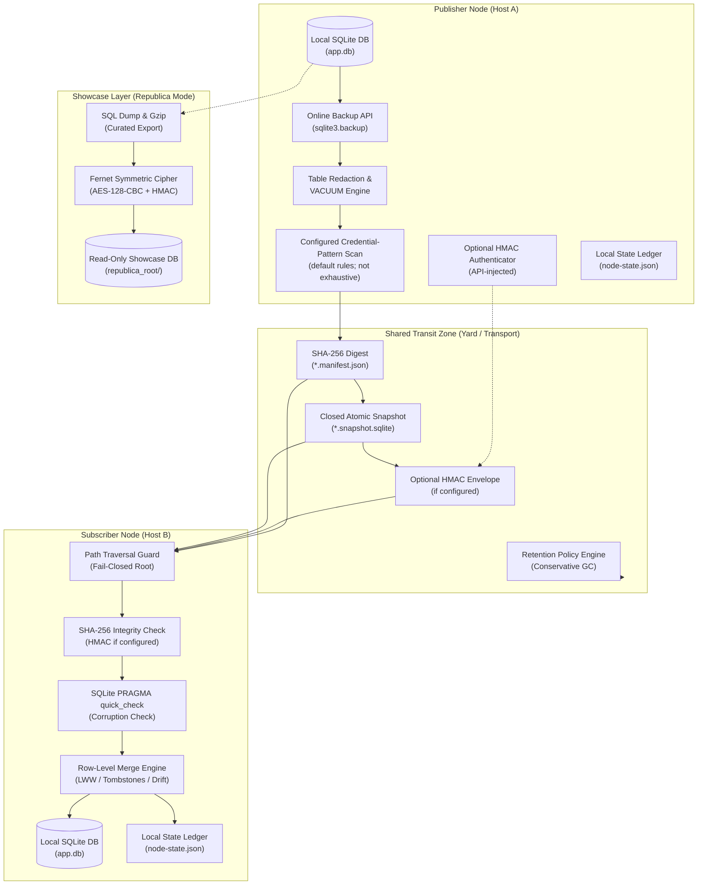

# sqlite-transit-sync


[](https://github.com/ellmos-ai/sqlite-transit-sync/actions/workflows/ci.yml)
[](CHANGELOG.md)
[](#tests)
[](#tests)
[](https://www.python.org/)
[](#)
[](#)
[](#governance-runtime-invariants-matrix)
[](SECURITY.md)
[](SECURITY.md)
[](CONTRIBUTING.md)
[](THIRD_PARTY_LICENSES.md)
[](THIRD_PARTY_LICENSES.txt)
[](NOTICE)
[](MARKETING-LOG.txt)
[](LICENSE)
[](https://github.com/ellmos-ai)
[](https://github.com/open-bricks)
[](llms.txt)

> [!NOTE]
> **Contexte pour les LLM et les agents IA** : un plan du site lisible par machine, une vue d’ensemble de l’architecture et un guide API structurés sont disponibles dans [`llms.txt`](llms.txt).

**🇬🇧 [English](README.md)** | **🇫🇷 Français** | **🇩🇪 [Version allemande](README_de.md)** | **🇪🇸 [Version espagnole](README_es.md)** | **🇯🇵 [Version japonaise](README_ja.md)** | **🇨🇳 [Chinois simplifié](README_zh.md)** | **🇵🇹 [Version portugaise](README_pt.md)** | **🇷🇺 [Version russe](README_ru.md)** | **🤝 [Contribuer](CONTRIBUTING.md)** | **🛡️ [Politique de sécurité](SECURITY.md)** | **📝 [Journal des modifications](CHANGELOG.md)** | **📋 [llms.txt](llms.txt)**

## 🧭 Navigation rapide

1. [Résumé et identité fondamentale](#what-is-sqlite-transit-sync)
2. [Topologie visuelle de l’architecture et couches découplées](#system-architecture-topology)
3. [Cycle de vie de bout en bout des instantanés et de la synchronisation](#end-to-end-snapshot-synchronization-lifecycle)
4. [Profils cibles et requêtes SEO à forte intention](#marketing--target-personas)
5. [Comportements implémentés et limites](#comparison-with-distributed-sql)
6. [Matrice de gouvernance et invariants d’exécution](#governance-runtime-invariants-matrix)
7. [Fonctionnalités principales et fonctions découplées](#what-it-provides)
8. [Projections applicatives en lecture seule](#read-only-application-projections)
9. [Installation et prérequis](#install)
10. [Démarrage rapide et flux de travail multinœud](#quick-start)
11. [Référence de configuration et déclencheurs de détection d’identifiants](#configuration)
12. [Vitrine Republica et méthode de chiffrement](#republica-the-showcase-method)
13. [API Python et points d’extension](#python-api)
14. [Sécurité, modèle de menace et limites opérationnelles](#safety-and-limits)
15. [Inventaire des licences tierces](#third-party-licenses--transparency)
16. [Écosystème, outils associés et bundles](#ecosystem--sibling-tools)
17. [Tests, vérification et matrice CI](#tests)
18. [Avis légal, limitation de responsabilité et licence (§ 521 BGB)](#license)

---

<a id="what-is-sqlite-transit-sync"></a><a id="core-identity"></a><a id="executive-summary--core-identity"></a>
## 1. Résumé et identité fondamentale

La version, l’état du module, sa visibilité et la référence faisant autorité pour la date de vérification sont définis
dans [`METADATA_CONTRACT.md`](METADATA_CONTRACT.md) ; ils ne constituent pas une
approbation de publication ni de mise en ligne publique.

Synchronisation local-first entre bases de données SQLite indépendantes au moyen d’instantanés dont l’intégrité est vérifiée, avec des politiques de fusion sélectionnables par l’application. L’authentification de l’émetteur est facultative et repose sur un authentificateur HMAC injecté via l’API. Cette conception est extraite de
l’architecture ProSync de BACH, sans dépendance à BACH, OneDrive, au nom de l’hôte ni aux chemins propres à
un utilisateur.

Ce n’est **pas un serveur SQL distribué**. Chaque nœud possède et ouvre uniquement sa base de données locale.
Un dossier partagé, un montage de stockage objet, un lecteur amovible ou un autre transport de fichiers véhicule des instantanés fermés et leurs manifestes.
Lors d’un pull, le module vérifie SHA-256 et SQLite `PRAGMA quick_check` avant de fusionner l’instantané dans la base locale au sein d’une transaction. L’authentification HMAC de l’émetteur n’est vérifiée que si un authentificateur est configuré.

Fonctionne bien avec [sync-master](https://github.com/dev-bricks/sync-master) (de la même famille de modules) : un espace sync-master constitue un transport naturel pour le transit —
indiquez
`--transit` comme chemin vers une zone `db-transit/<namespace>/` gérée par l’outil dans cet espace (règle de protocole R9). sync-master transporte les documents ; ce module
gère l’intégrité et la fusion des bases de données. Les deux restent
indépendants.

---

<a id="system-architecture-topology"></a><a id="system-architecture"></a>
## 2. Topologie visuelle de l’architecture et couches découplées

Le diagramme suivant illustre une topologie multinœud découplée dans laquelle les bases SQLite locales sont reliées exclusivement au moyen de bundles d’instantanés fermés dont l’intégrité est vérifiée par rapport à leurs manifestes :



### Projection architecturale en quatre vues ASCII

```text
+-------------------------------------------------------------------------------------------------------------------+
|                               SQLITE-TRANSIT-SYNC: FOUR-VIEW ARCHITECTURAL TOPOLOGY                               |
+-------------------------------------------------------------------------------------------------------------------+
| [VIEW 1: PUBLISHER NODE]               [VIEW 2: SHARED TRANSIT YARD]              [VIEW 3: SUBSCRIBER NODE]       |
|                                                                                                                   |
| +-------------------------+              +-----------------------------+            +---------------------------+ |
| | Local SQLite Database   |              |  Closed Transit Zone        |            | Path Traversal Guard      | |
| | (app.db - Exclusive RW) |              |  (Folder / Sync-Master / S3)|            | (Canonical Bounds Check)  | |
| +------------+------------+              +--------------+--------------+            +-------------+-------------+ |
|              |                                          ^                                         |               |
|              v (sqlite3.backup)                         |                                         v               |
| +------------+------------+                             |                           +-------------+-------------+ |
| | Online Consistent Backup|                             |                           | SHA-256 Integrity Check   | |
| | (Closed Rollback-Journal|                             |                           | Optional HMAC if set      | |
| +------------+------------+                             |                           +-------------+-------------+ |
|              |                                          |                                         |               |
|              v                                          |                                         v               |
| +------------+------------+                             |                           +-------------+-------------+ |
| | Redaction & VACUUM      |                             |                           | SQLite PRAGMA quick_check | |
| | (Exclude Sensitive Data)|                             |                           | (Integrity Verification)  | |
| +------------+------------+                             |                           +-------------+-------------+ |
|              |                                          |                                         |               |
|              v                                          |                                         v               |
| +------------+------------+                             |                           +-------------+-------------+ |
| | Pattern Scan            |                             |                           | Transactional Row Merge   | |
| | (default rules; limited) |                             |                           | (Row-Level LWW / Drift)  | |
| +------------+------------+                             |                           +-------------+-------------+ |
|              |                                          |                                         |               |
|              v                                          |                                         v               |
| +------------+------------+              +--------------+--------------+            +-------------+-------------+ |
| | Optional HMAC Adapter   |              |  *.snapshot.sqlite (Atomic) |            | Local SQLite Database     | |
| | (API-injected if set)   |- - - - - - ->|  *.manifest.json   (Digest) |----------->| (app.db - Merged State)   | |
| +-------------------------+              |  Retention Engine  (Scoped) |            +-------------+-------------+ |
|                                          +-----------------------------+                          |               |
|                                                                                                   v               |
|                                                                                     +-------------+-------------+ |
|                                                                                     | Local State Ledger        | |
|                                                                                     | (node-state.json)         | |
|                                                                                     +---------------------------+ |
+-------------------------------------------------------------------------------------------------------------------+
| [VIEW 4: REPUBLICA SHOWCASE / COURIER ENVELOPE (OPTIONAL ZERO-TRUST TRANSPORT)]                                   |
|                                                                                                                   |
| Local Database ----> Curated SQL Dump ----> Gzip Compression ----> AES-128-CBC (Fernet) ----> Encrypted Outpost   |
| (Source Node)       (FTS Rebuilt on Dest)   (53MB -> 11MB)         (Pre-Shared Key)          (republica_root/)    |
|                                                                                                                   |
| Single Secret File -> Fernet Cipher Envelope -> Courier Transit -> Destination Directory (Mode 0600, Transit Clr) |
+-------------------------------------------------------------------------------------------------------------------+
```

---

<a id="end-to-end-snapshot-synchronization-lifecycle"></a><a id="lifecycle"></a>
## 3. Cycle de vie de bout en bout des instantanés et de la synchronisation

Le flux de travail maintient les fichiers de base de données actifs hors de la synchronisation au niveau des fichiers. Il vérifie les octets de l’instantané par rapport à un manifeste SHA-256, exécute l’analyse configurée des motifs d’identifiants lorsqu’elle est activée (activée par défaut) et fusionne les lignes acceptées dans une transaction. L’authentification de l’émetteur n’est disponible que si un authentificateur HMAC injecté via l’API est configuré. Les pairs ne voient les changements qu’après un échange push/pull réussi :

```mermaid
sequenceDiagram
    autonumber
    participant App as Application / Node A
    participant CoreA as sqlite-transit-sync (Push)
    participant Shield as Credential-Pattern Scan (default on; configurable)
    participant Transit as Shared Transit (db-transit)
    participant CoreB as sqlite-transit-sync (Pull)
    participant Target as Local DB / Node B

    Note over App,CoreA: Phase 1: Local Online Snapshot & Redaction
    App->>CoreA: push(config, db)
    CoreA->>CoreA: Online Snapshot via SQLite Backup API
    CoreA->>CoreA: Drop Excluded Tables & VACUUM
    CoreA->>Shield: Scan Content for Secret Patterns (credential-triggers.json)
    Shield-->>CoreA: No configured pattern matched (if enabled)

    Note over CoreA,Transit: Phase 2: Snapshot Digest & File Publication
    CoreA->>CoreA: Calculate SHA-256 digest and size
    CoreA->>Transit: Write Temporary Snapshot & Atomic os.replace

    Note over CoreA,Transit: Phase 3: Optional Manifest Authentication & Publication
    CoreA->>CoreA: Optionally HMAC-sign manifest (if configured)
    CoreA->>Transit: Atomically write manifest with SHA-256; HMAC only if configured (*.manifest.json)

    Note over Transit,CoreB: Phase 4: Transit Ingestion & Boundary Guard
    CoreB->>Transit: Discover Manifests & Validate Path Bounds (Anti-Traversal)
    CoreB->>CoreB: Verify HMAC first if configured
    CoreB->>CoreB: Verify snapshot size and SHA-256 (integrity only)
    CoreB->>CoreB: Run PRAGMA quick_check on Isolated Snapshot

    Note over CoreB,Target: Phase 5: Transactional Row Merge & State Advance
    CoreB->>Target: BEGIN IMMEDIATE Transaction
    CoreB->>Target: Apply Row-Level Merge Policy (LWW per PK / Tombstones)
    CoreB->>Target: Reconcile Shared Column Schema Drift
    CoreB->>Target: COMMIT Transaction
    CoreB->>CoreB: Advance Local State Ledger (node-state.json)
    Note over Target: Peer state reflects successful exchange; no background convergence guarantee
```

---

<a id="marketing--target-personas"></a><a id="target-personas--discoverability-queries"></a><a id="target-personas"></a>
## 4. Profils cibles et requêtes SEO à forte intention

`sqlite-transit-sync` s’adresse à 4 profils de parties prenantes d’écosystèmes modulaires et décentralisés :

- **`[PERSONA-01]` Ingénieurs en agents IA autonomes et architectes d’essaims multi-hôtes :**
  - *Défi :* les essaims multi-agents répartis entre postes de travail, ordinateurs portables et serveurs ont besoin d’une persistance de l’état local sans conflits de verrouillage de fichiers.
  - *Solution :* l’analyse activée par défaut peut interrompre la publication lorsqu’un motif d’identifiant configuré correspond. Il s’agit d’un filet de sécurité, pas d’une preuve que l’instantané ne contient aucun secret. Les pairs reçoivent les changements après un échange push/pull réussi.
- **`[PERSONA-02]` Développeurs d’applications de bureau et edge multi-appareils :**
  - *Défi :* les utilisateurs avancés qui échangent des notes personnelles et des bases de tâches par synchronisation de fichiers (p. ex. sync-master, Syncthing, Nextcloud) rencontrent des corruptions de base de données et des blocages `-wal`.
  - *Solution :* l’API de sauvegarde SQLite et la publication par fichier maintiennent les fichiers de base SQLite actifs hors du chemin de synchronisation de fichiers ; les instantanés de transit sont les fichiers échangés par ce transport.
- **`[PERSONA-03]` Créateurs d’outils local-first à transit configurable :**
  - *Défi :* les applications qui exigent la souveraineté des données ne peuvent tolérer la dépendance à un fournisseur cloud, des frais récurrents d’hébergement de base de données ni des sorties réseau en arrière-plan non maîtrisées.
  - *Solution :* le module échange des fichiers d’instantané via un chemin de système de fichiers configuré. Ce chemin peut être local ou amovible ; le comportement d’un transport partagé ou monté sur le réseau échappe au contrôle du module.
- **`[PERSONA-04]` Responsables de la sécurité, de la confidentialité et de la conformité en entreprise :**
  - *Défi :* des exigences strictes de confiance zéro interdisent la synchronisation accidentelle d’identifiants, de blobs binaires non vérifiés et de services en arrière-plan privilégiés.
  - *Solution :* l’analyse activée par défaut vérifie les motifs d’identifiants configurés avant la publication ; SHA-256 vérifie l’intégrité de l’instantané par rapport au manifeste. Un authentificateur HMAC injecté via l’API peut être activé pour authentifier l’émetteur. Le processus hérite des autorisations de son lanceur.

### Requêtes de recherche à forte intention (bilingues EN et DE)

| Catégorie d’intention | Requêtes de recherche en anglais (EN) | Requêtes de recherche en allemand (DE) |
|:---|:---|:---|
| **Synchronisation local-first** | `sqlite synchronization python zero-dependency`, `local-first database snapshot sync`, `offline sqlite multi-device sync` | `lokale datenbank synchronisation offline snapshots`, `sqlite abgleich python ohne abhängigkeiten`, `lokale datenbank replikation dateibasiert` |
| **Intégrité et analyse configurée des motifs d’identifiants** | `configured credential-pattern scan sqlite sync`, `configured filesystem transit sqlite sync`, `optional hmac sqlite snapshot manifest` | `konfigurierter credential musterscan sqlite sync`, `dateipfad transit sqlite sync`, `optional hmac snapshot manifest` |
| **Fusion au niveau des lignes et conflits** | `row level merge lww sqlite offline`, `sqlite last write wins schema drift tolerance`, `tombstone merge policy sqlite` | `row level merge lww sqlite offline`, `last-write-wins datenbank abgleich zeitstempel`, `schema drift toleranz sqlite merge` |
| **Architecture découplée** | `sqlite multi-node sync without distributed sql`, `sqlite over syncthing without corruption`, `sqlite transit yard architecture` | `sqlite synchronisation ohne verteilten server`, `sqlite über cloud sync ohne datenbankkorruption`, `transit yard sqlite synchronisation` |

Pour consulter le détail des profils, les requêtes de recherche à forte intention et le positionnement, voir [MARKETING-LOG.txt](MARKETING-LOG.txt).

---

<a id="comparison-with-distributed-sql"></a><a id="comparative-matrix--alternatives"></a><a id="comparative-matrix"></a>
## 5. Comportements implémentés et limites

Cette section consigne les comportements implémentés et les limites du projet. Elle ne constitue pas un audit comparatif actuel d’autres produits.

| Dimension | Invariant | Comportement implémenté | Limite / périmètre |
|:---|:---|:---|:---|
| **1. Traitement local et transport** | `INV-LOCAL-01` | Lit des bases SQLite locales et publie des instantanés vers un chemin de transit configuré ; aucun serveur central de base de données n’est nécessaire. | Le chemin configuré peut être partagé ou monté sur le réseau. L’accès à ce transport et son comportement sont hors du périmètre de ce module. |
| **2. Publication d’instantanés** | `INV-SNAP-02` | Capture une sauvegarde en ligne et publie le fichier d’instantané au moyen d’un fichier temporaire et de `os.replace`. | Le remplacement d’un fichier ne rend pas l’instantané et son manifeste une transaction multifichier. |
| **3. Fichiers annexes et périmètre du processus** | `INV-ROLL-03` | Ferme les instantanés en mode journal de rollback et échoue de manière fermée si les fichiers annexes SQLite temporaires ne peuvent pas être nettoyés. | Exécutez un seul processus de synchronisation par nœud, sauf si l’application hôte ajoute un verrou de processus. |
| **4. Confinement du chemin de transit** | `INV-PATH-04` | Limite les chemins de manifeste et d’instantané à des fichiers réguliers directs sous la racine canonique de transit. | Cela ne contrôle pas qui peut écrire dans l’emplacement de transit. |
| **5. Contrôles d’intégrité** | `INV-VERIFY-05` | Compare les octets de l’instantané au SHA-256 du manifeste et exécute SQLite `PRAGMA quick_check`. | Une empreinte concordante n’authentifie ni l’émetteur ni le transport. |
| **6. Analyse des motifs d’identifiants** | `INV-SHIELD-06` | Par défaut, compare le contenu de l’instantané aux motifs configurés et interrompt la publication en cas de correspondance, en signalant `table.column` sans révéler la valeur. | Les règles préfixées par fournisseur constituent un filet de sécurité, pas une garantie. Une analyse sans correspondance signifie qu’aucun motif connu n’a correspondu ; des secrets personnalisés ou sans préfixe peuvent passer. |
| **7. Authentification de l’émetteur** | `INV-HMAC-07` | Une application peut activer l’authentification HMAC-SHA256 injectée via l’API pour le manifeste canonique. | Sans authentificateur configuré, l’émetteur n’est pas authentifié. Le HMAC à clé partagée ne fournit ni protocole de fraîcheur ni signature à clé publique. |
| **8. Fusion des lignes** | `INV-MERGE-08` | Applique une politique de fusion configurable au niveau des lignes ; par défaut, LWW s’appuie sur les horodatages pour les tables prises en charge. | L’application qui intègre le module reste responsable des hypothèses d’horloge, des règles de suppression, des migrations et des conflits métier. |
| **9. Rétention et périmètre de suppression** | `INV-RET-09` | Le nettoyage est en mode simulation par défaut et limité aux artefacts du nœud local, sauf activation explicite de l’autorité inter-nœuds. | Le nettoyage de rétention n’est pas un service de sauvegarde ou de récupération. |
| **10. Autorisations du processus et politique de sécurité** | `INV-SLA-10` | Le processus utilise les autorisations du processus qui le lance. `SECURITY.md` énonce la politique de signalement : accusé de réception sous 48 heures et évaluation initiale sous 5 jours ouvrés. | Le module n’impose pas les privilèges d’un utilisateur standard et ne demande pas d’élévation. Ces délais relèvent d’une politique de signalement, pas d’une fonctionnalité d’exécution. |

<a id="distributed-sql-detailed-comparison"></a>
### Modèle de traitement et limites

| Aspect | Comportement de `sqlite-transit-sync` | Limite / périmètre |
|---|---|---|
| Modèle de base | Chaque nœud possède sa propre base SQLite locale ; les instantanés transitent par un chemin configuré. | Il n’existe pas une base unique faisant autorité à l’échelle globale. |
| Écritures | Les applications écrivent localement ; un appelant exécute push et pull pour échanger des instantanés. | Aucune synchronisation automatique en arrière-plan. |
| Visibilité | Un pair peut voir les changements après un échange et une fusion réussis. | Le module ne garantit ni visibilité immédiate ni cohérence globale. |
| Transactions globales | Non fournies. | L’application ne peut pas valider une transaction unique sur plusieurs nœuds. |
| Fonctionnement hors ligne | Une base locale peut être utilisée de manière indépendante lorsque le nœud est hors ligne. | L’échange d’instantanés attend que le transit configuré soit disponible. |
| Conflits | La `MergePolicy` configurée détermine la combinaison des lignes ; LWW fondé sur les horodatages est la valeur par défaut. | Les horloges de l’application, les règles de suppression et la sémantique métier restent à la charge de l’intégration. |
| Modifications de schéma | La fusion de colonnes communes tolère une dérive limitée du schéma. | Les applications restent responsables des migrations et de la compatibilité des schémas. |
| Gestion des défaillances | Les données locales sont stockées dans SQLite et les instantanés de transit sont des fichiers distincts. | Le module ne fournit pas de réplication, de basculement ni de sauvegarde du transit automatiques. |

### Avantages, inconvénients et cas d’usage typiques

| Système | Avantages | Inconvénients | Cas d’usage adaptés | Cas d’usage inadaptés |
|---|---|---|---|---|
| `sqlite-transit-sync` | Faible empreinte locale ; aucun serveur central de base de données ; travail local hors ligne ; transport de fichiers configurable ; politiques de fusion sélectionnables par l’application. | Les changements nécessitent push/pull pour atteindre les pairs ; pas de transaction globale ni de basculement automatique ; horloges, suppressions, migrations et conflits nécessitent des règles applicatives. | Bases de données personnelles ou de tâches ; état local d’agents ; ordinateurs portables, postes de travail ou appareils edge connectés par intermittence ; notes de recherche. | Charges de travail exigeant des transactions validées globalement, un état partagé immédiat, un basculement automatique ou de nombreux processus d’écriture simultanés. |

### Guide de décision rapide

| Exigence | Adéquation |
|---|---|
| Les nœuds doivent continuer à utiliser leur propre base locale lorsqu’ils sont hors ligne | `sqlite-transit-sync` |
| Les mises à jour peuvent parvenir aux pairs après un échange explicite push/pull | `sqlite-transit-sync` |
| L’application peut définir ses règles de fusion, d’horloge, de suppression et de migration | `sqlite-transit-sync` |
| Chaque écriture doit devenir immédiatement la référence globale | Utilisez une architecture offrant ce contrat de cohérence |
| Des transactions globales, un basculement automatique ou de nombreux processus d’écriture simultanés sont requis | Évaluez une architecture qui fournit ces comportements |

Pour un petit nombre d’appareils connectés par intermittence, ce module peut convenir si un échange différé et des règles de fusion définies par l’application sont acceptables. Si la charge de travail exige des transactions globales, un état partagé immédiat ou un basculement automatique, choisissez une conception dont le contrat documenté fournit ces comportements.

---

<a id="governance-runtime-invariants-matrix"></a><a id="governance--runtime-invariants"></a>
## 6. Matrice de gouvernance et invariants d’exécution

La matrice ci-dessous consigne les 10 invariants de gouvernance et d’exécution du projet, avec le comportement implémenté et les limites pertinentes :

| Nº | Invariant | Périmètre architectural | Comportement et limites documentés |
|---|---|---|---|
| 1 | **INV-LOCAL-01 : traitement SQLite local et transit configuré** | Architecture système | Lit des bases SQLite locales et publie des instantanés via le chemin de transit configuré. Ce chemin peut être partagé ou monté sur le réseau ; l’hôte et le transport sont hors du périmètre du module. |
| 2 | **INV-SNAP-02 : atomicité de publication des instantanés** | Publication vers le transit | Les fichiers de base actifs ne sont jamais partagés par synchronisation de fichiers. Les instantanés en ligne sont créés via `sqlite3.backup` et publiés via le remplacement atomique `os.replace`. |
| 3 | **INV-ROLL-03 : isolation propre en mode journal de rollback** | Prévention des fichiers annexes | Les sauvegardes sont fermées en mode journal de rollback ; tous les fichiers annexes SQLite temporaires (`-wal`, `-shm`, `-journal`) sont nettoyés de façon fermée avant la création du manifeste. |
| 4 | **INV-PATH-04 : confinement strict du chemin de transit** | Limite du système de fichiers | Les chemins du manifeste et de l’instantané doivent désigner des fichiers réguliers directs à l’intérieur de la racine canonique de transit. Les traversées de chemin (`../`), les liens symboliques et les points de réanalyse échouent de façon fermée. |
| 5 | **INV-VERIFY-05 : vérification en deux étapes de l’intégrité et de la cohérence** | Validation avant fusion | Chaque instantané reçu doit satisfaire la vérification de correspondance de l’empreinte SHA-256 et SQLite `PRAGMA quick_check` avant l’inspection ou la fusion des données. |
| 6 | **INV-SHIELD-06 : filtrage des identifiants avant publication** | Inspection du contenu | Par défaut, les motifs d’identifiants configurés sont comparés au contenu de l’instantané ; une correspondance interrompt la publication et signale `table.column`, pas la valeur. Les motifs préfixés par fournisseur constituent un filet de sécurité, pas une garantie ; l’absence de correspondance ne prouve pas que l’instantané est exempt de secrets. |
| 7 | **INV-HMAC-07 : authentification HMAC facultative** | Authentification de l’émetteur | Enveloppe HMAC-SHA256 facultative injectée via l’API, calculée sur la charge utile canonique du manifeste (protocole, espace de noms, identifiant de l’émetteur, nom de fichier, SHA-256, taille, liste de caviardage). Un HMAC à clé partagée n’est ni un protocole de fraîcheur ni une signature à clé publique ; sans HMAC, le manifeste n’authentifie pas l’émetteur. |
| 8 | **INV-MERGE-08 : fusion déterministe au niveau des lignes** | Convergence des données | Fusion transactionnelle des lignes (LWW par clé primaire, union des colonnes communes pour tolérer les dérives de schéma, politique explicite de tombstones). Un départage par empreinte du contenu assure une convergence déterministe. |
| 9 | **INV-RET-09 : rétention prudente et périmètre d’autorité** | Collecte des déchets | Le nettoyage des instantanés est en mode simulation par défaut et limité aux artefacts du nœud local. La suppression inter-nœuds (`--all-nodes`) exige une activation administrative explicite. |
| 10 | **INV-SLA-10 : autorisations du processus et politique de sécurité** | Contexte d’exécution | Le processus hérite des autorisations de son lanceur ; ce module n’impose pas les privilèges d’un utilisateur standard et ne demande pas d’élévation. `SECURITY.md` prévoit un accusé de réception sous 48 heures et une évaluation initiale sous 5 jours ouvrés. |

---

<a id="what-it-provides"></a><a id="core-capabilities"></a><a id="part-of-the-ellmos-stack-family"></a>
## 7. Fonctionnalités principales et fonctions découplées

`sqlite-transit-sync` complète
[dev-bricks/sync-master](https://github.com/dev-bricks/sync-master) au sein de la même
famille : sync-master gère le transport des fichiers (`sync.files`), tandis que ce
module gère l’intégrité et la fusion des bases de données (`sync.database`). Chacun fonctionne
seul ou peut être composé dans des stacks de la famille
[ellmos-ai](https://github.com/ellmos-ai) — voir le catalogue
[ellmos-ai/stacks](https://github.com/ellmos-ai/stacks). Dans cette boîte à outils, son rôle est le suivant :
aucun fichier SQLite actif ne passe par la synchronisation de fichiers ; seuls passent des instantanés dont
l’intégrité du manifeste et de SQLite est vérifiée, avec des politiques de fusion sélectionnables par l’application.

### Fonctionnalités clés

- instantanés en ligne cohérents via l’API de sauvegarde SQLite ;
- publication atomique au moyen d’un fichier temporaire et de `os.replace` ;
- instantanés fermés en mode journal de rollback, avec nettoyage en mode fail-closed de tous les fichiers annexes SQLite temporaires
  avant publication ;
- les chemins du manifeste et de l’instantané sont limités aux fichiers réguliers directs du
  répertoire canonique de transit ; les traversées, chemins absolus, liens symboliques et points de réanalyse
  échouent de manière fermée avant le calcul de l’empreinte ou la fusion ;
- vérification du manifeste SHA-256 et de `PRAGMA quick_check` ;
- authentification HMAC-SHA256 facultative injectée via l’API, portant sur le manifeste canonique,
  l’identité de l’émetteur, la version du protocole et l’empreinte de l’instantané, avec des ID de clé explicites ;
- état local de pull par nœud et relecture idempotente ;
- stratégie LWW au niveau de chaque ligne par clé primaire pour les tables horodatées ;
- adaptateur de référence `TombstoneMergePolicy` activé à la demande pour les suppressions explicites ;
- fusion des colonnes communes pour tolérer les dérives simples de schéma ;
- exclusion configurable de tables et caviardage de l’instantané, suivi de VACUUM ;
- analyse du contenu activée par défaut, qui interrompt la publication lorsqu’un motif d’identifiant configuré
  correspond (signale `table.column`, jamais la valeur). Les règles préfixées par fournisseur constituent un filet de
  sécurité ; une analyse sans correspondance ne prouve pas que l’instantané ne contient aucun secret ;
- prise en charge personnalisée de `MergePolicy` pour les règles métier, les tombstones ou les CRDT ;
- nettoyage vérifié des instantanés, en mode simulation par défaut, limité par défaut au nœud local,
  avec activation explicite de la suppression et de l’administration inter-nœuds ;
- sélection de pulls en attente pour les adaptateurs applicatifs à cycle de vie léger, sans dupliquer
  la logique de fusion ou d’avancement de l’état ;
- contrats de projection en lecture seule versionnés et stricts, avec listes d’autorisation exactes pour le schéma et la confidentialité,
  provenance, point de contrôle, boucles et vérification des tombstones hors ligne ;
- mode vitrine [Republica](#republica-the-showcase-method) facultatif, qui distribue une base de données
  à sens unique sous forme de charge utile chiffrée et la matérialise comme vitrine distincte en lecture seule,
  au lieu de la fusionner ;
- API Python sans dépendances et CLI JSON (le mode Republica ajoute `cryptography`).

---

<a id="read-only-application-projections"></a><a id="projections"></a>
## 8. Projections applicatives en lecture seule

`verify-projection` valide une projection SQLite fermée et détenue par l’application,
sans copie, fusion, migration, planification ni avancement d’état. L’application fournit
l’identité de son consommateur et l’intervalle hors ligne maximal qu’elle a examiné ;
le vérificateur rejette les boucles, les points de contrôle obsolètes, une rétention des tombstones insuffisante,
les tables ou colonnes non répertoriées et les références d’enregistrements qui ne sont pas opaques.

Six contrats restreints sont fournis pour les résumés de soldes de comptes, l’état
des abonnements AboTracker, les dates de réapprovisionnement de HausLagerist, l’état
des échéances et alertes de stock de médicaments, des échéances et réalisations de routines, ainsi que des
échéances d’assurance. Le contrat AboTracker est
limité au statut, car la version 1 du schéma d’export ne confirme aucune prochaine échéance ni date de renouvellement ;
il ne déduit jamais un rappel de la date de paiement et de la périodicité de facturation. Les données de test
sont des recettes JSON synthétiques, et les identités métier ou les détails privés restent
hors des listes d’autorisation.

Les noms des contrats fournis sont `abotracker-subscription-status-projection.v1`,
`accounts-balance-projection.v1`, `hauslagerist-replenishment-projection.v1`,
`mediplaner-reminder-projection.v1`,
`routinika-reminder-projection.v1` et
`versicherungsmanager-deadline-projection.v1`.
Voir [Contrats de projection en lecture seule](PROJECTION_CONTRACTS.md) et le
[document compagnon en allemand](PROJECTION_CONTRACTS_de.md).

```bash
sqlite-transit-sync verify-projection \
  --contract mediplaner-reminder-projection.v1 \
  --database ./closed-projection.sqlite \
  --consumer-id reminder-consumer \
  --minimum-offline-seconds 2592000 \
  --previous-checkpoint 41
```

---

<a id="install"></a><a id="installation"></a>
## 9. Installation et prérequis

```bash
python -m pip install -e .
```

---

<a id="quick-start"></a><a id="quickstart"></a>
## 10. Démarrage rapide et flux de travail multinœud

Créez une configuration sur chaque nœud. Chaque nœud utilise sa propre base de données et son
propre fichier d’état, mais le même répertoire de transit et le même espace de noms.

```bash
sqlite-transit-sync init \
  --config node.json \
  --database ./app.db \
  --transit ./shared-transit \
  --node-id laptop \
  --namespace my-app

sqlite-transit-sync push --config node.json
sqlite-transit-sync pull --config node.json --dry-run
sqlite-transit-sync pull --config node.json
sqlite-transit-sync status --config node.json
sqlite-transit-sync verify --config node.json
sqlite-transit-sync cleanup --config node.json
# Review the JSON plan, then explicitly apply it:
sqlite-transit-sync cleanup --config node.json --apply
```

Le schéma applicatif doit déjà exister sur chaque nœud. La copie initiale automatique
est volontairement désactivée, car un module générique ne peut pas décider quel schéma,
quels secrets, tables locales ou migrations appartiennent à une application.

### Démarrage rapide Python autonome exécutable (sans dépendances externes)

Les développeurs qui intègrent `sqlite-transit-sync` directement dans des frameworks d’agents, des démons ou des workers en arrière-plan peuvent exécuter ce script autonome et copiable tel quel pour vérifier une synchronisation multinœud de bout en bout sans dépendances externes :

```python
import sqlite3
from contextlib import closing
import tempfile
from pathlib import Path
from sqlite_transit_sync import SyncConfig, TransitSync

with tempfile.TemporaryDirectory() as tmp:
    root = Path(tmp)
    transit = root / "transit"
    transit.mkdir()

    # 1. Initialize Node A and record local data
    db_a = root / "node_a.db"
    with closing(sqlite3.connect(db_a)) as conn, conn:
        conn.execute("CREATE TABLE notes (id INTEGER PRIMARY KEY, title TEXT, updated_at TEXT)")
        conn.execute("INSERT INTO notes VALUES (1, 'Hello from Node A', '2026-10-18T08:00:00Z')")

    # 2. Publish atomic snapshot from Node A to shared transit
    cfg_a = SyncConfig(database=db_a, transit=transit, state=root / "state_a.json", node_id="node_a", namespace="demo")
    snapshot = TransitSync(cfg_a).push()
    print(f"Node A published snapshot: {snapshot.path.name} (SHA-256: {snapshot.sha256[:8]}...)")

    # 3. Initialize Node B with schema and pull snapshot
    db_b = root / "node_b.db"
    with closing(sqlite3.connect(db_b)) as conn, conn:
        conn.execute("CREATE TABLE notes (id INTEGER PRIMARY KEY, title TEXT, updated_at TEXT)")

    cfg_b = SyncConfig(database=db_b, transit=transit, state=root / "state_b.json", node_id="node_b", namespace="demo")
    reports = TransitSync(cfg_b).pull()

    # 4. Verify converged state in Node B
    with closing(sqlite3.connect(db_b)) as conn, conn:
        rows = conn.execute("SELECT id, title, updated_at FROM notes").fetchall()
        print(f"Node B converged records: {rows}")
        assert rows == [(1, "Hello from Node A", "2026-10-18T08:00:00Z")]
```

---

<a id="configuration"></a><a id="configuration-reference"></a>
## 11. Référence de configuration et déclencheurs d’identifiants

```json
{
  "database": "./app.db",
  "transit": "./shared-transit",
  "state": "./node-state.json",
  "node_id": "laptop",
  "namespace": "my-app",
  "timestamp_columns": ["updated_at", "modified_at", "created_at"],
  "exclude_tables": ["secrets", "sqlite_sequence"],
  "snapshot_exclude_tables": ["secrets"],
  "scan_snapshot_for_secrets": true,
  "secret_scan_skip_tables": [],
  "secret_scan_extra_patterns": [],
  "secret_patterns_file": null
}
```

Les chemins relatifs sont résolus à partir du fichier de configuration. La base active ne doit jamais
se trouver dans le répertoire de transit, et le fichier d’état doit rester en dehors de l’arborescence de
transit. `SyncConfig`, `from_file`, `from_bytes` et `init` de la CLI rejettent un chemin d’état
invalide avant la création des répertoires de transit ou d’état ; aucune migration n’est
effectuée automatiquement.

Les applications qui ont besoin d’une empreinte d’audit correspondant exactement à la configuration
analysée peuvent lire les octets une fois et utiliser le même analyseur relatif à la source, sans seconde
lecture du fichier :

```python
import hashlib
from pathlib import Path

from sqlite_transit_sync import SyncConfig

config_path = Path("node.json").resolve()
payload = config_path.read_bytes()
config = SyncConfig.from_bytes(payload, source_path=config_path)
config_sha256 = hashlib.sha256(payload).hexdigest()
```

### Toutes les clés et leurs valeurs par défaut

| Clé | Valeur par défaut | Signification |
|---|---|---|
| `database` | *(obligatoire)* | Base de données SQLite active appartenant à ce nœud |
| `transit` | *(obligatoire)* | Répertoire partagé qui transporte les instantanés et manifestes |
| `state` | `./.sync-state.json` | État de pull par nœud ; gardez-le hors du transit |
| `node_id` | nom d’hôte de la machine | Identifie le nœud émetteur dans les noms des instantanés |
| `namespace` | `"default"` | Sépare les jeux de données indépendants dans un même transit |
| `timestamp_columns` | `["updated_at","modified_at","created_at"]` | Colonnes consultées pour la stratégie LWW |
| `exclude_tables` | `["secrets","sqlite_sequence"]` | Tables qui ne sont jamais **fusionnées** dans la base locale |
| `snapshot_exclude_tables` | `["secrets"]` | Tables dont les lignes sont **supprimées de l’instantané** avant publication (puis `VACUUM`) |
| `scan_snapshot_for_secrets` | `true` | Interrompt la publication lorsqu’un motif d’identifiant configuré correspond au contenu de l’instantané |
| `secret_scan_skip_tables` | `[]` | Tables ignorées par l’analyse — à utiliser pour une seule table bruyante plutôt que de désactiver l’analyse |
| `secret_scan_extra_patterns` | `[]` | Expressions régulières supplémentaires, en plus du fichier de déclencheurs |
| `secret_patterns_file` | `null` (fichier fourni) | Chemin vers votre propre fichier de déclencheurs ; il **remplace** les motifs intégrés |
| `key_file` | `null`, sinon `$SQLITE_TRANSIT_SYNC_KEY_FILE` | Clé Fernet pour le mode Republica ; à conserver hors du transit |
| `republica_root` | `~/.republica` | Emplacement des vitrines importées ; à conserver hors du transit |
| `allow_key_in_synced_folder` | `false` | Lève le contrôle qui refuse une clé dans un dossier synchronisé par le cloud |

La valeur par défaut de `state` dans ce tableau s’applique lorsqu’une configuration JSON est chargée
sans cette clé. `sqlite-transit-sync init` écrit plutôt
`.<config-stem>-state.json` lorsque `--state` est omis (pour `node.json` :
`.node-state.json`).

### L’analyse des identifiants et comment la désactiver

`snapshot_exclude_tables` ne peut supprimer qu’une table que vous aviez déjà identifiée. L’analyse
répond à la question que cette règle ne peut pas résoudre : *un identifiant s’est-il retrouvé collé dans une
colonne de texte libre* — une note, une ligne de journal, un résumé de session ? Elle s’exécute sur la copie
d’instantané après le caviardage et avant la publication. En cas de correspondance, elle lève `SyncError`
et indique `table.column` ; la valeur correspondante n’est jamais incluse, afin que l’identifiant ne se retrouve
pas dans les journaux, les traces d’erreur ou la sortie de CI. L’instantané partiel est supprimé ; rien
n’atteint donc le répertoire de transit.

**Désactiver l’analyse est un choix légitime**, pas un contournement. Si votre transit est un
emplacement de stockage que vous contrôlez et en qui vous avez confiance — votre propre serveur, un volume
hébergé dans l’UE sous contrat, un lecteur amovible chiffré — et que vous *voulez* que les identifiants voyagent
avec les données, définissez :

```json
{ "scan_snapshot_for_secrets": false }
```

Préférez `secret_scan_skip_tables` lorsqu’une seule table génère des faux positifs : garder
l’analyse active partout ailleurs vaut mieux que de la désactiver globalement.

### Ajuster les déclencheurs

Les motifs sont des données, pas du code — `sqlite_transit_sync/credential-triggers.json` —
afin de pouvoir affiner la détection au fil du temps sans attendre une version :

```json
{
  "version": 1,
  "patterns": [
    { "name": "github", "regex": "gh[pousr]_[A-Za-z0-9]{16,}", "prefilter": "gh" },
    { "name": "acme-internal", "regex": "ACME-[0-9]{4}", "prefilter": "ACME-" }
  ]
}
```

- `prefilter` est un littéral facultatif utilisé comme préfiltre SQL `LIKE` peu coûteux afin d’accélérer les instantanés volumineux. Il
  **doit** apparaître dans chaque valeur que l’expression régulière peut reconnaître,
  sinon certains résultats ne seront pas détectés. Omettez-le si aucun littéral de ce type n’existe — l’analyseur
  lira alors toute la colonne pour garantir l’exactitude.
- Faites pointer `secret_patterns_file` vers votre propre copie pour remplacer entièrement les valeurs par défaut,
  ou utilisez `secret_scan_extra_patterns` pour les compléter.

Les motifs sont volontairement préfixés par fournisseur. Une règle générique « longue chaîne hexadécimale »
signalerait des sommes de contrôle, des UUID et des SHA Git, qui sont des données légitimes de base de données ;
un analyseur qui génère trop de faux positifs finit désactivé, et ne protège alors plus rien.
Interprétez une analyse sans correspondance comme « aucun motif connu n’a correspondu », jamais comme
« cet instantané ne contient aucun secret ».

### Ce n’est pas un gestionnaire de secrets

L’analyse peut interrompre la publication lorsqu’un motif configuré correspond ; elle ne garantit pas la détection de tous les identifiants et ne **distribue** pas d’identifiants. Si votre véritable besoin est « mes machines doivent partager les mêmes mots de passe ou clés API », ce
module n’est pas adapté — pas plus qu’un dossier de synchronisation de documents. Envisagez un outil spécialisé dans la gestion de secrets et examinez son déploiement et son modèle de confiance :

| Approche | Adaptée à | Remarques |
|---|---|---|
| **Vaultwarden** (Bitwarden auto-hébergé) | personnes + CLI sur plusieurs machines | Fonctionne sur une petite machine toujours allumée ; utilisez un réseau privé (WireGuard, Tailscale) au lieu de l’exposer. Les clients officiels Bitwarden, extensions de navigateur et CLI `bw` sont compatibles ; les scripts et agents peuvent donc également récupérer des secrets. |
| **SOPS + age** | secrets à conserver à côté du code | Les fichiers chiffrés peuvent être validés dans un dépôt et stockés dans tout dossier synchronisé, car seul le texte chiffré circule. Clés par destinataire, bonne intégration aux revues Git. |
| **`pass`** (GPG) + git | utilisateurs Unix seuls et petites équipes | Un fichier par secret, dépôt distant git classique, aucun serveur. |
| **Base KeePassXC via Syncthing** | absence de serveur ou de compte cloud | Synchronisation de fichiers pair-à-pair ; le coffre reste un fichier chiffré unique. |
| **Infisical / OpenBao (fork de Vault)** | équipes, identités de machine, rotation | Véritables serveurs de secrets avec journaux d’audit et identifiants dynamiques — davantage de composants qu’un foyer n’en a besoin. |
| **Magasins propres à la plateforme** | une machine, une application | Trousseau macOS, DPAPI/Gestionnaire d’identifiants Windows, `systemd-creds` ou magasin de secrets de votre CI. Pas de synchronisation, mais pas d’exposition non plus. |

Quel que soit votre choix, la séparation importante reste la même : **un canal pour les données,
un autre pour les identifiants.** Ce module peut bloquer un instantané lorsqu’un motif
configuré correspond ; il ne peut garantir la détection de chaque secret.

---

<a id="republica-the-showcase-method"></a><a id="republica-showcase"></a>
## 12. Vitrine Republica et méthode de chiffrement

Chaque machine dépose une **vitrine chiffrée** de sa base de données dans une zone de fichiers partagée. Toutes
les autres machines peuvent la consulter ; aucune ne peut la modifier. D’où le nom : une republication de la
base de données, lisible uniquement par les personnes qui détiennent la clé.

Utilisez Republica lorsque `push`/`pull` ne convient pas : vous voulez consulter les données d’un autre nœud sans les fusionner dans vos lignes, ou les machines ne partagent qu’un dossier — sans serveur, ports ouverts ni tunnel pair-à-pair dédié à Republica, mais une clé Fernet partagée reste nécessaire — et ce dossier ne doit pas voir les données en clair.

<a id="deux-modes-volontairement-redondants"></a>
### Deux modes, un même transit configuré

Avec la même `SyncConfig`, `push`/`pull` et Republica utilisent le même chemin `transit` configuré. `push`/`pull` publient des instantanés et les fusionnent dans la base locale ; Republica publie des répliques chiffrées dans un sous-répertoire par nœud de ce transit, puis les importe comme bases distinctes en lecture seule sous `republica_root`. La différence porte sur le chiffrement et la fusion, pas sur le transport.

| Condition | Transit de fichiers (`push`/`pull`) | Republica |
|---|---|---|
| Un nœud pair est hors ligne | Un nœud peut publier pendant que les autres sont hors ligne ; `pull` peut fusionner les instantanés déjà présents dans le transit. Les nouvelles données attendent leur publication par le nœud source. | Un nœud peut déposer une réplique chiffrée pour un import ultérieur. Les données d’une source hors ligne attendent également sa publication. |
| Tunnel VPN/SSH indisponible | Le chemin de fichiers configuré doit rester accessible ; `push`/`pull` n’ouvrent pas de tunnel direct entre pairs. | Même dépendance au transit ; une panne VPN/SSH n’a d’effet que si elle rend le chemin configuré inaccessible. |
| Transit configuré indisponible | Impossible de publier ou de récupérer des fichiers par un chemin indisponible. | Même limite ; Republica ne fournit pas de transport alternatif. |
| Rotation de clé ou configuration de confiance en attente | HMAC est facultatif. Si un authentificateur est configuré, sa clé et la configuration de confiance doivent correspondre ; sans lui, SHA-256 vérifie l’intégrité mais n’authentifie pas l’expéditeur. | La publication et l’import exigent la même clé Fernet compatible ; les rotations doivent être coordonnées. |
| Aucune politique de fusion propre à l’application n’est configurée | La `MergePolicy` configurée s’applique ou, par défaut, le LWW horodaté ; configurez une politique métier si ce défaut ne convient pas aux données. | Importe une base distincte en lecture seule et ne fusionne pas les lignes. |

Republica est utile lorsqu’il faut des copies chiffrées, distinctes et en lecture seule. Il n’assure pas le basculement du transport ; l’application doit configurer des chemins de transit indépendants et disponibles.

### Coût de mise en place : un transfert de clé

La clé partagée doit parvenir aux autres machines par **un canal autre que le
transport lui-même** — un tunnel chiffré déjà établi, un gestionnaire de mots de passe, une clé USB ou une lecture
au téléphone. Une seule fois. Ensuite, un simple dossier partagé suffit, pour toujours, même si vous
ne lui faites pas confiance.

```text
republica_root/
  laptop/my-app.sqlite      <- read-only showcase of laptop's database
  workstation/my-app.sqlite <- read-only showcase of workstation's database
```

```bash
# Once per key, on local disk - never inside the transit, never in a synced folder.
# Then copy this file to the other machines out of band; do NOT run keygen there.
sqlite-transit-sync keygen --key-file ~/.keys/republica.key

sqlite-transit-sync init --config node.json \
  --database ./app.db --transit ./shared-transit \
  --node-id laptop --namespace my-app \
  --key-file ~/.keys/republica.key

sqlite-transit-sync republica-publish --config node.json   # encrypt and publish
sqlite-transit-sync republica-list    --config node.json   # what other nodes offer
sqlite-transit-sync republica-import  --config node.json   # materialise them locally
```

Le mode nécessite l’option de chiffrement facultative : `pip install 'sqlite-transit-sync[crypto]'`.

**Ce qui circule** n’est pas un fichier de base de données, mais un dump SQL sélectionné, compressé avec gzip et
chiffré par Fernet. Dans une base de connaissances réelle de 53,6 Mo, le transit ne contient que 11,0 Mo, car
les structures internes de l’index plein texte sont reconstruites à l’arrivée au lieu d’être expédiées (35 370 des 49 636
instructions du dump). La publication passe par les mêmes contrôles qu’un instantané de fusion : caviardage,
analyse des identifiants, `quick_check` et manifeste.

**Ce que cela protège :** le transport ne voit que du texte chiffré et le HMAC de Fernet détecte une
modification délibérée, même si l’empreinte du manifeste est recalculée pour lui correspondre.

**Ce que cela ne protège pas :** Fernet authentifie la *clé*, pas l’*émetteur* — toute personne qui la détient
peut publier un instantané valide. C’est précisément pourquoi une réplique est conservée séparément et jamais
fusionnée. Gardez la clé hors du transport : une clé placée dans le répertoire de transit est refusée, tout
comme une clé située dans un dossier qui semble synchronisé (remplacez ce contrôle avec
`allow_key_in_synced_folder`). La même règle s’applique à `republica_root` : une
réplique déchiffrée placée dans le transit serait redistribuée en clair.

**Limite :** un index plein texte sans son propre contenu (`content=''`) ne peut être reconstruit,
car il n’y a rien à partir de quoi le reconstruire. Ces tables sont signalées dans le manifeste comme
`contentless_fts` au lieu d’arriver silencieusement vides.

### Enveloppe scellée : un fichier, le même canal, jamais une base de données

Le problème d’amorçage : deux machines ne disposent pas encore de canal sécurisé, et c’est précisément pour cela qu’un
identifiant doit être transmis. La même clé et le même dossier peuvent transporter un seul fichier chiffré.

```bash
sqlite-transit-sync envelope-send    --config node.json --file ./api-token.txt --label api-token
sqlite-transit-sync envelope-receive --config node.json --into ~/credentials
```

Le fichier arrive **sous forme de fichier** (mode `0600`), nommé `<source-node>__<filename>`, et n’entre
jamais dans une base de données — un secret stocké dans une base est recopié par chaque sauvegarde, index et
synchronisation qui le touche. Les notes doivent indiquer où se trouve un secret, jamais le secret lui-même.

Deux règles de la vitrine sont volontairement inversées : **l’analyse des identifiants ne s’applique pas**
(elle bloquerait précisément la charge utile transportée), et l’enveloppe est **supprimée du transit** après
réception, afin qu’un secret ne reste pas dans un dossier partagé. Le déchiffrement vers le transit ou vers un
dossier qui semble synchronisé par le cloud est refusé ; le nom de fichier est de nouveau assaini à l’arrivée
pour qu’un manifeste forgé ne puisse pas écrire hors du répertoire cible.

Il s’agit d’un moyen de transport ponctuel, pas d’un gestionnaire de mots de passe ni d’un service de synchronisation de fichiers : limitez le nombre et la taille des enveloppes.

---

<a id="python-api"></a><a id="api"></a>
## 13. API Python et points d’extension

```python
from sqlite_transit_sync import SyncConfig, TransitSync

sync = TransitSync(SyncConfig.from_file("node.json"))
snapshot = sync.push()
pending = sync.pending()
selected_reports = sync.pull_selected([pending[-1].path.name]) if pending else []
reports = sync.pull()
cleanup_plan = sync.cleanup()
print(
    snapshot.sha256,
    [report.as_dict() for report in reports],
    [report.as_dict() for report in selected_reports],
    cleanup_plan,
)
```

`pull_selected()` n’accepte que les instantanés explicitement nommés qui sont actuellement en attente et réutilise
les mêmes contrôles de vérification, de fusion et d’avancement de l’état que `pull()`. Un adaptateur de cycle de vie léger
peut ainsi sélectionner un instantané admissible sans recopier la mécanique des données du composant porteur.

### Manifestes authentifiés facultatifs et précontrôle en lecture seule

Une application intégratrice peut décrire des clés au moyen de références non secrètes
de type `HMACKeyReference`. `load_hmac_authenticator()` obtient les octets uniquement
par un `SecretResolver` injecté ; `OSKeyringSecretResolver` est un adaptateur facultatif,
chargé à la demande pour le paquet `keyring` installé séparément. La configuration JSON et
la CLI ne transportent jamais la matière de la clé :

```python
from sqlite_transit_sync import (
    HMACKeyReference,
    OSKeyringSecretResolver,
    load_hmac_authenticator,
    verify_authenticated_snapshot,
)

auth = load_hmac_authenticator(
    [HMACKeyReference(
        key_id="node-a-v2",
        service="ellmos-ocean-transit",
        account="node-a-v2",
        sender="node-a",
    )],
    active_key_id="node-a-v2",
    resolver=OSKeyringSecretResolver(),
    trusted_senders={"node-a"},
)
snapshot = verify_authenticated_snapshot(
    manifest_path,
    snapshot_path,
    authenticator=auth,
)
```

L’adaptateur de référence utilise HMAC-SHA256 à clé partagée, et non des signatures publiques
à non-répudiation. Sa charge utile canonique couvre le protocole, l’espace de noms, le nœud, le nom de
l’instantané, SHA-256, la taille, la liste de caviardage et l’en-tête algorithme/clé/émetteur/source de confiance. Conservez
les anciennes clés dans le trousseau de vérification lors d’une rotation. Un vérificateur configuré rejette les
signatures absentes, mal formées, étrangères ou non concordantes. Le précontrôle explicite
rejette aussi les fichiers manquants et les fichiers annexes SQLite avant le calcul de l’empreinte ; il n’ouvre
jamais SQLite, ne fusionne pas de lignes et ne lit ni n’écrit l’état de synchronisation. Sa réussite authentifie les
octets du fichier désigné, pas son schéma SQLite ni sa sémantique applicative.
`TransitSync(..., authenticator=auth)` reste disponible pour les appels existants ;
une relecture déjà effectuée est une opération sans effet fondée sur l’état, pas une garantie de fraîcheur. Un
lecteur sans authentificateur configuré ne prétend pas à l’authenticité. La fraîcheur et le stockage des clés
restent à la charge de l’application.

### Politique de référence pour les tombstones

Pour les applications qui ont besoin de suppressions, appelez `ensure_tombstone_table()` lors de
leur propre configuration de schéma et utilisez `TombstoneMergePolicy`. La table réservée stocke
`table_name`, un tableau JSON canonique de valeurs de clé primaire et `deleted_at` comme
version de suppression. Un tombstone l’emporte en cas d’égalité et sur les lignes plus anciennes ; un horodatage de ligne
ultérieur peut rétablir la clé. L’adaptateur ne déduit jamais une suppression d’une ligne manquante et
ne purge jamais les tombstones ; la rétention doit donc couvrir l’intervalle hors ligne maximal.
Les tables inconnues et les incompatibilités de schéma restent protégées ou échouent de manière fermée ;
aucune migration automatique n’est tentée.

Passez un objet implémentant `MergePolicy.merge(local, remote, snapshot)` à
`TransitSync` lorsque LWW fondé sur les horodatages ne suffit pas.

### Rétention des instantanés activée à la demande

La rétention est explicite et fonctionne par défaut en mode simulation. Elle ne déduit jamais une suppression d’un
nom de fichier : seuls les instantanés vérifiés dans l’espace de noms configuré, appartenant au nœud actuel,
qui ne sont plus en attente et que le callback `acknowledge` de l’appelant accepte sont admissibles. Les artefacts
étrangers, inconnus, incomplets, non vérifiés et
non acquittés sont conservés. Les limites d’âge sont strictes (`age >
max_age`) ; `keep_latest` et `max_age` peuvent être combinés.

```python
from datetime import timedelta
from sqlite_transit_sync import SnapshotRetentionPolicy

policy = SnapshotRetentionPolicy(
    max_age=timedelta(days=30),
    keep_latest=3,
    acknowledge=lambda snapshot: application_has_acked(snapshot),
)
report = sync.apply_retention(policy, dry_run=True, audit_path="retention-report.json")
# Apply only after reviewing exact planned paths and reasons:
report = sync.apply_retention(policy, dry_run=False, audit_path="retention-report.json")
```

La mutation relit et vérifie chaque paire planifiée, ne supprime que son
instantané et son manifeste exacts, consigne les erreurs sans nettoyage général et peut être répétée sans risque.
Les fichiers annexes et artefacts incomplets sont conservés. Il s’agit d’un contrat neutre du cœur,
pas d’un adaptateur de rétention BACH.

### Comparaison de référence de compatibilité avec BACH

Avant tout adaptateur de compatibilité BACH, exécutez la comparaison synthétique incluse :

```bash
python scripts/compare_bach_golden.py --output golden/bach_compatibility_report.json
```

Les sept jeux de données de test couvrent la sauvegarde fermée, l’échec du manifeste ou de l’intégrité,
le caviardage ou l’interruption par l’analyse des identifiants, la fusion horodatage/schéma, l’acquittement du pull,
le rollback et la propriété de rétention. Le rapport reste volontairement à l’état
`blocked_no_authorized_bach_golden` tant qu’un résultat de référence BACH autorisé
n’existe pas pour chaque scénario ; aucun adaptateur ni engagement de compatibilité n’en découle.

---

<a id="safety-and-limits"></a><a id="threat-model"></a>
## 14. Sécurité, modèle de menace et limites opérationnelles

- N’ouvrez jamais une base SQLite active depuis un dossier réseau ou synchronisé par le cloud.
- Gardez l’état propre à chaque nœud hors du transit partagé ; les chemins égaux ou enfants non valides sont
  rejetés avant toute écriture de répertoire ou d’état.
- La lecture du manifeste n’accepte qu’un nom de fichier d’instantané relatif ; le confinement des chemins
  et la vérification des liens et points de réanalyse ont lieu avant SHA-256, la vérification SQLite ou la fusion.
- SHA-256 détecte la corruption, mais n’authentifie pas un transport hostile.
- L’authentification HMAC est une vérification facultative d’identité par clé partagée, pas un service de
  distribution de clés, un protocole de fraîcheur ou une signature à clé publique.
- LWW par défaut suppose des horodatages comparables et ne déduit pas les suppressions.
- La rétention des tombstones, les horloges, le stockage des clés et les migrations applicatives restent
  des responsabilités d’intégration.
- Des horodatages identiques convergent grâce à un départage déterministe par contenu ; c’est un
  recours technique, pas un substitut aux règles de résolution des conflits métier.
- Les tables sans clé primaire ou colonne d’horodatage sont ignorées.
- Le caviardage de l’instantané supprime les tables répertoriées puis exécute VACUUM, mais il faut
  tout de même répertorier chaque table contenant des identifiants ou des données privées ; le module
  générique ne peut pas détecter de façon fiable les secrets propres à un domaine.
- Les migrations de l’application, sa politique d’horloge, ses paramètres de rétention et la sémantique des conflits restent
  à la charge de l’application intégratrice. `cleanup` ne fournit que le mécanisme : il vérifie chaque
  paire, fonctionne par défaut en mode simulation, conserve les dix instantanés les plus récents par nœud et ne gère
  les nœuds étrangers que si `--all-nodes` est explicitement indiqué.
- N’exécutez qu’un seul processus de synchronisation par nœud, sauf si l’application hôte ajoute un verrou de processus.

Voir [ARCHITECTURE.md](ARCHITECTURE.md), [README_de.md](README_de.md) et
[SECURITY.md](SECURITY.md).

---

<a id="third-party-licenses--transparency"></a><a id="level-1-sbom"></a>
## 15. Inventaire des licences tierces

`sqlite-transit-sync` est un paquet de synchronisation SQLite local-first. Il échange des instantanés via un chemin de transit du système de fichiers configuré ; l’hôte, le montage et le comportement du transport sont hors du périmètre du module. Les opérations principales n’ont aucune dépendance d’exécution externe.

- **Aucune dépendance d’exécution** : le moteur de synchronisation principal nécessite **uniquement** la bibliothèque standard Python (`>=3.10`).
- **Couche vitrine facultative** : le mode vitrine chiffrée Republica utilise éventuellement [`cryptography`](https://github.com/pyca/cryptography) (Apache-2.0 / BSD-3-Clause). La recherche HMAC facultative via le trousseau de clés du système d’exploitation utilise [`keyring`](https://github.com/jaraco/keyring) (MIT).
- **Registre d’inventaire et politique de sécurité** : l’inventaire tenu par le projet consigne les identifiants de licence MIT, Apache-2.0, BSD-3-Clause et PSF ainsi qu’une date de relevé au 2026-10-02 ; il ne s’agit ni d’un audit indépendant ni d’une certification. **INV-SLA-10** renvoie à la politique de signalement de sécurité (accusé de réception sous 48 heures et évaluation initiale sous 5 jours ouvrés) ; les autorisations d’exécution suivent celles du processus appelant, sans contrôle intégré des privilèges.
- **Inventaire des licences maintenu par le projet** : le dépôt consigne les identifiants des licences des paquets et leurs textes dans [THIRD_PARTY_LICENSES.md](THIRD_PARTY_LICENSES.md). Ce registre n’est ni un audit indépendant ni une certification.
- **Attribution formelle** : l’avis d’attribution juridique figure dans [NOTICE](NOTICE).

---

<a id="ecosystem--sibling-tools"></a><a id="sibling-tools"></a>
## 16. Écosystème, outils associés et bundles

`sqlite-transit-sync` fait partie de l’écosystème logiciel local-first **ellmos-ai** et **open-bricks**. Avec ses dépôts associés, il forme une suite modulaire destinée au développement résilient hors ligne, à la documentation et à l’orchestration d’agents :

| Dépôt | Domaine | Description |
|---|---|---|
| [dev-bricks/sync-master](https://github.com/dev-bricks/sync-master) | Yard de synchronisation de fichiers | Compagnon de transport de fichiers local-first (`sync.files`) pour les zones de transit. |
| [ellmos-ai/policy-registry](https://github.com/ellmos-ai/policy-registry) | Registre de politiques | Évaluation cryptographique des politiques et exécution d’agents liée à des capacités. |
| [ellmos-ai/system-gap-master](https://github.com/ellmos-ai/system-gap-master) | Topologie système | Inspection de la dérive système, vérification de l’état du yard de synchronisation et validation de la topologie. |
| [ellmos-ai/lock-master](https://github.com/ellmos-ai/lock-master) | Gestion des verrous | Coordinateur de concurrence multi-agents avec verrouillage coopératif et détection des interblocages. |
| [ellmos-ai/ticket-master](https://github.com/ellmos-ai/ticket-master) | Suivi des tâches | Suivi local-first des tickets et jalons sans dépendances à un serveur externe. |
| [ellmos-ai/clutch](https://github.com/ellmos-ai/clutch) | Pont de processus | Gestion de sous-processus, isolation de stdio et supervision des processus pour outils LLM. |
| [ellmos-ai/memoryhooker](https://github.com/ellmos-ai/memoryhooker) | Mémoire à long terme | Mémoire persistante et hooks de contexte pour interactions avec des LLM. |
| [ellmos-ai/workflowhooker](https://github.com/ellmos-ai/workflowhooker) | Automatisation des flux | Interception de pipelines pilotée par événements et hooks automatisés de cycle de vie. |
| [ellmos-ai/ellmos-controlcenter-mcp](https://github.com/ellmos-ai/ellmos-controlcenter-mcp) | Control Center MCP | Passerelle d’orchestration unifiée pour outils, modèles, stacks et sous-agents. |
| [ellmos-ai/ellmos-filecommander-mcp](https://github.com/ellmos-ai/ellmos-filecommander-mcp) | File Commander MCP | Opérations de système de fichiers sûres et renforcées, avec journaux d’audit et application des limites. |
| [ellmos-ai/ellmos-codecommander-mcp](https://github.com/ellmos-ai/ellmos-codecommander-mcp) | Code Commander MCP | Serveur MCP de haut niveau pour l’analyse de code, les transformations AST et le diagnostic des imports. |
| [dev-bricks/automation-master](https://github.com/dev-bricks/automation-master) | Moteur d’automatisation | Pipeline d’automatisation local à événements, avec exécution fondée sur des projections. |
| [dev-bricks/DevCenter](https://github.com/dev-bricks/DevCenter) | Cockpit développeur | Interface graphique de bureau pour gérer des projets, environnements et flux de travail multi-dépôts. |
| [dev-bricks/CodeBox](https://github.com/dev-bricks/CodeBox) | Gestion du code | Bibliothèque de code local-first et index de motifs AST. |
| [doc-bricks/PDFtoPDFocr](https://github.com/doc-bricks/PDFtoPDFocr) | OCR de documents | Conversion de PDF consultables avec couche OCR ; ce guide n’évalue pas son comportement réseau ou de confidentialité. |
| [open-bricks/open-bricks](https://github.com/open-bricks) | Hub fédérateur | Méta-dépôt et documentation fédératrice de toutes les briques open source. |
| [ellmos-ai/coma](https://github.com/ellmos-ai/coma) | Cycle de vie des tâches et processus d’agents | Gère des fichiers de tâches locaux et démarre ou vérifie l’état des processus d’agents ; sujet distinct de la vérification des instantanés SQLite et de la fusion au niveau des lignes. |

<!-- BEGIN GENERATED ELLMOS BUNDLE DISCOVERY -->

### Bundles and partners

Generated discovery projection for `module:sqlite-transit-sync` from `catalog:v4-bundles` (`546290dafbaafd810df1d59ef5a3d7183738472b48cd5a8a81f1e8f2b64d852e`).
Target repository visibility: `public`. Bundle manifests remain the membership authority; this section does not install or activate components.
Discovery approval: `public` module-registry record, explicit default-deny bundle allowlist.

#### `ellmos-sync-federation-bundle`

- Bundle recipe visibility: `private`; role: `declared-component`; requirement: `recommended`.
- module partners: `module:cloud-safe-exporter`, `module:direct-beam`, `module:receipt-validator`, `module:sync`, `module:system-explorer-export`, `module:system-gap-master`.
- skill partners: `skill:agent-config-sync`, `skill:mcp-config-sync`, `skill:system-onboarding`.

Composition and runtime details are intentionally omitted.

<!-- END GENERATED ELLMOS BUNDLE DISCOVERY -->

### Index lisible par machine

Pour les agents IA, les LLM et les outils automatisés, un plan du site et un index d’API structurés sont disponibles dans [llms.txt](llms.txt).

---

<a id="tests"></a><a id="testing--verification"></a>
## 17. Tests, vérification et matrice CI

```bash
python -m unittest discover -s tests -v
python -m pytest -q -ra
python -m pytest --collect-only -q
```

La suite utilise uniquement des bases de données synthétiques et des répertoires de transit temporaires. L’aide de la CLI,
le contrat de rétention, la comparaison de référence et les tests rapides JSON des commandes
init/status/push/list/verify/pull font partie de la collection de tests vérifiée ; aucune base de données réelle, aucun runtime BACH
ni aucun transport externe ne sont utilisés.

---

<a id="license"></a><a id="statutory-notice--liability-limitation"></a><a id="license--statutory-liability-limitation"></a>
## 18. Avis légal, limitation de responsabilité et licence (§ 521 BGB)

### Avis légal (§ 521 BGB, droit allemand des libéralités)

Ce logiciel libre est fourni à titre gratuit, comme un **don** au sens des §§ 516 et suivants du BGB. Conformément au **§ 521 BGB**, la responsabilité de l’auteur et des contributeurs est limitée aux cas de **faute intentionnelle et de négligence grave**. Les exclusions de responsabilité suivantes de la licence MIT s’appliquent en complément.

Utilisation à vos propres risques. Aucune obligation de maintenance, aucune garantie de disponibilité, aucune garantie d’absence d’erreurs ni d’adéquation à un usage particulier.

### Résumé

Ce projet est un don gratuit de logiciel open source. Conformément au § 521 du Code civil allemand (BGB), la responsabilité est strictement limitée aux cas de faute intentionnelle et de négligence grave. Les exclusions de responsabilité complémentaires figurent dans la licence MIT ci-dessous.

Utilisation entièrement à vos propres risques. Aucune obligation de maintenance, aucune garantie de disponibilité ni garantie d’adéquation à un usage particulier.

### Licence et attribution

Distribué sous les termes de la [licence MIT](LICENSE).<br>
Copyright (c) 2026 Lukas Geiger. Voir [LICENSE](LICENSE) et [NOTICE](NOTICE) pour plus de détails.<br>
L’inventaire des dépendances et licences tierces maintenu par le projet, ainsi que sa copie en texte brut, figurent dans [THIRD_PARTY_LICENSES.md](THIRD_PARTY_LICENSES.md) et [THIRD_PARTY_LICENSES.txt](THIRD_PARTY_LICENSES.txt).

### Provenance

Extrait en 2026 de BACH `system/hub/db_sync.py` (ProSync). Le
module autonome remplace les chemins, gestionnaires, secrets et hypothèses de tables propres à
BACH par des interfaces de configuration et de politique. Il effectue également des fusions par
clé primaire et ajoute des manifestes vérifiés.
