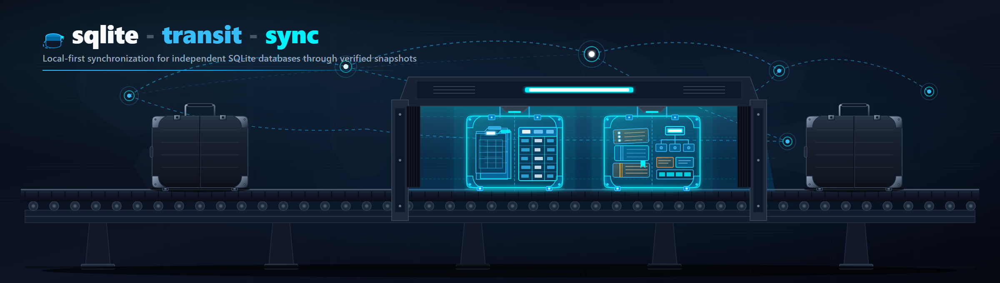
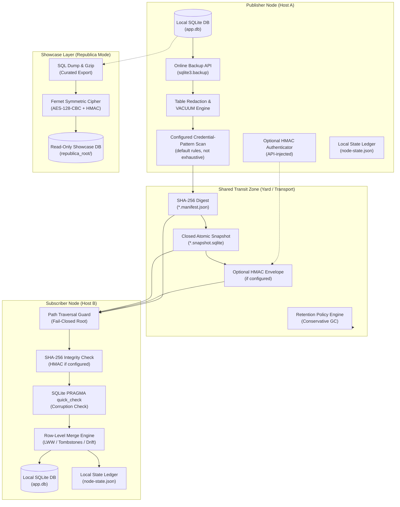
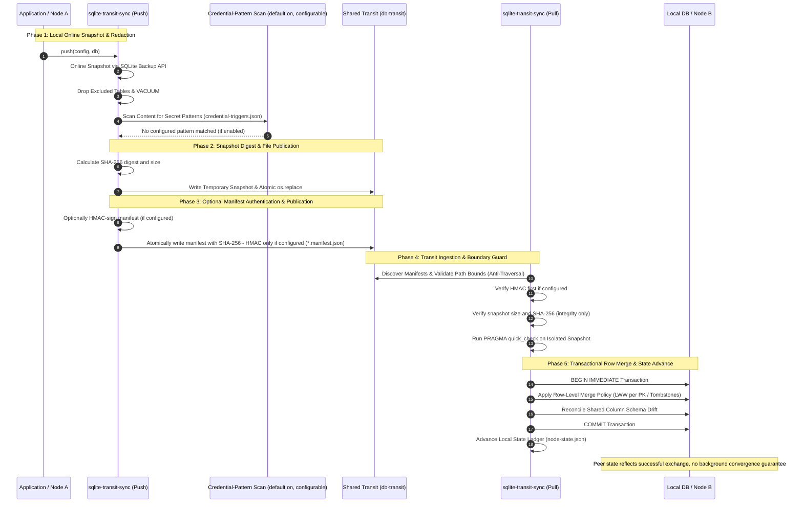

# sqlite-transit-sync



[](https://github.com/ellmos-ai/sqlite-transit-sync/actions/workflows/ci.yml)
[](CHANGELOG.md)
[-brightgreen.svg)](#tests)
[](#tests)
[](https://www.python.org/)
[](#)
[](#)
[](#governance-runtime-invariants-matrix)
[](SECURITY.md)
[](SECURITY.md)
[](CONTRIBUTING.md)
[](THIRD_PARTY_LICENSES.md)
[](THIRD_PARTY_LICENSES.txt)
[](NOTICE)
[](MARKETING-LOG.txt)
[](LICENSE)
[](https://github.com/ellmos-ai)
[](https://github.com/open-bricks)
[](llms.txt)

> [!NOTE]
> **LLM और AI एजेंट संदर्भ**: एक संरचित मशीन-पठनीय साइटमैप, आर्किटेक्चरल अवलोकन और API गाइड [`llms.txt`](llms.txt) पर उपलब्ध है।

**🇬🇧 [English Version](README.md)** | **🇩🇪 [Deutsche Version](README_de.md)** | **🇪🇸 [Spanish Version](README_es.md)** | **🇫🇷 [French Version](README_fr.md)** | **🇯🇵 [Japanese Version](README_ja.md)** | **🇨🇳 [Simplified Chinese Version](README_zh.md)** | **🇵🇹 [Portuguese Version](README_pt.md)** | **🇷🇺 [Russian Version](README_ru.md)** | **🇸🇦 [Arabic Version](README_ar.md)** | **🇮🇳 हिन्दी** | **🇧🇩 [Bengali Version](README_bn.md)** | **🤝 [Contributing](CONTRIBUTING.md)** | **🛡️ [Security Policy](SECURITY.md)** | **📝 [Changelog](CHANGELOG.md)** | **📋 [llms.txt](llms.txt)**

## 🧭 त्वरित नेविगेशन

1. [कार्यकारी सारांश और मुख्य पहचान](#what-is-sqlite-transit-sync)
2. [दृश्य आर्किटेक्चर टोपोलॉजी और डिकपल्ड परतें](#system-architecture-topology)
3. [एंड-टू-एंड स्नैपशॉट और सिंक्रोनाइज़ेशन जीवनचक्र](#end-to-end-snapshot-synchronization-lifecycle)
4. [लक्षित व्यक्तित्व और उच्च-इरादा SEO प्रश्न](#marketing--target-personas)
5. [कार्यान्वित व्यवहार और सीमाएं](#comparison-with-distributed-sql)
6. [गवर्नेंस और रनटाइम इनवेरिएंट्स मैट्रिक्स](#governance-runtime-invariants-matrix)
7. [मुख्य क्षमताएं और डिकपल्ड सुविधाएं](#what-it-provides)
8. [केवल-पठनीय एप्लिकेशन प्रोजेक्शन](#read-only-application-projections)
9. [इंस्टॉलेशन और पूर्व-आवश्यकताएं](#install)
10. [त्वरित आरंभ और मल्टी-नोड वर्कफ़्लो](#quick-start)
11. [कॉन्फ़िगरेशन संदर्भ और क्रेडेंशियल ट्रिगर](#configuration)
12. [रिपब्लिका शोकेस और सिफर विधि](#republica-the-showcase-method)
13. [पायथन API और विस्तार बिंदु](#python-api)
14. [सुरक्षा, खतरा मॉडल और परिचालन सीमाएं](#safety-and-limits)
15. [थर्ड-पार्टी लाइसेंस इन्वेंट्री](#third-party-licenses--transparency)
16. [इकोसिस्टम, सहोदर उपकरण और बंडल](#ecosystem--sibling-tools)
17. [परीक्षण, सत्यापन और CI मैट्रिक्स](#tests)
18. [वैधानिक सूचना, देयता सीमा और लाइसेंस (§ 521 BGB)](#license)

---

<a id="what-is-sqlite-transit-sync"></a><a id="core-identity"></a><a id="executive-summary--core-identity"></a>
## 1. कार्यकारी सारांश और मुख्य पहचान

संस्करण, मॉड्यूल स्थिति, दृश्यता और सत्यापन-तिथि का अधिकार [`METADATA_CONTRACT.md`](METADATA_CONTRACT.md) में परिभाषित हैं; वे रिलीज़ या सार्वजनिक-अपलोड अनुमोदन का गठन नहीं करते हैं।

अखंडता-सत्यापित स्नैपशॉट और एप्लिकेशन-चयन योग्य मर्ज नीतियों के माध्यम से स्वतंत्र SQLite डेटाबेस के लिए लोकल-फर्स्ट सिंक्रोनाइज़ेशन। API-इंजेक्‍टेड HMAC प्रमाणीकरण के माध्यम से प्रेषक प्रमाणीकरण वैकल्पिक है। इसे BACH ProSync आर्किटेक्चर से निकाला गया है, जिसमें कोई BACH, OneDrive, होस्ट-नाम या उपयोगकर्ता-पथ निर्भरताएं नहीं हैं।

यह **वितरित SQL सर्वर नहीं है**। प्रत्येक नोड केवल अपने स्थानीय डेटाबेस का स्वामित्व रखता है और उसे खोलता है। एक साझा फ़ोल्डर, ऑब्जेक्ट-स्टोर माउंट, हटाने योग्य ड्राइव या अन्य फ़ाइल ट्रांसपोर्ट बंद स्नैपशॉट और मेनिफेस्ट ले जाता है। पुल (Pull) ऑपरेशन एक लेन-देन के भीतर स्थानीय डेटाबेस में स्नैपशॉट को मर्ज करने से पहले SHA-256 और SQLite `PRAGMA quick_check` की जांच करता है। HMAC प्रेषक प्रमाणीकरण केवल तभी जाँचा जाता है जब कोई प्रमाणक कॉन्फ़िगर किया गया हो।

[sync-master](https://github.com/dev-bricks/sync-master) (समान मॉड्यूल परिवार) के साथ अच्छी तरह से काम करता है: एक sync-master यार्ड एक स्वाभाविक ट्रांजिट ट्रांसपोर्ट है — यार्ड के अंदर एक टूल-स्वामित्व वाले `db-transit/<namespace>/` ज़ोन पर `--transit` को इंगित करें (इसका प्रोटोकॉल नियम R9)। sync-master फ़ाइलों को ले जाता है, यह मॉड्यूल डेटाबेस अखंडता और विलय का स्वामित्व रखता है; दोनों स्वतंत्र रहते हैं।

---

<a id="system-architecture-topology"></a><a id="system-architecture"></a>
## 2. दृश्य आर्किटेक्चर टोपोलॉजी और अलग-अलग परतें

निम्नलिखित आरेख मल्टी-नोड डिकपल्ड टोपोलॉजी को दर्शाता है जहां स्थानीय SQLite डेटाबेस विशेष रूप से उनके मेनिफेस्ट के विरुद्ध अखंडता के लिए जांचे गए बंद स्नैपशॉट बंडलों के माध्यम से जुड़े होते हैं:



### ASCII चार-दृश्य आर्किटेक्चरल प्रोजेक्शन

```text
+-------------------------------------------------------------------------------------------------------------------+
|                               SQLITE-TRANSIT-SYNC: FOUR-VIEW ARCHITECTURAL TOPOLOGY                               |
+-------------------------------------------------------------------------------------------------------------------+
| [VIEW 1: PUBLISHER NODE]               [VIEW 2: SHARED TRANSIT YARD]              [VIEW 3: SUBSCRIBER NODE]       |
|                                                                                                                   |
| +-------------------------+              +-----------------------------+            +---------------------------+ |
| | Local SQLite Database   |              |  Closed Transit Zone        |            | Path Traversal Guard      | |
| | (app.db - Exclusive RW) |              |  (Folder / Sync-Master / S3)|            | (Canonical Bounds Check)  | |
| +------------+------------+              +--------------+--------------+            +-------------+-------------+ |
|              |                                          ^                                         |               |
|              v (sqlite3.backup)                         |                                         v               |
| +------------+------------+                             |                           +-------------+-------------+ |
| | Online Consistent Backup|                             |                           | SHA-256 Integrity Check   | |
| | (Closed Rollback-Journal|                             |                           | Optional HMAC if set      | |
| +------------+------------+                             |                           +-------------+-------------+ |
|              |                                          |                                         |               |
|              v                                          |                                         v               |
| +------------+------------+                             |                           +-------------+-------------+ |
| | Redaction & VACUUM      |                             |                           | SQLite PRAGMA quick_check | |
| | (Exclude Sensitive Data)|                             |                           | (Integrity Verification)  | |
| +------------+------------+                             |                           +-------------+-------------+ |
|              |                                          |                                         |               |
|              v                                          |                                         v               |
| +------------+------------+                             |                           +-------------+-------------+ |
| | Pattern Scan            |                             |                           | Transactional Row Merge   | |
| | (default rules; limited) |                             |                           | (Row-Level LWW / Drift)  | |
| +------------+------------+                             |                           +-------------+-------------+ |
|              |                                          |                                         |               |
|              v                                          |                                         v               |
| +------------+------------+              +--------------+--------------+            +-------------+-------------+ |
| | Optional HMAC Adapter   |              |  *.snapshot.sqlite (Atomic) |            | Local SQLite Database     | |
| | (API-injected if set)   |- - - - - - ->|  *.manifest.json   (Digest) |----------->| (app.db - Merged State)   | |
| +-------------------------+              |  Retention Engine  (Scoped) |            +-------------+-------------+ |
|                                          +-----------------------------+                          |               |
|                                                                                                   v               |
|                                                                                     +-------------+-------------+ |
|                                                                                     | Local State Ledger        | |
|                                                                                     | (node-state.json)         | |
|                                                                                     +---------------------------+ |
+-------------------------------------------------------------------------------------------------------------------+
| [VIEW 4: REPUBLICA SHOWCASE / COURIER ENVELOPE (OPTIONAL ZERO-TRUST TRANSPORT)]                                   |
|                                                                                                                   |
| Local Database ----> Curated SQL Dump ----> Gzip Compression ----> AES-128-CBC (Fernet) ----> Encrypted Outpost   |
| (Source Node)       (FTS Rebuilt on Dest)   (53MB -> 11MB)         (Pre-Shared Key)          (republica_root/)    |
|                                                                                                                   |
| Single Secret File -> Fernet Cipher Envelope -> Courier Transit -> Destination Directory (Mode 0600, Transit Clr) |
+-------------------------------------------------------------------------------------------------------------------+
```

---

<a id="end-to-end-snapshot-synchronization-lifecycle"></a><a id="lifecycle"></a>
## 3. एंड-टू-एंड स्नैपशॉट और सिंक्रोनाइज़ेशन जीवनचक्र

वर्कफ़्लो लाइव डेटाबेस फ़ाइलों को फ़ाइल-स्तरीय सिंक्रोनाइज़ेशन से बाहर रखता है। यह SHA-256 मेनिफेस्ट के विरुद्ध स्नैपशॉट बाइट्स की जांच करता है, सक्षम होने पर कॉन्फ़िगर किए गए क्रेडेंशियल-पैटर्न स्कैन को चलाता है (डिफ़ॉल्ट: चालू), और स्वीकृत पंक्तियों को लेन-देन के आधार पर मर्ज करता है। प्रेषक प्रमाणीकरण केवल तभी उपलब्ध होता है जब API-इंजेक्‍टेड HMAC प्रमाणक कॉन्फ़िगर किया गया हो। सहकर्मी सफल पुश/पुल एक्सचेंज के बाद ही परिवर्तन देखते हैं:



---

<a id="marketing--target-personas"></a><a id="target-personas--discoverability-queries"></a><a id="target-personas"></a>
## 4. लक्षित उपयोगकर्ता और उच्च-आशय खोज प्रश्न

मॉड्यूलर, विकेंद्रीकृत पारिस्थितिक तंत्र के लिए डिज़ाइन किया गया, `sqlite-transit-sync` 4 मुख्य हितधारक व्यक्तित्वों को संबोधित करता है:

- **`[PERSONA-01]` स्वायत्त AI एजेंट इंजीनियर और मल्टी-होस्ट स्वार्म आर्किटेक्ट:**
  - *चुनौती:* वर्कस्टेशन, लैपटॉप और सर्वर पर काम करने वाले मल्टी-एजेंट स्वार्म को फ़ाइल-लॉक टकराव के बिना स्थानीय स्थिति दृढ़ता की आवश्यकता होती है।
  - *समाधान:* डिफ़ॉल्ट-चालू स्कैन कॉन्फ़िगर किए गए क्रेडेंशियल पैटर्न से मेल खाने पर प्रकाशन को रोक सकता है। यह एक सुरक्षा तंत्र है, इस बात का प्रमाण नहीं कि स्नैपशॉट में कोई रहस्य नहीं है। सहकर्मियों को सफल पुश/पुल विनिमय के बाद परिवर्तन प्राप्त होते हैं।
- **`[PERSONA-02]` मल्टी-डिवाइस डेस्कटॉप और एज एप्लिकेशन डेवलपर्स:**
  - *चुनौती:* फ़ाइल सिंक (जैसे sync-master, Syncthing, Nextcloud) पर व्यक्तिगत नोट्स और कार्य डेटाबेस का आदान-प्रदान करने वाले पावर उपयोगकर्ताओं को डेटाबेस भ्रष्टाचार और `-wal` लॉक-अप का सामना करना पड़ता है।
  - *समाधान:* SQLite बैकअप API और प्रति-फ़ाइल प्रकाशन लाइव SQLite डेटाबेस फ़ाइलों को फ़ाइल-सिंक पथ से बाहर रखते हैं; ट्रांजिट स्नैपशॉट उस ट्रांसपोर्ट द्वारा आदान-प्रदान की जाने वाली फ़ाइलें हैं।
- **`[PERSONA-03]` लोकल-फर्स्ट और कॉन्फ़िगरेबल-ट्रांजिट टूल बिल्डर्स:**
  - *चुनौती:* डेटा संप्रभुता की आवश्यकता वाले अनुप्रयोग क्लाउड लॉक-इन, आवर्ती डेटाबेस होस्टिंग शुल्क या अनियंत्रित पृष्ठभूमि नेटवर्क निकास को बर्दाश्त नहीं कर सकते।
  - *समाधान:* मॉड्यूल एक कॉन्फ़िगर किए गए फ़ाइल सिस्टम पथ के माध्यम से स्नैपशॉट फ़ाइलों का आदान-प्रदान करता है। वह पथ स्थानीय या हटाने योग्य हो सकता है; साझा या नेटवर्क-माउंटेड ट्रांसपोर्ट मॉड्यूल के नियंत्रण से बाहर रहता है।
- **`[PERSONA-04]` एंटरप्राइज़ सुरक्षा, गोपनीयता और अनुपालन अधिकारी:**
  - *चुनौती:* सख्त शून्य-विश्वास नियम आकस्मिक क्रेडेंशियल सिंक्रोनाइज़ेशन, असत्यापित बाइनरी ब्लॉब्स और विशेषाधिकार प्राप्त पृष्ठभूमि सेवाओं को प्रतिबंधित करते हैं।
  - *समाधान:* डिफ़ॉल्ट-चालू स्कैन प्रकाशन से पहले कॉन्फ़िगर किए गए क्रेडेंशियल पैटर्न की जांच करता है; SHA-256 मेनिफेस्ट के विरुद्ध स्नैपशॉट अखंडता की पुष्टि करता है। प्रेषक प्रमाणीकरण के लिए API-इंजेक्‍टेड HMAC प्रमाणक सक्षम किया जा सकता है। प्रक्रिया इसे शुरू करने वाले उपयोगकर्ता की अनुमतियाँ प्राप्त करती है।

### उच्च-आशय खोज प्रश्न (द्विभाषी EN और DE)

| इरादा श्रेणी | अंग्रेजी (EN) खोज प्रश्न | जर्मन (DE) खोज शब्द |
|:---|:---|:---|
| **लोकल-फर्स्ट सिंक्रोनाइज़ेशन** | `sqlite synchronization python zero-dependency`, `local-first database snapshot sync`, `offline sqlite multi-device sync` | `lokale datenbank synchronisation offline snapshots`, `sqlite abgleich python ohne abhängigkeiten`, `lokale datenbank replikation dateibasiert` |
| **अखंडता और कॉन्फ़िगर क्रेडेंशियल-पैटर्न स्कैन** | `configured credential-pattern scan sqlite sync`, `configured filesystem transit sqlite sync`, `optional hmac sqlite snapshot manifest` | `konfigurierter credential musterscan sqlite sync`, `dateipfad transit sqlite sync`, `optional hmac snapshot manifest` |
| **पंक्ति-स्तरीय मर्ज और संघर्ष** | `row level merge lww sqlite offline`, `sqlite last write wins schema drift tolerance`, `tombstone merge policy sqlite` | `row level merge lww sqlite offline`, `last-write-wins datenbank abgleich zeitstempel`, `schema drift toleranz sqlite merge` |
| **डिकपल्ड आर्किटेक्चर** | `sqlite multi-node sync without distributed sql`, `sqlite over syncthing without corruption`, `sqlite transit yard architecture` | `sqlite synchronisation ohne verteilten server`, `sqlite über cloud sync ohne datenbankkorruption`, `transit yard sqlite synchronisation` |

विस्तृत व्यक्तित्व विवरण, उच्च-इरादा खोज प्रश्नों और प्रतिस्पर्धी स्थिति के लिए [MARKETING-LOG.txt](MARKETING-LOG.txt) देखें।

---

<a id="comparison-with-distributed-sql"></a><a id="comparative-matrix--alternatives"></a><a id="comparative-matrix"></a>
## 5. कार्यान्वित व्यवहार और सीमाएँ

यह खंड परियोजना के कार्यान्वित व्यवहार और सीमाओं को दर्ज करता है। यह अन्य उत्पादों का वर्तमान तुलनात्मक ऑडिट नहीं है।

| आयाम | इनवेरिएंट | कार्यान्वित व्यवहार | सीमा / दायरा |
|:---|:---|:---|:---|
| **1. स्थानीय प्रसंस्करण और परिवहन** | `INV-LOCAL-01` | स्थानीय SQLite डेटाबेस पढ़ता है और कॉन्फ़िगर किए गए ट्रांजिट पथ पर स्नैपशॉट प्रकाशित करता है; किसी केंद्रीय डेटाबेस सर्वर की आवश्यकता नहीं है। | कॉन्फ़िगर किया गया पथ साझा या नेटवर्क-माउंटेड स्थान हो सकता है। उस ट्रांसपोर्ट की पहुंच और व्यवहार इस मॉड्यूल के बाहर रहता है। |
| **2. स्नैपशॉट प्रकाशन** | `INV-SNAP-02` | ऑनलाइन बैकअप लेता है और अस्थायी फ़ाइल तथा `os.replace` के साथ स्नैपशॉट फ़ाइल प्रकाशित करता है। | प्रति-फ़ाइल प्रतिस्थापन स्नैपशॉट और मेनिफेस्ट को एक मल्टी-फ़ाइल लेन-देन नहीं बनाता है। |
| **3. साइडकार्स और प्रक्रिया दायरा** | `INV-ROLL-03` | रोलबैक-जर्नल मोड में स्नैपशॉट बंद करता है और जब अस्थायी SQLite साइडकार साफ़ नहीं किए जा सकते हैं तो सुरक्षित रूप से विफल (fail closed) हो जाता है। | प्रति नोड एक सिंक प्रक्रिया चलाएं जब तक कि होस्ट एप्लिकेशन कोई प्रक्रिया लॉक न जोड़े। |
| **4. ट्रांजिट पथ रोकथाम** | `INV-PATH-04` | मेनिफेस्ट और स्नैपशॉट पथों को प्रामाणिक ट्रांजिट रूट के तहत प्रत्यक्ष नियमित फ़ाइलों तक सीमित करता है। | यह नियंत्रित नहीं करता कि ट्रांजिट स्थान पर कौन लिख सकता है। |
| **5. अखंडता जांच** | `INV-VERIFY-05` | मेनिफेस्ट SHA-256 के साथ स्नैपशॉट बाइट्स की तुलना करता है और SQLite `PRAGMA quick_check` चलाता है। | मिलान वाला डाइजेस्ट प्रेषक या ट्रांसपोर्ट को प्रमाणित नहीं करता है। |
| **6. क्रेडेंशियल-पैटर्न स्कैन** | `INV-SHIELD-06` | डिफ़ॉल्ट रूप से, कॉन्फ़िगर किए गए पैटर्न के विरुद्ध स्नैपशॉट सामग्री की जांच करता है और मिलान होने पर प्रकाशन निरस्त करता है, केवल `table.column` की रिपोर्ट करता है, मान की नहीं। | वेंडर-उपसर्ग वाले नियम सुरक्षा जाल हैं, गारंटी नहीं। स्वच्छ स्कैन का अर्थ है कोई ज्ञात पैटर्न मेल नहीं खाया; कस्टम रहस्य पास हो सकते हैं। |
| **7. प्रेषक प्रमाणीकरण** | `INV-HMAC-07` | एक एप्लिकेशन प्रामाणिक मेनिफेस्ट के लिए API-इंजेक्‍टेड HMAC-SHA256 प्रमाणीकरण का विकल्प चुन सकता है। | कॉन्फ़िगर किए गए प्रमाणक के बिना कोई प्रेषक प्रमाणीकरण नहीं है। साझा-कुंजी HMAC कोई नवीनता प्रोटोकॉल या सार्वजनिक-कुंजी हस्ताक्षर नहीं है। |
| **8. पंक्ति मर्ज** | `INV-MERGE-08` | एक कॉन्फ़िगरेबल पंक्ति-स्तरीय मर्ज नीति लागू करता है, जिसमें समर्थित तालिकाओं के लिए डिफ़ॉल्ट रूप से टाइमस्टैम्प-आधारित LWW होता है। | एकीकृत एप्लिकेशन क्लॉक मान्यताओं, विलोपन शब्दार्थ, माइग्रेशन और डोमेन संघर्ष नियमों का स्वामित्व रखता है। |
| **9. अवधारण और विलोपन दायरा** | `INV-RET-09` | सफ़ाई डिफ़ॉल्ट रूप से ड्राई-रन होती है और स्थानीय-नोड आर्टिफ़ैक्ट तक सीमित होती है जब तक कि क्रॉस-नोड अधिकार स्पष्ट रूप से सक्षम न हो। | अवधारण सफ़ाई कोई बैकअप या पुनर्प्राप्ति सेवा नहीं है। |
| **10. प्रक्रिया अनुमतियाँ और सुरक्षा नीति** | `INV-SLA-10` | प्रक्रिया इसे लॉन्च करने वाली प्रक्रिया की अनुमतियों का उपयोग करती है। `SECURITY.md` रिपोर्टिंग नीति बताता है: 48 घंटों के भीतर पावती और 5 कार्य दिवसों के भीतर ट्राइएज। | मॉड्यूल मानक-उपयोगकर्ता विशेषाधिकार लागू नहीं करता है या उन्नयन का अनुरोध नहीं करता है। प्रतिक्रिया समय एक रिपोर्टिंग नीति है, रनटाइम सुविधा नहीं। |

<a id="distributed-sql-detailed-comparison"></a>
### प्रोसेसिंग मॉडल और सीमाएँ

| पहलू | `sqlite-transit-sync` व्यवहार | सीमा / दायरा |
|---|---|---|
| मूल मॉडल | प्रत्येक नोड का अपना स्थानीय SQLite डेटाबेस होता है; स्नैपशॉट एक कॉन्फ़िगर किए गए ट्रांजिट पथ के माध्यम से आगे बढ़ते हैं। | कोई एकल विश्व स्तर पर आधिकारिक डेटाबेस नहीं है। |
| लेखन कार्य | एप्लिकेशन स्थानीय रूप से लिखते हैं; कॉलर स्नैपशॉट का आदान-प्रदान करने के लिए पुश और पुल चलाता है। | कोई स्वचालित पृष्ठभूमि सिंक्रोनाइज़ेशन नहीं है। |
| दृश्यता | सफल विनिमय और विलय के बाद एक सहकर्मी परिवर्तन देख सकता है। | मॉड्यूल तत्काल या विश्व स्तर पर सुसंगत दृश्यता का वादा नहीं करता है। |
| वैश्विक लेन-देन | प्रदान नहीं किया गया। | एप्लिकेशन एकाधिक नोड्स पर एक लेन-देन प्रतिबद्ध नहीं कर सकता है। |
| ऑफ़लाइन संचालन | नोड ऑफ़लाइन होने पर भी स्थानीय डेटाबेस का स्वतंत्र रूप से उपयोग किया जा सकता है। | स्नैपशॉट विनिमय तब तक प्रतीक्षा करता है जब तक कॉन्फ़िगर किया गया ट्रांजिट उपलब्ध न हो। |
| संघर्ष | कॉन्फ़िगर की गई `MergePolicy` तय करती है कि पंक्तियों को कैसे संयोजित किया जाए; टाइमस्टैम्प LWW डिफ़ॉल्ट है। | एप्लिकेशन घड़ियां, विलोपन नियम और डोमेन शब्दार्थ एकीकरण की ज़िम्मेदारी बने रहते हैं। |
| स्कीमा परिवर्तन | साझा-कॉलम मर्ज सीमित स्कीमा बहाव का समर्थन करता है। | एप्लिकेशन माइग्रेशन और स्कीमा संगतता के लिए ज़िम्मेदार बने रहते हैं। |
| विफलता प्रबंधन | स्थानीय डेटा SQLite में संग्रहीत होता है और ट्रांजिट स्नैपशॉट अलग फ़ाइलें होती हैं। | मॉड्यूल स्वचालित प्रतिकृति, फ़ेलओवर या ट्रांजिट बैकअप प्रदान नहीं करता है। |

### लाभ, सीमाएँ और सामान्य उपयोग परिदृश्य

| प्रणाली | फायदे | नुकसान | अच्छे उपयोग के मामले | अनुपयुक्त उपयोग के मामले |
|---|---|---|---|---|
| `sqlite-transit-sync` | छोटा स्थानीय फ़ुटप्रिंट; कोई केंद्रीय डेटाबेस सर्वर नहीं; ऑफ़लाइन स्थानीय कार्य; विन्यास योग्य फ़ाइल ट्रांसपोर्ट; एप्लिकेशन-चयन योग्य मर्ज नीतियां। | परिवर्तनों को सहकर्मियों तक पहुंचने के लिए पुश/पुल की आवश्यकता होती है; कोई वैश्विक लेन-देन या स्वचालित फ़ेलओवर नहीं; घड़ियों, विलोपन, माइग्रेशन और संघर्षों के लिए एप्लिकेशन नियमों की आवश्यकता होती है। | व्यक्तिगत या कार्य डेटाबेस; स्थानीय एजेंट स्थिति; रुक-रुक कर जुड़े लैपटॉप, वर्कस्टेशन या एज डिवाइस; शोध नोट्स। | विश्व स्तर पर प्रतिबद्ध लेन-देन, तत्काल साझा स्थिति, स्वचालित फ़ेलओवर या कई समवर्ती लेखकों की आवश्यकता वाले कार्यभार। |

### त्वरित निर्णय मार्गदर्शिका

| आवश्यकता | उपयुक्तता |
|---|---|
| ऑफ़लाइन होने पर भी नोड्स को अपने स्थानीय डेटाबेस का उपयोग जारी रखने की आवश्यकता है | `sqlite-transit-sync` |
| अपडेट स्पष्ट पुश/पुल एक्सचेंज के बाद सहकर्मियों तक पहुंच सकते हैं | `sqlite-transit-sync` |
| एप्लिकेशन अपने मर्ज, क्लॉक, विलोपन और माइग्रेशन नियमों को परिभाषित कर सकता है | `sqlite-transit-sync` |
| प्रत्येक लेखन तुरंत विश्व स्तर पर आधिकारिक होना चाहिए | उस स्थिरता अनुबंध वाले आर्किटेक्चर का उपयोग करें |
| वैश्विक लेन-देन, स्वचालित फ़ेलओवर या कई समवर्ती लेखक आवश्यक हैं | उन व्यवहारों को प्रदान करने वाले आर्किटेक्चर का मूल्यांकन करें |

रुक-रुक कर जुड़े उपकरणों की एक छोटी संख्या के लिए, यह मॉड्यूल तब उपयुक्त हो सकता है जब विलंबित विनिमय और एप्लिकेशन-स्वामित्व वाले मर्ज नियम स्वीकार्य हों। यदि कार्यभार के लिए वैश्विक लेन-देन, तत्काल साझा स्थिति या स्वचालित फ़ेलओवर की आवश्यकता है, तो ऐसा डिज़ाइन चुनें जिसका प्रलेखित अनुबंध उन व्यवहारों को प्रदान करता हो।

---

<a id="governance-runtime-invariants-matrix"></a><a id="governance--runtime-invariants"></a>
## 6. गवर्नेंस और रनटाइम इनवेरिएंट मैट्रिक्स

नीचे दी गई मैट्रिक्स परियोजना के 10 गवर्नेंस और रनटाइम इनवेरिएंट्स को कार्यान्वित व्यवहार और प्रासंगिक सीमाओं के साथ दर्ज करती है:

| # | इनवेरिएंट | आर्किटेक्चरल दायरा | प्रलेखित व्यवहार और सीमाएं |
|---|---|---|---|
| 1 | **INV-LOCAL-01: स्थानीय SQLite प्रसंस्करण और कॉन्फ़िगर ट्रांजिट** | सिस्टम आर्किटेक्चर | स्थानीय SQLite डेटाबेस पढ़ता है और कॉन्फ़िगर किए गए ट्रांजिट पथ के माध्यम से स्नैपशॉट प्रकाशित करता है। पथ साझा या नेटवर्क-माउंटेड हो सकता है; होस्ट और ट्रांसपोर्ट व्यवहार इस मॉड्यूल के बाहर हैं। |
| 2 | **INV-SNAP-02: ऑफ़लाइन स्नैपशॉट परमाणुकता** | ट्रांजिट प्रकाशन | लाइव डेटाबेस फ़ाइलें कभी भी फ़ाइल-सिंक पर साझा नहीं की जाती हैं। ऑनलाइन स्नैपशॉट `sqlite3.backup` के माध्यम से लिए जाते हैं और परमाणु `os.replace` के माध्यम से प्रकाशित किए जाते हैं। |
| 3 | **INV-ROLL-03: रोलबैक जर्नल स्वच्छ अलगाव** | साइडकार रोकथाम | बैकअप रोलबैक-जर्नल मोड में बंद होते हैं; मेनिफेस्ट निर्माण से पहले सभी अस्थायी SQLite साइडकार (`-wal`, `-shm`, `-journal`) सुरक्षित रूप से साफ़ किए जाते हैं। |
| 4 | **INV-PATH-04: सख्त ट्रांजिट पथ रोकथाम** | फ़ाइल सिस्टम सीमा | मेनिफेस्ट और स्नैपशॉट पथ प्रामाणिक ट्रांजिट रूट के भीतर प्रत्यक्ष नियमित फ़ाइलें होने चाहिए। पाथ ट्रैवर्सल (`../`), सिम्बोलिक लिंक और रिपार्स पॉइंट सुरक्षित रूप से विफल हो जाते हैं। |
| 5 | **INV-VERIFY-05: दो-चरणीय अखंडता और शुद्धता सत्यापन** | प्री-मर्ज सत्यापन | प्रत्येक प्राप्त स्नैपशॉट को डेटा का निरीक्षण या विलय करने से पहले SHA-256 क्रिप्टोग्राफ़िक डाइजेस्ट मिलान और SQLite `PRAGMA quick_check` पास करना होगा। |
| 6 | **INV-SHIELD-06: प्री-पब्लिकेशन क्रेडेंशियल शील्डिंग** | सामग्री निरीक्षण | डिफ़ॉल्ट रूप से, स्नैपशॉट सामग्री के विरुद्ध कॉन्फ़िगर किए गए क्रेडेंशियल पैटर्न की जांच की जाती है; मिलान होने पर प्रकाशन रद्द हो जाता है और केवल `table.column` की रिपोर्ट होती है, मान की नहीं। वेंडर-उपसर्ग वाले पैटर्न एक सुरक्षा जाल हैं, गारंटी नहीं; मिलान न होना यह साबित नहीं करता कि स्नैपशॉट रहस्य-मुक्त है। |
| 7 | **INV-HMAC-07: वैकल्पिक HMAC प्रमाणीकरण** | प्रेषक प्रमाणीकरण | प्रामाणिक मेनिफेस्ट पेलोड (प्रोटोकॉल, नेमस्पेस, प्रेषक ID, फ़ाइल नाम, SHA-256, आकार, विलोपन सूची) पर वैकल्पिक API-इंजेक्‍टेड HMAC-SHA256 लिफाफा। साझा-कुंजी HMAC कोई नवीनता प्रोटोकॉल या सार्वजनिक-कुंजी हस्ताक्षर नहीं है; इसके बिना, मेनिफेस्ट प्रेषक को प्रमाणित नहीं करता है। |
| 8 | **INV-MERGE-08: नियतात्मक पंक्ति-स्तरीय मर्ज** | डेटा अभिसरण | लेन-देन संबंधी पंक्ति-स्तरीय मर्ज (प्रति PK LWW, स्कीमा बहाव के लिए साझा कॉलम संघ, स्पष्ट टॉम्बस्टोन नीति)। सामग्री हैश टाई-ब्रेकर नियतात्मक अभिसरण सुनिश्चित करता है। |
| 9 | **INV-RET-09: रूढ़िवादी अवधारण और प्राधिकरण दायरा** | कचरा संग्रहण | स्नैपशॉट सफ़ाई डिफ़ॉल्ट रूप से ड्राई-रन होती है, जो स्थानीय नोड के आर्टिफ़ैक्ट तक सख्ती से सीमित होती है। क्रॉस-नोड विलोपन (`--all-nodes`) के लिए स्पष्ट प्रशासनिक विकल्प की आवश्यकता होती है। |
| 10 | **INV-SLA-10: प्रक्रिया अनुमतियाँ और सुरक्षा नीति** | रनटाइम संदर्भ | प्रक्रिया इसे लॉन्च करने वाले की अनुमतियाँ प्राप्त करती है; यह मॉड्यूल मानक-उपयोगकर्ता विशेषाधिकार लागू नहीं करता है या उन्नयन का अनुरोध नहीं करता है। `SECURITY.md` 48 घंटों के भीतर पावती और 5 कार्य दिवसों के भीतर ट्राइएज का उल्लेख करता है। |

---

<a id="what-it-provides"></a><a id="core-capabilities"></a><a id="part-of-the-ellmos-stack-family"></a>
## 7. मुख्य क्षमताएँ और स्वतंत्र सुविधाएँ

`sqlite-transit-sync` समान मॉड्यूल परिवार में [dev-bricks/sync-master](https://github.com/dev-bricks/sync-master) का एक साथी है: sync-master फ़ाइल ट्रांसपोर्ट (`sync.files`) का मालिक है, यह मॉड्यूल डेटाबेस अखंडता और विलय (`sync.database`) का मालिक है। दोनों स्टैंडअलोन काम करते हैं या [ellmos-ai](https://github.com/ellmos-ai) परिवार से स्टैक में रचे जाते हैं — [ellmos-ai/stacks](https://github.com/ellmos-ai/stacks) कैटलॉग देखें। उस टूलकिट में इसकी भूमिका: फ़ाइल-सिंक पर कोई लाइव SQLite नहीं — केवल वे स्नैपशॉट जो मेनिफेस्ट और SQLite अखंडता जांच पास करते हैं, साथ ही एप्लिकेशन-चयन योग्य मर्ज नीतियां।

### प्रमुख क्षमताएँ

- SQLite के बैकअप API के माध्यम से सुसंगत ऑनलाइन स्नैपशॉट;
- एक अस्थायी फ़ाइल और `os.replace` का उपयोग करके परमाणु प्रकाशन;
- प्रकाशन से पहले प्रत्येक अस्थायी SQLite साइडकार की सुरक्षित सफ़ाई के साथ बंद, रोलबैक-जर्नल स्नैपशॉट;
- मेनिफेस्ट और स्नैपशॉट पथ प्रामाणिक ट्रांजिट निर्देशिका में प्रत्यक्ष नियमित फ़ाइलों तक सीमित हैं; हैशिंग या मर्ज से पहले पाथ ट्रैवर्सल, पूर्ण पथ, सिम्लिंक और रिपार्स पॉइंट सुरक्षित रूप से विफल हो जाते हैं;
- SHA-256 मेनिफेस्ट और `PRAGMA quick_check` सत्यापन;
- स्पष्ट कुंजी ID के साथ प्रामाणिक मेनिफेस्ट, प्रेषक पहचान, प्रोटोकॉल संस्करण और स्नैपशॉट हैश पर वैकल्पिक API-इंजेक्‍टेड HMAC-SHA256 प्रमाणीकरण;
- प्रति-नोड स्थानीय पुल स्थिति और समरूपी (idempotent) रीप्ले;
- टाइमस्टैम्प की गई तालिकाओं के लिए प्राथमिक कुंजी के अनुसार पंक्ति-स्तरीय लास्ट-राइट-विन्स (LWW);
- स्पष्ट विलोपन के लिए एक वैकल्पिक `TombstoneMergePolicy` संदर्भ एडेप्टर;
- बुनियादी स्कीमा बहाव सहनशीलता के लिए साझा-कॉलम मर्ज;
- कॉन्फ़िगरेबल टेबल बहिष्करण और पोस्ट-डिलीट VACUUM के साथ स्नैपशॉट रिडक्शन;
- एक डिफ़ॉल्ट-चालू सामग्री स्कैन जो कॉन्फ़िगर किए गए क्रेडेंशियल पैटर्न से मेल खाने पर प्रकाशन को निरस्त करता है (`table.column` की रिपोर्ट करता है, कभी भी मान की नहीं)। वेंडर-उपसर्ग वाले नियम एक सुरक्षा जाल हैं; एक स्वच्छ स्कैन यह साबित नहीं करता कि स्नैपशॉट में कोई रहस्य नहीं है;
- डोमेन नियमों, टॉम्बस्टोन या CRDTs के लिए कस्टम `MergePolicy` समर्थन;
- डिफ़ॉल्ट रूप से ड्राई-रन, डिफ़ॉल्ट रूप से स्थानीय-नोड दायरे, और विलोपन तथा विदेशी-नोड प्रशासन के लिए स्पष्ट विकल्पों के साथ सत्यापित स्नैपशॉट सफ़ाई;
- मर्ज या स्थिति-प्रगति तर्क की नकल किए बिना पतले एप्लिकेशन जीवनचक्र एडेप्टर के लिए चयनित लंबित पुल;
- सटीक स्कीमा/गोपनीयता अनुमति सूचियों, उद्भव, चेकपॉइंट, लूप और ऑफ़लाइन-टॉम्बस्टोन सत्यापन के साथ सख्त संस्करणित केवल-पठनीय प्रोजेक्शन अनुबंध;
- एक वैकल्पिक [Republica showcase mode](#republica-the-showcase-method) जो डेटाबेस को एन्क्रिप्टेड पेलोड के रूप में एकतरफा वितरित करता है और इसे मर्ज करने के बजाय एक अलग केवल-पठनीय शोकेस के रूप में साकार करता है;
- निर्भरता-मुक्त पायथन API और JSON CLI (रिपब्लिका मोड `cryptography` जोड़ता है)।

---

<a id="read-only-application-projections"></a><a id="projections"></a>
## 8. केवल-पठनीय एप्लिकेशन प्रोजेक्शन

`verify-projection` स्थिति की प्रतिलिपि बनाने, विलय करने, माइग्रेट करने, शेड्यूलिंग करने या आगे बढ़ाने के बिना एक बंद, एप्लिकेशन-स्वामित्व वाले SQLite प्रोजेक्शन को मान्य करता है। एप्लिकेशन अपनी उपभोक्ता पहचान और समीक्षा किए गए अधिकतम ऑफ़लाइन अंतराल की आपूर्ति करता है; सत्यापनकर्ता लूप, पुराने चेकपॉइंट, अपर्याप्त टॉम्बस्टोन अवधारण, असूचीबद्ध तालिकाओं या कॉलमों और गैर-अपारदर्शी रिकॉर्ड संदर्भों को अस्वीकार करता है।

खाता-शेष सारांश, AboTracker सदस्यता स्थिति, HausLagerist पुनःपूर्ति तिथियां, दवा देय/इन्वेंट्री-चेतावनी स्थिति, नियमित देय/पूर्णता स्थिति और बीमा समय-सीमा के लिए छह संकीर्ण अनुबंध बंडल किए गए हैं। AboTracker अनुबंध केवल स्थिति-मात्र है क्योंकि निर्यात स्कीमा v1 में कोई पुष्ट अगली देय या नवीनीकरण तिथि नहीं है; यह कभी भी भुगतान तिथि और बिलिंग चक्र से रिमाइंडर प्राप्त नहीं करता है। परीक्षण फिक्स्चर सिंथेटिक JSON व्यंजन हैं, और डोमेन पहचान या निजी विवरण अनुमति सूचियों से बाहर रहते हैं।

बंडल किए गए नाम `abotracker-subscription-status-projection.v1`, `accounts-balance-projection.v1`, `hauslagerist-replenishment-projection.v1`, `mediplaner-reminder-projection.v1`, `routinika-reminder-projection.v1`, और `versicherungsmanager-deadline-projection.v1` हैं। [Read-only projection contracts](PROJECTION_CONTRACTS.md) और [German companion](PROJECTION_CONTRACTS_de.md) देखें।

```bash
sqlite-transit-sync verify-projection \
  --contract mediplaner-reminder-projection.v1 \
  --database ./closed-projection.sqlite \
  --consumer-id reminder-consumer \
  --minimum-offline-seconds 2592000 \
  --previous-checkpoint 41
```

---

<a id="install"></a><a id="installation"></a>
## 9. इंस्टॉलेशन और पूर्व-आवश्यकताएँ

```bash
python -m pip install -e .
```

---

<a id="quick-start"></a><a id="quickstart"></a>
## 10. त्वरित आरंभ और मल्टी-नोड वर्कफ़्लो

प्रत्येक नोड पर एक कॉन्फ़िगरेशन बनाएं। प्रत्येक नोड अपने स्वयं के डेटाबेस और स्थिति फ़ाइल का उपयोग करता है, लेकिन समान ट्रांजिट निर्देशिका और नेमस्पेस का उपयोग करता है।

```bash
sqlite-transit-sync init \
  --config node.json \
  --database ./app.db \
  --transit ./shared-transit \
  --node-id laptop \
  --namespace my-app

sqlite-transit-sync push --config node.json
sqlite-transit-sync pull --config node.json --dry-run
sqlite-transit-sync pull --config node.json
sqlite-transit-sync status --config node.json
sqlite-transit-sync verify --config node.json
sqlite-transit-sync cleanup --config node.json
# Review the JSON plan, then explicitly apply it:
sqlite-transit-sync cleanup --config node.json --apply
```

एप्लिकेशन स्कीमा प्रत्येक नोड पर पहले से मौजूद होना चाहिए। स्वचालित पहली-प्रतिलिपि को जानबूझकर अक्षम किया गया है क्योंकि एक सामान्य मॉड्यूल यह तय नहीं कर सकता कि कौन सा स्कीमा, रहस्य, स्थानीय तालिकाएं या माइग्रेशन किसी एप्लिकेशन से संबंधित हैं।

### स्वतंत्र निष्पादन-योग्य Python त्वरित आरंभ (शून्य बाहरी निर्भरताएँ)

एजेंट फ्रेमवर्क, डेमॉन या बैकग्राउंड वर्कर्स में सीधे `sqlite-transit-sync` को एकीकृत करने वाले डेवलपर्स शून्य बाहरी निर्भरता के साथ एंड-टू-एंड मल्टी-नोड सिंक्रोनाइज़ेशन को सत्यापित करने के लिए इस आत्मनिर्भर, कॉपी-पेस्टेबल स्क्रिप्ट को चला सकते हैं:

```python
import sqlite3
from contextlib import closing
import tempfile
from pathlib import Path
from sqlite_transit_sync import SyncConfig, TransitSync

with tempfile.TemporaryDirectory() as tmp:
    root = Path(tmp)
    transit = root / "transit"
    transit.mkdir()

    # 1. Initialize Node A and record local data
    db_a = root / "node_a.db"
    with closing(sqlite3.connect(db_a)) as conn, conn:
        conn.execute("CREATE TABLE notes (id INTEGER PRIMARY KEY, title TEXT, updated_at TEXT)")
        conn.execute("INSERT INTO notes VALUES (1, 'Hello from Node A', '2026-10-18T08:00:00Z')")

    # 2. Publish atomic snapshot from Node A to shared transit
    cfg_a = SyncConfig(database=db_a, transit=transit, state=root / "state_a.json", node_id="node_a", namespace="demo")
    snapshot = TransitSync(cfg_a).push()
    print(f"Node A published snapshot: {snapshot.path.name} (SHA-256: {snapshot.sha256[:8]}...)")

    # 3. Initialize Node B with schema and pull snapshot
    db_b = root / "node_b.db"
    with closing(sqlite3.connect(db_b)) as conn, conn:
        conn.execute("CREATE TABLE notes (id INTEGER PRIMARY KEY, title TEXT, updated_at TEXT)")

    cfg_b = SyncConfig(database=db_b, transit=transit, state=root / "state_b.json", node_id="node_b", namespace="demo")
    reports = TransitSync(cfg_b).pull()

    # 4. Verify converged state in Node B
    with closing(sqlite3.connect(db_b)) as conn, conn:
        rows = conn.execute("SELECT id, title, updated_at FROM notes").fetchall()
        print(f"Node B converged records: {rows}")
        assert rows == [(1, "Hello from Node A", "2026-10-18T08:00:00Z")]
```

---

<a id="configuration"></a><a id="configuration-reference"></a>
## 11. कॉन्फ़िगरेशन संदर्भ और क्रेडेंशियल ट्रिगर

```json
{
  "database": "./app.db",
  "transit": "./shared-transit",
  "state": "./node-state.json",
  "node_id": "laptop",
  "namespace": "my-app",
  "timestamp_columns": ["updated_at", "modified_at", "created_at"],
  "exclude_tables": ["secrets", "sqlite_sequence"],
  "snapshot_exclude_tables": ["secrets"],
  "scan_snapshot_for_secrets": true,
  "secret_scan_skip_tables": [],
  "secret_scan_extra_patterns": [],
  "secret_patterns_file": null
}
```

सापेक्ष पथ कॉन्फ़िगरेशन फ़ाइल से हल किए जाते हैं। लाइव डेटाबेस कभी भी ट्रांजिट निर्देशिका के अंदर स्थित नहीं होना चाहिए, और स्थिति फ़ाइल ट्रांजिट ट्री के बाहर होनी चाहिए। `SyncConfig`, `from_file`, `from_bytes` और CLI `init` ट्रांजिट या स्थिति निर्देशिका बनाने से पहले एक अमान्य स्थिति पथ को अस्वीकार करते हैं; कोई माइग्रेशन स्वचालित रूप से नहीं किया जाता है।

जिन अनुप्रयोगों को पार्स किए गए कॉन्फ़िगरेशन के लिए ऑडिट हैश की आवश्यकता होती है, वे बाइट्स को एक बार पढ़ सकते हैं और दूसरी फ़ाइल पढ़े बिना उसी स्रोत-सापेक्ष पार्सर का उपयोग कर सकते हैं:

```python
import hashlib
from pathlib import Path

from sqlite_transit_sync import SyncConfig

config_path = Path("node.json").resolve()
payload = config_path.read_bytes()
config = SyncConfig.from_bytes(payload, source_path=config_path)
config_sha256 = hashlib.sha256(payload).hexdigest()
```

### सभी कुंजियाँ और उनके डिफ़ॉल्ट मान

| कुंजी | डिफ़ॉल्ट | अर्थ |
|---|---|---|
| `database` | *(आवश्यक)* | इस नोड के स्वामित्व वाला लाइव SQLite डेटाबेस |
| `transit` | *(आवश्यक)* | स्नैपशॉट और मेनिफेस्ट ले जाने वाली साझा निर्देशिका |
| `state` | `./.sync-state.json` | प्रति-नोड पुल स्थिति; इसे ट्रांजिट से बाहर रखें |
| `node_id` | मशीन होस्टनाम | स्नैपशॉट नामों में प्रकाशक नोड की पहचान करता है |
| `namespace` | `"default"` | एक ट्रांजिट में असंबंधित डेटासेट को अलग करता है |
| `timestamp_columns` | `["updated_at","modified_at","created_at"]` | लास्ट-राइट-विन्स के लिए देखे जाने वाले कॉलम |
| `exclude_tables` | `["secrets","sqlite_sequence"]` | तालिकाएं जो कभी भी स्थानीय डेटाबेस में **मर्ज नहीं की जाती हैं** |
| `snapshot_exclude_tables` | `["secrets"]` | तालिकाएं जिनकी पंक्तियाँ प्रकाशन से पहले **स्नैपशॉट से हटा दी जाती हैं** (फिर `VACUUM`) |
| `scan_snapshot_for_secrets` | `true` | जब स्नैपशॉट सामग्री क्रेडेंशियल जैसी दिखती है तो प्रकाशन निरस्त करें |
| `secret_scan_skip_tables` | `[]` | वे तालिकाएं जिन्हें स्कैन अनदेखा करता है — स्कैन को अक्षम करने के बजाय एकल शोर वाली तालिका के लिए उपयोग करें |
| `secret_scan_extra_patterns` | `[]` | ट्रिगर फ़ाइल के अतिरिक्त रेगुलर एक्सप्रेशन |
| `secret_patterns_file` | `null` (बंडल फ़ाइल) | आपकी अपनी ट्रिगर फ़ाइल का पथ; अंतर्निहित पैटर्न को **पूरी तरह से बदल देता है** |
| `key_file` | `null`, अन्यथा `$SQLITE_TRANSIT_SYNC_KEY_FILE` | रिपब्लिका मोड के लिए फ़र्नेट कुंजी; ट्रांजिट से बाहर रहनी चाहिए |
| `republica_root` | `~/.republica` | जहां आयातित शोकेस लिखे जाते हैं; ट्रांजिट से बाहर रहना चाहिए |
| `allow_key_in_synced_folder` | `false` | क्लाउड-सिंक फ़ोल्डर के अंदर कुंजी को अस्वीकार करने वाली जांच को माफ करता है |

इस तालिका में `state` डिफ़ॉल्ट तब लागू होता है जब कोई JSON कॉन्फ़िगरेशन उस कुंजी के बिना लोड किया जाता है। `--state` छोड़े जाने पर `sqlite-transit-sync init` इसके बजाय `.<config-stem>-state.json` लिखता है (`node.json` के लिए: `.node-state.json`)।

### क्रेडेंशियल स्कैन और इसे बंद करने का तरीका

`snapshot_exclude_tables` केवल उस तालिका को हटा सकता है जिसका आपने पहले से अनुमान लगाया था। स्कैन उस प्रश्न का उत्तर देता है जिसे वह नियम हल नहीं कर सकता: *क्या कोई क्रेडेंशियल मुक्त-पाठ कॉलम में चिपकाया गया था* — एक नोट, एक लॉग लाइन, एक सत्र सारांश? यह संपादन के बाद और प्रकाशन से पहले स्नैपशॉट प्रतिलिपि पर चलता है। मिलान होने पर यह `table.column` का नाम देते हुए `SyncError` उठाता है; मेल खाने वाला मान कभी शामिल नहीं किया जाता है, इसलिए क्रेडेंशियल लॉग, ट्रेसबैक या CI आउटपुट में नहीं जाता है। आंशिक स्नैपशॉट को त्याग दिया जाता है, इसलिए ट्रांजिट निर्देशिका में कुछ भी नहीं पहुंचता है।

**तैयारी और प्रकाशन की सीमा:** रॉ बैकअप, रिडक्शन और स्कैनिंग प्रामाणिक ट्रांजिट के बाहर, कॉन्फ़िगर किए गए स्थानीय-स्थिति पैरेंट के तहत प्रति-कॉल अस्थायी निर्देशिका में चलती है। Republica भी वहां अपने सादे पाठ SQL/gzip को तैयार करता है और ट्रांजिट में कुछ भी कॉपी करने से पहले एन्क्रिप्ट करता है। उस स्थिति पैरेंट को स्थानीय, निजी और साझा/सिंक्रोनाइज़्ड फ़ोल्डरों से बाहर रखें; समान OS खाते का उपयोग करने वाले अन्य सिंक रूट और प्रक्रियाएं इस गारंटी से बाहर हैं। वैकल्पिक पैटर्न स्कैन पूर्ण गुप्त पहचान नहीं है।

केवल जाँचे गए स्नैपशॉट बाइट्स (सामान्य पुश) या सिफरटेक्स्ट (Republica) को विशेष रूप से बनाई गई ट्रांजिट अस्थायी फ़ाइल में कॉपी किया जाता है, आकार/हैश द्वारा सत्यापित किया जाता है, फिर उस लक्ष्य फ़ाइल सिस्टम के भीतर नाम बदल दिया जाता है। मेनिफेस्ट इसके बाद आता है; फ़ाइल युग्म एक परमाणु लेन-देन नहीं है। निजी सफ़ाई त्रुटियाँ आगे बढ़ती हैं। क्रैश होने पर निजी कार्यक्षेत्र छूट सकते हैं; ऐतिहासिक/विदेशी कलाकृतियों का कोई सुरक्षित-मिटाना या स्वचालित सफ़ाई नहीं है।

**इसे बंद करना एक वैध विकल्प है**, कोई अस्थायी समाधान नहीं। यदि आपका ट्रांजिट एक ऐसा भंडारण स्थान है जिसे आप नियंत्रित करते हैं और जिस पर भरोसा करते हैं — आपका अपना सर्वर, आपके अनुबंध के तहत एक यूरोपीय संघ-होस्टेड वॉल्यूम, एक एन्क्रिप्टेड हटाने योग्य ड्राइव — और आप *चाहते हैं* कि क्रेडेंशियल डेटा के साथ यात्रा करें, तो सेट करें:

```json
{ "scan_snapshot_for_secrets": false }
```

जब केवल एक तालिका गलत सकारात्मक परिणाम देती है तो `secret_scan_skip_tables` को प्राथमिकता दें: हर जगह स्कैन चालू रखना इसे विश्व स्तर पर बंद करने से कहीं अधिक मूल्यवान है।

### ट्रिगर पैटर्न को समायोजित करना

पैटर्न डेटा में रहते हैं, कोड में नहीं — `sqlite_transit_sync/credential-triggers.json` — इसलिए रिलीज़ की प्रतीक्षा किए बिना समय के साथ पहचान को कड़ा किया जा सकता है:

```json
{
  "version": 1,
  "patterns": [
    { "name": "github", "regex": "gh[pousr]_[A-Za-z0-9]{16,}", "prefilter": "gh" },
    { "name": "acme-internal", "regex": "ACME-[0-9]{4}", "prefilter": "ACME-" }
  ]
}
```

- `prefilter` एक वैकल्पिक शाब्दिक है जिसका उपयोग सस्ते SQL `LIKE` प्री-फ़िल्टर के रूप में किया जाता है ताकि बड़े स्नैपशॉट तेज़ रहें। यह उस प्रत्येक मान में दिखाई देना **चाहिए** जिसे रेगेक्स मिला सकता है, अन्यथा निष्कर्ष छूट जाते हैं। जब ऐसा कोई शाब्दिक मौजूद न हो तो इसे छोड़ दें — स्कैनर फिर शुद्धता के लिए कॉलम को पूरा पढ़ता है।
- डिफ़ॉल्ट को पूरी तरह से बदलने के लिए `secret_patterns_file` को अपनी प्रतिलिपि पर इंगित करें, या उनमें जोड़ने के लिए `secret_scan_extra_patterns` का उपयोग करें।

पैटर्न जानबूझकर विक्रेता-उपसर्ग वाले हैं। एक सामान्य "लंबी हेक्साडेसिमल स्ट्रिंग" नियम चेकसम, UUID और git SHA को चिह्नित करेगा, जो कि वैध डेटाबेस सामग्री हैं — और उच्च गलत-सकारात्मक दर वाला स्कैनर बंद हो जाता है, जो कुछ भी सुरक्षित नहीं करता है। स्वच्छ स्कैन को "कोई ज्ञात पैटर्न मेल नहीं खाया" के रूप में समझें, कभी भी "यह स्नैपशॉट रहस्यों से मुक्त है" के रूप में नहीं।

### यह सीक्रेट्स मैनेजर नहीं है

कॉन्फ़िगर किया गया पैटर्न मेल खाने पर स्कैन प्रकाशन को रोक सकता है; यह गारंटी नहीं देता कि प्रत्येक क्रेडेंशियल का पता लगाया जाएगा, और यह क्रेडेंशियल को **वितरित** नहीं करता है। यदि आपकी वास्तविक समस्या "मेरी मशीनों को समान पासवर्ड या API कुंजियों की आवश्यकता है", तो यह मॉड्यूल गलत उपकरण है — और कोई भी दस्तावेज़-सिंक फ़ोल्डर भी गलत है। एक उद्देश्य-निर्मित सीक्रेट्स टूल पर विचार करें और इसके परिनियोजन और विश्वास मॉडल की समीक्षा करें:

| दृष्टिकोण | किसके लिए अच्छा है | टिप्पणियाँ |
|---|---|---|
| **Vaultwarden** (सेल्फ-होस्टेड Bitwarden) | कई मशीनों पर इंसान + CLI | एक छोटे से हमेशा चालू रहने वाले बॉक्स पर चलता है; इसे उजागर करने के बजाय एक निजी नेटवर्क (WireGuard, Tailscale) पर एक्सेस करें। आधिकारिक Bitwarden क्लाइंट, ब्राउज़र एक्सटेंशन और `bw` CLI इसके विरुद्ध काम करते हैं, इसलिए स्क्रिप्ट और एजेंट भी सीक्रेट्स प्राप्त कर सकते हैं। |
| **SOPS + age** | रहस्य जो कोड के बगल में होने चाहिए | एन्क्रिप्टेड फ़ाइलें कमिट करने के लिए सुरक्षित हैं और किसी भी सिंक फ़ोल्डर में रखने के लिए सुरक्षित हैं, क्योंकि केवल सिफरटेक्स्ट यात्रा करता है। प्रति-प्राप्तकर्ता कुंजियाँ, git समीक्षा के साथ अच्छी तरह से काम करती हैं। |
| **`pass`** (GPG) + git | यूनिक्स-माइंडेड एकल उपयोगकर्ता और छोटी टीमें | प्रति रहस्य एक फ़ाइल, साधारण git रिमोट, बिल्कुल कोई सर्वर नहीं। |
| **Syncthing पर KeePassXC डेटाबेस** | कोई सर्वर नहीं, कोई क्लाउड खाता नहीं | पीयर-टू-पीयर फ़ाइल सिंक; वॉल्ट स्वयं एक एकल एन्क्रिप्टेड फ़ाइल बना रहता है। |
| **Infisical / OpenBao (Vault का फ़ोर्क)** | टीमें, मशीन पहचान, रोटेशन | ऑडिट लॉग और गतिशील क्रेडेंशियल वाले वास्तविक सीक्रेट सर्वर — एक गृहस्थी की आवश्यकता से अधिक चलते हुए भाग। |
| **प्लेटफ़ॉर्म-नेटिव स्टोर** | एक मशीन, एक ऐप | macOS Keychain, Windows DPAPI/Credential Manager, `systemd-creds`, या आपका CI सीक्रेट स्टोर। कोई सिंक नहीं, लेकिन कोई जोखिम भी नहीं। |

आप जो भी चुनें, महत्वपूर्ण विभाजन वही रहता है: **डेटा के लिए एक चैनल, क्रेडेंशियल के लिए दूसरा।** कॉन्फ़िगर किया गया पैटर्न मेल खाने पर यह मॉड्यूल स्नैपशॉट को ब्लॉक कर सकता है; यह गारंटी नहीं दे सकता कि प्रत्येक रहस्य का पता लगाया गया है।

---

<a id="republica-the-showcase-method"></a><a id="republica-showcase"></a>
## 12. Republica शोकेस और सिफ़र विधि

प्रत्येक मशीन अपने डेटाबेस का एक **एन्क्रिप्टेड शोकेस** एक साझा फ़ाइल क्षेत्र में रखती है। प्रत्येक अन्य मशीन इसे देख सकती है; कोई भी इसे बदल नहीं सकता है। इसलिए यह नाम — डेटाबेस का पुनः प्रकाशन (re-publication), केवल वही पढ़ सकता है जिसके पास कुंजी है।

Republica का उपयोग तब करें जब `push`/`pull` उपयुक्त न हो: आप किसी अन्य नोड के डेटा को अपनी पंक्तियों में मर्ज किए बिना पढ़ना चाहते हैं, या मशीनें केवल एक फ़ोल्डर साझा करती हैं — Republica के लिए कोई सर्वर, खुले पोर्ट या समर्पित पीयर टनल नहीं है, हालांकि एक साझा Fernet कुंजी अभी भी आवश्यक है — और फ़ोल्डर को आपकी सामग्री सादे पाठ में नहीं देखनी चाहिए।

<a id="two-modes-deliberately-redundant"></a>
### दो मोड, एक कॉन्फ़िगर किया गया फ़ाइल ट्रांज़िट

समान `SyncConfig` के साथ, `push`/`pull` और Republica समान कॉन्फ़िगर किए गए `transit` पथ का उपयोग करते हैं। `push`/`pull` स्नैपशॉट प्रकाशित करते हैं और उन्हें स्थानीय डेटाबेस में मर्ज करते हैं; Republica उस ट्रांजिट में प्रति-नोड उपनिर्देशिका के नीचे एन्क्रिप्टेड प्रतिकृतियां प्रकाशित करता है और उन्हें `republica_root` के तहत अलग केवल-पठनीय डेटाबेस के रूप में आयात करता है। यह एन्क्रिप्शन और मर्ज व्यवहार को बदलता है, ट्रांसपोर्ट को नहीं।

| स्थिति | फ़ाइल-ट्रांजिट सिंक (`push`/`pull`) | Republica |
|---|---|---|
| सहकर्मी मशीन ऑफ़लाइन है | सहकर्मियों के ऑफ़लाइन होने पर एक नोड प्रकाशित कर सकता है; `pull` पहले से ही पारगमन में मौजूद स्नैपशॉट को मर्ज कर सकता है। नया डेटा तब तक प्रतीक्षा करता है जब तक उसका स्रोत नोड प्रकाशित नहीं करता। | प्रकाशक बाद में आयात के लिए एक एन्क्रिप्टेड प्रतिकृति तैयार कर सकता है। ऑफ़लाइन स्रोत का डेटा भी इसी तरह प्रकाशन की प्रतीक्षा करता है। |
| VPN/SSH टनल अनुपलब्ध | कॉन्फ़िगर किए गए फ़ाइल पथ को सुलभ रहने की आवश्यकता है; `push`/`pull` पीयर टनल नहीं खोलते हैं। | समान ट्रांजिट निर्भरता; VPN/SSH केवल तभी मायने रखता है जब यह कॉन्फ़िगर किए गए पथ को अनुपलब्ध बनाता है। |
| कॉन्फ़िगर किया गया ट्रांजिट अनुपलब्ध | अनुपलब्ध कॉन्फ़िगर किए गए पथ के माध्यम से प्रकाशित या पुनर्प्राप्त नहीं किया जा सकता। | समान; Republica के पास कोई वैकल्पिक ट्रांसपोर्ट नहीं है। |
| मुख्य रोटेशन या विश्वास सेटअप लंबित | HMAC वैकल्पिक है। यदि कोई प्रमाणक कॉन्फ़िगर किया गया है, तो उसकी कुंजी/विश्वास सेटअप का मिलान होना चाहिए; इसके बिना, SHA-256 अखंडता की जांच करता है लेकिन प्रेषक को प्रमाणित नहीं करता है। | प्रकाशन और आयात के लिए संगत साझा Fernet कुंजी की आवश्यकता होती है; घुमावों का समन्वय होना चाहिए। |
| कोई एप्लिकेशन-विशिष्ट मर्ज नीति कॉन्फ़िगर नहीं है | कॉन्फ़िगर की गई `MergePolicy`, या डिफ़ॉल्ट रूप से टाइमस्टैम्प LWW का उपयोग करता है; यदि वह डिफ़ॉल्ट फिट नहीं बैठता है तो डोमेन-विशिष्ट नीति चुनें। | एक अलग केवल-पठनीय डेटाबेस आयात करता है और पंक्तियों को मर्ज नहीं करता है। |

Republica तब उपयोगी होता है जब एन्क्रिप्टेड, अलग केवल-पठनीय प्रतियों की आवश्यकता होती है। यह ट्रांसपोर्ट फ़ेलओवर प्रदान नहीं करता है; इसके लिए अलग से कॉन्फ़िगर किए गए, स्वतंत्र रूप से उपलब्ध ट्रांजिट पथों की आवश्यकता होगी।

### सेटअप लागत: केवल एक कुंजी स्थानांतरण

साझा कुंजी अन्य मशीनों तक **किसी ऐसे चैनल के माध्यम से पहुंचनी चाहिए जो स्वयं ट्रांसपोर्ट नहीं है** — एक मौजूदा एन्क्रिप्टेड टनल, एक पासवर्ड मैनेजर, एक USB स्टिक, इसे फोन पर पढ़ना। केवल एक बार। उसके बाद एक साधारण साझा फ़ोल्डर हमेशा के लिए पर्याप्त है, भले ही वह ऐसा फ़ोल्डर हो जिस पर आप भरोसा नहीं करते हैं।

```text
republica_root/
  laptop/my-app.sqlite      <- read-only showcase of laptop's database
  workstation/my-app.sqlite <- read-only showcase of workstation's database
```

```bash
# Once per key, on local disk - never inside the transit, never in a synced folder.
# Then copy this file to the other machines out of band; do NOT run keygen there.
sqlite-transit-sync keygen --key-file ~/.keys/republica.key

sqlite-transit-sync init --config node.json \
  --database ./app.db --transit ./shared-transit \
  --node-id laptop --namespace my-app \
  --key-file ~/.keys/republica.key

sqlite-transit-sync republica-publish --config node.json   # encrypt and publish
sqlite-transit-sync republica-list    --config node.json   # what other nodes offer
sqlite-transit-sync republica-import  --config node.json   # materialise them locally
```

वैकल्पिक सिफर की आवश्यकता है: `pip install 'sqlite-transit-sync[crypto]'`।

**जो यात्रा करता है** वह डेटाबेस फ़ाइल नहीं है बल्कि एक क्यूरेटेड SQL डंप है, जो gzip-कंप्रेस्ड और Fernet-एन्क्रिप्टेड है। वास्तविक 53.6 MB ज्ञान डेटाबेस पर यह ट्रांजिट में 11.0 MB होता है, क्योंकि फुल-टेक्स्ट इंडेक्स इंटरनल को भेजे जाने के बजाय आगमन पर फिर से बनाया जाता है (49636 डंप बयानों में से 35370)। प्रकाशन मर्ज स्नैपशॉट के समान गेट से गुजरता है — रिडक्शन, क्रेडेंशियल स्कैन, `quick_check`, मेनिफेस्ट।

**यह क्या सुरक्षित करता है:** ट्रांसपोर्ट सिफरटेक्स्ट देखता है, और Fernet का HMAC जानबूझकर किए गए संशोधन का पता लगाता है, भले ही मेनिफेस्ट हैश को मिलान के लिए फिर से गणना किया गया हो।

**यह क्या नहीं करता है:** Fernet *कुंजी* को प्रमाणित करता है, *प्रेषक* को नहीं — इसे रखने वाला कोई भी व्यक्ति एक वैध स्नैपशॉट प्रकाशित कर सकता है। यही कारण है कि प्रतिकृति को अलग रखा जाता है और कभी मर्ज नहीं किया जाता है। कुंजी को ट्रांसपोर्ट से बाहर रखें: ट्रांजिट निर्देशिका के अंदर एक कुंजी को अस्वीकार कर दिया जाता है, और इसी तरह उस फ़ोल्डर में भी जो सिंक्रोनाइज़्ड दिखता है (`allow_key_in_synced_folder` के साथ ओवरराइड करें)। यही नियम `republica_root` पर भी लागू होता है — ट्रांजिट के अंदर डिक्रिप्ट की गई प्रतिकृति को सादे पाठ में पुनर्वितरित किया जाएगा।

**सीमा:** अपनी स्वयं की सामग्री (`content=''`) के बिना एक फुल-टेक्स्ट इंडेक्स का पुनर्निर्माण नहीं किया जा सकता है, क्योंकि इसे फिर से बनाने के लिए कुछ भी नहीं है। ऐसी तालिकाओं को चुपचाप खाली आने के बजाय मेनिफेस्ट में `contentless_fts` के रूप में रिपोर्ट किया जाता है।

### सीलबंद लिफ़ाफ़ा: एक फ़ाइल, वही चैनल, डेटाबेस नहीं

बूटस्ट्रैप समस्या: दो मशीनें *अभी तक* कोई सुरक्षित चैनल साझा नहीं करती हैं, और यही कारण है कि एक क्रेडेंशियल को पार करना पड़ता है। वही कुंजी और वही फ़ोल्डर एक एकल एन्क्रिप्टेड फ़ाइल ले जा सकते हैं।

```bash
sqlite-transit-sync envelope-send    --config node.json --file ./api-token.txt --label api-token
sqlite-transit-sync envelope-receive --config node.json --into ~/credentials
```

फ़ाइल **एक फ़ाइल के रूप में** (मोड `0600`) आती है, जिसका नाम `<source-node>__<filename>` होता है, और कभी भी डेटाबेस में प्रवेश नहीं करती है — डेटाबेस में एक रहस्य हर बैकअप, इंडेक्स और सिंक द्वारा कॉपी हो जाता है जो इसे छूता है। नोट्स में दर्ज होना चाहिए कि कोई रहस्य कहां रहता है, कभी भी स्वयं रहस्य नहीं।

दो शोकेस नियमों को जानबूझकर उलट दिया गया है: **क्रेडेंशियल स्कैन लागू नहीं होता है** (यह उस पेलोड को ब्लॉक कर देगा जिसे स्थानांतरित किया जा रहा है), और रसीद के बाद लिफाफे को **ट्रांजिट से हटा दिया जाता है**, ताकि कोई रहस्य साझा फ़ोल्डर में न रहे। ट्रांजिट में या क्लाउड-सिंक दिखने वाले फ़ोल्डर में अनसीलिंग को अस्वीकार कर दिया जाता है, और आगमन पर फ़ाइल नाम को फिर से साफ किया जाता है ताकि एक तैयार किया गया मेनिफेस्ट लक्ष्य निर्देशिका के बाहर न लिख सके।

यह एक कूरियर है, पासवर्ड मैनेजर नहीं और फ़ाइल सिंक नहीं — लिफाफों को कम और छोटा रखें।

---

<a id="python-api"></a><a id="api"></a>
## 13. Python API और विस्तार बिंदु

```python
from sqlite_transit_sync import SyncConfig, TransitSync

sync = TransitSync(SyncConfig.from_file("node.json"))
snapshot = sync.push()
pending = sync.pending()
selected_reports = sync.pull_selected([pending[-1].path.name]) if pending else []
reports = sync.pull()
cleanup_plan = sync.cleanup()
print(
    snapshot.sha256,
    [report.as_dict() for report in reports],
    [report.as_dict() for report in selected_reports],
    cleanup_plan,
)
```

`pull_selected()` केवल स्पष्ट रूप से नामित स्नैपशॉट स्वीकार करता है जो वर्तमान में लंबित हैं और `pull()` के समान सत्यापन, विलय और स्थिति गेट्स का पुन: उपयोग करता है। इसलिए एक पतला जीवनचक्र एडेप्टर वाहक के डेटा यांत्रिकी की नकल किए बिना एक पात्र स्नैपशॉट चुन सकता है।

### वैकल्पिक प्रमाणित मेनिफ़ेस्ट और केवल-पठनीय प्रीफ़्लाइट

एक एकीकृत एप्लिकेशन गैर-गुप्त `HMACKeyReference` मानों के साथ कुंजियों का वर्णन कर सकता है। `load_hmac_authenticator()` केवल एक इंजेक्टेड `SecretResolver` के माध्यम से बाइट्स प्राप्त करता है; `OSKeyringSecretResolver` अलग से स्थापित `keyring` पैकेज के लिए एक वैकल्पिक, आलसी एडेप्टर है। JSON कॉन्फ़िगरेशन और CLI कभी भी मुख्य सामग्री नहीं ले जाते हैं:

```python
from sqlite_transit_sync import (
    HMACKeyReference,
    OSKeyringSecretResolver,
    load_hmac_authenticator,
    verify_authenticated_snapshot,
)

auth = load_hmac_authenticator(
    [HMACKeyReference(
        key_id="node-a-v2",
        service="ellmos-ocean-transit",
        account="node-a-v2",
        sender="node-a",
    )],
    active_key_id="node-a-v2",
    resolver=OSKeyringSecretResolver(),
    trusted_senders={"node-a"},
)
snapshot = verify_authenticated_snapshot(
    manifest_path,
    snapshot_path,
    authenticator=auth,
)
```

संदर्भ एडेप्टर साझा-कुंजी HMAC-SHA256 का उपयोग करता है, गैर-अस्वीकार्य सार्वजनिक हस्ताक्षरों का नहीं। इसका विहित पेलोड प्रोटोकॉल, नेमस्पेस, नोड, स्नैपशॉट नाम, SHA-256, आकार, रिडक्शन सूची और एल्गोरिदम/कुंजी/प्रेषक/विश्वास-स्रोत हेडर को कवर करता है। रोटेशन के दौरान सत्यापनकर्ता की रिंग में पुरानी चाबियां रखें। एक कॉन्फ़िगर किया गया सत्यापनकर्ता लापता, विकृत, विदेशी या बेमेल हस्ताक्षरों को अस्वीकार करता है। स्पष्ट प्रीफ़्लाइट हैशिंग से पहले लापता फ़ाइलों और SQLite साइडकार को भी अस्वीकार करता है; यह कभी भी SQLite नहीं खोलता, पंक्तियों को मर्ज नहीं करता, या सिंक स्थिति को पढ़ता/लिखता नहीं है। इसकी सफलता नामित फ़ाइल बाइट्स को प्रमाणित करती है, उनके SQLite स्कीमा या एप्लिकेशन शब्दार्थ को नहीं। `TransitSync(..., authenticator=auth)` मौजूदा कॉलर्स के लिए उपलब्ध रहता है; पहले से खींचा गया रीप्ले एक स्टेट-समर्थित नो-ऑप है, ताजगी की गारंटी नहीं। एक असंबद्ध पाठक प्रामाणिकता का कोई दावा नहीं करता है। ताजगी और मुख्य भंडारण अनुप्रयोग की चिंताएं बनी हुई हैं।

### टॉम्बस्टोन संदर्भ नीति

विलोपन की आवश्यकता वाले अनुप्रयोगों के लिए, अपने स्वयं के स्कीमा सेटअप के दौरान `ensure_tombstone_table()` को कॉल करें और `TombstoneMergePolicy` का उपयोग करें। आरक्षित तालिका `table_name`, प्राथमिक-कुंजी मानों की एक विहित JSON सरणी, और विलोपन संस्करण के रूप में `deleted_at` संग्रहीत करती है। एक टॉम्बस्टोन संबंधों और पुरानी पंक्तियों को जीतता है; बाद का पंक्ति टाइमस्टैम्प कुंजी को पुनर्जीवित कर सकता है। एडेप्टर कभी भी लापता पंक्ति से विलोपन का अनुमान नहीं लगाता है और कभी भी टॉम्बस्टोन को प्रून नहीं करता है, इसलिए अवधारण को अधिकतम ऑफ़लाइन अंतराल को कवर करना चाहिए। अज्ञात तालिकाओं और स्कीमा विसंगतियों को सुरक्षित छोड़ दिया जाता है या सुरक्षित रूप से विफल कर दिया जाता है; कोई स्वचालित माइग्रेशन का प्रयास नहीं किया जाता है।

जब टाइमस्टैम्प LWW पर्याप्त न हो तो `TransitSync` को `MergePolicy.merge(local, remote, snapshot)` लागू करने वाला ऑब्जेक्ट पास करें।

### वैकल्पिक स्नैपशॉट प्रतिधारण (Retention)

अवधारण स्पष्ट है और डिफ़ॉल्ट रूप से ड्राई-रन है। यह कभी भी फ़ाइल नाम से विलोपन का अनुमान नहीं लगाता है: केवल कॉन्फ़िगर किए गए नेमस्पेस में एक सत्यापित स्नैपशॉट, वर्तमान नोड के स्वामित्व में, अब लंबित नहीं है, और कॉलर के `acknowledge` कॉलबैक द्वारा स्वीकार किया गया है, पात्र हो सकता है। विदेशी, अज्ञात, अपूर्ण, असत्यापित और अस्वीकृत कलाकृतियों को बरकरार रखा जाता है। आयु सीमाएं सख्त हैं (`age > max_age`); `keep_latest` और `max_age` को जोड़ा जा सकता है।

```python
from datetime import timedelta
from sqlite_transit_sync import SnapshotRetentionPolicy

policy = SnapshotRetentionPolicy(
    max_age=timedelta(days=30),
    keep_latest=3,
    acknowledge=lambda snapshot: application_has_acked(snapshot),
)
report = sync.apply_retention(policy, dry_run=True, audit_path="retention-report.json")
# Apply only after reviewing exact planned paths and reasons:
report = sync.apply_retention(policy, dry_run=False, audit_path="retention-report.json")
```

उत्परिवर्तन प्रत्येक नियोजित जोड़ी को फिर से पढ़ता है और सत्यापित करता है, केवल इसके सटीक स्नैपशॉट और मेनिफेस्ट को हटाता है, व्यापक सफ़ाई के बिना त्रुटियों को रिकॉर्ड करता है, और दोहराने के लिए सुरक्षित है। साइडकार और अपूर्ण कलाकृतियाँ बरकरार रहती हैं। यह एक तटस्थ कोर अनुबंध है, BACH अवधारण एडेप्टर नहीं।

### BACH संगतता स्वर्ण तुलना

किसी भी BACH अनुकूलता एडेप्टर से पहले, प्रतिबद्ध सिंथेटिक तुलना चलाएं:

```bash
python scripts/compare_bach_golden.py --output golden/bach_compatibility_report.json
```

सात फिक्स्चर बंद बैकअप, मेनिफेस्ट/अखंडता विफलता, रिडक्शन/क्रेडेंशियल निरस्तीकरण, टाइमस्टैम्प/स्कीमा मर्ज, पुल पावती, रोलबैक और अवधारण स्वामित्व को कवर करते हैं। रिपोर्ट जानबूझकर `blocked_no_authorized_bach_golden` बनी हुई है जब तक कि प्रत्येक परिदृश्य के लिए एक अधिकृत BACH संदर्भ परिणाम मौजूद न हो; कोई एडेप्टर या अनुकूलता दावा इसके बाद नहीं आता है।

---

<a id="safety-and-limits"></a><a id="threat-model"></a>
## 14. सुरक्षा, थ्रेट मॉडल और परिचालन सीमाएँ

- नेटवर्क या क्लाउड-सिंक फ़ोल्डर से कभी भी लाइव SQLite डेटाबेस न खोलें।
- साझा ट्रांजिट के बाहर प्रति-नोड स्थिति रखें; किसी भी निर्देशिका या स्थिति लिखने से पहले अमान्य समान/बाल पथ अस्वीकार कर दिए जाते हैं।
- मेनिफेस्ट रीड केवल एक सापेक्ष स्नैपशॉट फ़ाइल नाम स्वीकार करता है; पथ रोकथाम और लिंक/रिपार्स जांच SHA-256, SQLite सत्यापन या विलय से पहले होती हैं।
- SHA-256 भ्रष्टाचार का पता लगाता है लेकिन शत्रुतापूर्ण परिवहन को प्रमाणित नहीं करता है।
- HMAC प्रमाणीकरण वैकल्पिक साझा-कुंजी पहचान जांच है, कुंजी वितरण सेवा, नवीनता प्रोटोकॉल या सार्वजनिक-कुंजी हस्ताक्षर नहीं।
- डिफ़ॉल्ट LWW तुलनीय टाइमस्टैम्प मानता है और विलोपन का अनुमान नहीं लगाता है।
- टॉम्बस्टोन अवधारण, घड़ियां, मुख्य भंडारण और एप्लिकेशन माइग्रेशन एकीकरण की ज़िम्मेदारियां बनी हुई हैं।
- समान टाइमस्टैम्प एक नियतात्मक सामग्री टाई-ब्रेकर के माध्यम से अभिसरित होते हैं; यह एक तकनीकी फ़ालबैक है, डोमेन संघर्ष नियमों का विकल्प नहीं।
- प्राथमिक कुंजी या टाइमस्टैम्प कॉलम के बिना तालिकाओं को छोड़ दिया जाता है।
- स्नैपशॉट रिडक्शन सूचीबद्ध तालिकाओं को हटाता है और स्नैपशॉट को VACUUM करता है, लेकिन इसे अभी भी क्रेडेंशियल या निजी डेटा वाली प्रत्येक तालिका को सूचीबद्ध करना होगा; जेनेरिक मॉड्यूल डोमेन रहस्यों को मज़बूती से नहीं खोज सकता है।
- एप्लिकेशन माइग्रेशन, क्लॉक पॉलिसी, रिटेंशन पैरामीटर और संघर्ष शब्दार्थ एकीकृत एप्लिकेशन के साथ रहते हैं। `cleanup` केवल तंत्र की आपूर्ति करता है: यह प्रत्येक जोड़ी को सत्यापित करता है, डिफ़ॉल्ट रूप से एक ड्राई-रन करता है, प्रति नोड दस सबसे नए स्नैपशॉट रखता है, और विदेशी नोड्स का प्रबंधन केवल तभी करता है जब `--all-nodes` स्पष्ट हो।
- प्रति नोड केवल एक सिंक प्रक्रिया चलाएं जब तक कि होस्ट एप्लिकेशन कोई प्रक्रिया लॉक न जोड़े।

[ARCHITECTURE.md](ARCHITECTURE.md), [README_de.md](README_de.md) और [SECURITY.md](SECURITY.md) देखें।

---

<a id="third-party-licenses--transparency"></a><a id="level-1-sbom"></a>
## 15. तृतीय-पक्ष लाइसेंस सूची

`sqlite-transit-sync` एक लोकल-फर्स्ट SQLite सिंक्रोनाइज़ेशन पैकेज है। यह एक कॉन्फ़िगर किए गए फ़ाइल सिस्टम ट्रांजिट पथ के माध्यम से स्नैपशॉट का आदान-प्रदान करता है; होस्ट, माउंट और ट्रांसपोर्ट व्यवहार इस मॉड्यूल के बाहर हैं। कोर संचालन में कोई बाहरी रनटाइम निर्भरता नहीं है।

- **शून्य रनटाइम निर्भरताएं**: कोर सिंक्रोनाइज़ेशन इंजन को **केवल** पायथन मानक लाइब्रेरी (`>=3.10`) की आवश्यकता होती है।
- **वैकल्पिक शोकेस परत**: Republica एन्क्रिप्टेड शोकेस मोड वैकल्पिक रूप से [`cryptography`](https://github.com/pyca/cryptography) (Apache-2.0 / BSD-3-Clause) का उपयोग करता है। HMAC के लिए वैकल्पिक OS कीरिंग लुकअप [`keyring`](https://github.com/jaraco/keyring) (MIT) का उपयोग करता है।
- **इन्वेंट्री रिकॉर्ड और सुरक्षा नीति**: परियोजना द्वारा बनाए गए इन्वेंट्री रिकॉर्ड MIT, Apache-2.0, BSD-3-Clause और PSF लाइसेंस पहचानकर्ता और 2026-10-02 की रिकॉर्ड तिथि; यह कोई स्वतंत्र ऑडिट या प्रमाणीकरण नहीं है। **INV-SLA-10** सुरक्षा रिपोर्टिंग नीति (48 घंटे की पावती और 5-व्यवसाय-दिवस ट्राइएज) को इंगित करता है; रनटाइम अनुमतियाँ आमंत्रित प्रक्रिया का पालन करती हैं, जिसमें कोई अंतर्निहित विशेषाधिकार लागू नहीं होता है।
- **परियोजना द्वारा अनुरक्षित लाइसेंस इन्वेंटरी**: रिपॉजिटरी [THIRD_PARTY_LICENSES.md](THIRD_PARTY_LICENSES.md) में पैकेज-लाइसेंस पहचानकर्ता और लाइसेंस टेक्स्ट रिकॉर्ड करती है। यह रिकॉर्ड कोई स्वतंत्र ऑडिट या प्रमाणीकरण नहीं है।
- **औपचारिक आभार**: कानूनी आभार नोटिस [NOTICE](NOTICE) में दर्ज है।

---

<a id="ecosystem--sibling-tools"></a><a id="sibling-tools"></a>
## 16. इकोसिस्टम, सहोदर उपकरण और बंडल

`sqlite-transit-sync` **ellmos-ai** और **open-bricks** लोकल-फर्स्ट सॉफ़्टवेयर इकोसिस्टम का हिस्सा है। अपने सहयोगी रिपॉजिटरी के साथ, यह लचीले, ऑफ़लाइन-पहले विकास, दस्तावेज़ीकरण और एजेंट ऑर्केस्ट्रेशन के लिए एक मॉड्यूलर सूट बनाता है:

| रिपॉजिटरी | फोकस / डोमेन | विवरण |
|---|---|---|
| [dev-bricks/sync-master](https://github.com/dev-bricks/sync-master) | फ़ाइल सिंक यार्ड | ट्रांजिट ज़ोन को शक्ति प्रदान करने वाला मजबूत लोकल-फर्स्ट फ़ाइल ट्रांसपोर्ट साथी (`sync.files`)। |
| [ellmos-ai/policy-registry](https://github.com/ellmos-ai/policy-registry) | नीति रजिस्ट्री | क्रिप्टोग्राफ़िक नीति मूल्यांकन और क्षमता-बाध्य एजेंट निष्पादन। |
| [ellmos-ai/system-gap-master](https://github.com/ellmos-ai/system-gap-master) | सिस्टम टोपोलॉजी | सिस्टम बहाव निरीक्षण, सिंक यार्ड स्वास्थ्य ऑडिटिंग और टोपोलॉजी सत्यापन। |
| [ellmos-ai/lock-master](https://github.com/ellmos-ai/lock-master) | लॉक प्रबंधन | सहकारी लॉकिंग और डेडलॉक पहचान के साथ मल्टी-एजेंट समवर्ती समन्वयक। |
| [ellmos-ai/ticket-master](https://github.com/ellmos-ai/ticket-master) | टास्क ट्रैकिंग | बाहरी सर्वर निर्भरता के बिना स्थानीय-पहला टिकट और मील का पत्थर ट्रैकिंग। |
| [ellmos-ai/clutch](https://github.com/ellmos-ai/clutch) | प्रक्रिया ब्रिज | सबप्रोसेस प्रबंधन, stdio अलगाव, और LLM उपकरणों के लिए प्रक्रिया पर्यवेक्षण। |
| [ellmos-ai/memoryhooker](https://github.com/ellmos-ai/memoryhooker) | दीर्घकालिक स्मृति | LLM इंटरैक्शन के लिए लगातार मेमोरी और संदर्भ हुक। |
| [ellmos-ai/workflowhooker](https://github.com/ellmos-ai/workflowhooker) | वर्कफ़्लो स्वचालन | घटना-संचालित पाइपलाइन अवरोधन और स्वचालित जीवनचक्र हुक। |
| [ellmos-ai/ellmos-controlcenter-mcp](https://github.com/ellmos-ai/ellmos-controlcenter-mcp) | नियंत्रण केंद्र MCP | उपकरण, मॉडल, स्टैक और सबएजेंट के लिए एकीकृत ऑर्केस्ट्रेशन गेटवे। |
| [ellmos-ai/ellmos-filecommander-mcp](https://github.com/ellmos-ai/ellmos-filecommander-mcp) | फ़ाइल कमांडर MCP | ऑडिट लॉग और सीमा प्रवर्तन के साथ सुरक्षित, कठोर फ़ाइल सिस्टम संचालन। |
| [ellmos-ai/ellmos-codecommander-mcp](https://github.com/ellmos-ai/ellmos-codecommander-mcp) | कोड कमांडर MCP | उच्च स्तरीय कोड विश्लेषण, AST परिवर्तन और आयात नैदानिक MCP सर्वर। |
| [dev-bricks/automation-master](https://github.com/dev-bricks/automation-master) | स्वचालन इंजन | प्रोजेक्शन-आधारित निष्पादन के साथ स्थानीय घटना-स्रोत स्वचालन पाइपलाइन। |
| [dev-bricks/DevCenter](https://github.com/dev-bricks/DevCenter) | डेवलपर कॉकपिट | परियोजनाओं, वातावरणों और मल्टी-रेपो वर्कफ़्लोज़ के प्रबंधन के लिए डेस्कटॉप GUI। |
| [dev-bricks/CodeBox](https://github.com/dev-bricks/CodeBox) | कोड प्रबंधन | स्थानीय-पहला कोड पुस्तकालय और AST पैटर्न सूचकांक। |
| [doc-bricks/PDFtoPDFocr](https://github.com/doc-bricks/PDFtoPDFocr) | दस्तावेज़ OCR | OCR परत के साथ खोजने योग्य PDF रूपांतरण; यह मार्गदर्शिका इसके नेटवर्क या गोपनीयता व्यवहार का आकलन नहीं करती है। |
| [open-bricks/open-bricks](https://github.com/open-bricks) | अम्ब्रेला हब | सभी ओपन-सोर्स ब्रिक्स के लिए मेटा-रिपॉजिटरी और व्यापक दस्तावेज़ीकरण। |
| [ellmos-ai/coma](https://github.com/ellmos-ai/coma) | एजेंट कार्य और प्रक्रिया जीवनचक्र | स्थानीय कार्य फ़ाइलों का प्रबंधन करता है और एजेंट प्रक्रिया की स्थिति शुरू या जांचता है; SQLite स्नैपशॉट सत्यापन और पंक्ति-स्तरीय मर्ज से एक अलग चिंता। |

<!-- BEGIN GENERATED ELLMOS BUNDLE DISCOVERY -->

### बंडल और साझेदार

`catalog:v4-bundles` (`546290dafbaafd810df1d59ef5a3d7183738472b48cd5a8a81f1e8f2b64d852e`) से `module:sqlite-transit-sync` के लिए उत्पन्न खोज प्रोजेक्शन।
लक्ष्य रिपॉजिटरी दृश्यता: `public`। बंडल मेनिफेस्ट सदस्यता प्राधिकरण बने रहते हैं; यह खंड घटकों को स्थापित या सक्रिय नहीं करता है।
खोज अनुमोदन: `public` मॉड्यूल-रजिस्ट्री रिकॉर्ड, स्पष्ट डिफ़ॉल्ट-अस्वीकार बंडल अनुमति सूची।

#### `ellmos-sync-federation-bundle`

- बंडल नुस्खा दृश्यता: `private`; भूमिका: `declared-component`; आवश्यकता: `recommended`।
- मॉड्यूल भागीदार: `module:cloud-safe-exporter`, `module:direct-beam`, `module:receipt-validator`, `module:sync`, `module:system-explorer-export`, `module:system-gap-master`।
- कौशल भागीदार: `skill:agent-config-sync`, `skill:mcp-config-sync`, `skill:system-onboarding`।

रचना और रनटाइम विवरण जानबूझकर छोड़ दिए गए हैं।

<!-- END GENERATED ELLMOS BUNDLE DISCOVERY -->

### मशीन-पठनीय सूचकांक

AI एजेंटों, LLMs और स्वचालित उपकरणों के लिए, [llms.txt](llms.txt) पर एक संरचित साइटमैप और API इंडेक्स उपलब्ध है।

---

<a id="tests"></a><a id="testing--verification"></a>
## 17. परीक्षण, सत्यापन और CI मैट्रिक्स

```bash
python -m unittest discover -s tests -v
python -m pytest -q -ra
python -m pytest --collect-only -q
```

सुइट केवल सिंथेटिक डेटाबेस और अस्थायी ट्रांजिट निर्देशिकाओं का उपयोग करता है। CLI सहायता, अवधारण अनुबंध, गोल्डन तुलना और JSON init/status/push/list/verify/pull स्मोक सत्यापित परीक्षण संग्रह का हिस्सा हैं; कोई लाइव डेटाबेस, BACH रनटाइम या बाहरी परिवहन का उपयोग नहीं किया जाता है।

---

<a id="license"></a><a id="statutory-notice--liability-limitation"></a><a id="license--statutory-liability-limitation"></a>
## 18. वैधानिक सूचना, देयता सीमा और लाइसेंस (§ 521 BGB)

### वैधानिक अस्वीकरण (§ 521 BGB Gefälligkeitsrecht)

Dieses Open-Source-Softwareprodukt wird als **unentgeltliche Schenkung** im Sinne der §§ 516 ff. BGB bereitgestellt. Gemäß **§ 521 BGB** ist die Haftung des Urhebers und der Beitragenden auf **Vorsatz und grobe Fahrlässigkeit** beschränkt. Ergänzend gelten die nachstehenden Haftungsausschlüsse der MIT-Lizenz.

Nutzung auf eigenes Risiko. Keine Wartungsverpflichtung, keine Verfügbarkeitszusicherung, keine Gewähr für Fehlerfreiheit oder Eignung für einen bestimmten Einsatzzweck.

### अंग्रेज़ी सारांश

This project is an unpaid open-source donation. In accordance with § 521 of the German Civil Code (BGB), liability is restricted strictly to cases of intentional misconduct and gross negligence. Supplemental liability disclaimers are set forth in the MIT License below.

Use entirely at your own risk. No maintenance commitments, no availability guarantees, and no warranties regarding fitness for any particular purpose.

### लाइसेंस और श्रेय

[MIT License](LICENSE) की शर्तों के तहत वितरित।<br>
कॉपीराइट (c) 2026 Lukas Geiger। पूर्ण विवरण के लिए [LICENSE](LICENSE) और [NOTICE](NOTICE) देखें।<br>
परियोजना द्वारा अनुरक्षित तृतीय-पक्ष निर्भरता/लाइसेंस इन्वेंट्री और सादा पाठ प्रति [THIRD_PARTY_LICENSES.md](THIRD_PARTY_LICENSES.md) और [THIRD_PARTY_LICENSES.txt](THIRD_PARTY_LICENSES.txt) में हैं।

### उद्गम (Provenance)

BACH `system/hub/db_sync.py` (ProSync) से 2026 में निकाला गया। स्टैंडअलोन मॉड्यूल BACH-विशिष्ट पथों, हैंडलर्स, रहस्यों और तालिका मान्यताओं को कॉन्फ़िगरेशन और नीति इंटरफेस से बदल देता है। यह प्राथमिक कुंजी के अनुसार मर्ज भी करता है और सत्यापित मेनिफेस्ट जोड़ता है।
