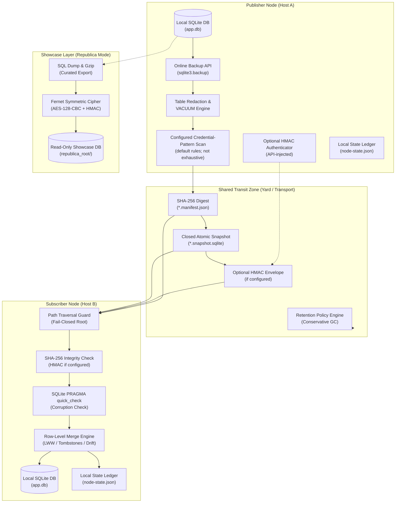

# sqlite-transit-sync


[](https://github.com/ellmos-ai/sqlite-transit-sync/actions/workflows/ci.yml)
[](CHANGELOG.md)
[](#tests)
[](#tests)
[](https://www.python.org/)
[](#)
[](#)
[](#governance-runtime-invariants-matrix)
[](SECURITY.md)
[](SECURITY.md)
[](CONTRIBUTING.md)
[](THIRD_PARTY_LICENSES.md)
[](THIRD_PARTY_LICENSES.txt)
[](NOTICE)
[](MARKETING-LOG.txt)
[](LICENSE)
[](https://github.com/ellmos-ai)
[](https://github.com/open-bricks)
[](llms.txt)

> [!NOTE]
> **LLM・AIエージェント向け情報**: 機械可読なサイトマップ、アーキテクチャ概要、APIガイドを [`llms.txt`](llms.txt) にまとめています。

**🇬🇧 [English](README.md)** | **🇩🇪 [ドイツ語版](README_de.md)** | **🇪🇸 [スペイン語版](README_es.md)** | **🇫🇷 [フランス語版](README_fr.md)** | **🇯🇵 日本語** | **🇨🇳 [簡体字中国語版](README_zh.md)** | **🇵🇹 [ポルトガル語版](README_pt.md)** | **🤝 [貢献ガイド](CONTRIBUTING.md)** | **🛡️ [セキュリティポリシー](SECURITY.md)** | **📝 [変更履歴](CHANGELOG.md)** | **📋 [llms.txt](llms.txt)**

## 🧭 クイックナビゲーション

1. [概要と中核となる役割](#what-is-sqlite-transit-sync)
2. [アーキテクチャ構成図と分離された層](#system-architecture-topology)
3. [スナップショット同期のエンドツーエンドの流れ](#end-to-end-snapshot-synchronization-lifecycle)
4. [想定ユーザーと検索意図の強いSEO検索語](#marketing--target-personas)
5. [実装済みの動作と制約](#comparison-with-distributed-sql)
6. [ガバナンスと実行時不変条件の一覧](#governance-runtime-invariants-matrix)
7. [主な機能と独立した機能群](#what-it-provides)
8. [読み取り専用のアプリケーション投影](#read-only-application-projections)
9. [インストールと前提条件](#install)
10. [クイックスタートと複数ノードの運用](#quick-start)
11. [設定リファレンスと認証情報検出パターン](#configuration)
12. [Republicaショーケースと暗号化方式](#republica-the-showcase-method)
13. [Python APIと拡張ポイント](#python-api)
14. [安全性、脅威モデル、運用上の制約](#safety-and-limits)
15. [サードパーティライセンス一覧](#third-party-licenses--transparency)
16. [エコシステム、関連ツール、バンドル](#ecosystem--sibling-tools)
17. [テスト、検証、CIマトリクス](#tests)
18. [法的通知、責任制限、ライセンス（ドイツ民法典 § 521）](#license)

---

<a id="what-is-sqlite-transit-sync"></a><a id="core-identity"></a><a id="executive-summary--core-identity"></a>
## 1. 概要と中核となる役割

バージョン、モジュールの状態・公開区分、確認日の基準は
[`METADATA_CONTRACT.md`](METADATA_CONTRACT.md) に定めています。これらはリリースや公開アップロードの承認を意味しません。

独立したSQLiteデータベースを、整合性を検証したスナップショットとアプリケーションが選べるマージポリシーによってローカル優先で同期します。送信元認証は任意で、APIから渡すHMAC認証器を使います。これはBACH ProSyncのアーキテクチャをもとにしていますが、BACH、OneDrive、ホスト名、ユーザー固有パスには依存しません。

これは**分散SQLサーバーではありません**。各ノードが所有して開くのは自分のローカルデータベースだけです。共有フォルダー、オブジェクトストレージのマウント、リムーバブルドライブなどのファイル転送経路で、閉じたスナップショットとマニフェストを受け渡します。pull時には、スナップショットをローカルデータベースへ1つのトランザクション内でマージする前に、SHA-256とSQLiteの `PRAGMA quick_check` を検証します。HMACによる送信元認証は、認証器が設定されている場合にのみ行います。

同じモジュール群に属する [sync-master](https://github.com/dev-bricks/sync-master) と組み合わせて使えます。sync-masterのyardは自然なファイル転送経路になります。`--transit` にyard内のツール管理領域 `db-transit/<namespace>/` を指定します（プロトコル規則R9）。sync-masterはファイルを運び、このモジュールはデータベースの整合性検証とマージを担います。両者は独立して動作します。

---

<a id="system-architecture-topology"></a><a id="system-architecture"></a>
## 2. アーキテクチャ構成図と分離された層

次の図は、ローカルSQLiteデータベース同士を、マニフェストに照らして整合性を検証した閉じたスナップショットバンドルだけで接続する、複数ノードの分離構成を示します。



### ASCIIによる4視点アーキテクチャ図

```text
+-------------------------------------------------------------------------------------------------------------------+
|                               SQLITE-TRANSIT-SYNC: FOUR-VIEW ARCHITECTURAL TOPOLOGY                               |
+-------------------------------------------------------------------------------------------------------------------+
| [VIEW 1: PUBLISHER NODE]               [VIEW 2: SHARED TRANSIT YARD]              [VIEW 3: SUBSCRIBER NODE]       |
|                                                                                                                   |
| +-------------------------+              +-----------------------------+            +---------------------------+ |
| | Local SQLite Database   |              |  Closed Transit Zone        |            | Path Traversal Guard      | |
| | (app.db - Exclusive RW) |              |  (Folder / Sync-Master / S3)|            | (Canonical Bounds Check)  | |
| +------------+------------+              +--------------+--------------+            +-------------+-------------+ |
|              |                                          ^                                         |               |
|              v (sqlite3.backup)                         |                                         v               |
| +------------+------------+                             |                           +-------------+-------------+ |
| | Online Consistent Backup|                             |                           | SHA-256 Integrity Check   | |
| | (Closed Rollback-Journal|                             |                           | Optional HMAC if set      | |
| +------------+------------+                             |                           +-------------+-------------+ |
|              |                                          |                                         |               |
|              v                                          |                                         v               |
| +------------+------------+                             |                           +-------------+-------------+ |
| | Redaction & VACUUM      |                             |                           | SQLite PRAGMA quick_check | |
| | (Exclude Sensitive Data)|                             |                           | (Integrity Verification)  | |
| +------------+------------+                             |                           +-------------+-------------+ |
|              |                                          |                                         |               |
|              v                                          |                                         v               |
| +------------+------------+                             |                           +-------------+-------------+ |
| | Pattern Scan            |                             |                           | Transactional Row Merge   | |
| | (default rules; limited) |                             |                           | (Row-Level LWW / Drift)  | |
| +------------+------------+                             |                           +-------------+-------------+ |
|              |                                          |                                         |               |
|              v                                          |                                         v               |
| +------------+------------+              +--------------+--------------+            +-------------+-------------+ |
| | Optional HMAC Adapter   |              |  *.snapshot.sqlite (Atomic) |            | Local SQLite Database     | |
| | (API-injected if set)   |- - - - - - ->|  *.manifest.json   (Digest) |----------->| (app.db - Merged State)   | |
| +-------------------------+              |  Retention Engine  (Scoped) |            +-------------+-------------+ |
|                                          +-----------------------------+                          |               |
|                                                                                                   v               |
|                                                                                     +-------------+-------------+ |
|                                                                                     | Local State Ledger        | |
|                                                                                     | (node-state.json)         | |
|                                                                                     +---------------------------+ |
+-------------------------------------------------------------------------------------------------------------------+
| [VIEW 4: REPUBLICA SHOWCASE / COURIER ENVELOPE (OPTIONAL ZERO-TRUST TRANSPORT)]                                   |
|                                                                                                                   |
| Local Database ----> Curated SQL Dump ----> Gzip Compression ----> AES-128-CBC (Fernet) ----> Encrypted Outpost   |
| (Source Node)       (FTS Rebuilt on Dest)   (53MB -> 11MB)         (Pre-Shared Key)          (republica_root/)    |
|                                                                                                                   |
| Single Secret File -> Fernet Cipher Envelope -> Courier Transit -> Destination Directory (Mode 0600, Transit Clr) |
+-------------------------------------------------------------------------------------------------------------------+
```

---

<a id="end-to-end-snapshot-synchronization-lifecycle"></a><a id="lifecycle"></a>
## 3. スナップショット同期のエンドツーエンドの流れ

この手順では、稼働中のデータベースファイルをファイル同期の対象にしません。スナップショットのバイト列をSHA-256マニフェストと照合し、設定された認証情報パターンの検査を有効時（既定で有効）に実行して、受け入れた行をトランザクションでマージします。送信元認証を利用できるのは、APIから渡すHMAC認証器を設定した場合だけです。ほかのノードに変更が見えるのは、push/pullの交換が成功した後です。

```mermaid
sequenceDiagram
    autonumber
    participant App as Application / Node A
    participant CoreA as sqlite-transit-sync (Push)
    participant Shield as Credential-Pattern Scan (default on; configurable)
    participant Transit as Shared Transit (db-transit)
    participant CoreB as sqlite-transit-sync (Pull)
    participant Target as Local DB / Node B

    Note over App,CoreA: Phase 1: Local Online Snapshot & Redaction
    App->>CoreA: push(config, db)
    CoreA->>CoreA: Online Snapshot via SQLite Backup API
    CoreA->>CoreA: Drop Excluded Tables & VACUUM
    CoreA->>Shield: Scan Content for Secret Patterns (credential-triggers.json)
    Shield-->>CoreA: No configured pattern matched (if enabled)

    Note over CoreA,Transit: Phase 2: Snapshot Digest & File Publication
    CoreA->>CoreA: Calculate SHA-256 digest and size
    CoreA->>Transit: Write Temporary Snapshot & Atomic os.replace

    Note over CoreA,Transit: Phase 3: Optional Manifest Authentication & Publication
    CoreA->>CoreA: Optionally HMAC-sign manifest (if configured)
    CoreA->>Transit: Atomically write manifest with SHA-256; HMAC only if configured (*.manifest.json)

    Note over Transit,CoreB: Phase 4: Transit Ingestion & Boundary Guard
    CoreB->>Transit: Discover Manifests & Validate Path Bounds (Anti-Traversal)
    CoreB->>CoreB: Verify HMAC first if configured
    CoreB->>CoreB: Verify snapshot size and SHA-256 (integrity only)
    CoreB->>CoreB: Run PRAGMA quick_check on Isolated Snapshot

    Note over CoreB,Target: Phase 5: Transactional Row Merge & State Advance
    CoreB->>Target: BEGIN IMMEDIATE Transaction
    CoreB->>Target: Apply Row-Level Merge Policy (LWW per PK / Tombstones)
    CoreB->>Target: Reconcile Shared Column Schema Drift
    CoreB->>Target: COMMIT Transaction
    CoreB->>CoreB: Advance Local State Ledger (node-state.json)
    Note over Target: Peer state reflects successful exchange; no background convergence guarantee
```

---

<a id="marketing--target-personas"></a><a id="target-personas--discoverability-queries"></a><a id="target-personas"></a>
## 4. 想定ユーザーと検索意図の強いSEO検索語

モジュール型の分散エコシステム向けに設計された `sqlite-transit-sync` は、次の4つの主な利用者像を対象とします。

- **`[PERSONA-01]` 自律型AIエージェントのエンジニアと複数ホストのスウォーム設計者:**
  - *課題:* ワークステーション、ノートPC、サーバーにまたがって動作するマルチエージェント群では、ファイルロックの衝突を避けながらローカル状態を保持する必要があります。
  - *解決策:* 既定で有効な検査は、設定済みの認証情報パターンに一致した場合に公開を中断できます。これは安全網であり、スナップショットに秘密情報が含まれないことの証明ではありません。ほかのノードが変更を受け取るのは、push/pullの交換が成功した後です。
- **`[PERSONA-02]` 複数端末デスクトップ・エッジアプリケーションの開発者:**
  - *課題:* ファイル同期（sync-master、Syncthing、Nextcloudなど）で個人メモやタスク用データベースを交換する上級ユーザーは、データベースの破損や `-wal` のロックに悩まされます。
  - *解決策:* SQLite Backup APIとファイル単位の公開により、稼働中のSQLiteデータベースをファイル同期経路に置かずに済みます。転送経路で交換するのは転送領域上のスナップショットファイルです。
- **`[PERSONA-03]` ローカル優先・設定可能な転送ツールの開発者:**
  - *課題:* データ主権を必要とするアプリケーションでは、クラウドへの囲い込み、継続的なデータベースホスティング費用、制御できないバックグラウンド通信を受け入れられません。
  - *解決策:* このモジュールは、設定されたファイルシステムパスを介してスナップショットファイルを交換します。パスはローカルでもリムーバブルでも構いません。共有またはネットワークマウントされた転送経路の動作は、モジュールの管理範囲外です。
- **`[PERSONA-04]` エンタープライズのセキュリティ・プライバシー・コンプライアンス担当者:**
  - *課題:* 厳格なゼロトラスト要件では、認証情報の意図しない同期、未検証のバイナリデータ、特権を持つバックグラウンドサービスが許されません。
  - *解決策:* 既定で有効な検査は公開前に設定済みの認証情報パターンを調べ、SHA-256はスナップショットの整合性をマニフェストと照合します。送信元認証には、APIから渡すHMAC認証器を有効にできます。プロセスは起動元の権限を引き継ぎます。

### 検索意図の強い検索語（英語・ドイツ語）

| 検索意図の分類 | 英語（EN）の検索語 | ドイツ語（DE）の検索語 |
|:---|:---|:---|
| **ローカル優先の同期** | `sqlite synchronization python zero-dependency`, `local-first database snapshot sync`, `offline sqlite multi-device sync` | `lokale datenbank synchronisation offline snapshots`, `sqlite abgleich python ohne abhängigkeiten`, `lokale datenbank replikation dateibasiert` |
| **整合性と設定可能な認証情報パターン検査** | `configured credential-pattern scan sqlite sync`, `configured filesystem transit sqlite sync`, `optional hmac sqlite snapshot manifest` | `konfigurierter credential musterscan sqlite sync`, `dateipfad transit sqlite sync`, `optional hmac snapshot manifest` |
| **行単位のマージと競合** | `row level merge lww sqlite offline`, `sqlite last write wins schema drift tolerance`, `tombstone merge policy sqlite` | `row level merge lww sqlite offline`, `last-write-wins datenbank abgleich zeitstempel`, `schema drift toleranz sqlite merge` |
| **分離されたアーキテクチャ** | `sqlite multi-node sync without distributed sql`, `sqlite over syncthing without corruption`, `sqlite transit yard architecture` | `sqlite synchronisation ohne verteilten server`, `sqlite über cloud sync ohne datenbankkorruption`, `transit yard sqlite synchronisation` |

利用者像の詳細、検索意図の強い検索語、競合製品との位置付けについては [MARKETING-LOG.txt](MARKETING-LOG.txt) を参照してください。

---

<a id="comparison-with-distributed-sql"></a><a id="comparative-matrix--alternatives"></a><a id="comparative-matrix"></a>
## 5. 実装済みの動作と制約

この節では、プロジェクトに実装されている動作と制約を記録します。他製品との最新の直接比較調査ではありません。

| 項目 | 不変条件 | 実装されている動作 | 制約・境界 |
|:---|:---|:---|:---|
| **1. ローカル処理と転送** | `INV-LOCAL-01` | ローカルSQLiteデータベースを読み、設定済みの転送パスにスナップショットを公開します。中央データベースサーバーは不要です。 | 設定パスは共有領域やネットワークマウント先の場合があります。その転送経路へのアクセスと動作はこのモジュールの管理範囲外です。 |
| **2. スナップショットの公開** | `INV-SNAP-02` | オンラインバックアップを取得し、一時ファイルと `os.replace` を使ってスナップショットファイルを公開します。 | ファイルごとの置き換えであり、スナップショットとマニフェストをまとめた複数ファイルのトランザクションにはなりません。 |
| **3. 補助ファイルとプロセスの範囲** | `INV-ROLL-03` | スナップショットをロールバックジャーナルモードで閉じ、一時SQLite補助ファイルを削除できない場合はフェイルクローズします。 | ホストアプリケーションがプロセスロックを追加しない限り、各ノードで同期プロセスを1つだけ実行してください。 |
| **4. 転送パスの封じ込め** | `INV-PATH-04` | マニフェストとスナップショットのパスを、正規化された転送ルート直下の通常ファイルに限定します。 | 転送領域への書き込み権限を持つ人は制御しません。 |
| **5. 整合性検証** | `INV-VERIFY-05` | スナップショットのバイト列をマニフェストのSHA-256と照合し、SQLiteの `PRAGMA quick_check` を実行します。 | ダイジェストが一致しても、送信元や転送経路を認証したことにはなりません。 |
| **6. 認証情報パターンの検査** | `INV-SHIELD-06` | 既定ではスナップショットの内容を設定済みパターンと照合します。一致すると公開を中断し、値は示さず `table.column` を報告します。 | ベンダー接頭辞付きのルールは安全網であり、保証ではありません。検査に一致しない場合も、既知のパターンが見つからなかったという意味に限られ、独自形式や接頭辞のない秘密情報は通過することがあります。 |
| **7. 送信元認証** | `INV-HMAC-07` | アプリケーションは、正規化されたマニフェストに対するAPI注入型HMAC-SHA256認証を任意で有効にできます。 | 認証器を設定しなければ送信元認証は行われません。共有鍵HMACは鮮度確認プロトコルでも公開鍵署名でもありません。 |
| **8. 行のマージ** | `INV-MERGE-08` | 行単位で設定可能なマージポリシーを適用します。対応テーブルでは、既定でタイムスタンプに基づくLWWを使います。 | 時計の前提、削除の意味、マイグレーション、ドメイン固有の競合ルールは統合するアプリケーションの責任です。 |
| **9. 保持期間と削除範囲** | `INV-RET-09` | クリーンアップは既定でドライランとなり、ノード間の削除権限を明示的に有効にしない限り、ローカルノードの成果物だけを対象にします。 | 保持期間によるクリーンアップはバックアップや復旧サービスではありません。 |
| **10. プロセス権限とセキュリティ方針** | `INV-SLA-10` | プロセスは起動元の権限を使用します。`SECURITY.md` に定める報告対応方針では、48時間以内に受領を確認し、5営業日以内に初期評価を行います。 | このモジュールは標準ユーザー権限を強制せず、昇格も要求しません。対応期限は報告ポリシーであり、実行時機能ではありません。 |

<a id="distributed-sql-detailed-comparison"></a>
### 処理モデルと境界

| 観点 | `sqlite-transit-sync` の動作 | 制約・境界 |
|---|---|---|
| 基本モデル | 各ノードが個別のローカルSQLiteデータベースを持ち、設定済みの転送パスを通じてスナップショットを移動します。 | 全体で唯一の権威あるデータベースはありません。 |
| 書き込み | アプリケーションはローカルに書き込み、呼び出し側がpushとpullを実行してスナップショットを交換します。 | バックグラウンドでの自動同期はありません。 |
| 変更の反映 | 交換とマージが成功すると、他のノードから変更を確認できます。 | 即時反映や全体で一貫した可視性は保証しません。 |
| グローバルトランザクション | 提供しません。 | アプリケーションは複数ノードにまたがる1つのトランザクションをコミットできません。 |
| オフライン動作 | ノードがオフラインでもローカルデータベースを個別に利用できます。 | スナップショットの交換は、設定済み転送領域が利用可能になるまで待ちます。 |
| 競合 | 設定された `MergePolicy` が行のマージ方法を決めます。既定値はタイムスタンプLWWです。 | アプリケーションの時計、削除ルール、ドメイン上の意味は統合側の責任です。 |
| スキーマ変更 | 共通列のマージにより、限定的なスキーマ差異に対応します。 | マイグレーションとスキーマ互換性はアプリケーションの責任です。 |
| 障害対応 | ローカルデータはSQLiteに保存され、転送領域上のスナップショットは独立したファイルです。 | 自動レプリケーション、フェイルオーバー、転送領域のバックアップは提供しません。 |

### 長所、短所、代表的な用途

| システム | 長所 | 短所 | 適した用途 | 適さない用途 |
|---|---|---|---|---|
| `sqlite-transit-sync` | ローカルでの使用量が小さい。中央データベースサーバーが不要。オフラインでローカル作業ができる。ファイル転送を設定でき、アプリケーションがマージポリシーを選べる。 | 変更を他ノードへ届けるにはpush/pullが必要。グローバルトランザクションや自動フェイルオーバーはなく、時計、削除、マイグレーション、競合にはアプリケーション側のルールが必要です。 | 個人用・タスク用データベース、エージェントのローカル状態、断続的に接続するノートPC・ワークステーション・エッジ機器、研究メモ。 | 全体でコミットされるトランザクション、即時に共有される状態、自動フェイルオーバー、多数の同時書き込みが必要なワークロード。 |

### 選定の目安

| 要件 | 適合性 |
|---|---|
| ノードがオフライン中も各自のローカルデータベースを使い続ける必要がある | `sqlite-transit-sync` |
| 明示的なpush/pullの交換後に更新が他ノードへ届けばよい | `sqlite-transit-sync` |
| アプリケーション側でマージ、時計、削除、マイグレーションのルールを定義できる | `sqlite-transit-sync` |
| すべての書き込みを即時に全体の確定状態にする必要がある | その整合性契約を提供するアーキテクチャを選んでください。 |
| グローバルトランザクション、自動フェイルオーバー、多数の同時書き込みが必要 | それらの動作を提供するアーキテクチャを検討してください。 |

少数の端末が断続的に接続する環境では、交換の遅延とアプリケーションが管理するマージルールを許容できれば、このモジュールが適する場合があります。グローバルトランザクション、即時共有状態、自動フェイルオーバーが必要なら、それらを提供すると明記された設計を選んでください。

---

<a id="governance-runtime-invariants-matrix"></a><a id="governance--runtime-invariants"></a>
## 6. ガバナンスと実行時不変条件の一覧

次の一覧に、プロジェクトの10項目のガバナンス・実行時不変条件、実装されている動作、関連する制約を示します。

| # | 不変条件 | アーキテクチャ上の範囲 | 文書化された動作と制約 |
|---|---|---|---|
| 1 | **INV-LOCAL-01: ローカルSQLite処理と設定済み転送領域** | システムアーキテクチャ | ローカルSQLiteデータベースを読み、設定済み転送パスを通じてスナップショットを公開します。パスは共有またはネットワークマウントの場合があります。ホストと転送経路の動作はモジュールの管理範囲外です。 |
| 2 | **INV-SNAP-02: オフラインスナップショットの原子性** | 転送領域への公開 | 稼働中のデータベースファイルをファイル同期で共有することはありません。オンラインスナップショットは `sqlite3.backup` で取得し、原子的な `os.replace` で公開します。 |
| 3 | **INV-ROLL-03: ロールバックジャーナルによるクリーンな分離** | 補助ファイルの防止 | バックアップはロールバックジャーナルモードで閉じます。すべての一時SQLite補助ファイル（`-wal`、`-shm`、`-journal`）をマニフェスト作成前にフェイルクローズで削除します。 |
| 4 | **INV-PATH-04: 転送パスの厳格な封じ込め** | ファイルシステム境界 | マニフェストとスナップショットは、正規化された転送ルート直下の通常ファイルでなければなりません。パストラバーサル（`../`）、シンボリックリンク、再解析ポイントはフェイルクローズで拒否します。 |
| 5 | **INV-VERIFY-05: 2段階の整合性・健全性検証** | マージ前の検証 | 受信した各スナップショットは、データを調査またはマージする前にSHA-256ダイジェスト照合とSQLite `PRAGMA quick_check` に合格する必要があります。 |
| 6 | **INV-SHIELD-06: 公開前の認証情報検査** | 内容の検査 | 既定ではスナップショットの内容を設定済み認証情報パターンと照合します。一致すると公開を中断し、値ではなく `table.column` を報告します。ベンダー接頭辞付きパターンは安全網であり、保証ではありません。一致なしでも秘密情報がないとは証明できません。 |
| 7 | **INV-HMAC-07: 任意のHMAC認証** | 送信元認証 | 正規化されたマニフェストのペイロード（プロトコル、名前空間、送信元ID、ファイル名、SHA-256、サイズ、秘匿化リスト）に対するAPI注入型HMAC-SHA256エンベロープを任意で使用できます。共有鍵HMACは鮮度確認プロトコルでも公開鍵署名でもありません。これを使わない場合、マニフェストは送信元を認証しません。 |
| 8 | **INV-MERGE-08: 決定的な行単位マージ** | データの収束 | トランザクション内で行単位にマージします（主キーごとのLWW、スキーマ差異に対する共通列の統合、明示的なtombstoneポリシー）。内容ハッシュによるタイブレークで決定的な収束を保ちます。 |
| 9 | **INV-RET-09: 保守的な保持と権限範囲** | ガベージコレクション | スナップショットのクリーンアップは既定でドライランとなり、ローカルノードの成果物だけを厳密に対象とします。ノード間削除（`--all-nodes`）には管理者による明示的な有効化が必要です。 |
| 10 | **INV-SLA-10: プロセス権限とセキュリティ方針** | 実行時の権限 | プロセスは起動元の権限を引き継ぎます。このモジュールは標準ユーザー権限を強制せず、昇格を要求しません。`SECURITY.md` では、48時間以内の受領確認と5営業日以内の初期評価を定めています。 |

---

<a id="what-it-provides"></a><a id="core-capabilities"></a><a id="part-of-the-ellmos-stack-family"></a>
## 7. 主な機能と独立した機能群

`sqlite-transit-sync` は同じモジュール群に属する
[dev-bricks/sync-master](https://github.com/dev-bricks/sync-master) の関連ツールです。sync-masterはファイル転送（`sync.files`）を担い、このモジュールはデータベースの整合性検証とマージ（`sync.database`）を担います。どちらも単独で使えるほか、
[ellmos-ai](https://github.com/ellmos-ai) ファミリーのスタックに組み込めます。カタログは
[ellmos-ai/stacks](https://github.com/ellmos-ai/stacks) を参照してください。このツール群での役割は、稼働中のSQLiteをファイル同期に流さず、マニフェストとSQLiteの整合性検証に合格したスナップショットだけを扱い、アプリケーションが選ぶマージポリシーを適用することです。

### 主な機能

- SQLiteのBackup APIによる一貫したオンラインスナップショット取得;
- 一時ファイルと `os.replace` を使った原子的な公開;
- ロールバックジャーナルモードで閉じたスナップショットを作成し、公開前にすべての一時SQLite補助ファイルをフェイルクローズで削除;
- マニフェストとスナップショットのパスを正規化された転送ディレクトリ直下の通常ファイルに限定し、ハッシュ計算やマージの前にトラバーサル、絶対パス、シンボリックリンク、再解析ポイントをフェイルクローズで拒否;
- マニフェストのSHA-256と `PRAGMA quick_check` による検証;
- 正規化マニフェスト、送信元ID、プロトコルバージョン、スナップショットハッシュを対象とするAPI注入型HMAC-SHA256認証を任意で利用し、鍵IDを明示;
- ノードごとのローカルpull状態と冪等な再実行;
- タイムスタンプ付きテーブルで主キーごとに行単位のlast-write-winsを適用;
- 明示的な削除のための任意利用型リファレンスアダプター `TombstoneMergePolicy`;
- 基本的なスキーマ差異に対応する共通列マージ;
- テーブル除外と、削除後のVACUUMを伴うスナップショット秘匿化を設定可能;
- 既定で有効な内容検査を実行し、設定済み認証情報パターンに一致した場合は公開を中断（値は示さず `table.column` を報告）。ベンダー接頭辞付きのルールは安全網であり、検査に一致しなくてもスナップショットに秘密情報がないとは証明できません;
- ドメインルール、tombstone、CRDTに対応する独自 `MergePolicy`;
- 検証済みスナップショットのクリーンアップ。既定はドライランかつローカルノード対象で、削除や他ノード管理には明示的な有効化が必要;
- マージや状態更新のロジックを重複させずに、アプリケーションの薄いライフサイクルアダプターから保留中のpullを選択;
- スキーマとプライバシーの厳密な許可リスト、来歴、チェックポイント、ループ、オフラインtombstoneの検証を備えた、バージョン管理された読み取り専用投影契約;
- データベースを暗号化ペイロードとして一方向に配布し、マージせず独立した読み取り専用ショーケースとして実体化する任意の [Republicaショーケースモード](#republica-the-showcase-method);
- 外部依存のないPython APIとJSON CLI（Republicaモードでは `cryptography` が追加で必要）。

---

<a id="read-only-application-projections"></a><a id="projections"></a>
## 8. 読み取り専用のアプリケーション投影

`verify-projection` は、アプリケーションが所有する閉じたSQLite投影を検証します。コピー、マージ、マイグレーション、スケジュール実行、状態更新は行いません。アプリケーションは利用側の識別情報と確認済みの最大オフライン期間を指定します。検証器はループ、古いチェックポイント、不十分なtombstone保持期間、許可リストにないテーブルや列、不透明でないレコード参照を拒否します。

口座残高の要約、AboTrackerの購読状態、HausLageristの補充日、服薬予定・在庫警告状態、ルーティンの予定・完了状態、保険の期限を対象とした6つの限定的な契約を同梱しています。エクスポートスキーマv1では次回期限や更新日が確認できないため、AboTracker契約は状態のみを扱います。支払日と請求周期からリマインダーを推定することはありません。テスト用フィクスチャは合成JSONレシピであり、ドメイン上の識別情報や個人情報は許可リストの対象外です。

同梱している契約名は次のとおりです。`abotracker-subscription-status-projection.v1`、
`accounts-balance-projection.v1`、`hauslagerist-replenishment-projection.v1`、
`mediplaner-reminder-projection.v1`、
`routinika-reminder-projection.v1`、および
`versicherungsmanager-deadline-projection.v1`。
[読み取り専用投影契約](PROJECTION_CONTRACTS.md) と
[ドイツ語版](PROJECTION_CONTRACTS_de.md) を参照してください。

```bash
sqlite-transit-sync verify-projection \
  --contract mediplaner-reminder-projection.v1 \
  --database ./closed-projection.sqlite \
  --consumer-id reminder-consumer \
  --minimum-offline-seconds 2592000 \
  --previous-checkpoint 41
```

---

<a id="install"></a><a id="installation"></a>
## 9. インストールと前提条件

```bash
python -m pip install -e .
```

---

<a id="quick-start"></a><a id="quickstart"></a>
## 10. クイックスタートと複数ノードの運用

各ノードに設定ファイルを作成します。各ノードはそれぞれのデータベースと状態ファイルを使い、転送ディレクトリと名前空間は共通にします。

```bash
sqlite-transit-sync init \
  --config node.json \
  --database ./app.db \
  --transit ./shared-transit \
  --node-id laptop \
  --namespace my-app

sqlite-transit-sync push --config node.json
sqlite-transit-sync pull --config node.json --dry-run
sqlite-transit-sync pull --config node.json
sqlite-transit-sync status --config node.json
sqlite-transit-sync verify --config node.json
sqlite-transit-sync cleanup --config node.json
# Review the JSON plan, then explicitly apply it:
sqlite-transit-sync cleanup --config node.json --apply
```

各ノードには、あらかじめアプリケーションのスキーマが存在している必要があります。汎用モジュールでは、どのスキーマ、秘密情報、ローカルテーブル、マイグレーションがアプリケーションに属するか判断できないため、初回コピーは意図的に自動化していません。

### 単独で実行できるPythonクイックスタート（外部依存なし）

`sqlite-transit-sync` をエージェントフレームワーク、デーモン、バックグラウンドワーカーに直接組み込む開発者は、次の自己完結したスクリプトをコピーして実行し、外部依存なしで複数ノード間の同期を最初から最後まで検証できます。

```python
import sqlite3
from contextlib import closing
import tempfile
from pathlib import Path
from sqlite_transit_sync import SyncConfig, TransitSync

with tempfile.TemporaryDirectory() as tmp:
    root = Path(tmp)
    transit = root / "transit"
    transit.mkdir()

    # 1. Initialize Node A and record local data
    db_a = root / "node_a.db"
    with closing(sqlite3.connect(db_a)) as conn, conn:
        conn.execute("CREATE TABLE notes (id INTEGER PRIMARY KEY, title TEXT, updated_at TEXT)")
        conn.execute("INSERT INTO notes VALUES (1, 'Hello from Node A', '2026-10-18T08:00:00Z')")

    # 2. Publish atomic snapshot from Node A to shared transit
    cfg_a = SyncConfig(database=db_a, transit=transit, state=root / "state_a.json", node_id="node_a", namespace="demo")
    snapshot = TransitSync(cfg_a).push()
    print(f"Node A published snapshot: {snapshot.path.name} (SHA-256: {snapshot.sha256[:8]}...)")

    # 3. Initialize Node B with schema and pull snapshot
    db_b = root / "node_b.db"
    with closing(sqlite3.connect(db_b)) as conn, conn:
        conn.execute("CREATE TABLE notes (id INTEGER PRIMARY KEY, title TEXT, updated_at TEXT)")

    cfg_b = SyncConfig(database=db_b, transit=transit, state=root / "state_b.json", node_id="node_b", namespace="demo")
    reports = TransitSync(cfg_b).pull()

    # 4. Verify converged state in Node B
    with closing(sqlite3.connect(db_b)) as conn, conn:
        rows = conn.execute("SELECT id, title, updated_at FROM notes").fetchall()
        print(f"Node B converged records: {rows}")
        assert rows == [(1, "Hello from Node A", "2026-10-18T08:00:00Z")]
```

---

<a id="configuration"></a><a id="configuration-reference"></a>
## 11. 設定リファレンスと認証情報検出パターン

```json
{
  "database": "./app.db",
  "transit": "./shared-transit",
  "state": "./node-state.json",
  "node_id": "laptop",
  "namespace": "my-app",
  "timestamp_columns": ["updated_at", "modified_at", "created_at"],
  "exclude_tables": ["secrets", "sqlite_sequence"],
  "snapshot_exclude_tables": ["secrets"],
  "scan_snapshot_for_secrets": true,
  "secret_scan_skip_tables": [],
  "secret_scan_extra_patterns": [],
  "secret_patterns_file": null
}
```

相対パスは設定ファイルの場所を基準に解決されます。稼働中のデータベースを転送ディレクトリ内に置いてはならず、状態ファイルも転送ディレクトリツリーの外に置く必要があります。`SyncConfig`、`from_file`、`from_bytes`、CLIの `init` は、転送領域や状態ディレクトリを作成する前に無効な状態パスを拒否します。自動マイグレーションは行いません。

解析した設定そのものの監査用ハッシュが必要なアプリケーションは、ファイルを一度だけ読み込み、同じソース相対パーサーを使うことで、2回目のファイル読み込みをせずに算出できます。

```python
import hashlib
from pathlib import Path

from sqlite_transit_sync import SyncConfig

config_path = Path("node.json").resolve()
payload = config_path.read_bytes()
config = SyncConfig.from_bytes(payload, source_path=config_path)
config_sha256 = hashlib.sha256(payload).hexdigest()
```

### すべてのキーと既定値

| キー | 既定値 | 意味 |
|---|---|---|
| `database` | *(必須)* | このノードが所有する稼働中のSQLiteデータベース |
| `transit` | *(必須)* | スナップショットとマニフェストを運ぶ共有ディレクトリ |
| `state` | `./.sync-state.json` | ノードごとのpull状態。転送領域の外に置きます |
| `node_id` | マシンのホスト名 | スナップショット名で公開元ノードを識別します |
| `namespace` | `"default"` | 1つの転送領域内で無関係なデータセットを区別します |
| `timestamp_columns` | `["updated_at","modified_at","created_at"]` | last-write-wins判定に使う列 |
| `exclude_tables` | `["secrets","sqlite_sequence"]` | ローカルデータベースに**マージしない**テーブル |
| `snapshot_exclude_tables` | `["secrets"]` | 公開前に行を**スナップショットから削除**するテーブル（その後 `VACUUM` を実行） |
| `scan_snapshot_for_secrets` | `true` | 設定済みの認証情報パターンにスナップショットの内容が一致した場合、公開を中断します |
| `secret_scan_skip_tables` | `[]` | 検査対象外にするテーブル。検査全体を無効にする代わりに、誤検知の多い1つのテーブルに使います |
| `secret_scan_extra_patterns` | `[]` | 検出パターンファイルに追加する正規表現 |
| `secret_patterns_file` | `null`（同梱ファイル） | 独自の検出パターンファイルのパス。組み込みパターンを**置き換えます** |
| `key_file` | `null`、または `$SQLITE_TRANSIT_SYNC_KEY_FILE` | Republicaモード用Fernet鍵。転送領域の外に置きます |
| `republica_root` | `~/.republica` | インポートしたショーケースの保存先。転送領域の外に置きます |
| `allow_key_in_synced_folder` | `false` | クラウド同期フォルダー内の鍵を拒否する検査を省略します |

この表の `state` の既定値は、そのキーを含まないJSON設定を読み込む場合に適用されます。一方、`sqlite-transit-sync init` では `.<config-stem>-state.json` が書き込まれます。これは `--state` を省略した場合の動作です（`node.json` の場合は `.node-state.json`）。

### 認証情報検査と無効化方法

`snapshot_exclude_tables` で除外できるのは、あらかじめ想定したテーブルだけです。検査はその設定では答えられない問いに対応します。つまり、メモ、ログ行、セッションの要約などの自由記述列に認証情報が貼り付けられていないかを調べます。秘匿化後、公開前のスナップショット複製に対して実行します。一致すると `SyncError` を送出し、`table.column` を示します。一致した値は含まれないため、認証情報がログ、トレースバック、CI出力に流れることはありません。途中までのスナップショットは破棄され、転送ディレクトリには届きません。

**無効化は正当な選択肢であり、回避策ではありません**。自分で管理し信頼できる場所（自前サーバー、契約に基づくEU内ホストのボリューム、暗号化したリムーバブルドライブなど）を転送領域として使い、認証情報もデータと一緒に運びたい場合は、次のように設定します。

```json
{ "scan_snapshot_for_secrets": false }
```

誤検知が発生するのが1つのテーブルだけなら、検査全体を止めずに `secret_scan_skip_tables` を使ってください。他のテーブルで検査を有効に保つ方が、全体を無効にするより有益です。

### 検出パターンの調整

パターンはコードではなく `sqlite_transit_sync/credential-triggers.json` というデータファイルにあります。そのため、リリースを待たずに検出条件を段階的に厳しくできます。

```json
{
  "version": 1,
  "patterns": [
    { "name": "github", "regex": "gh[pousr]_[A-Za-z0-9]{16,}", "prefilter": "gh" },
    { "name": "acme-internal", "regex": "ACME-[0-9]{4}", "prefilter": "ACME-" }
  ]
}
```

- `prefilter` は任意のリテラルで、大きなスナップショットでも高速に処理するため、軽量なSQL `LIKE` 事前フィルターに使います。正規表現に一致し得る値すべてに、このリテラルが含まれていなければ**なりません**。そうでないと検出漏れが起きます。そのようなリテラルがない場合は省略してください。正確性のため、スキャナーは列全体を読み込みます。
- `secret_patterns_file` に独自ファイルを指定すると既定値をすべて置き換えます。既定値に追加する場合は `secret_scan_extra_patterns` を使います。

パターンには意図的にベンダー接頭辞を付けています。「長い16進文字列」のような汎用ルールでは、データベースに正当に含まれるチェックサム、UUID、Git SHAまで検出してしまいます。誤検知の多いスキャナーは無効化され、何も守れなくなるためです。検査に一致しない結果は「既知のパターンが一致しなかった」と解釈し、「このスナップショットに秘密情報はない」とは決して解釈しないでください。

### これはシークレット管理ツールではありません

設定済みパターンに一致すれば検査によって公開を中断できますが、すべての認証情報を検出できる保証はなく、認証情報を**配布する**機能もありません。「複数の端末で同じパスワードやAPIキーを使いたい」という課題には、このモジュールも文書同期フォルダーも適しません。専用のシークレット管理ツールを検討し、その導入方法と信頼モデルを確認してください。

| 方法 | 適した用途 | 備考 |
|---|---|---|
| **Vaultwarden**（セルフホスト型Bitwarden） | 複数端末で人とCLIが使う場合 | 常時稼働する小型機で動かし、公開せずにプライベートネットワーク（WireGuard、Tailscale）経由で接続します。Bitwarden公式クライアント、ブラウザー拡張機能、`bw` CLIが利用できるため、スクリプトやエージェントもシークレットを取得できます。 |
| **SOPS + age** | コードの近くに置くシークレット | 暗号文だけが転送されるため、暗号化ファイルはリポジトリにコミットしても、任意の同期フォルダーに置いても安全です。受信者ごとの鍵を使え、Gitレビューとの相性も良好です。 |
| **`pass`**（GPG）+ git | Unixに慣れた個人や小規模チーム | シークレットごとに1ファイルを使い、通常のGitリモートで管理できます。サーバーは不要です。 |
| **Syncthing経由のKeePassXCデータベース** | サーバーやクラウドアカウントを使わない場合 | ピアツーピアでファイルを同期し、保管庫自体は1つの暗号化ファイルのままです。 |
| **Infisical / OpenBao（Vaultのフォーク）** | チーム、マシンID、鍵のローテーション | 監査ログと動的認証情報を備えた本格的なシークレットサーバーです。一般家庭で必要とするには構成要素が多くなります。 |
| **プラットフォーム標準の保管庫** | 1台の端末、1つのアプリ | macOS Keychain、Windows DPAPI/Credential Manager、`systemd-creds`、またはCIのシークレットストアを使います。同期はありませんが、露出もありません。 |

どの方法を選んでも、重要な分離は同じです。**データ用の経路と認証情報用の経路を分けてください。**設定済みパターンに一致すれば、このモジュールはスナップショットをブロックできますが、すべての秘密情報を検出する保証はありません。

---

<a id="republica-the-showcase-method"></a><a id="republica-showcase"></a>
## 12. Republicaショーケースと暗号化方式

各マシンはデータベースの**暗号化ショーケース**を共有ファイル領域に置きます。他のマシンはそれを参照できますが、変更はできません。鍵を持つ人だけが読めるデータベースの再公開であることから、この名前が付いています。

`push`/`pull` が合わない場合はRepublicaを使います。たとえば、他ノードのデータを自分の行にマージせずに読みたい場合や、マシン間で共有するのがフォルダーだけの場合です。Republica自体にはサーバー、開放ポート、専用のピアトンネルは不要ですが、共通のFernet鍵は必要です。また、共有フォルダーに内容を平文で見せたくない場合にも適しています。

<a id="two-modes-deliberately-redundant"></a>
### 2つの方式、共通の設定済みファイル転送領域

同じ `SyncConfig` を使う場合、`push`/`pull` とRepublicaは共通の設定済み `transit` パスを使います。`push`/`pull` はスナップショットを公開し、ローカルデータベースにマージします。Republicaは暗号化したレプリカを転送領域内のノード別サブディレクトリに公開し、`republica_root` 以下に独立した読み取り専用データベースとしてインポートします。変わるのは暗号化とマージの動作であり、転送経路ではありません。

| 状況 | ファイル転送領域を使った同期（`push`/`pull`） | Republica |
|---|---|---|
| ピアのマシンがオフライン | 他のピアがオフラインでもノードは公開できます。`pull` はすでに転送領域にあるスナップショットをマージできます。新しいデータは、送信元ノードが公開するまで届きません。 | 公開側は暗号化レプリカを置いておき、後でインポートできます。オフラインの送信元のデータも、公開されるまで待ちます。 |
| VPN/SSHトンネルが利用できない | 設定されたファイルパスに引き続きアクセスできる必要があります。`push`/`pull` はピア間トンネルを開きません。 | 同じ転送領域に依存します。VPN/SSHが関係するのは、設定パスにアクセスできなくなる場合だけです。 |
| 設定済み転送領域が利用できない | 利用できない設定パスを通じて公開も取得もできません。 | 同じ制約があります。Republicaに代替の転送経路はありません。 |
| 鍵のローテーションや信頼設定が未完了 | HMACは任意です。認証器を設定する場合は鍵と信頼設定を一致させる必要があります。設定しない場合、SHA-256は整合性を検証しますが、送信元は認証しません。 | 公開とインポートには互換性のある共通Fernet鍵が必要です。ローテーションは調整してください。 |
| アプリ固有のマージポリシーが未設定 | 設定された `MergePolicy` を使い、未設定ならタイムスタンプLWWを既定で使います。その既定値が合わない場合はドメイン固有のポリシーを選んでください。 | 独立した読み取り専用データベースとしてインポートし、行はマージしません。 |

暗号化された独立の読み取り専用コピーが必要な場合にRepublicaが役立ちます。転送経路のフェイルオーバーは提供しません。それには、別々に設定され、個別に利用可能な転送パスが必要です。

### 導入時の手間: 鍵の受け渡しは1回

共通鍵は、**ファイル転送経路とは別の何らかの経路**で他のマシンに渡す必要があります。既存の暗号化トンネル、パスワードマネージャー、USBメモリー、電話での読み上げなどを使います。必要なのは最初の1回だけです。その後は、信頼していない共有フォルダーでも継続して使えます。

```text
republica_root/
  laptop/my-app.sqlite      <- read-only showcase of laptop's database
  workstation/my-app.sqlite <- read-only showcase of workstation's database
```

```bash
# Once per key, on local disk - never inside the transit, never in a synced folder.
# Then copy this file to the other machines out of band; do NOT run keygen there.
sqlite-transit-sync keygen --key-file ~/.keys/republica.key

sqlite-transit-sync init --config node.json \
  --database ./app.db --transit ./shared-transit \
  --node-id laptop --namespace my-app \
  --key-file ~/.keys/republica.key

sqlite-transit-sync republica-publish --config node.json   # encrypt and publish
sqlite-transit-sync republica-list    --config node.json   # what other nodes offer
sqlite-transit-sync republica-import  --config node.json   # materialise them locally
```

暗号化機能の追加インストールが必要です: `pip install 'sqlite-transit-sync[crypto]'`。

**転送するもの**はデータベースファイルではなく、選別したSQLダンプをgzip圧縮し、Fernetで暗号化したものです。実際の53.6 MBのナレッジデータベースでは、転送量は11.0 MBです。全文検索インデックスの内部データは送らず、到着後に再構築するためです（全49,636件のダンプ文のうち35,370件が、このインデックス内部構造に相当します）。公開時には、マージ用スナップショットと同じゲート（秘匿化、認証情報検査、`quick_check`、マニフェスト）を通ります。

**保護されるもの:** 転送経路から見えるのは暗号文です。マニフェストのハッシュを変更後の内容に合わせて再計算されても、FernetのHMACが意図的な改変を検出します。

**保護されないもの:** Fernetが認証するのは*鍵*であり、*送信元*ではありません。鍵を持つ人なら誰でも有効なスナップショットを公開できます。そのため、レプリカは分離したままにし、決してマージしません。鍵は転送経路の外に保管してください。転送ディレクトリ内の鍵は拒否され、同期対象に見えるフォルダー内の鍵も拒否されます（`allow_key_in_synced_folder` でこの検査を省略できます）。同じ規則は `republica_root` にも適用されます。復号済みレプリカが転送領域内にあると、平文のまま再配布されます。

**制約:** 独自の内容を持たない全文検索インデックス（`content=''`）は、再構築の元になるデータがないため再構築できません。このようなテーブルは、何も通知されず空の状態で到着するのではなく、マニフェストで `contentless_fts` と報告されます。

### 封印済みエンベロープ: 同じ経路で運ぶ単一ファイル、データベースには入れない

初期設定時には、2台のマシン間に安全な経路がまだありません。そのため認証情報を渡す必要が生じます。同じ鍵と同じフォルダーを使って、暗号化した単一ファイルを運べます。

```bash
sqlite-transit-sync envelope-send    --config node.json --file ./api-token.txt --label api-token
sqlite-transit-sync envelope-receive --config node.json --into ~/credentials
```

ファイルは**ファイルのまま**（モード `0600`）到着し、`<source-node>__<filename>` という名前が付けられます。データベースには入りません。データベースに入った秘密情報は、それに触れるすべてのバックアップ、インデックス、同期によって複製されます。メモには秘密情報そのものではなく、その保管場所を記録してください。

ショーケースとは意図的に逆のルールが2つあります。運ぶペイロード自体をブロックしてしまうため、**認証情報検査は適用されません**。また、共有フォルダーに秘密情報が残らないよう、受信後にエンベロープを**転送領域から削除します**。転送領域内やクラウド同期対象に見えるフォルダーへの展開は拒否されます。細工されたマニフェストが対象ディレクトリの外に書き込めないよう、到着時にファイル名を再度サニタイズします。

これは運び屋の仕組みであり、パスワードマネージャーでもファイル同期でもありません。エンベロープは少数かつ小容量にしてください。

---

<a id="python-api"></a><a id="api"></a>
## 13. Python APIと拡張ポイント

```python
from sqlite_transit_sync import SyncConfig, TransitSync

sync = TransitSync(SyncConfig.from_file("node.json"))
snapshot = sync.push()
pending = sync.pending()
selected_reports = sync.pull_selected([pending[-1].path.name]) if pending else []
reports = sync.pull()
cleanup_plan = sync.cleanup()
print(
    snapshot.sha256,
    [report.as_dict() for report in reports],
    [report.as_dict() for report in selected_reports],
    cleanup_plan,
)
```

`pull_selected()` が受け付けるのは、現在保留中で、明示的に名前を指定したスナップショットだけです。`pull()` と同じ検証、マージ、状態更新のゲートを再利用します。そのため、薄いライフサイクルアダプターから、転送処理を重複実装せずに対象スナップショットを1つ選べます。

### 任意の認証付きマニフェストと読み取り専用の事前検証

統合するアプリケーションは、秘密情報を含まない `HMACKeyReference` 値で鍵を指定できます。`load_hmac_authenticator()` は注入された `SecretResolver` を通じてのみ鍵のバイト列を取得します。`OSKeyringSecretResolver` は、別途インストールする `keyring` パッケージ用の任意・遅延読み込みアダプターです。JSON設定とCLIが鍵素材を運ぶことはありません。

```python
from sqlite_transit_sync import (
    HMACKeyReference,
    OSKeyringSecretResolver,
    load_hmac_authenticator,
    verify_authenticated_snapshot,
)

auth = load_hmac_authenticator(
    [HMACKeyReference(
        key_id="node-a-v2",
        service="ellmos-ocean-transit",
        account="node-a-v2",
        sender="node-a",
    )],
    active_key_id="node-a-v2",
    resolver=OSKeyringSecretResolver(),
    trusted_senders={"node-a"},
)
snapshot = verify_authenticated_snapshot(
    manifest_path,
    snapshot_path,
    authenticator=auth,
)
```

リファレンスアダプターは共有鍵のHMAC-SHA256を使います。否認防止機能のある公開鍵署名ではありません。正規化されたペイロードには、プロトコル、名前空間、ノード、スナップショット名、SHA-256、サイズ、秘匿化リスト、アルゴリズム・鍵・送信元・信頼元のヘッダーが含まれます。ローテーション中は古い鍵も検証用キーリングに残してください。認証器を設定した検証器は、署名の欠落、形式不正、未知の送信元、不一致を拒否します。明示的な事前検証では、ハッシュ計算前にファイル欠落やSQLite補助ファイルも拒否します。SQLiteを開かず、行をマージせず、同期状態の読み書きもしません。検証に成功すると指定ファイルのバイト列は認証されますが、そのSQLiteスキーマやアプリケーション上の意味までは検証されません。既存の呼び出し元では `TransitSync(..., authenticator=auth)` も引き続き利用できます。すでにpull済みのデータの再実行は状態に基づくno-opであり、鮮度を保証するものではありません。認証器が未設定の読み込み側は真正性を主張しません。鮮度管理と鍵保管はアプリケーション側の責任です。

### Tombstoneポリシーのリファレンス実装

削除を扱うアプリケーションは、自身のスキーマ設定時に `ensure_tombstone_table()` を呼び出し、`TombstoneMergePolicy` を使ってください。予約テーブルには `table_name`、主キー値を正規化したJSON配列、削除バージョンとしての `deleted_at` を保存します。tombstoneは同時刻または古い行より優先されます。より新しい行タイムスタンプがあれば、そのキーを再作成できます。このアダプターは、行がないことから削除を推定せず、tombstoneも削除しません。そのため、保持期間は最大オフライン期間をカバーする必要があります。不明なテーブルやスキーマ不一致は保護したままにするか、フェイルクローズします。自動マイグレーションは行いません。

タイムスタンプLWWでは不十分な場合は、`MergePolicy.merge(local, remote, snapshot)` を実装するオブジェクトを `TransitSync` に渡してください。

### 明示的に有効化するスナップショット保持

保持処理は明示的に実行し、既定ではドライランです。ファイル名だけから削除を推定することはありません。設定済み名前空間内にあり、現在のノードが所有し、保留中ではなく、呼び出し側の `acknowledge` コールバックが承認した検証済みスナップショットだけが削除候補になります。他ノードの成果物、不明・不完全・未検証・未承認の成果物は保持されます。経過時間の境界は厳密で（`age >
max_age`）、`keep_latest` と `max_age` は併用できます。

```python
from datetime import timedelta
from sqlite_transit_sync import SnapshotRetentionPolicy

policy = SnapshotRetentionPolicy(
    max_age=timedelta(days=30),
    keep_latest=3,
    acknowledge=lambda snapshot: application_has_acked(snapshot),
)
report = sync.apply_retention(policy, dry_run=True, audit_path="retention-report.json")
# Apply only after reviewing exact planned paths and reasons:
report = sync.apply_retention(policy, dry_run=False, audit_path="retention-report.json")
```

変更処理では、計画対象の各ペアを再読込して検証し、該当するスナップショットとマニフェストだけを削除します。広範なクリーンアップをせずにエラーを記録し、繰り返し実行しても安全です。補助ファイルと不完全な成果物は保持します。これは中立的なコア契約であり、BACH用の保持アダプターではありません。

### BACH互換性のゴールデン比較

BACH互換アダプターを作成する前に、コミット済みの合成比較を実行してください。

```bash
python scripts/compare_bach_golden.py --output golden/bach_compatibility_report.json
```

7つのフィクスチャは、閉じたバックアップ、マニフェスト・整合性エラー、秘匿化・認証情報検査による中断、タイムスタンプ・スキーマのマージ、pullの承認、ロールバック、保持処理の所有範囲を扱います。すべてのシナリオについて承認済みのBACH参照結果がそろうまで、レポートは意図的に `blocked_no_authorized_bach_golden` のままです。その結果がない限り、アダプターも互換性の主張もありません。

---

<a id="safety-and-limits"></a><a id="threat-model"></a>
## 14. 安全性、脅威モデル、運用上の制約

- ネットワークフォルダーやクラウド同期フォルダー上の稼働中SQLiteデータベースを開かないでください。
- ノードごとの状態ファイルは共有転送領域の外に置いてください。転送領域と同じパスやその子パスは、ディレクトリや状態ファイルへの書き込み前に拒否されます。
- マニフェストの読み込みで受け付けるスナップショット名は相対ファイル名1つだけです。パスの封じ込めとリンク・再解析ポイントの検査は、SHA-256、SQLite検証、マージの前に行われます。
- SHA-256は破損を検出しますが、敵対的な転送経路を認証するものではありません。
- HMAC認証は共有鍵による任意の送信元確認です。鍵配布サービス、鮮度確認プロトコル、公開鍵署名ではありません。
- 既定のLWWはタイムスタンプを比較できることを前提とし、削除を推定しません。
- tombstoneの保持、時計、鍵保管、アプリケーションのマイグレーションは統合側の責任です。
- タイムスタンプが同じ場合、内容に基づく決定的なタイブレークで収束させます。これは技術的な代替手段であり、ドメイン固有の競合ルールの代わりにはなりません。
- 主キー列またはタイムスタンプ列のないテーブルはスキップされます。
- スナップショットの秘匿化は指定テーブルを削除し、スナップショットにVACUUMを実行します。ただし、認証情報や個人データを含むテーブルはすべて指定する必要があります。汎用モジュールでは、ドメイン固有の秘密情報を確実に見つけられません。
- アプリケーションのマイグレーション、時計の方針、保持期間のパラメーター、競合の意味付けは統合するアプリケーションが担います。`cleanup` が提供するのは仕組みだけです。各ペアを検証し、既定でドライランを行い、ノードごとに最新10件のスナップショットを保持します。他ノードを管理するのは `--all-nodes` を明示した場合だけです。
- ホストアプリケーションがプロセスロックを追加しない限り、各ノードで同期プロセスを1つだけ実行してください。

[ARCHITECTURE.md](ARCHITECTURE.md)、[README_de.md](README_de.md)、[SECURITY.md](SECURITY.md) を参照してください。

---

<a id="third-party-licenses--transparency"></a><a id="level-1-sbom"></a>
## 15. サードパーティライセンス一覧

`sqlite-transit-sync` はローカル優先のSQLite同期パッケージです。設定済みのファイルシステム転送パスを通じてスナップショットを交換します。ホスト、マウント、転送経路の動作はモジュールの管理範囲外です。コア機能に外部の実行時依存はありません。

- **実行時依存なし**: コア同期エンジンが必要とするのはPython標準ライブラリ（`>=3.10`）**だけ**です。
- **任意のショーケース層**: 任意で選択するRepublicaの暗号化ショーケースモードでは、 [`cryptography`](https://github.com/pyca/cryptography)（Apache-2.0 / BSD-3-Clause）を使います。OSキーチェーンからの任意のHMAC鍵取得には [`keyring`](https://github.com/jaraco/keyring)（MIT）を使います。
- **インベントリ記録とセキュリティ方針**: プロジェクト管理のインベントリには、MIT、Apache-2.0、BSD-3-Clause、PSFのライセンス識別子と記録日（2026-10-02）が記載されています。独立監査や認証ではありません。**INV-SLA-10** はセキュリティ報告対応方針（48時間以内の受領確認、5営業日以内の初期評価）を参照します。実行時権限は呼び出し元プロセスに従い、特権を強制する仕組みは組み込まれていません。
- **プロジェクト管理のライセンス一覧**: リポジトリでは、パッケージのライセンス識別子とライセンス本文を [THIRD_PARTY_LICENSES.md](THIRD_PARTY_LICENSES.md) に記録しています。この記録は独立監査や認証ではありません。
- **正式な帰属表示**: 法的な帰属表示は [NOTICE](NOTICE) に記載されています。

---

<a id="ecosystem--sibling-tools"></a><a id="sibling-tools"></a>
## 16. エコシステム、関連ツール、バンドル

`sqlite-transit-sync` は、ローカル優先ソフトウェアの **ellmos-ai** および **open-bricks** エコシステムの一部です。関連リポジトリとともに、堅牢なオフライン優先の開発、ドキュメント作成、エージェントオーケストレーション向けのモジュール群を構成します。

| リポジトリ | 分野 | 説明 |
|---|---|---|
| [dev-bricks/sync-master](https://github.com/dev-bricks/sync-master) | ファイル同期yard | 転送領域を支える、ローカル優先の関連ファイル転送ツール（`sync.files`）。 |
| [ellmos-ai/policy-registry](https://github.com/ellmos-ai/policy-registry) | ポリシーレジストリ | 暗号学的なポリシー評価と、権限を限定したエージェント実行。 |
| [ellmos-ai/system-gap-master](https://github.com/ellmos-ai/system-gap-master) | システム構成 | システムの差異、同期yardの健全性、構成トポロジーを検査。 |
| [ellmos-ai/lock-master](https://github.com/ellmos-ai/lock-master) | ロック管理 | 協調ロックとデッドロック検出を備えた、マルチエージェント向け並行処理コーディネーター。 |
| [ellmos-ai/ticket-master](https://github.com/ellmos-ai/ticket-master) | タスク管理 | 外部サーバーに依存しない、ローカル優先のチケット・マイルストーン管理。 |
| [ellmos-ai/clutch](https://github.com/ellmos-ai/clutch) | プロセスブリッジ | LLMツール向けのサブプロセス管理、stdio分離、プロセス監視。 |
| [ellmos-ai/memoryhooker](https://github.com/ellmos-ai/memoryhooker) | 長期記憶 | LLMとの対話向けの永続メモリとコンテキストフック。 |
| [ellmos-ai/workflowhooker](https://github.com/ellmos-ai/workflowhooker) | ワークフロー自動化 | イベント駆動のパイプライン介入とライフサイクルフックの自動化。 |
| [ellmos-ai/ellmos-controlcenter-mcp](https://github.com/ellmos-ai/ellmos-controlcenter-mcp) | Control Center MCP | ツール、モデル、スタック、サブエージェントを統合するオーケストレーションゲートウェイ。 |
| [ellmos-ai/ellmos-filecommander-mcp](https://github.com/ellmos-ai/ellmos-filecommander-mcp) | File Commander MCP | 監査ログと境界制御を備えた、安全性を強化したファイルシステム操作。 |
| [ellmos-ai/ellmos-codecommander-mcp](https://github.com/ellmos-ai/ellmos-codecommander-mcp) | Code Commander MCP | 高度なコード解析、AST変換、import診断を行うMCPサーバー。 |
| [dev-bricks/automation-master](https://github.com/dev-bricks/automation-master) | 自動化エンジン | 投影ベースの実行を行う、ローカルなイベントソーシング型自動化パイプライン。 |
| [dev-bricks/DevCenter](https://github.com/dev-bricks/DevCenter) | 開発者コックピット | プロジェクト、環境、複数リポジトリの作業を管理するデスクトップGUI。 |
| [dev-bricks/CodeBox](https://github.com/dev-bricks/CodeBox) | コード管理 | ローカル優先のコードライブラリとASTパターン索引。 |
| [doc-bricks/PDFtoPDFocr](https://github.com/doc-bricks/PDFtoPDFocr) | 文書OCR | OCRレイヤーを加えて検索可能なPDFに変換します。このガイドではネットワーク動作やプライバシー動作を評価していません。 |
| [open-bricks/open-bricks](https://github.com/open-bricks) | 統括ハブ | すべてのオープンソースbricksをまとめるメタリポジトリと総合ドキュメント。 |
| [ellmos-ai/coma](https://github.com/ellmos-ai/coma) | エージェントのジョブとプロセスのライフサイクル | ローカルのジョブファイルを管理し、エージェントプロセスを起動または状態確認します。SQLiteスナップショットの検証や行単位マージとは別の役割です。 |

<!-- BEGIN GENERATED ELLMOS BUNDLE DISCOVERY -->

### Bundles and partners

Generated discovery projection for `module:sqlite-transit-sync` from `catalog:v4-bundles` (`546290dafbaafd810df1d59ef5a3d7183738472b48cd5a8a81f1e8f2b64d852e`).
Target repository visibility: `public`. Bundle manifests remain the membership authority; this section does not install or activate components.
Discovery approval: `public` module-registry record, explicit default-deny bundle allowlist.

#### `ellmos-sync-federation-bundle`

- Bundle recipe visibility: `private`; role: `declared-component`; requirement: `recommended`.
- module partners: `module:cloud-safe-exporter`, `module:direct-beam`, `module:receipt-validator`, `module:sync`, `module:system-explorer-export`, `module:system-gap-master`.
- skill partners: `skill:agent-config-sync`, `skill:mcp-config-sync`, `skill:system-onboarding`.

Composition and runtime details are intentionally omitted.

<!-- END GENERATED ELLMOS BUNDLE DISCOVERY -->

### 機械可読インデックス

AIエージェント、LLM、自動化ツール向けの構造化サイトマップとAPI索引は [llms.txt](llms.txt) にあります。

---

<a id="tests"></a><a id="testing--verification"></a>
## 17. テスト、検証、CIマトリクス

```bash
python -m unittest discover -s tests -v
python -m pytest -q -ra
python -m pytest --collect-only -q
```

テストスイートは合成データベースと一時転送ディレクトリだけを使います。CLIヘルプ、保持契約、ゴールデン比較、およびJSON形式のinit/status/push/list/verify/pullのスモーク検証は、検証対象のテストに含まれます。稼働中のデータベース、BACHランタイム、外部転送経路は使いません。

---

<a id="license"></a><a id="statutory-notice--liability-limitation"></a><a id="license--statutory-liability-limitation"></a>
## 18. 法的通知、責任制限、ライセンス（ドイツ民法典 § 521）

### 法的免責事項（ドイツ民法典 § 521・好意による無償提供）

本オープンソースソフトウェアは、ドイツ民法典（BGB）§§ 516以下にいう**無償の贈与**として提供されます。**BGB § 521** により、著作者および貢献者の責任は**故意および重過失**に限定されます。これに加えて、以下に記載するMITライセンスの免責事項が適用されます。

利用は自己責任で行ってください。保守義務や可用性の保証はなく、無欠陥性や特定目的への適合性も保証されません。

### 補足の概要

本プロジェクトは無償で提供されるオープンソースソフトウェアです。ドイツ民法典（BGB）§ 521に従い、責任は故意または重過失の場合に厳格に限定されます。追加の責任免除条項は、以下のMITライセンスに記載されています。

すべて自己責任で利用してください。保守の約束、可用性の保証、特定目的への適合性に関する保証はありません。

### ライセンスと帰属表示

[MIT License](LICENSE) の条件に基づいて配布されます。<br>
Copyright (c) 2026 Lukas Geiger。詳細は [LICENSE](LICENSE) および [NOTICE](NOTICE) を参照してください。<br>
プロジェクト管理のサードパーティ依存関係・ライセンス一覧とテキスト版は、[THIRD_PARTY_LICENSES.md](THIRD_PARTY_LICENSES.md) および [THIRD_PARTY_LICENSES.txt](THIRD_PARTY_LICENSES.txt) にあります。

### 来歴

2026年にBACHの `system/hub/db_sync.py`（ProSync）から切り出しました。単独モジュールでは、BACH固有のパス、ハンドラー、秘密情報、テーブル前提を設定・ポリシー用インターフェースに置き換えています。また、主キー単位のマージを行い、検証済みマニフェストを追加しています。
