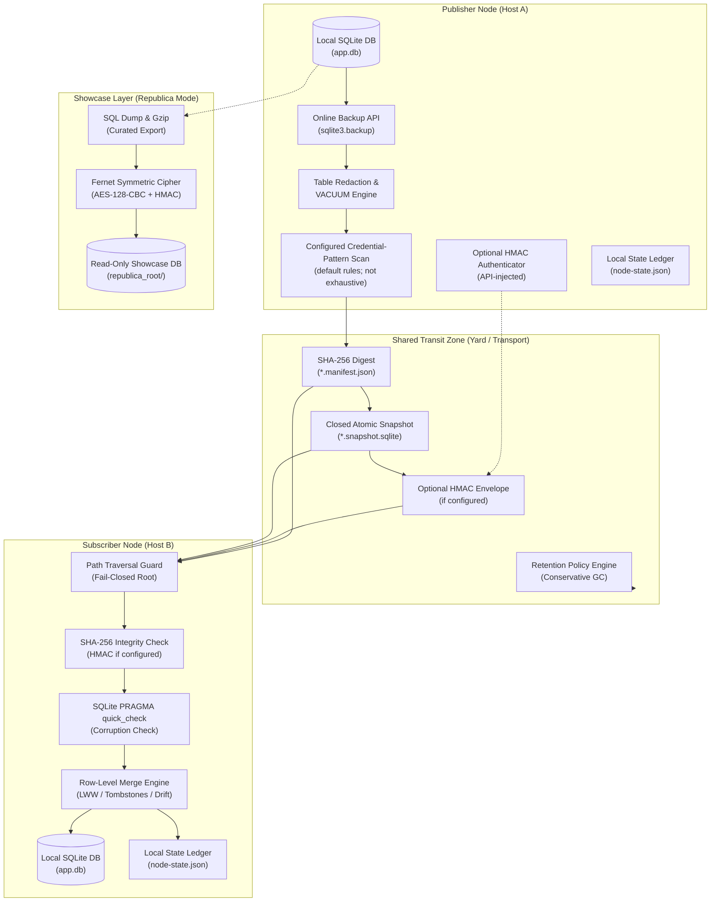

# sqlite-transit-sync


[](https://github.com/ellmos-ai/sqlite-transit-sync/actions/workflows/ci.yml)
[](CHANGELOG.md)
[](#tests)
[](#tests)
[](https://www.python.org/)
[](#)
[](#)
[](#governance-runtime-invariants-matrix)
[](SECURITY.md)
[](SECURITY.md)
[](CONTRIBUTING.md)
[](THIRD_PARTY_LICENSES.md)
[](THIRD_PARTY_LICENSES.txt)
[](NOTICE)
[](MARKETING-LOG.txt)
[](LICENSE)
[](https://github.com/ellmos-ai)
[](https://github.com/open-bricks)
[](llms.txt)

> [!NOTE]
> **Contexto para LLMs e agentes de IA**: um mapa do site estruturado e legível por máquina, uma visão geral da arquitetura e um guia da API estão disponíveis em [`llms.txt`](llms.txt).

**🇬🇧 [English](README.md)** | **🇩🇪 [Versão em alemão](README_de.md)** | **🇪🇸 [Versão em espanhol](README_es.md)** | **🇫🇷 [Versão em francês](README_fr.md)** | **🇯🇵 [Versão em japonês](README_ja.md)** | **🇨🇳 [Versão em chinês simplificado](README_zh.md)** | **🇵🇹 Português** | **🤝 [Contribuir](CONTRIBUTING.md)** | **🛡️ [Política de segurança](SECURITY.md)** | **📝 [Registro de alterações](CHANGELOG.md)** | **📋 [llms.txt](llms.txt)**

## 🧭 Navegação rápida

1. [Resumo executivo e identidade central](#what-is-sqlite-transit-sync)
2. [Topologia visual da arquitetura e camadas desacopladas](#system-architecture-topology)
3. [Ciclo de vida completo de snapshots e sincronização](#end-to-end-snapshot-synchronization-lifecycle)
4. [Personas-alvo e consultas SEO de alta intenção](#marketing--target-personas)
5. [Comportamento implementado e limites](#comparison-with-distributed-sql)
6. [Matriz de governança e invariantes de execução](#governance-runtime-invariants-matrix)
7. [Recursos centrais e funcionalidades desacopladas](#what-it-provides)
8. [Projeções de aplicação somente leitura](#read-only-application-projections)
9. [Instalação e pré-requisitos](#install)
10. [Início rápido e fluxo de trabalho multinó](#quick-start)
11. [Referência de configuração e gatilhos de credenciais](#configuration)
12. [Showcase Republica e método de criptografia](#republica-the-showcase-method)
13. [API Python e pontos de extensão](#python-api)
14. [Segurança, modelo de ameaças e limites operacionais](#safety-and-limits)
15. [Inventário de licenças de terceiros](#third-party-licenses--transparency)
16. [Ecossistema, ferramentas relacionadas e bundles](#ecosystem--sibling-tools)
17. [Testes, verificação e matriz de CI](#tests)
18. [Aviso legal, limitação de responsabilidade e licença (§ 521 do BGB)](#license)

---

<a id="what-is-sqlite-transit-sync"></a><a id="core-identity"></a><a id="executive-summary--core-identity"></a>
## 1. Resumo executivo e identidade central

Versão, status do módulo, visibilidade e autoridade da data de verificação estão definidos
em [`METADATA_CONTRACT.md`](METADATA_CONTRACT.md); esses dados não constituem aprovação para lançamento ou publicação pública.

Sincronização local-first de bancos de dados SQLite independentes por meio de snapshots com integridade verificada e políticas de mesclagem selecionáveis pela aplicação. A autenticação do remetente é opcional e usa um autenticador HMAC fornecido pela API. A arquitetura foi extraída do BACH ProSync sem dependências do BACH, do OneDrive, do nome do host ou de caminhos específicos do usuário.

Este **não é um servidor SQL distribuído**. Cada nó possui e abre apenas seu próprio banco de dados local. Uma pasta compartilhada, montagem de armazenamento de objetos, unidade removível ou outro transporte de arquivos carrega snapshots fechados e manifestos. Ao executar pull, o módulo verifica SHA-256 e SQLite `PRAGMA quick_check` antes de mesclar o snapshot no banco local dentro de uma transação. A autenticação HMAC do remetente só é verificada quando há um autenticador configurado.

Funciona bem com [sync-master](https://github.com/dev-bricks/sync-master), da mesma família de módulos. Um yard do sync-master é um transporte natural para os dados: aponte `--transit` para uma área `db-transit/<namespace>/` gerenciada pela ferramenta dentro do yard (regra de protocolo R9). O sync-master transporta os arquivos; este módulo cuida da integridade e da mesclagem do banco de dados. Os dois continuam independentes.

---

<a id="system-architecture-topology"></a><a id="system-architecture"></a>
## 2. Topologia visual da arquitetura e camadas desacopladas

O diagrama a seguir mostra a topologia desacoplada de vários nós, na qual bancos de dados SQLite locais se conectam exclusivamente por bundles de snapshots fechados, cuja integridade é verificada com base nos manifestos:



### Projeção arquitetural ASCII em quatro perspectivas

```text
+-------------------------------------------------------------------------------------------------------------------+
|                               SQLITE-TRANSIT-SYNC: FOUR-VIEW ARCHITECTURAL TOPOLOGY                               |
+-------------------------------------------------------------------------------------------------------------------+
| [VIEW 1: PUBLISHER NODE]               [VIEW 2: SHARED TRANSIT YARD]              [VIEW 3: SUBSCRIBER NODE]       |
|                                                                                                                   |
| +-------------------------+              +-----------------------------+            +---------------------------+ |
| | Local SQLite Database   |              |  Closed Transit Zone        |            | Path Traversal Guard      | |
| | (app.db - Exclusive RW) |              |  (Folder / Sync-Master / S3)|            | (Canonical Bounds Check)  | |
| +------------+------------+              +--------------+--------------+            +-------------+-------------+ |
|              |                                          ^                                         |               |
|              v (sqlite3.backup)                         |                                         v               |
| +------------+------------+                             |                           +-------------+-------------+ |
| | Online Consistent Backup|                             |                           | SHA-256 Integrity Check   | |
| | (Closed Rollback-Journal|                             |                           | Optional HMAC if set      | |
| +------------+------------+                             |                           +-------------+-------------+ |
|              |                                          |                                         |               |
|              v                                          |                                         v               |
| +------------+------------+                             |                           +-------------+-------------+ |
| | Redaction & VACUUM      |                             |                           | SQLite PRAGMA quick_check | |
| | (Exclude Sensitive Data)|                             |                           | (Integrity Verification)  | |
| +------------+------------+                             |                           +-------------+-------------+ |
|              |                                          |                                         |               |
|              v                                          |                                         v               |
| +------------+------------+                             |                           +-------------+-------------+ |
| | Pattern Scan            |                             |                           | Transactional Row Merge   | |
| | (default rules; limited) |                             |                           | (Row-Level LWW / Drift)  | |
| +------------+------------+                             |                           +-------------+-------------+ |
|              |                                          |                                         |               |
|              v                                          |                                         v               |
| +------------+------------+              +--------------+--------------+            +-------------+-------------+ |
| | Optional HMAC Adapter   |              |  *.snapshot.sqlite (Atomic) |            | Local SQLite Database     | |
| | (API-injected if set)   |- - - - - - ->|  *.manifest.json   (Digest) |----------->| (app.db - Merged State)   | |
| +-------------------------+              |  Retention Engine  (Scoped) |            +-------------+-------------+ |
|                                          +-----------------------------+                          |               |
|                                                                                                   v               |
|                                                                                     +-------------+-------------+ |
|                                                                                     | Local State Ledger        | |
|                                                                                     | (node-state.json)         | |
|                                                                                     +---------------------------+ |
+-------------------------------------------------------------------------------------------------------------------+
| [VIEW 4: REPUBLICA SHOWCASE / COURIER ENVELOPE (OPTIONAL ZERO-TRUST TRANSPORT)]                                   |
|                                                                                                                   |
| Local Database ----> Curated SQL Dump ----> Gzip Compression ----> AES-128-CBC (Fernet) ----> Encrypted Outpost   |
| (Source Node)       (FTS Rebuilt on Dest)   (53MB -> 11MB)         (Pre-Shared Key)          (republica_root/)    |
|                                                                                                                   |
| Single Secret File -> Fernet Cipher Envelope -> Courier Transit -> Destination Directory (Mode 0600, Transit Clr) |
+-------------------------------------------------------------------------------------------------------------------+
```

---

<a id="end-to-end-snapshot-synchronization-lifecycle"></a><a id="lifecycle"></a>
## 3. Ciclo de vida completo de snapshots e sincronização

O fluxo mantém os arquivos de bancos de dados ativos fora da sincronização em nível de arquivo. Ele compara os bytes do snapshot com um manifesto SHA-256, executa a verificação de padrões de credenciais configurada quando habilitada (padrão: ligada) e mescla transacionalmente as linhas aceitas. A autenticação do remetente só está disponível quando um autenticador HMAC fornecido pela API é configurado. Os pares só veem as alterações após uma troca push/pull bem-sucedida:

```mermaid
sequenceDiagram
    autonumber
    participant App as Application / Node A
    participant CoreA as sqlite-transit-sync (Push)
    participant Shield as Credential-Pattern Scan (default on; configurable)
    participant Transit as Shared Transit (db-transit)
    participant CoreB as sqlite-transit-sync (Pull)
    participant Target as Local DB / Node B

    Note over App,CoreA: Phase 1: Local Online Snapshot & Redaction
    App->>CoreA: push(config, db)
    CoreA->>CoreA: Online Snapshot via SQLite Backup API
    CoreA->>CoreA: Drop Excluded Tables & VACUUM
    CoreA->>Shield: Scan Content for Secret Patterns (credential-triggers.json)
    Shield-->>CoreA: No configured pattern matched (if enabled)

    Note over CoreA,Transit: Phase 2: Snapshot Digest & File Publication
    CoreA->>CoreA: Calculate SHA-256 digest and size
    CoreA->>Transit: Write Temporary Snapshot & Atomic os.replace

    Note over CoreA,Transit: Phase 3: Optional Manifest Authentication & Publication
    CoreA->>CoreA: Optionally HMAC-sign manifest (if configured)
    CoreA->>Transit: Atomically write manifest with SHA-256; HMAC only if configured (*.manifest.json)

    Note over Transit,CoreB: Phase 4: Transit Ingestion & Boundary Guard
    CoreB->>Transit: Discover Manifests & Validate Path Bounds (Anti-Traversal)
    CoreB->>CoreB: Verify HMAC first if configured
    CoreB->>CoreB: Verify snapshot size and SHA-256 (integrity only)
    CoreB->>CoreB: Run PRAGMA quick_check on Isolated Snapshot

    Note over CoreB,Target: Phase 5: Transactional Row Merge & State Advance
    CoreB->>Target: BEGIN IMMEDIATE Transaction
    CoreB->>Target: Apply Row-Level Merge Policy (LWW per PK / Tombstones)
    CoreB->>Target: Reconcile Shared Column Schema Drift
    CoreB->>Target: COMMIT Transaction
    CoreB->>CoreB: Advance Local State Ledger (node-state.json)
    Note over Target: Peer state reflects successful exchange; no background convergence guarantee
```

---

<a id="marketing--target-personas"></a><a id="target-personas--discoverability-queries"></a><a id="target-personas"></a>
## 4. Personas-alvo e consultas SEO de alta intenção

Projetado para ecossistemas modulares e descentralizados, `sqlite-transit-sync` atende a quatro personas centrais:

- **`[PERSONA-01]` Engenheiros de agentes autônomos de IA e arquitetos de enxames multi-host:**
  - *Desafio:* Enxames de múltiplos agentes executados em estações de trabalho, laptops e servidores precisam persistir o estado local sem colisões de bloqueio de arquivos.
  - *Solução:* A verificação, ativada por padrão, pode interromper a publicação quando um padrão de credencial configurado corresponde. É uma camada de proteção, não uma prova de que o snapshot não contém segredos. Os pares recebem as alterações após uma troca push/pull bem-sucedida.
- **`[PERSONA-02]` Desenvolvedores de aplicações desktop e edge para vários dispositivos:**
  - *Desafio:* Usuários avançados que trocam notas pessoais e bancos de dados de tarefas por sincronização de arquivos (por exemplo, sync-master, Syncthing, Nextcloud) enfrentam corrupção de banco de dados e travamentos de `-wal`.
  - *Solução:* A API de backup do SQLite e a publicação por arquivo mantêm os bancos SQLite ativos fora do caminho de sincronização. Os snapshots no trânsito são os arquivos trocados por esse transporte.
- **`[PERSONA-03]` Criadores de ferramentas local-first e com transporte configurável:**
  - *Desafio:* Aplicações que exigem soberania dos dados não podem aceitar dependência de um provedor de nuvem, custos recorrentes de hospedagem de banco de dados ou tráfego de saída em segundo plano sem controle.
  - *Solução:* O módulo troca arquivos de snapshot por um caminho do sistema de arquivos configurado. Esse caminho pode ser local ou removível; o transporte compartilhado ou montado pela rede permanece fora do controle do módulo.
- **`[PERSONA-04]` Responsáveis corporativos por segurança, privacidade e conformidade:**
  - *Desafio:* Requisitos rigorosos de zero trust proíbem a sincronização acidental de credenciais, blobs binários não verificados e serviços privilegiados em segundo plano.
  - *Solução:* A verificação, ativada por padrão, procura padrões de credenciais configurados antes da publicação; SHA-256 confere a integridade do snapshot em relação ao manifesto. Um autenticador HMAC fornecido pela API pode ser ativado para autenticar o remetente. O processo herda as permissões de quem o inicia.

### Consultas de busca de alta intenção (bilíngues: EN e DE)

| Categoria de intenção | Consultas de busca em inglês (EN) | Termos de busca em alemão (DE) |
|:---|:---|:---|
| **Sincronização local-first** | `sqlite synchronization python zero-dependency`, `local-first database snapshot sync`, `offline sqlite multi-device sync` | `lokale datenbank synchronisation offline snapshots`, `sqlite abgleich python ohne abhängigkeiten`, `lokale datenbank replikation dateibasiert` |
| **Integridade e verificação configurável de padrões de credenciais** | `configured credential-pattern scan sqlite sync`, `configured filesystem transit sqlite sync`, `optional hmac sqlite snapshot manifest` | `konfigurierter credential musterscan sqlite sync`, `dateipfad transit sqlite sync`, `optional hmac snapshot manifest` |
| **Mesclagem em nível de linha e conflitos** | `row level merge lww sqlite offline`, `sqlite last write wins schema drift tolerance`, `tombstone merge policy sqlite` | `row level merge lww sqlite offline`, `last-write-wins datenbank abgleich zeitstempel`, `schema drift toleranz sqlite merge` |
| **Arquitetura desacoplada** | `sqlite multi-node sync without distributed sql`, `sqlite over syncthing without corruption`, `sqlite transit yard architecture` | `sqlite synchronisation ohne verteilten server`, `sqlite über cloud sync ohne datenbankkorruption`, `transit yard sqlite synchronisation` |

Para detalhes sobre as personas, consultas de busca de alta intenção e posicionamento competitivo, consulte [MARKETING-LOG.txt](MARKETING-LOG.txt).

---

<a id="comparison-with-distributed-sql"></a><a id="comparative-matrix--alternatives"></a><a id="comparative-matrix"></a>
## 5. Comportamento implementado e limites

Esta seção registra o comportamento implementado e os limites do projeto. Não é uma avaliação comparativa atualizada de outros produtos.

| Dimensão | Invariante | Comportamento implementado | Limite / fronteira |
|:---|:---|:---|:---|
| **1. Processamento local e transporte** | `INV-LOCAL-01` | Lê bancos de dados SQLite locais e publica snapshots em um caminho de transporte configurado; não é necessário um servidor central de banco de dados. | O caminho configurado pode ser compartilhado ou montado pela rede. O acesso e o comportamento desse transporte estão fora do escopo deste módulo. |
| **2. Publicação de snapshots** | `INV-SNAP-02` | Captura um backup online e publica o arquivo de snapshot usando um arquivo temporário e `os.replace`. | A substituição individual de cada arquivo não transforma snapshot e manifesto em uma única transação de vários arquivos. |
| **3. Arquivos auxiliares e escopo do processo** | `INV-ROLL-03` | Fecha snapshots no modo rollback-journal e falha de forma fechada quando não consegue remover arquivos auxiliares temporários do SQLite. | Execute um processo de sincronização por nó, a menos que a aplicação hospedeira implemente um bloqueio de processo. |
| **4. Contenção do caminho de transporte** | `INV-PATH-04` | Restringe os caminhos de manifestos e snapshots a arquivos regulares diretamente sob a raiz canônica do diretório de transporte. | Isso não controla quem pode gravar no local de transporte. |
| **5. Verificações de integridade** | `INV-VERIFY-05` | Compara os bytes do snapshot com o SHA-256 do manifesto e executa SQLite `PRAGMA quick_check`. | Um digest correspondente não autentica o remetente nem o transporte. |
| **6. Verificação de padrões de credenciais** | `INV-SHIELD-06` | Por padrão, compara o conteúdo do snapshot com os padrões configurados e interrompe a publicação quando encontra uma correspondência; informa `table.column`, mas não o valor. | As regras com prefixos de fornecedores são uma proteção adicional, não uma garantia. Um resultado limpo significa que nenhum padrão conhecido correspondeu; segredos personalizados ou sem prefixo podem passar. |
| **7. Autenticação do remetente** | `INV-HMAC-07` | A aplicação pode ativar a autenticação HMAC-SHA256, fornecida pela API, para o manifesto canônico. | Sem um autenticador configurado, não há autenticação do remetente. HMAC com chave compartilhada não é um protocolo de atualidade nem uma assinatura de chave pública. |
| **8. Mesclagem de linhas** | `INV-MERGE-08` | Aplica uma política configurável de mesclagem em nível de linha; para tabelas compatíveis, o padrão é LWW por timestamp. | A aplicação integradora é responsável pelas premissas de relógio, semântica de exclusão, migrações e regras de conflito do domínio. |
| **9. Retenção e escopo de exclusão** | `INV-RET-09` | A limpeza é uma simulação por padrão e se limita aos artefatos do nó local, a menos que a autoridade entre nós seja ativada explicitamente. | A limpeza por retenção não é um serviço de backup ou recuperação. |
| **10. Permissões do processo e política de segurança** | `INV-SLA-10` | O processo usa as permissões de quem o inicia. `SECURITY.md` define a política de reporte: confirmação de recebimento em até 48 horas e triagem inicial em até 5 dias úteis. | O módulo não impõe privilégios de usuário padrão nem solicita elevação. Esses prazos fazem parte da política de reporte, não são um recurso de execução. |

<a id="distributed-sql-detailed-comparison"></a>
### Modelo de processamento e fronteiras

| Aspecto | Comportamento de `sqlite-transit-sync` | Limite / fronteira |
|---|---|---|
| Modelo básico | Cada nó tem seu próprio banco de dados SQLite local; os snapshots percorrem um caminho de transporte configurado. | Não existe um único banco de dados com autoridade global. |
| Gravações | As aplicações gravam localmente; quem chama executa push e pull para trocar snapshots. | Não há sincronização automática em segundo plano. |
| Visibilidade | Um nó par pode ver as alterações após uma troca e mesclagem bem-sucedidas. | O módulo não promete visibilidade imediata nem consistência global. |
| Transações globais | Não são fornecidas. | A aplicação não pode confirmar uma única transação em vários nós. |
| Operação offline | O banco local pode ser usado independentemente enquanto o nó estiver offline. | A troca de snapshots aguarda a disponibilidade do transporte configurado. |
| Conflitos | A `MergePolicy` configurada determina como as linhas são combinadas; o padrão é LWW por timestamp. | Relógios da aplicação, regras de exclusão e semântica do domínio continuam sob responsabilidade da integração. |
| Alterações de esquema | A mesclagem de colunas compartilhadas tolera diferenças limitadas de esquema. | As aplicações continuam responsáveis pelas migrações e compatibilidade de esquema. |
| Tratamento de falhas | Os dados locais ficam no SQLite, e os snapshots de transporte são arquivos separados. | O módulo não fornece replicação automática, failover ou backups do transporte. |

### Vantagens, desvantagens e casos de uso típicos

| Sistema | Vantagens | Desvantagens | Bons casos de uso | Casos de uso inadequados |
|---|---|---|---|---|
| `sqlite-transit-sync` | Baixo uso de recursos locais; dispensa servidor central de banco de dados; permite trabalho local offline; transporte de arquivos configurável; políticas de mesclagem selecionáveis pela aplicação. | As alterações dependem de push/pull para chegar aos pares; não há transação global nem failover automático; relógios, exclusões, migrações e conflitos exigem regras da aplicação. | Bancos de dados pessoais ou de tarefas; estado local de agentes; laptops, estações de trabalho e dispositivos edge com conexão intermitente; anotações de pesquisa. | Cargas que exigem transações confirmadas globalmente, estado compartilhado imediato, failover automático ou muitos gravadores simultâneos. |

### Guia rápido para decidir

| Requisito | Adequação |
|---|---|
| Os nós precisam continuar usando seus bancos locais enquanto estiverem offline | `sqlite-transit-sync` |
| As atualizações podem chegar aos pares após uma troca explícita de push/pull | `sqlite-transit-sync` |
| A aplicação pode definir suas regras de mesclagem, relógio, exclusão e migração | `sqlite-transit-sync` |
| Toda gravação precisa ter autoridade global imediata | Use uma arquitetura com esse contrato de consistência |
| São necessárias transações globais, failover automático ou muitas gravações concorrentes | Avalie uma arquitetura que ofereça esses comportamentos |

Para poucos dispositivos com conexão intermitente, este módulo pode ser adequado quando são aceitáveis a troca com atraso e regras de mesclagem definidas pela aplicação. Se a carga exigir transações globais, estado compartilhado imediato ou failover automático, escolha uma solução cujo contrato documentado ofereça esses comportamentos.

---

<a id="governance-runtime-invariants-matrix"></a><a id="governance--runtime-invariants"></a>
## 6. Matriz de governança e invariantes de execução

A matriz abaixo registra os 10 invariantes de governança e execução do projeto, com o comportamento implementado e os limites relevantes:

| Nº | Invariante | Escopo arquitetural | Comportamento documentado e limites |
|---|---|---|---|
| 1 | **INV-LOCAL-01: Processamento SQLite local e transporte configurado** | Arquitetura do sistema | Lê bancos SQLite locais e publica snapshots pelo caminho de transporte configurado. O caminho pode ser compartilhado ou montado pela rede; o comportamento do host e do transporte está fora do escopo deste módulo. |
| 2 | **INV-SNAP-02: Atomicidade de snapshots offline** | Publicação no transporte | Arquivos de bancos de dados ativos nunca são compartilhados por sincronização de arquivos. Snapshots online são obtidos com `sqlite3.backup` e publicados por `os.replace` atômico. |
| 3 | **INV-ROLL-03: Isolamento limpo com rollback journal** | Prevenção de arquivos auxiliares | Os backups são fechados no modo rollback-journal; todos os arquivos auxiliares temporários do SQLite (`-wal`, `-shm`, `-journal`) são removidos de forma fail-closed antes da criação do manifesto. |
| 4 | **INV-PATH-04: Contenção rigorosa do caminho de transporte** | Fronteira do sistema de arquivos | Os caminhos de manifestos e snapshots devem apontar para arquivos regulares diretamente na raiz canônica do transporte. Travessia de caminho (`../`), links simbólicos e pontos de nova análise são rejeitados de forma fail-closed. |
| 5 | **INV-VERIFY-05: Verificação de integridade e validade em duas etapas** | Validação antes da mesclagem | Todo snapshot recebido deve passar pela comparação do digest SHA-256 e por SQLite `PRAGMA quick_check` antes que os dados sejam inspecionados ou mesclados. |
| 6 | **INV-SHIELD-06: Proteção de credenciais antes da publicação** | Inspeção de conteúdo | Por padrão, o conteúdo do snapshot é comparado com padrões de credenciais configurados; uma correspondência interrompe a publicação e informa `table.column`, não o valor. Padrões com prefixo de fornecedor são uma proteção adicional, não uma garantia; nenhuma correspondência não prova que o snapshot esteja livre de segredos. |
| 7 | **INV-HMAC-07: Autenticação HMAC opcional** | Autenticação do remetente | Envelope HMAC-SHA256 opcional, injetado pela API, sobre o conteúdo canônico do manifesto (protocolo, namespace, ID do remetente, nome do arquivo, SHA-256, tamanho e lista de redação). HMAC com chave compartilhada não é um protocolo de atualidade nem uma assinatura de chave pública; sem ele, o manifesto não autentica o remetente. |
| 8 | **INV-MERGE-08: Mesclagem determinística em nível de linha** | Convergência dos dados | Mesclagem transacional em nível de linha (LWW por chave primária, união de colunas compartilhadas para diferenças de esquema e política explícita de tombstone). Um desempate por hash do conteúdo garante convergência determinística. |
| 9 | **INV-RET-09: Retenção conservadora e escopo de autoridade** | Coleta de lixo | A limpeza de snapshots é uma simulação por padrão e se limita estritamente aos artefatos do nó local. A exclusão entre nós (`--all-nodes`) exige ativação administrativa explícita. |
| 10 | **INV-SLA-10: Permissões do processo e política de segurança** | Contexto de execução | O processo herda as permissões de quem o inicia; este módulo não impõe privilégios de usuário padrão nem solicita elevação. `SECURITY.md` define confirmação de recebimento em até 48 horas e triagem inicial em até 5 dias úteis. |

---

<a id="what-it-provides"></a><a id="core-capabilities"></a><a id="part-of-the-ellmos-stack-family"></a>
## 7. Recursos centrais e funcionalidades desacopladas

`sqlite-transit-sync` é um complemento do
[dev-bricks/sync-master](https://github.com/dev-bricks/sync-master), da
mesma família de módulos: o sync-master cuida do transporte de arquivos (`sync.files`), e este
módulo cuida da integridade e mesclagem do banco de dados (`sync.database`). Ambos funcionam
sozinhos ou integrados a stacks da família
[ellmos-ai](https://github.com/ellmos-ai) — consulte o catálogo
[ellmos-ai/stacks](https://github.com/ellmos-ai/stacks). Sua função
nesse conjunto: não transportar bancos SQLite ativos por sincronização de arquivos — apenas snapshots que passam pelas verificações de integridade do manifesto e do SQLite, com
políticas de mesclagem selecionáveis pela aplicação.

### Principais recursos

- snapshots online consistentes pela API de backup do SQLite;
- publicação atômica usando um arquivo temporário e `os.replace`;
- snapshots fechados em modo rollback-journal e limpeza fail-closed de todos os arquivos auxiliares temporários do SQLite antes da publicação;
- caminhos de manifestos e snapshots restritos a arquivos regulares diretamente no diretório canônico de transporte; travessia de caminho, caminhos absolutos, links simbólicos e pontos de nova análise são rejeitados de forma fail-closed antes do hash ou da mesclagem;
- verificação SHA-256 do manifesto e `PRAGMA quick_check`;
- autenticação HMAC-SHA256 opcional, injetada pela API, sobre o manifesto canônico, a identidade do remetente, a versão do protocolo e o hash do snapshot, com IDs de chave explícitos;
- estado local de pull por nó e repetição idempotente;
- last-write-wins em nível de linha por chave primária para tabelas com timestamp;
- adaptador de referência `TombstoneMergePolicy`, ativado optativamente, para exclusões explícitas;
- mesclagem de colunas compartilhadas para tolerar diferenças básicas de esquema;
- exclusão configurável de tabelas e redação do snapshot, com VACUUM após as exclusões;
- verificação de conteúdo ativada por padrão que interrompe a publicação quando um padrão de credencial configurado corresponde (informa `table.column`, nunca o valor). As regras com prefixos de fornecedores são uma proteção adicional; uma verificação limpa não prova que o snapshot esteja livre de segredos;
- suporte a `MergePolicy` personalizada para regras do domínio, tombstones ou CRDTs;
- limpeza de snapshots verificados, em simulação e limitada ao nó local por padrão, com ativação explícita para exclusão e administração de nós externos;
- seleção de pulls pendentes por adaptadores leves de ciclo de vida da aplicação, sem duplicar a lógica de mesclagem ou avanço de estado;
- contratos versionados e estritos para projeções somente leitura, com listas de permissões exatas para esquema e privacidade, verificação de proveniência, checkpoint, loop e tombstones offline;
- um [modo de showcase Republica](#republica-the-showcase-method) opcional que distribui um banco de dados em uma única direção como payload criptografado e o materializa como showcase separado e somente leitura,
  em vez de mesclá-lo;
- API Python e CLI JSON sem dependências externas (o modo Republica adiciona `cryptography`).

---

<a id="read-only-application-projections"></a><a id="projections"></a>
## 8. Projeções de aplicação somente leitura

`verify-projection` valida uma projeção SQLite fechada e pertencente à aplicação, sem copiar, mesclar, migrar, agendar ou avançar o estado. A aplicação informa a identidade do consumidor e o intervalo máximo offline que revisou; o verificador rejeita loops, checkpoints obsoletos, retenção insuficiente de tombstones, tabelas ou colunas não listadas e referências de registros que não sejam opacas.

O pacote inclui seis contratos de escopo restrito: resumos de saldo de contas, status de assinatura do AboTracker, datas de reposição do HausLagerist, estado de vencimento/aviso de estoque de medicamentos, estado de vencimento/conclusão de rotinas e prazos de seguros. O contrato do AboTracker informa apenas o status porque o esquema de exportação v1 não tem uma próxima data de vencimento ou renovação confirmada; nunca calcula um lembrete somando a data de pagamento e o ciclo de cobrança. Os fixtures de teste são receitas JSON sintéticas; identidades do domínio e dados privados ficam fora das listas de permissões.

Os nomes dos contratos incluídos são `abotracker-subscription-status-projection.v1`,
`accounts-balance-projection.v1`, `hauslagerist-replenishment-projection.v1`,
`mediplaner-reminder-projection.v1`,
`routinika-reminder-projection.v1` e
`versicherungsmanager-deadline-projection.v1`.
Consulte os [contratos de projeção somente leitura](PROJECTION_CONTRACTS.md) e a
[versão em alemão](PROJECTION_CONTRACTS_de.md).

```bash
sqlite-transit-sync verify-projection \
  --contract mediplaner-reminder-projection.v1 \
  --database ./closed-projection.sqlite \
  --consumer-id reminder-consumer \
  --minimum-offline-seconds 2592000 \
  --previous-checkpoint 41
```

---

<a id="install"></a><a id="installation"></a>
## 9. Instalação e pré-requisitos

```bash
python -m pip install -e .
```

---

<a id="quick-start"></a><a id="quickstart"></a>
## 10. Início rápido e fluxo de trabalho multinó

Crie uma configuração em cada nó. Cada nó usa seu próprio banco de dados e arquivo de estado, mas todos usam o mesmo diretório de transporte e namespace.

```bash
sqlite-transit-sync init \
  --config node.json \
  --database ./app.db \
  --transit ./shared-transit \
  --node-id laptop \
  --namespace my-app

sqlite-transit-sync push --config node.json
sqlite-transit-sync pull --config node.json --dry-run
sqlite-transit-sync pull --config node.json
sqlite-transit-sync status --config node.json
sqlite-transit-sync verify --config node.json
sqlite-transit-sync cleanup --config node.json
# Review the JSON plan, then explicitly apply it:
sqlite-transit-sync cleanup --config node.json --apply
```

O esquema da aplicação já deve existir em cada nó. A primeira cópia automática está intencionalmente desativada porque um módulo genérico não pode decidir quais esquemas, segredos, tabelas locais ou migrações pertencem a cada aplicação.

### Início rápido com Python executável de forma independente (sem dependências externas)

Desenvolvedores que integrem `sqlite-transit-sync` diretamente a frameworks de agentes, daemons ou workers em segundo plano podem executar este script autocontido, pronto para copiar e colar, para verificar a sincronização de ponta a ponta entre vários nós sem dependências externas:

```python
import sqlite3
from contextlib import closing
import tempfile
from pathlib import Path
from sqlite_transit_sync import SyncConfig, TransitSync

with tempfile.TemporaryDirectory() as tmp:
    root = Path(tmp)
    transit = root / "transit"
    transit.mkdir()

    # 1. Initialize Node A and record local data
    db_a = root / "node_a.db"
    with closing(sqlite3.connect(db_a)) as conn, conn:
        conn.execute("CREATE TABLE notes (id INTEGER PRIMARY KEY, title TEXT, updated_at TEXT)")
        conn.execute("INSERT INTO notes VALUES (1, 'Hello from Node A', '2026-10-18T08:00:00Z')")

    # 2. Publish atomic snapshot from Node A to shared transit
    cfg_a = SyncConfig(database=db_a, transit=transit, state=root / "state_a.json", node_id="node_a", namespace="demo")
    snapshot = TransitSync(cfg_a).push()
    print(f"Node A published snapshot: {snapshot.path.name} (SHA-256: {snapshot.sha256[:8]}...)")

    # 3. Initialize Node B with schema and pull snapshot
    db_b = root / "node_b.db"
    with closing(sqlite3.connect(db_b)) as conn, conn:
        conn.execute("CREATE TABLE notes (id INTEGER PRIMARY KEY, title TEXT, updated_at TEXT)")

    cfg_b = SyncConfig(database=db_b, transit=transit, state=root / "state_b.json", node_id="node_b", namespace="demo")
    reports = TransitSync(cfg_b).pull()

    # 4. Verify converged state in Node B
    with closing(sqlite3.connect(db_b)) as conn, conn:
        rows = conn.execute("SELECT id, title, updated_at FROM notes").fetchall()
        print(f"Node B converged records: {rows}")
        assert rows == [(1, "Hello from Node A", "2026-10-18T08:00:00Z")]
```

---

<a id="configuration"></a><a id="configuration-reference"></a>
## 11. Referência de configuração e gatilhos de credenciais

```json
{
  "database": "./app.db",
  "transit": "./shared-transit",
  "state": "./node-state.json",
  "node_id": "laptop",
  "namespace": "my-app",
  "timestamp_columns": ["updated_at", "modified_at", "created_at"],
  "exclude_tables": ["secrets", "sqlite_sequence"],
  "snapshot_exclude_tables": ["secrets"],
  "scan_snapshot_for_secrets": true,
  "secret_scan_skip_tables": [],
  "secret_scan_extra_patterns": [],
  "secret_patterns_file": null
}
```

Caminhos relativos são resolvidos a partir do arquivo de configuração. O banco de dados ativo nunca deve ficar dentro do diretório de transporte, e o arquivo de estado deve ficar fora dessa árvore. `SyncConfig`, `from_file`, `from_bytes` e o comando CLI `init` rejeitam um caminho de estado inválido antes de criar os diretórios de transporte ou de estado; nenhuma migração é feita automaticamente.

Aplicações que precisam de um hash de auditoria exatamente da configuração analisada podem ler os bytes uma única vez e usar o mesmo analisador relativo à origem, sem uma segunda leitura do arquivo:

```python
import hashlib
from pathlib import Path

from sqlite_transit_sync import SyncConfig

config_path = Path("node.json").resolve()
payload = config_path.read_bytes()
config = SyncConfig.from_bytes(payload, source_path=config_path)
config_sha256 = hashlib.sha256(payload).hexdigest()
```

### Todas as chaves e seus valores padrão

| Chave | Padrão | Significado |
|---|---|---|
| `database` | *(obrigatório)* | Banco de dados SQLite ativo pertencente a este nó |
| `transit` | *(obrigatório)* | Diretório compartilhado que transporta snapshots e manifestos |
| `state` | `./.sync-state.json` | Estado de pull por nó; mantenha-o fora do diretório de transporte |
| `node_id` | nome de host da máquina | Identifica o nó publicador nos nomes dos snapshots |
| `namespace` | `"default"` | Separa conjuntos de dados não relacionados no mesmo diretório de transporte |
| `timestamp_columns` | `["updated_at","modified_at","created_at"]` | Colunas consultadas para aplicar last-write-wins |
| `exclude_tables` | `["secrets","sqlite_sequence"]` | Tabelas que nunca são **mescladas** no banco de dados local |
| `snapshot_exclude_tables` | `["secrets"]` | Tabelas cujas linhas são **removidas do snapshot** antes da publicação (depois executa `VACUUM`) |
| `scan_snapshot_for_secrets` | `true` | Interrompe a publicação quando o conteúdo do snapshot ainda parece conter uma credencial |
| `secret_scan_skip_tables` | `[]` | Tabelas ignoradas pela verificação — use para uma tabela com muito ruído em vez de desativar a verificação |
| `secret_scan_extra_patterns` | `[]` | Expressões regulares adicionais, além das do arquivo de gatilhos |
| `secret_patterns_file` | `null` (arquivo incluído) | Caminho para um arquivo de gatilhos próprio; **substitui** os padrões integrados |
| `key_file` | `null`, ou `$SQLITE_TRANSIT_SYNC_KEY_FILE` | Chave Fernet do modo Republica; deve ficar fora do diretório de transporte |
| `republica_root` | `~/.republica` | Local onde os showcases importados são gravados; deve ficar fora do diretório de transporte |
| `allow_key_in_synced_folder` | `false` | Ignora a verificação que rejeita uma chave dentro de uma pasta sincronizada na nuvem |

O valor padrão de `state` nesta tabela se aplica quando uma configuração JSON é carregada sem essa chave. Já `sqlite-transit-sync init` grava `.<config-stem>-state.json` quando `--state` é omitido (para `node.json`: `.node-state.json`).

### A verificação de credenciais e como desativá-la

`snapshot_exclude_tables` só consegue remover tabelas que você já previu. A verificação responde à pergunta que essa regra não cobre: *uma credencial acabou colada em uma coluna de texto livre* — uma anotação, linha de log ou resumo de sessão? Ela é executada na cópia do snapshot após a redação e antes da publicação. Em caso de correspondência, gera `SyncError` e informa `table.column`; o valor encontrado nunca é incluído, então a credencial não aparece em logs, tracebacks nem na saída da CI. O snapshot parcial é descartado e nada chega ao diretório de transporte.

**Desativar a verificação é uma escolha legítima**, não uma solução improvisada. Se o transporte for um local de armazenamento que você controla e em que confia — seu próprio servidor, um volume hospedado na UE sob seu contrato ou uma unidade removível criptografada — e você *quiser* que as credenciais sejam transportadas com os dados, configure:

```json
{ "scan_snapshot_for_secrets": false }
```

Prefira `secret_scan_skip_tables` quando apenas uma tabela gera falsos positivos: manter a verificação ativa nas demais tabelas é melhor do que silenciá-la globalmente.

### Ajuste dos gatilhos

Os padrões ficam em um arquivo de dados, não no código — `sqlite_transit_sync/credential-triggers.json` —
para que a detecção possa ser reforçada ao longo do tempo sem esperar por uma versão:

```json
{
  "version": 1,
  "patterns": [
    { "name": "github", "regex": "gh[pousr]_[A-Za-z0-9]{16,}", "prefilter": "gh" },
    { "name": "acme-internal", "regex": "ACME-[0-9]{4}", "prefilter": "ACME-" }
  ]
}
```

- `prefilter` é um literal opcional usado como pré-filtro SQL `LIKE` de baixo custo para manter a velocidade em snapshots grandes. Ele **precisa** aparecer em todos os valores que a expressão regular pode reconhecer; caso contrário, ocorrências passarão despercebidas. Se não existir um literal assim, omita-o — o scanner lerá a coluna inteira para manter a precisão.
- Aponte `secret_patterns_file` para uma cópia própria para substituir completamente os padrões padrão, ou use `secret_scan_extra_patterns` para acrescentar padrões.

Os padrões usam intencionalmente prefixos de fornecedores. Uma regra genérica de “sequência hexadecimal longa” sinalizaria checksums, UUIDs e SHAs do Git, que são conteúdo legítimo do banco de dados. Um scanner com muitos falsos positivos acaba desativado e deixa de proteger qualquer coisa. Interprete uma verificação limpa como “nenhum padrão conhecido correspondeu”, nunca como “este snapshot não contém segredos”.

### Isto não é um gerenciador de segredos

A verificação pode interromper a publicação quando um padrão configurado corresponde; ela não garante a detecção de todas as credenciais e não **distribui** credenciais. Se o seu problema é “minhas máquinas precisam usar as mesmas senhas ou chaves de API”, este módulo não é a ferramenta adequada — e uma pasta de sincronização de documentos também não. Considere uma ferramenta específica para segredos e avalie sua implantação e seu modelo de confiança:

| Abordagem | Adequado para | Observações |
|---|---|---|
| **Vaultwarden** (Bitwarden auto-hospedado) | pessoas e CLI em várias máquinas | Executa em um dispositivo pequeno sempre ligado; acesse-o por uma rede privada (WireGuard, Tailscale) em vez de expô-lo. Clientes oficiais Bitwarden, extensões de navegador e a CLI `bw` funcionam com ele, permitindo que scripts e agentes também obtenham segredos. |
| **SOPS + age** | segredos que devem ficar junto ao código | É seguro enviar arquivos criptografados ao repositório ou colocá-los em qualquer pasta sincronizada, pois somente o texto cifrado é transportado. Usa chaves por destinatário e funciona bem com revisão do Git. |
| **`pass`** (GPG) + git | usuários individuais familiarizados com Unix e equipes pequenas | Um arquivo por segredo, um repositório Git remoto comum e nenhum servidor. |
| **Banco de dados KeePassXC pelo Syncthing** | quem não quer servidor nem conta na nuvem | Sincronização de arquivos ponto a ponto; o cofre continua sendo um único arquivo criptografado. |
| **Infisical / OpenBao (fork do Vault)** | equipes, identidades de máquinas, rotação | Servidores de segredos completos com logs de auditoria e credenciais dinâmicas — mais componentes do que uma residência precisa. |
| **Armazenamentos nativos da plataforma** | uma máquina, um aplicativo | macOS Keychain, Windows DPAPI/Credential Manager, `systemd-creds` ou o armazenamento de segredos da sua CI. Não há sincronização, mas também não há exposição. |

Qualquer que seja a opção, a separação importante é a mesma: **um canal para os dados e outro para as credenciais.** Este módulo pode bloquear um snapshot quando um padrão configurado corresponde, mas não garante a detecção de todos os segredos.

---

<a id="republica-the-showcase-method"></a><a id="republica-showcase"></a>
## 12. Showcase Republica e método de criptografia

Cada máquina coloca um **showcase criptografado** de seu banco de dados em uma área compartilhada de arquivos. As outras máquinas podem consultá-lo, mas nenhuma pode alterá-lo. Daí o nome: uma republicação de um banco de dados, legível apenas por quem possui a chave.

Use Republica quando `push`/`pull` não for adequado: quando você quiser ler os dados de outro nó sem mesclá-los às suas linhas, ou quando as máquinas compartilharem apenas uma pasta — sem servidor, portas abertas ou túnel ponto a ponto dedicado para o próprio Republica, embora ainda seja necessária uma chave Fernet compartilhada — e a pasta não puder ver o conteúdo em texto claro.

<a id="two-modes-deliberately-redundant"></a>
### Dois modos, o mesmo diretório de transporte configurado

Com a mesma `SyncConfig`, `push`/`pull` e Republica usam o mesmo caminho `transit` configurado. `push`/`pull` publicam snapshots e os mesclam no banco de dados local; Republica publica réplicas criptografadas em um subdiretório por nó dentro desse diretório de transporte e as importa como bancos de dados separados e somente leitura sob `republica_root`. O que muda é a criptografia e o comportamento de mesclagem, não o transporte.

| Condição | Sincronização por arquivos (`push`/`pull`) | Republica |
|---|---|---|
| Um nó par está offline | Um nó pode publicar enquanto os pares estão offline; `pull` pode mesclar snapshots que já estejam no diretório de transporte. Os dados novos aguardam a publicação pelo nó de origem. | Um publicador pode deixar uma réplica criptografada pronta para importação posterior. Os dados de uma origem offline também aguardam a publicação. |
| Túnel VPN/SSH indisponível | O caminho de arquivo configurado precisa continuar acessível; `push`/`pull` não abrem túneis entre pares. | A mesma dependência do diretório de transporte; VPN/SSH só importa se tornar o caminho configurado inacessível. |
| Diretório de transporte configurado indisponível | Não é possível publicar ou recuperar arquivos por um caminho configurado que esteja indisponível. | O mesmo vale para Republica; não há transporte alternativo. |
| Rotação de chave ou configuração de confiança pendente | HMAC é opcional. Se houver um autenticador configurado, a chave e a configuração de confiança devem corresponder; sem ele, SHA-256 verifica a integridade, mas não autentica o remetente. | Publicação e importação exigem uma chave Fernet compartilhada compatível; as rotações devem ser coordenadas. |
| Nenhuma política de mesclagem específica da aplicação está configurada | Usa a `MergePolicy` configurada ou, por padrão, LWW por timestamp; escolha uma política específica do domínio se esse padrão não for adequado. | Importa um banco de dados separado e somente leitura; não mescla linhas. |

Republica é útil quando são necessárias cópias criptografadas, separadas e somente leitura. Ele não oferece failover de transporte; isso exigiria caminhos de transporte configurados separadamente e disponíveis de forma independente.

### Custo de configuração: uma transferência de chave

A chave compartilhada deve chegar às outras máquinas por **algum canal diferente do próprio transporte** — um túnel criptografado já existente, um gerenciador de senhas, um pen drive ou leitura por telefone. Uma única vez. Depois disso, uma pasta compartilhada simples é suficiente, mesmo que você não confie nela.

```text
republica_root/
  laptop/my-app.sqlite      <- read-only showcase of laptop's database
  workstation/my-app.sqlite <- read-only showcase of workstation's database
```

```bash
# Once per key, on local disk - never inside the transit, never in a synced folder.
# Then copy this file to the other machines out of band; do NOT run keygen there.
sqlite-transit-sync keygen --key-file ~/.keys/republica.key

sqlite-transit-sync init --config node.json \
  --database ./app.db --transit ./shared-transit \
  --node-id laptop --namespace my-app \
  --key-file ~/.keys/republica.key

sqlite-transit-sync republica-publish --config node.json   # encrypt and publish
sqlite-transit-sync republica-list    --config node.json   # what other nodes offer
sqlite-transit-sync republica-import  --config node.json   # materialise them locally
```

Requer a cifra opcional: `pip install 'sqlite-transit-sync[crypto]'`.

**O que é transportado** não é um arquivo de banco de dados, mas um dump SQL selecionado, compactado com gzip e criptografado com Fernet. Em um banco de conhecimento real de 53,6 MB, isso representa 11,0 MB em trânsito, porque os dados internos do índice de texto completo são reconstruídos na chegada em vez de serem enviados (35.370 de 49.636 instruções do dump). A publicação passa pelos mesmos controles de um snapshot para mesclagem — redação, verificação de credenciais, `quick_check` e manifesto.

**O que protege:** o transporte vê apenas o texto cifrado, e o HMAC do Fernet detecta alterações deliberadas mesmo quando o hash do manifesto foi recalculado para corresponder.

**O que não protege:** o Fernet autentica a *chave*, não o *remetente* — qualquer pessoa que a possua pode publicar um snapshot válido. Por isso a réplica permanece separada e nunca é mesclada. Mantenha a chave fora do transporte: uma chave dentro do diretório de transporte é recusada, assim como uma em uma pasta que pareça sincronizada (a verificação pode ser ignorada com `allow_key_in_synced_folder`). A mesma regra se aplica a `republica_root`: uma réplica descriptografada dentro do transporte seria redistribuída em texto claro.

**Limite:** um índice de texto completo sem conteúdo próprio (`content=''`) não pode ser reconstruído, pois não há dados de origem. Essas tabelas são informadas no manifesto como `contentless_fts`, em vez de chegarem vazias sem aviso.

### Envelope lacrado: um arquivo pelo mesmo canal, nunca um banco de dados

O problema inicial: duas máquinas ainda não compartilham um canal seguro, e é justamente por isso que uma credencial precisa ser transferida. A mesma chave e a mesma pasta podem transportar um único arquivo criptografado.

```bash
sqlite-transit-sync envelope-send    --config node.json --file ./api-token.txt --label api-token
sqlite-transit-sync envelope-receive --config node.json --into ~/credentials
```

O arquivo chega **como arquivo** (modo `0600`), com o nome `<source-node>__<filename>`, e nunca entra em um banco de dados — todo backup, índice e sincronização que tocar em um segredo armazenado no banco fará outra cópia dele. As anotações devem registrar onde o segredo está, nunca o próprio segredo.

Duas regras do showcase são intencionalmente invertidas: a **verificação de credenciais não se aplica** (ela bloquearia justamente o payload transportado), e o envelope é **removido do diretório de transporte** após o recebimento, para que um segredo não fique em uma pasta compartilhada. A abertura do envelope no diretório de transporte ou em uma pasta que pareça sincronizada com a nuvem é recusada. O nome do arquivo também é sanitizado novamente na chegada para que um manifesto manipulado não grave fora do diretório de destino.

Isto é um serviço de transporte, não um gerenciador de senhas nem uma sincronização de arquivos — mantenha poucos envelopes e mantenha-os pequenos.

---

<a id="python-api"></a><a id="api"></a>
## 13. API Python e pontos de extensão

```python
from sqlite_transit_sync import SyncConfig, TransitSync

sync = TransitSync(SyncConfig.from_file("node.json"))
snapshot = sync.push()
pending = sync.pending()
selected_reports = sync.pull_selected([pending[-1].path.name]) if pending else []
reports = sync.pull()
cleanup_plan = sync.cleanup()
print(
    snapshot.sha256,
    [report.as_dict() for report in reports],
    [report.as_dict() for report in selected_reports],
    cleanup_plan,
)
```

`pull_selected()` aceita apenas snapshots explicitamente nomeados que estejam pendentes e reutiliza os mesmos controles de verificação, mesclagem e estado de `pull()`. Assim, um adaptador leve de ciclo de vida pode escolher um snapshot elegível sem duplicar a lógica de transporte dos dados.

### Manifestos autenticados opcionais e pré-verificação somente leitura

Uma aplicação integradora pode descrever chaves com valores não secretos de `HMACKeyReference`. `load_hmac_authenticator()` obtém os bytes somente por meio de um `SecretResolver` injetado; `OSKeyringSecretResolver` é um adaptador opcional e carregado sob demanda para o pacote `keyring`, instalado separadamente. A configuração JSON e a CLI nunca carregam o material da chave:

```python
from sqlite_transit_sync import (
    HMACKeyReference,
    OSKeyringSecretResolver,
    load_hmac_authenticator,
    verify_authenticated_snapshot,
)

auth = load_hmac_authenticator(
    [HMACKeyReference(
        key_id="node-a-v2",
        service="ellmos-ocean-transit",
        account="node-a-v2",
        sender="node-a",
    )],
    active_key_id="node-a-v2",
    resolver=OSKeyringSecretResolver(),
    trusted_senders={"node-a"},
)
snapshot = verify_authenticated_snapshot(
    manifest_path,
    snapshot_path,
    authenticator=auth,
)
```

O adaptador de referência usa HMAC-SHA256 com chave compartilhada, não assinaturas públicas com não repúdio. O payload canônico inclui protocolo, namespace, nó, nome do snapshot, SHA-256, tamanho, lista de redação e o cabeçalho de algoritmo/chave/remetente/origem da confiança. Durante a rotação, mantenha as chaves antigas no chaveiro do verificador. Um verificador configurado rejeita assinaturas ausentes, malformadas, de origem externa ou incompatíveis. A pré-verificação explícita também rejeita arquivos ausentes e arquivos auxiliares do SQLite antes de calcular hashes; ela nunca abre o SQLite, mescla linhas nem lê ou grava o estado de sincronização. O sucesso autentica os bytes do arquivo indicado, não o esquema SQLite nem a semântica da aplicação. `TransitSync(..., authenticator=auth)` continua disponível para chamadores existentes; repetir um pull já aplicado é um no-op baseado no estado, não uma garantia de atualidade. Um leitor sem autenticador configurado não faz afirmações de autenticidade. Atualidade e armazenamento de chaves são responsabilidades da aplicação.

### Política de referência para tombstones

Para tratar exclusões, as aplicações devem chamar `ensure_tombstone_table()` durante a configuração do próprio esquema e usar `TombstoneMergePolicy`. A tabela reservada armazena `table_name`, um array JSON canônico de valores da chave primária e `deleted_at` como versão da exclusão. Um tombstone vence empates e linhas mais antigas; um timestamp posterior de uma linha pode restaurar a chave. O adaptador nunca infere exclusão pela ausência de uma linha e nunca elimina tombstones, portanto a retenção deve cobrir o intervalo offline máximo. Tabelas desconhecidas e incompatibilidades de esquema permanecem protegidas ou falham de forma fechada; nenhuma migração automática é tentada.

Passe um objeto que implemente `MergePolicy.merge(local, remote, snapshot)` para `TransitSync` quando LWW por timestamp não for suficiente.

### Retenção de snapshots ativada explicitamente

A retenção é explícita e funciona em modo de simulação por padrão. Nunca infere exclusão pelo nome do arquivo: só pode ser elegível um snapshot verificado no namespace configurado, pertencente ao nó atual, que não esteja mais pendente e que tenha sido aceito pelo callback `acknowledge` do chamador. Artefatos externos, desconhecidos, incompletos, não verificados ou não reconhecidos são mantidos. Os limites de idade são estritos (`age >
max_age`); `keep_latest` e `max_age` podem ser combinados.

```python
from datetime import timedelta
from sqlite_transit_sync import SnapshotRetentionPolicy

policy = SnapshotRetentionPolicy(
    max_age=timedelta(days=30),
    keep_latest=3,
    acknowledge=lambda snapshot: application_has_acked(snapshot),
)
report = sync.apply_retention(policy, dry_run=True, audit_path="retention-report.json")
# Apply only after reviewing exact planned paths and reasons:
report = sync.apply_retention(policy, dry_run=False, audit_path="retention-report.json")
```

A operação de alteração relê e verifica cada par planejado, exclui apenas o snapshot e o manifesto exatos, registra erros sem fazer uma limpeza abrangente e pode ser repetida com segurança. Arquivos auxiliares e artefatos incompletos são mantidos. Este é um contrato neutro do núcleo, não um adaptador de retenção do BACH.

### Comparação de referência para compatibilidade com BACH

Antes de criar qualquer adaptador de compatibilidade com o BACH, execute a comparação sintética versionada no repositório:

```bash
python scripts/compare_bach_golden.py --output golden/bach_compatibility_report.json
```

Os sete fixtures cobrem backup fechado, falha de manifesto/integridade, interrupção por redação/credenciais, mesclagem de timestamp/esquema, reconhecimento de pull, rollback e titularidade da retenção. O relatório permanece intencionalmente como `blocked_no_authorized_bach_golden` até que exista um resultado de referência autorizado do BACH para cada cenário; não há adaptador nem alegação de compatibilidade antes disso.

---

<a id="safety-and-limits"></a><a id="threat-model"></a>
## 14. Segurança, modelo de ameaças e limites operacionais

- Nunca abra um banco de dados SQLite ativo em uma pasta de rede ou sincronizada com a nuvem.
- Mantenha o estado de cada nó fora do diretório de transporte compartilhado; caminhos inválidos iguais ou filhos são rejeitados antes de qualquer gravação de diretório ou estado.
- A leitura do manifesto aceita apenas um nome de arquivo de snapshot relativo; as verificações de contenção de caminho, links e pontos de nova análise ocorrem antes de SHA-256, da verificação SQLite ou da mesclagem.
- SHA-256 detecta corrupção, mas não autentica um transporte hostil.
- A autenticação HMAC é uma verificação opcional de identidade por chave compartilhada, não um serviço de distribuição de chaves, protocolo de atualidade ou assinatura de chave pública.
- O LWW padrão pressupõe timestamps comparáveis e não infere exclusões.
- Retenção de tombstones, relógios, armazenamento de chaves e migrações da aplicação continuam sendo responsabilidades da integração.
- Timestamps iguais convergem por um desempate determinístico baseado no conteúdo; isso é uma alternativa técnica, não substitui as regras de conflito do domínio.
- Tabelas sem chave primária ou coluna de timestamp são ignoradas.
- A redação do snapshot exclui as tabelas listadas e executa VACUUM no snapshot, mas ainda precisa incluir todas as tabelas que contenham credenciais ou dados privados; um módulo genérico não consegue descobrir segredos específicos do domínio com confiabilidade.
- Migrações da aplicação, política de relógio, parâmetros de retenção e semântica de conflitos são responsabilidade da aplicação integradora. `cleanup` fornece apenas o mecanismo: verifica cada par, funciona em modo de simulação por padrão, mantém os dez snapshots mais recentes por nó e administra nós externos somente quando `--all-nodes` é explícito.
- Execute apenas um processo de sincronização por nó, a menos que a aplicação hospedeira implemente um bloqueio de processo.

Consulte [ARCHITECTURE.md](ARCHITECTURE.md), [README_de.md](README_de.md) e
[SECURITY.md](SECURITY.md).

---

<a id="third-party-licenses--transparency"></a><a id="level-1-sbom"></a>
## 15. Inventário de licenças de terceiros

`sqlite-transit-sync` é um pacote de sincronização SQLite local-first. Ele troca snapshots por um caminho de transporte configurado no sistema de arquivos; o comportamento do host, da montagem e do transporte está fora do escopo deste módulo. As operações centrais não têm dependências externas de execução.

- **Nenhuma dependência de execução**: o mecanismo central de sincronização requer **somente** a biblioteca padrão do Python (`>=3.10`).
- **Camada showcase opcional**: o modo de showcase criptografado Republica pode usar [`cryptography`](https://github.com/pyca/cryptography) (Apache-2.0 / BSD-3-Clause). A consulta HMAC opcional ao chaveiro do sistema operacional usa [`keyring`](https://github.com/jaraco/keyring) (MIT).
- **Registro do inventário e política de segurança**: o inventário mantido pelo projeto registra identificadores de licença MIT, Apache-2.0, BSD-3-Clause e PSF e a data do registro, 2026-10-02; não é uma auditoria nem certificação independente. **INV-SLA-10** remete à política de reporte de segurança (confirmação em até 48 horas e triagem inicial em até 5 dias úteis); as permissões de execução seguem o processo chamador, sem imposição de privilégios integrada.
- **Inventário de licenças mantido pelo projeto**: o repositório registra identificadores de licença dos pacotes e os textos das licenças em [THIRD_PARTY_LICENSES.md](THIRD_PARTY_LICENSES.md). Esse registro não é uma auditoria nem certificação independente.
- **Atribuição formal**: o aviso legal de atribuição está registrado em [NOTICE](NOTICE).

---

<a id="ecosystem--sibling-tools"></a><a id="sibling-tools"></a>
## 16. Ecossistema, ferramentas relacionadas e bundles

`sqlite-transit-sync` faz parte do ecossistema de software local-first **ellmos-ai** e **open-bricks**. Junto com os repositórios relacionados, forma um conjunto modular para desenvolvimento resiliente e offline-first, documentação e orquestração de agentes:

| Repositório | Foco / domínio | Descrição |
|---|---|---|
| [dev-bricks/sync-master](https://github.com/dev-bricks/sync-master) | Yard de sincronização de arquivos | Complemento robusto de transporte local-first (`sync.files`) que alimenta as áreas de transporte. |
| [ellmos-ai/policy-registry](https://github.com/ellmos-ai/policy-registry) | Registro de políticas | Avaliação criptográfica de políticas e execução de agentes limitada por capacidades. |
| [ellmos-ai/system-gap-master](https://github.com/ellmos-ai/system-gap-master) | Topologia do sistema | Inspeção de desvios do sistema, auditoria da saúde do sync yard e validação da topologia. |
| [ellmos-ai/lock-master](https://github.com/ellmos-ai/lock-master) | Gerenciamento de bloqueios | Coordenador de concorrência multiagente com bloqueios cooperativos e detecção de deadlocks. |
| [ellmos-ai/ticket-master](https://github.com/ellmos-ai/ticket-master) | Acompanhamento de tarefas | Acompanhamento local-first de tickets e marcos sem dependências de servidores externos. |
| [ellmos-ai/clutch](https://github.com/ellmos-ai/clutch) | Ponte de processos | Gerenciamento de subprocessos, isolamento de stdio e supervisão de processos para ferramentas LLM. |
| [ellmos-ai/memoryhooker](https://github.com/ellmos-ai/memoryhooker) | Memória de longo prazo | Memória persistente e hooks de contexto para interações com LLMs. |
| [ellmos-ai/workflowhooker](https://github.com/ellmos-ai/workflowhooker) | Automação de workflows | Interceptação de pipeline orientada a eventos e hooks automatizados de ciclo de vida. |
| [ellmos-ai/ellmos-controlcenter-mcp](https://github.com/ellmos-ai/ellmos-controlcenter-mcp) | Control Center MCP | Gateway unificado de orquestração para ferramentas, modelos, stacks e subagentes. |
| [ellmos-ai/ellmos-filecommander-mcp](https://github.com/ellmos-ai/ellmos-filecommander-mcp) | File Commander MCP | Operações de sistema de arquivos seguras e reforçadas, com logs de auditoria e imposição de limites. |
| [ellmos-ai/ellmos-codecommander-mcp](https://github.com/ellmos-ai/ellmos-codecommander-mcp) | Code Commander MCP | Servidor MCP para análise avançada de código, transformações de AST e diagnóstico de imports. |
| [dev-bricks/automation-master](https://github.com/dev-bricks/automation-master) | Mecanismo de automação | Pipeline local de automação orientado a eventos, com execução baseada em projeções. |
| [dev-bricks/DevCenter](https://github.com/dev-bricks/DevCenter) | Cockpit de desenvolvimento | GUI desktop para gerenciar projetos, ambientes e workflows com vários repositórios. |
| [dev-bricks/CodeBox](https://github.com/dev-bricks/CodeBox) | Gerenciamento de código | Biblioteca de código local-first e índice de padrões de AST. |
| [doc-bricks/PDFtoPDFocr](https://github.com/doc-bricks/PDFtoPDFocr) | OCR de documentos | Conversão de PDFs pesquisáveis com camada OCR; este guia não avalia seu comportamento de rede nem de privacidade. |
| [open-bricks/open-bricks](https://github.com/open-bricks) | Hub guarda-chuva | Metarrepositório e documentação geral de todos os bricks de código aberto. |
| [ellmos-ai/coma](https://github.com/ellmos-ai/coma) | Ciclo de vida de tarefas e processos de agentes | Gerencia arquivos de tarefas locais e inicia ou verifica o status dos processos de agentes; é uma responsabilidade distinta da verificação de snapshots SQLite e da mesclagem em nível de linha. |

<!-- BEGIN GENERATED ELLMOS BUNDLE DISCOVERY -->

### Bundles and partners

Generated discovery projection for `module:sqlite-transit-sync` from `catalog:v4-bundles` (`546290dafbaafd810df1d59ef5a3d7183738472b48cd5a8a81f1e8f2b64d852e`).
Target repository visibility: `public`. Bundle manifests remain the membership authority; this section does not install or activate components.
Discovery approval: `public` module-registry record, explicit default-deny bundle allowlist.

#### `ellmos-sync-federation-bundle`

- Bundle recipe visibility: `private`; role: `declared-component`; requirement: `recommended`.
- module partners: `module:cloud-safe-exporter`, `module:direct-beam`, `module:receipt-validator`, `module:sync`, `module:system-explorer-export`, `module:system-gap-master`.
- skill partners: `skill:agent-config-sync`, `skill:mcp-config-sync`, `skill:system-onboarding`.

Composition and runtime details are intentionally omitted.

<!-- END GENERATED ELLMOS BUNDLE DISCOVERY -->

### Índice legível por máquina

Para agentes de IA, LLMs e ferramentas automatizadas, há um mapa do site estruturado e um índice da API em [llms.txt](llms.txt).

---

<a id="tests"></a><a id="testing--verification"></a>
## 17. Testes, verificação e matriz de CI

```bash
python -m unittest discover -s tests -v
python -m pytest -q -ra
python -m pytest --collect-only -q
```

A suíte usa apenas bancos de dados sintéticos e diretórios de transporte temporários. A ajuda da CLI, o contrato de retenção, a comparação de referência e os testes rápidos em JSON de init/status/push/list/verify/pull fazem parte da coleção de testes verificada; nenhum banco de dados ativo, runtime do BACH ou transporte externo é usado.

---

<a id="license"></a><a id="statutory-notice--liability-limitation"></a><a id="license--statutory-liability-limitation"></a>
## 18. Aviso legal, limitação de responsabilidade e licença (§ 521 do BGB)

### Isenção legal (§ 521 do BGB, doação por liberalidade)

Este produto de software de código aberto é fornecido como **doação gratuita** nos termos dos §§ 516 e seguintes do BGB. De acordo com o **§ 521 do BGB**, a responsabilidade do autor e dos contribuidores limita-se a **dolo e negligência grave**. Aplicam-se também as isenções de responsabilidade da licença MIT abaixo.

O uso é por sua conta e risco. Não há obrigação de manutenção, garantia de disponibilidade, ausência de erros ou adequação a uma finalidade específica.

### Resumo

Este projeto é uma doação gratuita de software de código aberto. De acordo com o § 521 do Código Civil Alemão (BGB), a responsabilidade limita-se estritamente aos casos de conduta intencional e negligência grave. Isenções adicionais de responsabilidade constam da licença MIT abaixo.

Use inteiramente por sua conta e risco. Não há compromissos de manutenção, garantias de disponibilidade nem garantias de adequação a qualquer finalidade específica.

### Licença e atribuição

Distribuído nos termos da [Licença MIT](LICENSE).<br>
Copyright (c) 2026 Lukas Geiger. Consulte [LICENSE](LICENSE) e [NOTICE](NOTICE) para todos os detalhes.<br>
O inventário de dependências/licenças de terceiros mantido pelo projeto e sua cópia em texto simples estão em [THIRD_PARTY_LICENSES.md](THIRD_PARTY_LICENSES.md) e [THIRD_PARTY_LICENSES.txt](THIRD_PARTY_LICENSES.txt).

### Proveniência

Extraído em 2026 de `system/hub/db_sync.py` (ProSync) do BACH. O módulo independente substitui caminhos, handlers, segredos e premissas de tabelas específicos do BACH por interfaces de configuração e políticas. Também mescla por chave primária e adiciona manifestos verificados.
