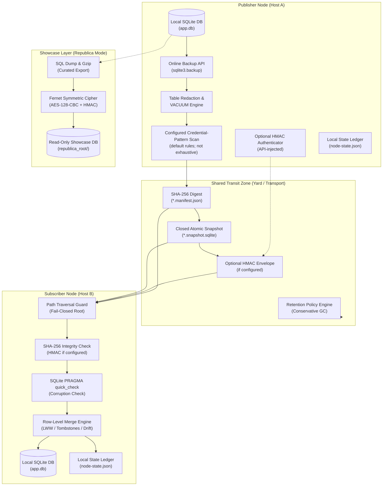

# sqlite-transit-sync


[](https://github.com/ellmos-ai/sqlite-transit-sync/actions/workflows/ci.yml)
[](CHANGELOG.md)
[](#tests)
[](#tests)
[](https://www.python.org/)
[](#)
[](#)
[](#governance-runtime-invariants-matrix)
[](SECURITY.md)
[](SECURITY.md)
[](CONTRIBUTING.md)
[](THIRD_PARTY_LICENSES.md)
[](THIRD_PARTY_LICENSES.txt)
[](NOTICE)
[](MARKETING-LOG.txt)
[](LICENSE)
[](https://github.com/ellmos-ai)
[](https://github.com/open-bricks)
[](llms.txt)

> [!NOTE]
> **Контекст для LLM и ИИ-агентов**: структурированная машиночитаемая карта разделов, архитектурный обзор и руководство по API доступны в [`llms.txt`](llms.txt).

**🇬🇧 [English Version](README.md)** | **🇩🇪 [Deutsche Version](README_de.md)** | **🇪🇸 [Spanish Version](README_es.md)** | **🇫🇷 [French Version](README_fr.md)** | **🇯🇵 [Japanese Version](README_ja.md)** | **🇨🇳 [Simplified Chinese Version](README_zh.md)** | **🇵🇹 [Portuguese Version](README_pt.md)** | **🇷🇺 Русский** | **🤝 [Вклад в проект](CONTRIBUTING.md)** | **🛡️ [Политика безопасности](SECURITY.md)** | **📝 [Журнал изменений](CHANGELOG.md)** | **📋 [llms.txt](llms.txt)**

## 🧭 Быстрая навигация

1. [Краткое описание и основное назначение](#what-is-sqlite-transit-sync)
2. [Визуальная схема архитектуры и независимые слои](#system-architecture-topology)
3. [Полный цикл снимка и синхронизации](#end-to-end-snapshot-synchronization-lifecycle)
4. [Целевые пользователи и SEO-запросы с выраженным намерением](#marketing--target-personas)
5. [Реализованное поведение и ограничения](#comparison-with-distributed-sql)
6. [Матрица инвариантов управления и выполнения](#governance-runtime-invariants-matrix)
7. [Основные возможности и независимые функции](#what-it-provides)
8. [Проекции приложений только для чтения](#read-only-application-projections)
9. [Установка и предварительные требования](#install)
10. [Быстрый старт и работа с несколькими узлами](#quick-start)
11. [Справочник конфигурации и условия срабатывания проверки учетных данных](#configuration)
12. [Republica: демонстрационный режим и шифрование](#republica-the-showcase-method)
13. [Python API и точки расширения](#python-api)
14. [Безопасность, модель угроз и эксплуатационные ограничения](#safety-and-limits)
15. [Реестр сторонних лицензий](#third-party-licenses--transparency)
16. [Экосистема, родственные инструменты и комплекты](#ecosystem--sibling-tools)
17. [Тестирование, проверка и матрица CI](#tests)
18. [Правовое уведомление, ограничение ответственности и лицензия (§ 521 BGB)](#license)

---

<a id="what-is-sqlite-transit-sync"></a><a id="core-identity"></a><a id="executive-summary--core-identity"></a>
## 1. Краткое описание и основное назначение

Версия, статус модуля, видимость и источник даты проверки определены в
[`METADATA_CONTRACT.md`](METADATA_CONTRACT.md); сами по себе эти сведения не
означают одобрения выпуска или публичной загрузки.

Синхронизация независимых баз данных SQLite по принципу local-first: обмен
выполняется снимками, проверенными на целостность, с применением политик
объединения, выбираемых приложением. Аутентификация отправителя необязательна
и подключается через HMAC-аутентификатор, передаваемый через API. Модуль
выделен из архитектуры BACH ProSync и не зависит от BACH, OneDrive, имени
хоста или пользовательских путей.

Это **не распределенный SQL-сервер**. Каждый узел владеет только своей
локальной базой данных и открывает только ее. Общая папка, подключенное
хранилище объектов, съемный накопитель или другой файловый транспорт
переносит закрытые снимки вместе с манифестами. При получении перед слиянием
снимка с локальной базой проверяются SHA-256 и `PRAGMA quick_check`; слияние
выполняется в одной транзакции. Аутентификация отправителя с помощью HMAC
проверяется только при настроенном аутентификаторе.

Работает в паре с [sync-master](https://github.com/dev-bricks/sync-master)
(из того же семейства модулей): площадка sync-master подходит в качестве
транспорта для обмена — укажите в `--transit` принадлежащую инструменту зону
`db-transit/<namespace>/` внутри площадки (правило протокола R9). sync-master
переносит документы, а этот модуль отвечает за целостность базы данных и
слияние; модули остаются независимыми.

---

<a id="system-architecture-topology"></a><a id="system-architecture"></a>
## 2. Визуальная схема архитектуры и независимые слои

На следующей диаграмме показана независимая многоузловая архитектура:
локальные базы SQLite связаны исключительно через закрытые пакеты снимков,
целостность которых проверяется по манифестам:



### Архитектурная проекция ASCII в четырех представлениях

```text
+-------------------------------------------------------------------------------------------------------------------+
|                               SQLITE-TRANSIT-SYNC: FOUR-VIEW ARCHITECTURAL TOPOLOGY                               |
+-------------------------------------------------------------------------------------------------------------------+
| [VIEW 1: PUBLISHER NODE]               [VIEW 2: SHARED TRANSIT YARD]              [VIEW 3: SUBSCRIBER NODE]       |
|                                                                                                                   |
| +-------------------------+              +-----------------------------+            +---------------------------+ |
| | Local SQLite Database   |              |  Closed Transit Zone        |            | Path Traversal Guard      | |
| | (app.db - Exclusive RW) |              |  (Folder / Sync-Master / S3)|            | (Canonical Bounds Check)  | |
| +------------+------------+              +--------------+--------------+            +-------------+-------------+ |
|              |                                          ^                                         |               |
|              v (sqlite3.backup)                         |                                         v               |
| +------------+------------+                             |                           +-------------+-------------+ |
| | Online Consistent Backup|                             |                           | SHA-256 Integrity Check   | |
| | (Closed Rollback-Journal|                             |                           | Optional HMAC if set      | |
| +------------+------------+                             |                           +-------------+-------------+ |
|              |                                          |                                         |               |
|              v                                          |                                         v               |
| +------------+------------+                             |                           +-------------+-------------+ |
| | Redaction & VACUUM      |                             |                           | SQLite PRAGMA quick_check | |
| | (Exclude Sensitive Data)|                             |                           | (Integrity Verification)  | |
| +------------+------------+                             |                           +-------------+-------------+ |
|              |                                          |                                         |               |
|              v                                          |                                         v               |
| +------------+------------+                             |                           +-------------+-------------+ |
| | Pattern Scan            |                             |                           | Transactional Row Merge   | |
| | (default rules; limited) |                             |                           | (Row-Level LWW / Drift)  | |
| +------------+------------+                             |                           +-------------+-------------+ |
|              |                                          |                                         |               |
|              v                                          |                                         v               |
| +------------+------------+              +--------------+--------------+            +-------------+-------------+ |
| | Optional HMAC Adapter   |              |  *.snapshot.sqlite (Atomic) |            | Local SQLite Database     | |
| | (API-injected if set)   |- - - - - - ->|  *.manifest.json   (Digest) |----------->| (app.db - Merged State)   | |
| +-------------------------+              |  Retention Engine  (Scoped) |            +-------------+-------------+ |
|                                          +-----------------------------+                          |               |
|                                                                                                   v               |
|                                                                                     +-------------+-------------+ |
|                                                                                     | Local State Ledger        | |
|                                                                                     | (node-state.json)         | |
|                                                                                     +---------------------------+ |
+-------------------------------------------------------------------------------------------------------------------+
| [VIEW 4: REPUBLICA SHOWCASE / COURIER ENVELOPE (OPTIONAL ZERO-TRUST TRANSPORT)]                                   |
|                                                                                                                   |
| Local Database ----> Curated SQL Dump ----> Gzip Compression ----> AES-128-CBC (Fernet) ----> Encrypted Outpost   |
| (Source Node)       (FTS Rebuilt on Dest)   (53MB -> 11MB)         (Pre-Shared Key)          (republica_root/)    |
|                                                                                                                   |
| Single Secret File -> Fernet Cipher Envelope -> Courier Transit -> Destination Directory (Mode 0600, Transit Clr) |
+-------------------------------------------------------------------------------------------------------------------+
```

---

<a id="end-to-end-snapshot-synchronization-lifecycle"></a><a id="lifecycle"></a>
## 3. Полный цикл снимка и синхронизации

Рабочий процесс исключает файлы работающих баз данных из файловой
синхронизации. Он сверяет байты снимка с манифестом SHA-256, при включенной
настройке (по умолчанию — включена) запускает сканирование заданных шаблонов
учетных данных и транзакционно объединяет принятые строки. Аутентификация
отправителя доступна только при настроенном через API HMAC-аутентификаторе.
Другие узлы увидят изменения лишь после успешного обмена push/pull:

```mermaid
sequenceDiagram
    autonumber
    participant App as Application / Node A
    participant CoreA as sqlite-transit-sync (Push)
    participant Shield as Credential-Pattern Scan (default on; configurable)
    participant Transit as Shared Transit (db-transit)
    participant CoreB as sqlite-transit-sync (Pull)
    participant Target as Local DB / Node B

    Note over App,CoreA: Phase 1: Local Online Snapshot & Redaction
    App->>CoreA: push(config, db)
    CoreA->>CoreA: Online Snapshot via SQLite Backup API
    CoreA->>CoreA: Drop Excluded Tables & VACUUM
    CoreA->>Shield: Scan Content for Secret Patterns (credential-triggers.json)
    Shield-->>CoreA: No configured pattern matched (if enabled)

    Note over CoreA,Transit: Phase 2: Snapshot Digest & File Publication
    CoreA->>CoreA: Calculate SHA-256 digest and size
    CoreA->>Transit: Write Temporary Snapshot & Atomic os.replace

    Note over CoreA,Transit: Phase 3: Optional Manifest Authentication & Publication
    CoreA->>CoreA: Optionally HMAC-sign manifest (if configured)
    CoreA->>Transit: Atomically write manifest with SHA-256; HMAC only if configured (*.manifest.json)

    Note over Transit,CoreB: Phase 4: Transit Ingestion & Boundary Guard
    CoreB->>Transit: Discover Manifests & Validate Path Bounds (Anti-Traversal)
    CoreB->>CoreB: Verify HMAC first if configured
    CoreB->>CoreB: Verify snapshot size and SHA-256 (integrity only)
    CoreB->>CoreB: Run PRAGMA quick_check on Isolated Snapshot

    Note over CoreB,Target: Phase 5: Transactional Row Merge & State Advance
    CoreB->>Target: BEGIN IMMEDIATE Transaction
    CoreB->>Target: Apply Row-Level Merge Policy (LWW per PK / Tombstones)
    CoreB->>Target: Reconcile Shared Column Schema Drift
    CoreB->>Target: COMMIT Transaction
    CoreB->>CoreB: Advance Local State Ledger (node-state.json)
    Note over Target: Peer state reflects successful exchange; no background convergence guarantee
```

---

<a id="marketing--target-personas"></a><a id="target-personas--discoverability-queries"></a><a id="target-personas"></a>
## 4. Целевые пользователи и SEO-запросы с выраженным намерением

Модуль `sqlite-transit-sync` рассчитан на модульные децентрализованные
экосистемы и предназначен для четырех основных групп пользователей:

- **`[PERSONA-01]` Инженеры автономных ИИ-агентов и архитекторы многоузловых сред:**
  - *Проблема:* роям агентов, работающим на рабочих станциях, ноутбуках и серверах, нужно сохранять локальное состояние без конфликтов блокировки файлов.
  - *Решение:* включенное по умолчанию сканирование может остановить публикацию, если сработал настроенный шаблон учетных данных. Это дополнительная мера, а не доказательство отсутствия секретов в снимке. Узлы получают изменения после успешного обмена push/pull.
- **`[PERSONA-02]` Разработчики настольных и периферийных приложений для нескольких устройств:**
  - *Проблема:* опытные пользователи обмениваются личными заметками и базами задач через файловую синхронизацию (например, sync-master, Syncthing, Nextcloud), что может приводить к повреждению баз данных и блокировкам `-wal`.
  - *Решение:* API резервного копирования SQLite и публикация отдельных файлов не дают помещать работающие файлы базы SQLite в путь файловой синхронизации; транспорт обменивается снимками из transit.
- **`[PERSONA-03]` Разработчики инструментов local-first с настраиваемым транспортом:**
  - *Проблема:* приложениям, которым важно суверенное хранение данных, не подходят привязка к облаку, регулярная плата за размещение базы данных или неконтролируемая фоновая передача данных по сети.
  - *Решение:* модуль обменивается файлами снимков через настроенный путь файловой системы. Это может быть локальный или съемный путь; общая папка или сетевое подключение остаются вне контроля модуля.
- **`[PERSONA-04]` Специалисты по корпоративной безопасности, конфиденциальности и соответствию требованиям:**
  - *Проблема:* строгие требования zero-trust запрещают случайную синхронизацию учетных данных, непроверенных двоичных файлов и привилегированные фоновые службы.
  - *Решение:* включенное по умолчанию сканирование проверяет заданные шаблоны учетных данных перед публикацией; SHA-256 сверяет целостность снимка с манифестом. Через API можно включить HMAC-аутентификатор отправителя. Процесс работает с разрешениями, унаследованными от запускающей его программы.

### Поисковые запросы с выраженным намерением (английский и немецкий)

| Категория намерения | Поисковые запросы на английском (EN) | Поисковые запросы на немецком (DE) |
|:---|:---|:---|
| **Синхронизация local-first** | `sqlite synchronization python zero-dependency`, `local-first database snapshot sync`, `offline sqlite multi-device sync` | `lokale datenbank synchronisation offline snapshots`, `sqlite abgleich python ohne abhängigkeiten`, `lokale datenbank replikation dateibasiert` |
| **Целостность и настраиваемое сканирование учетных данных** | `configured credential-pattern scan sqlite sync`, `configured filesystem transit sqlite sync`, `optional hmac sqlite snapshot manifest` | `konfigurierter credential musterscan sqlite sync`, `dateipfad transit sqlite sync`, `optional hmac snapshot manifest` |
| **Слияние строк и конфликты** | `row level merge lww sqlite offline`, `sqlite last write wins schema drift tolerance`, `tombstone merge policy sqlite` | `row level merge lww sqlite offline`, `last-write-wins datenbank abgleich zeitstempel`, `schema drift toleranz sqlite merge` |
| **Разделенная архитектура** | `sqlite multi-node sync without distributed sql`, `sqlite over syncthing without corruption`, `sqlite transit yard architecture` | `sqlite synchronisation ohne verteilten server`, `sqlite über cloud sync ohne datenbankkorruption`, `transit yard sqlite synchronisation` |

Подробное описание персон, поисковых запросов и позиционирования см. в
[MARKETING-LOG.txt](MARKETING-LOG.txt).

---

<a id="comparison-with-distributed-sql"></a><a id="comparative-matrix--alternatives"></a><a id="comparative-matrix"></a>
## 5. Реализованное поведение и ограничения

В этом разделе описаны реализованное поведение и ограничения проекта. Здесь
не приводится актуальное прямое сравнение с другими продуктами.

| Измерение | Инвариант | Реализованное поведение | Ограничение / граница |
|:---|:---|:---|:---|
| **1. Локальная обработка и транспорт** | `INV-LOCAL-01` | Читает локальные базы SQLite и публикует снимки по настроенному пути transit; центральный сервер баз данных не требуется. | Настроенный путь может указывать на общую папку или сетевой ресурс. Доступность и поведение такого транспорта находятся вне модуля. |
| **2. Публикация снимков** | `INV-SNAP-02` | Создает оперативную резервную копию и публикует файл снимка через временный файл и `os.replace`. | Замена отдельного файла не превращает снимок и манифест в одну многофайловую транзакцию. |
| **3. Сопутствующие файлы и область процесса** | `INV-ROLL-03` | Закрывает снимки в режиме журнала отката и прекращает работу, если не удается очистить временные файлы SQLite. | Запускайте один процесс синхронизации на узел, если хост-приложение не добавляет блокировку процессов. |
| **4. Ограничение пути transit** | `INV-PATH-04` | Путь к манифесту и снимку ограничен непосредственными обычными файлами внутри канонического корня transit. | Это не ограничивает круг лиц, которые могут записывать данные в расположение transit. |
| **5. Проверки целостности** | `INV-VERIFY-05` | Сверяет байты снимка с SHA-256 из манифеста и запускает `PRAGMA quick_check` SQLite. | Совпавший дайджест не аутентифицирует отправителя или транспорт. |
| **6. Сканирование шаблонов учетных данных** | `INV-SHIELD-06` | По умолчанию проверяет содержимое снимка по заданным шаблонам и при совпадении отменяет публикацию; сообщает `table.column`, но не значение. | Правила с префиксами поставщиков — дополнительная мера, а не гарантия. Чистый результат означает лишь, что известные шаблоны не сработали; нестандартные или не имеющие ожидаемого префикса секреты могут пройти. |
| **7. Аутентификация отправителя** | `INV-HMAC-07` | Приложение может включить через API HMAC-SHA256-аутентификацию канонического манифеста. | Без настроенного аутентификатора отправитель не аутентифицируется. HMAC с общим ключом не обеспечивает свежесть и не является подписью с открытым ключом. |
| **8. Слияние строк** | `INV-MERGE-08` | Применяет настраиваемую политику слияния строк; по умолчанию для поддерживаемых таблиц используется LWW по временным меткам. | За предположения о часах, семантику удаления, миграции и доменные правила конфликтов отвечает интегрирующее приложение. |
| **9. Хранение и область удаления** | `INV-RET-09` | Очистка по умолчанию выполняется в режиме предварительного просмотра и касается только артефактов локального узла, если явно не разрешены операции между узлами. | Очистка по политике хранения не является службой резервного копирования или восстановления. |
| **10. Разрешения процесса и политика безопасности** | `INV-SLA-10` | Процесс использует разрешения процесса, который его запустил. В `SECURITY.md` указано: подтверждение сообщения — в течение 48 часов, первичная оценка — в течение 5 рабочих дней. | Модуль не принуждает к использованию прав обычного пользователя и не запрашивает повышение привилегий. Сроки относятся к политике обработки сообщений, а не к возможностям исполнения программы. |

<a id="distributed-sql-detailed-comparison"></a>
### Модель обработки и границы

| Аспект | Поведение `sqlite-transit-sync` | Ограничение / граница |
|---|---|---|
| Базовая модель | У каждого узла своя локальная база SQLite; снимки перемещаются через настроенный путь transit. | Единой глобально авторитетной базы данных нет. |
| Запись | Приложения записывают данные локально; вызывающая сторона запускает push и pull для обмена снимками. | Автоматической фоновой синхронизации нет. |
| Видимость | Узел может увидеть изменения после успешного обмена и слияния. | Модуль не гарантирует немедленную или глобально согласованную видимость. |
| Глобальные транзакции | Не предоставляются. | Приложение не может зафиксировать одну транзакцию сразу на нескольких узлах. |
| Работа без сети | Локальную базу можно использовать независимо, пока узел отключен. | Обмен снимками ждет доступности настроенного transit. |
| Конфликты | Настроенная `MergePolicy` определяет объединение строк; по умолчанию применяется временная метка LWW. | Часы приложений, правила удаления и предметная семантика остаются ответственностью интеграции. |
| Изменения схемы | Слияние общих столбцов допускает ограниченный дрейф схемы. | За миграции и совместимость схем отвечают приложения. |
| Обработка сбоев | Локальные данные хранятся в SQLite, снимки transit — в отдельных файлах. | Модуль не обеспечивает автоматическую репликацию, переключение при сбое или резервные копии transit. |

### Преимущества, недостатки и типичные сценарии использования

| Система | Преимущества | Недостатки | Подходящие сценарии | Неподходящие сценарии |
|---|---|---|---|---|
| `sqlite-transit-sync` | Небольшой объем локальной установки; не нужен центральный сервер БД; локальная работа без сети; настраиваемый файловый транспорт; выбираемые приложением политики слияния. | Чтобы изменения дошли до узлов, нужен push/pull; нет глобальных транзакций или автоматического переключения при сбое; для часов, удалений, миграций и конфликтов нужны правила приложения. | Личные базы и базы задач; локальное состояние агентов; ноутбуки, рабочие станции и периферийные устройства с непостоянным подключением; исследовательские заметки. | Нагрузки, которым нужны глобально фиксируемые транзакции, мгновенно общее состояние, автоматическое переключение при сбое или множество параллельных писателей. |

### Краткое руководство по выбору

| Требование | Соответствие |
|---|---|
| Узлам нужно продолжать использовать собственные локальные базы, пока они отключены | `sqlite-transit-sync` |
| Обновления могут доходить до других узлов после явного обмена push/pull | `sqlite-transit-sync` |
| Приложение может определить правила слияния, часов, удаления и миграции | `sqlite-transit-sync` |
| Каждая запись должна сразу иметь глобально авторитетный статус | Выберите архитектуру с таким контрактом согласованности |
| Нужны глобальные транзакции, автоматическое переключение при сбое или множество параллельных писателей | Оцените архитектуру, которая предоставляет такие возможности |

Для небольшого числа устройств с непостоянным подключением модуль может подойти,
если приемлемы отложенный обмен и правила слияния, определяемые приложением. Для
нагрузок, которым нужны глобальные транзакции, мгновенно общее состояние или
автоматическое переключение при сбое, выберите архитектуру с документированной
поддержкой этих сценариев.

---

<a id="governance-runtime-invariants-matrix"></a><a id="governance--runtime-invariants"></a>
## 6. Матрица инвариантов управления и выполнения

В таблице приведены десять инвариантов управления и выполнения проекта,
реализованное поведение и соответствующие ограничения:

| № | Инвариант | Архитектурная область | Описанное поведение и ограничения |
|---|---|---|---|
| 1 | **INV-LOCAL-01: Локальная обработка SQLite и настроенный transit** | Архитектура системы | Читает локальные базы SQLite и публикует снимки через настроенный путь transit. Путь может быть общим или сетевым; хост и поведение транспорта находятся вне модуля. |
| 2 | **INV-SNAP-02: Атомарность автономных снимков** | Публикация в transit | Работающие файлы баз данных не передаются через файловую синхронизацию. Оперативные снимки создаются через `sqlite3.backup` и публикуются посредством атомарного `os.replace`. |
| 3 | **INV-ROLL-03: Чистое разделение с журналом отката** | Предотвращение сопутствующих файлов | Резервные копии закрываются в режиме журнала отката; все временные файлы SQLite (`-wal`, `-shm`, `-journal`) в режиме fail-closed очищаются до создания манифеста. |
| 4 | **INV-PATH-04: Строгое ограничение пути transit** | Граница файловой системы | Пути манифеста и снимка должны указывать на непосредственные обычные файлы в каноническом корне transit. Обход пути (`../`), символические ссылки и точки повторной обработки приводят к отказу. |
| 5 | **INV-VERIFY-05: Двухэтапная проверка целостности и корректности** | Проверка перед слиянием | Каждый полученный снимок должен пройти проверку криптографического дайджеста SHA-256 и `PRAGMA quick_check` SQLite до изучения или слияния данных. |
| 6 | **INV-SHIELD-06: Защита от учетных данных до публикации** | Проверка содержимого | По умолчанию содержимое снимка проверяется по настроенным шаблонам учетных данных; совпадение отменяет публикацию и указывает `table.column`, но не значение. Шаблоны с префиксами поставщиков — дополнительная мера, не гарантия; отсутствие совпадений не доказывает, что секретов в снимке нет. |
| 7 | **INV-HMAC-07: Необязательная аутентификация HMAC** | Аутентификация отправителя | Необязательная HMAC-SHA256-обертка, внедряемая через API, проверяет канонические данные манифеста (протокол, пространство имен, ID отправителя, имя файла, SHA-256, размер, список редактирования). HMAC с общим ключом не обеспечивает свежесть и не является подписью с открытым ключом; без него манифест не аутентифицирует отправителя. |
| 8 | **INV-MERGE-08: Детерминированное слияние строк** | Сходимость данных | Транзакционное слияние на уровне строк (LWW по первичному ключу, объединение общих столбцов при дрейфе схемы, явная политика tombstone). Разрешение равенства по хешу содержимого обеспечивает детерминированную сходимость. |
| 9 | **INV-RET-09: Консервативное хранение и ограничение полномочий** | Сбор мусора | Очистка снимков по умолчанию работает в режиме предварительного просмотра и строго ограничена артефактами локального узла. Удаление данных других узлов (`--all-nodes`) требует явного административного разрешения. |
| 10 | **INV-SLA-10: Разрешения процесса и политика безопасности** | Контекст выполнения | Процесс наследует разрешения запускающей его программы; модуль не принуждает к использованию прав обычного пользователя и не запрашивает повышение привилегий. В `SECURITY.md` указано подтверждение сообщения в течение 48 часов и первичная оценка в течение 5 рабочих дней. |

---

<a id="what-it-provides"></a><a id="core-capabilities"></a><a id="part-of-the-ellmos-stack-family"></a>
## 7. Основные возможности и независимые функции

`sqlite-transit-sync` дополняет
[dev-bricks/sync-master](https://github.com/dev-bricks/sync-master) в том же
семействе модулей: sync-master отвечает за файловый транспорт (`sync.files`),
а этот модуль — за целостность базы данных и слияние (`sync.database`). Оба
модуля можно использовать отдельно или в составе стеков семейства
[ellmos-ai](https://github.com/ellmos-ai) — см. каталог
[ellmos-ai/stacks](https://github.com/ellmos-ai/stacks). Назначение модуля в
этом наборе: не передавать работающую SQLite через файловую синхронизацию —
только снимки, прошедшие проверку манифеста и целостности SQLite, а также
политики слияния, выбираемые приложением.

### Основные возможности

- согласованные оперативные снимки через API резервного копирования SQLite;
- атомарная публикация с помощью временного файла и `os.replace`;
- закрытые снимки в режиме журнала отката с очисткой всех временных файлов
  SQLite в режиме fail-closed до публикации;
- пути к манифестам и снимкам ограничены непосредственными обычными файлами
  канонического каталога transit; обход пути, абсолютные пути, символические
  ссылки и точки повторной обработки приводят к отказу до вычисления хеша или
  слияния;
- проверка манифеста SHA-256 и `PRAGMA quick_check`;
- необязательная внедряемая через API аутентификация HMAC-SHA256 для
  канонического манифеста, идентификатора отправителя, версии протокола и
  хеша снимка с явными ID ключей;
- локальное состояние получения для каждого узла и идемпотентный повтор;
- слияние по принципу last-write-wins для каждой строки по первичному ключу
  в таблицах с временными метками;
- справочный адаптер `TombstoneMergePolicy` для явного учета удалений;
- слияние общих столбцов для базовой устойчивости к дрейфу схемы;
- настройка исключения таблиц и редактирования содержимого снимка с последующим
  VACUUM после удаления;
- включенное по умолчанию сканирование содержимого, которое отменяет публикацию,
  если обнаружен совпадающий настроенный шаблон учетных данных (указывает
  `table.column`, но никогда значение). Правила с префиксами поставщиков — лишь
  дополнительная мера; чистый результат не доказывает отсутствие секретов;
- поддержка пользовательского `MergePolicy` для доменных правил, tombstone или CRDT;
- проверенная очистка снимков: по умолчанию — предварительный просмотр и область
  локального узла; удаление данных и администрирование других узлов включаются
  явно;
- получение выбранных ожидающих снимков для тонких адаптеров жизненного цикла
  приложения без дублирования слияния или продвижения состояния;
- строгие версионируемые контракты проекций только для чтения с точными списками
  разрешенной схемы и данных, происхождением, контрольной точкой, проверкой
  циклов и офлайн-срока хранения tombstone;
- необязательный [демонстрационный режим Republica](#republica-the-showcase-method),
  который передает базу данных в одну сторону как зашифрованную полезную нагрузку
  и материализует ее как отдельную проекцию только для чтения вместо слияния;
- Python API и JSON CLI без зависимостей (режим Republica добавляет `cryptography`).

---

<a id="read-only-application-projections"></a><a id="projections"></a>
## 8. Проекции приложений только для чтения

`verify-projection` проверяет закрытую проекцию SQLite, принадлежащую
приложению, не копируя, не объединяя и не мигрируя данные, не планируя задания
и не продвигая состояние. Приложение указывает идентификатор потребителя и
проверенный максимальный период работы без подключения; проверка отклоняет
циклы, устаревшие контрольные точки, недостаточный срок хранения tombstone,
неразрешенные таблицы или столбцы и ссылки на записи, которые не являются
непрозрачными идентификаторами.

В комплект входят шесть узких контрактов: сводка баланса счетов, статус
подписок AboTracker, даты пополнения HausLagerist, сроки приема препаратов и
предупреждения о запасах, сроки и отметки выполнения процедур, а также сроки
по страхованию. Контракт AboTracker содержит только статус, поскольку в схеме
экспорта версии 1 нет подтвержденной следующей даты платежа или продления;
напоминание не вычисляется как дата платежа плюс расчетный цикл. Тестовые
фикстуры — синтетические JSON-рецепты, а идентификаторы предметной области и
личные сведения остаются вне разрешенных списков.

Названия контрактов: `abotracker-subscription-status-projection.v1`,
`accounts-balance-projection.v1`, `hauslagerist-replenishment-projection.v1`,
`mediplaner-reminder-projection.v1`,
`routinika-reminder-projection.v1` и
`versicherungsmanager-deadline-projection.v1`.
См. [контракты проекций только для чтения](PROJECTION_CONTRACTS.md) и
[немецкую версию](PROJECTION_CONTRACTS_de.md).

```bash
sqlite-transit-sync verify-projection \
  --contract mediplaner-reminder-projection.v1 \
  --database ./closed-projection.sqlite \
  --consumer-id reminder-consumer \
  --minimum-offline-seconds 2592000 \
  --previous-checkpoint 41
```

---

<a id="install"></a><a id="installation"></a>
## 9. Установка и предварительные требования

```bash
python -m pip install -e .
```

---

<a id="quick-start"></a><a id="quickstart"></a>
## 10. Быстрый старт и работа с несколькими узлами

Создайте файл конфигурации на каждом узле. У каждого узла своя база данных и
файл состояния, но каталог transit и пространство имен должны быть общими.

```bash
sqlite-transit-sync init \
  --config node.json \
  --database ./app.db \
  --transit ./shared-transit \
  --node-id laptop \
  --namespace my-app

sqlite-transit-sync push --config node.json
sqlite-transit-sync pull --config node.json --dry-run
sqlite-transit-sync pull --config node.json
sqlite-transit-sync status --config node.json
sqlite-transit-sync verify --config node.json
sqlite-transit-sync cleanup --config node.json
# Review the JSON plan, then explicitly apply it:
sqlite-transit-sync cleanup --config node.json --apply
```

На каждом узле схема приложения должна быть создана заранее. Автоматическое
первичное копирование намеренно отключено: универсальный модуль не может
определить, какие схемы, секреты, локальные таблицы и миграции относятся к
конкретному приложению.

### Запускаемый пример Python для отдельного узла (без внешних зависимостей)

Разработчики, напрямую встраивающие `sqlite-transit-sync` в фреймворки
агентов, службы или фоновые процессы, могут запустить этот автономный
копируемый сценарий, чтобы проверить полный цикл синхронизации между узлами
без внешних зависимостей:

```python
import sqlite3
from contextlib import closing
import tempfile
from pathlib import Path
from sqlite_transit_sync import SyncConfig, TransitSync

with tempfile.TemporaryDirectory() as tmp:
    root = Path(tmp)
    transit = root / "transit"
    transit.mkdir()

    # 1. Initialize Node A and record local data
    db_a = root / "node_a.db"
    with closing(sqlite3.connect(db_a)) as conn, conn:
        conn.execute("CREATE TABLE notes (id INTEGER PRIMARY KEY, title TEXT, updated_at TEXT)")
        conn.execute("INSERT INTO notes VALUES (1, 'Hello from Node A', '2026-10-18T08:00:00Z')")

    # 2. Publish atomic snapshot from Node A to shared transit
    cfg_a = SyncConfig(database=db_a, transit=transit, state=root / "state_a.json", node_id="node_a", namespace="demo")
    snapshot = TransitSync(cfg_a).push()
    print(f"Node A published snapshot: {snapshot.path.name} (SHA-256: {snapshot.sha256[:8]}...)")

    # 3. Initialize Node B with schema and pull snapshot
    db_b = root / "node_b.db"
    with closing(sqlite3.connect(db_b)) as conn, conn:
        conn.execute("CREATE TABLE notes (id INTEGER PRIMARY KEY, title TEXT, updated_at TEXT)")

    cfg_b = SyncConfig(database=db_b, transit=transit, state=root / "state_b.json", node_id="node_b", namespace="demo")
    reports = TransitSync(cfg_b).pull()

    # 4. Verify converged state in Node B
    with closing(sqlite3.connect(db_b)) as conn, conn:
        rows = conn.execute("SELECT id, title, updated_at FROM notes").fetchall()
        print(f"Node B converged records: {rows}")
        assert rows == [(1, "Hello from Node A", "2026-10-18T08:00:00Z")]
```
---

<a id="configuration"></a><a id="configuration-reference"></a>
## 11. Справочник конфигурации и условия срабатывания проверки учетных данных

```json
{
  "database": "./app.db",
  "transit": "./shared-transit",
  "state": "./node-state.json",
  "node_id": "laptop",
  "namespace": "my-app",
  "timestamp_columns": ["updated_at", "modified_at", "created_at"],
  "exclude_tables": ["secrets", "sqlite_sequence"],
  "snapshot_exclude_tables": ["secrets"],
  "scan_snapshot_for_secrets": true,
  "secret_scan_skip_tables": [],
  "secret_scan_extra_patterns": [],
  "secret_patterns_file": null
}
```

Относительные пути разрешаются относительно файла конфигурации. Рабочая база
данных не должна находиться в каталоге transit, а файл состояния — внутри
дерева transit. `SyncConfig`, `from_file`, `from_bytes` и CLI `init`
отклоняют недопустимый путь состояния до создания каталогов transit или
состояния; автоматическая миграция не выполняется.

Если приложению нужен хеш аудита именно для разобранной конфигурации, байты
файла можно прочитать один раз и передать тому же парсеру, использующему
пути относительно источника, чтобы избежать повторного чтения:

```python
import hashlib
from pathlib import Path

from sqlite_transit_sync import SyncConfig

config_path = Path("node.json").resolve()
payload = config_path.read_bytes()
config = SyncConfig.from_bytes(payload, source_path=config_path)
config_sha256 = hashlib.sha256(payload).hexdigest()
```

### Все ключи и значения по умолчанию

| Ключ | По умолчанию | Значение |
|---|---|---|
| `database` | *(обязательно)* | Рабочая база SQLite, принадлежащая этому узлу |
| `transit` | *(обязательно)* | Общий каталог для снимков и манифестов |
| `state` | `./.sync-state.json` | Состояние получения для узла; не храните его в transit |
| `node_id` | имя хоста компьютера | Идентификатор узла, публикующего данные, входит в имена снимков |
| `namespace` | `"default"` | Разделяет независимые наборы данных в одном transit |
| `timestamp_columns` | `["updated_at","modified_at","created_at"]` | Столбцы, используемые для last-write-wins |
| `exclude_tables` | `["secrets","sqlite_sequence"]` | Таблицы, которые никогда не **сливаются** с локальной базой |
| `snapshot_exclude_tables` | `["secrets"]` | Таблицы, строки которых **удаляются из снимка** перед публикацией (затем выполняется `VACUUM`) |
| `scan_snapshot_for_secrets` | `true` | Отменять публикацию, если содержимое снимка похоже на учетные данные |
| `secret_scan_skip_tables` | `[]` | Таблицы, пропускаемые сканером; для одной шумной таблицы используйте этот параметр вместо отключения сканирования |
| `secret_scan_extra_patterns` | `[]` | Дополнительные регулярные выражения к правилам из файла триггеров |
| `secret_patterns_file` | `null` (встроенный файл) | Путь к собственному файлу правил; **заменяет** встроенные шаблоны |
| `key_file` | `null`, иначе `$SQLITE_TRANSIT_SYNC_KEY_FILE` | Ключ Fernet для режима Republica; храните его вне transit |
| `republica_root` | `~/.republica` | Каталог для импортируемых проекций; должен находиться вне transit |
| `allow_key_in_synced_folder` | `false` | Отменяет проверку, запрещающую хранить ключ в каталоге облачной синхронизации |

Значение `state` в этой таблице применяется, когда из JSON-конфигурации
загружают файл без этого ключа. Команда `sqlite-transit-sync init` записывает файл `.<config-stem>-state.json`,
если `--state` не задан (для `node.json` это `.node-state.json`).
### Сканирование учетных данных и его отключение

Параметр `snapshot_exclude_tables` может удалить только таблицу, о которой
заранее известно. Сканирование отвечает на другой вопрос: *не попали ли
учетные данные в текстовый столбец со свободным содержимым* — заметку, строку
журнала или сводку сессии? Сканирование выполняется для копии снимка после
редактирования данных и перед публикацией. При совпадении возникает
`SyncError` с указанием `table.column`; найденное значение не попадает в
логи, traceback или вывод CI. Неполный снимок удаляется, поэтому в каталог
transit ничего не поступает.

**Отключить сканирование — допустимый выбор, а не обход защиты.** Если transit
— это хранилище, которым вы управляете и которому доверяете (собственный
сервер, том у провайдера в ЕС по вашему договору, зашифрованный съемный
накопитель), и вы хотите передавать учетные данные вместе с данными, задайте:

```json
{ "scan_snapshot_for_secrets": false }
```

Если ложные срабатывания возникают только для одной таблицы, предпочтительнее
указать ее в `secret_scan_skip_tables`: так сканирование сохранится для всех
остальных таблиц.

### Настройка триггеров

Шаблоны хранятся в данных, а не в коде — `sqlite_transit_sync/credential-triggers.json`,
поэтому обнаружение можно со временем уточнять без ожидания выпуска новой версии:

```json
{
  "version": 1,
  "patterns": [
    { "name": "github", "regex": "gh[pousr]_[A-Za-z0-9]{16,}", "prefilter": "gh" },
    { "name": "acme-internal", "regex": "ACME-[0-9]{4}", "prefilter": "ACME-" }
  ]
}
```

- `prefilter` — необязательная буквальная строка для предварительного отбора
  через SQL `LIKE`, ускоряющая работу с большими снимками. Она **должна**
  присутствовать в каждом значении, которое может совпасть с регулярным
  выражением; иначе совпадения будут пропущены. Если такой общей строки нет,
  не задавайте этот параметр: для точной проверки сканер прочитает столбец
  целиком.
- Укажите собственную копию файла в `secret_patterns_file`, чтобы полностью
  заменить набор по умолчанию, либо используйте
  `secret_scan_extra_patterns`, чтобы дополнить его.

Шаблоны намеренно используют префиксы поставщиков. Общее правило для «длинной
шестнадцатеричной строки» дало бы ложные срабатывания на контрольных суммах,
UUID и SHA Git, которые являются обычными данными базы. Сканер с большим
числом ложных срабатываний отключают, и тогда он вообще ничего не защищает.
Считайте чистый результат значением «известные шаблоны не совпали», а не
«в этом снимке нет секретов».

### Это не менеджер секретов

Сканирование может остановить публикацию при совпадении настроенного шаблона;
оно не гарантирует обнаружение всех учетных данных и не **распространяет** их.
Если задача звучит как «моим компьютерам нужны одни и те же пароли или ключи
API», этот модуль не подходит — как и папка для синхронизации документов.
Рассмотрите специализированный инструмент для секретов и проверьте его
развертывание и модель доверия:

| Подход | Подходит для | Примечания |
|---|---|---|
| **Vaultwarden** (самостоятельно размещаемый Bitwarden) | Люди и CLI на нескольких компьютерах | Работает на небольшом постоянно включенном устройстве; подключайтесь по частной сети (WireGuard, Tailscale), а не выставляйте его в интернет. Официальные клиенты Bitwarden, расширения браузера и CLI `bw` работают с ним, поэтому сценарии и агенты тоже могут получать секреты. |
| **SOPS + age** | Секреты, хранящиеся рядом с кодом | Зашифрованные файлы можно безопасно коммитить и помещать в папки синхронизации: передаются только шифротексты. Поддерживаются ключи для разных получателей, удобно использовать с проверкой git-изменений. |
| **`pass` (GPG) + git** | Пользователи Unix и небольшие команды | Отдельный файл на каждый секрет, обычный удаленный репозиторий git, сервер не нужен. |
| **База KeePassXC через Syncthing** | Без сервера и учетной записи в облаке | Одноранговая файловая синхронизация; хранилище остается одним зашифрованным файлом. |
| **Infisical / OpenBao (ответвление Vault)** | Команды, идентификаторы машин и ротация ключей | Полноценные серверы секретов с журналами аудита и временными учетными данными — для дома это обычно сложнее, чем нужно. |
| **Встроенные в платформу хранилища** | Одна машина, одно приложение | macOS Keychain, Windows DPAPI/Credential Manager, `systemd-creds` или хранилище секретов вашей CI-системы. Синхронизации нет, но нет и раскрытия данных. |

Какой бы инструмент вы ни выбрали, важно разделить каналы: **один для данных,
другой для учетных данных**. Этот модуль может заблокировать снимок при
совпадении заданного шаблона, но не гарантирует обнаружение каждого секрета.

---

<a id="republica-the-showcase-method"></a><a id="republica-showcase"></a>
## 12. Republica: демонстрационный режим и шифрование

Каждая машина помещает **зашифрованную проекцию** своей базы данных в общую
файловую область. Остальные машины могут ее просматривать, но не изменять.
Отсюда название — повторная публикация базы данных, доступная только для
чтения и лишь тому, у кого есть ключ.

Используйте Republica, когда `push`/`pull` не подходит: нужно прочитать данные
другого узла, не сливая их со своими строками, либо машины имеют доступ только
к общей папке — без сервера, открытых портов или отдельного туннеля между
узлами для самого Republica, хотя общий ключ Fernet все равно необходим, —
и содержимое не должно передаваться папке в открытом виде.

<a id="two-modes-deliberately-redundant"></a>
### Два режима, один настроенный файловый transit

При одной и той же конфигурации `SyncConfig` режимы `push`/`pull` и Republica
используют один настроенный путь `transit`. Режимы `push`/`pull` публикуют
снимки и сливают их с локальной базой данных; Republica публикует зашифрованные
реплики в подкаталоге transit для каждого узла и импортирует их как отдельные
базы данных только для чтения в `republica_root`. Отличаются шифрование и
поведение при слиянии, а не транспорт.

| Условие | Синхронизация через файловый transit (`push`/`pull`) | Republica |
|---|---|---|
| Узел-партнер отключен | Узел может публиковать данные, пока партнеры офлайн; `pull` может объединять снимки, уже находящиеся в transit. Новые данные появятся только после публикации исходным узлом. | Публикатор может подготовить зашифрованную реплику для последующего импорта. Данные отключенного узла также ждут публикации. |
| Недоступен VPN/SSH-туннель | Настроенный файловый путь должен оставаться доступным; `push`/`pull` не открывают туннели к узлам. | Зависимость от того же transit; VPN/SSH имеет значение только если из-за него настроенный путь становится недоступным. |
| Настроенный transit недоступен | Через недоступный настроенный путь нельзя ни публиковать, ни получать данные. | То же ограничение; у Republica нет альтернативного транспорта. |
| Ожидаются ротация ключа или настройка доверия | HMAC необязателен. Если настроен аутентификатор, его ключи и доверенные стороны должны совпадать; без него SHA-256 проверяет целостность, но не аутентифицирует отправителя. | Для публикации и импорта нужен совместимый общий ключ Fernet; ротацию следует согласовать. |
| Не настроена политика слияния конкретного приложения | Используется настроенная `MergePolicy`, а по умолчанию — LWW по временной метке; если это не подходит, выберите предметную политику. | Данные импортируются в отдельную базу только для чтения; строки не сливаются. |

Republica подходит, когда нужны отдельные зашифрованные копии только для чтения.
Режим не обеспечивает переключение на другой транспорт; для этого потребуется
отдельно настроить независимые и доступные пути transit.

### Затраты на настройку: передать ключ один раз

Общий ключ нужно передать на другие машины **по какому-либо каналу, отличному
от самого транспорта**: через уже имеющийся зашифрованный туннель, менеджер
паролей, USB-накопитель или даже по телефону. Один раз. После этого достаточно
обычной общей папки, даже если вы ей не доверяете.

```text
republica_root/
  laptop/my-app.sqlite      <- read-only showcase of laptop's database
  workstation/my-app.sqlite <- read-only showcase of workstation's database
```

```bash
# Once per key, on local disk - never inside the transit, never in a synced folder.
# Then copy this file to the other machines out of band; do NOT run keygen there.
sqlite-transit-sync keygen --key-file ~/.keys/republica.key

sqlite-transit-sync init --config node.json \
  --database ./app.db --transit ./shared-transit \
  --node-id laptop --namespace my-app \
  --key-file ~/.keys/republica.key

sqlite-transit-sync republica-publish --config node.json   # encrypt and publish
sqlite-transit-sync republica-list    --config node.json   # what other nodes offer
sqlite-transit-sync republica-import  --config node.json   # materialise them locally
```

Требуется необязательная криптографическая зависимость:
`pip install 'sqlite-transit-sync[crypto]'`.

**Что передается:** не файл базы данных, а подготовленный дамп SQL,
сжатый gzip и зашифрованный Fernet. Для реальной базы знаний размером 53,6 МБ
объем передачи составляет 11,0 МБ: внутренние структуры полнотекстового
индекса восстанавливаются при получении, а не передаются (35 370 из 49 636
операторов дампа). Публикация проходит те же проверки, что и снимок для
слияния: редактирование данных, сканирование учетных данных,
`quick_check`, манифест.

**Что защищает:** транспорт видит шифротекст, а HMAC Fernet обнаруживает
преднамеренное изменение данных, даже если хеш манифеста пересчитали.

**Чего не защищает:** Fernet аутентифицирует *ключ*, а не *отправителя* —
любой владелец ключа может опубликовать корректный снимок. Именно поэтому
реплика хранится отдельно и никогда не сливается с основной базой. Не храните
ключ в транспорте: ключ в каталоге transit отклоняется, как и ключ в папке,
которая выглядит синхронизируемой (проверку можно отменить через
`allow_key_in_synced_folder`). То же правило относится к `republica_root`:
расшифрованная реплика внутри transit будет повторно распространена в открытом
виде.

**Ограничение:** полнотекстовый индекс без собственного содержимого
(`content=''`) нельзя восстановить, поскольку восстанавливать нечего. Такие
таблицы отмечаются в манифесте как `contentless_fts`, а не поступают незаметно
пустыми.

### Запечатанный конверт: один файл по тому же каналу, но не база данных

Проблема первоначальной передачи: две машины **еще** не имеют общего
защищенного канала, поэтому учетные данные приходится передать. Тот же ключ и
та же папка могут перенести один зашифрованный файл.

```bash
sqlite-transit-sync envelope-send    --config node.json --file ./api-token.txt --label api-token
sqlite-transit-sync envelope-receive --config node.json --into ~/credentials
```

Файл поступает **как файл** (режим `0600`) с именем
`<source-node>__<filename>` и никогда не попадает в базу данных: секрет из
базы будет скопирован дальше каждой резервной копией, индексом и
синхронизацией, которая ее затронет. В заметках следует указывать, где хранится
секрет, но не записывать сам секрет.

Здесь намеренно действуют два обратных правила для проекций: **сканирование
учетных данных не применяется** (иначе оно заблокировало бы именно переносимую
полезную нагрузку), а конверт **удаляется из transit** после получения, чтобы
секрет не оставался в общей папке. Извлекать содержимое конверта в transit или в папку,
похожую на синхронизируемую через облако, нельзя; имя файла повторно
очищается при получении, чтобы поддельный манифест не мог записать файл
за пределами целевого каталога.

Это курьерская доставка, а не менеджер паролей и не синхронизация файлов —
отправляйте небольшое число конвертов и делайте каждый небольшим.

---

<a id="python-api"></a><a id="api"></a>
## 13. Python API и точки расширения

```python
from sqlite_transit_sync import SyncConfig, TransitSync

sync = TransitSync(SyncConfig.from_file("node.json"))
snapshot = sync.push()
pending = sync.pending()
selected_reports = sync.pull_selected([pending[-1].path.name]) if pending else []
reports = sync.pull()
cleanup_plan = sync.cleanup()
print(
    snapshot.sha256,
    [report.as_dict() for report in reports],
    [report.as_dict() for report in selected_reports],
    cleanup_plan,
)
```

`pull_selected()` принимает только явно названные снимки, которые сейчас
ожидают обработки, и использует те же проверки, этапы слияния и обновления
состояния, что и `pull()`. Поэтому тонкий адаптер жизненного цикла может
выбрать один подходящий снимок, не дублируя механику переноса данных.

### Необязательные аутентифицированные манифесты и предварительная проверка только для чтения

Интегрирующее приложение может описать ключи с помощью несекретных значений
`HMACKeyReference`. `load_hmac_authenticator()` получает байты только через
внедренный `SecretResolver`; `OSKeyringSecretResolver` — это необязательный
отложенно загружаемый адаптер для отдельно установленного пакета `keyring`.
В JSON-конфигурации и CLI нет ключевого материала:

```python
from sqlite_transit_sync import (
    HMACKeyReference,
    OSKeyringSecretResolver,
    load_hmac_authenticator,
    verify_authenticated_snapshot,
)

auth = load_hmac_authenticator(
    [HMACKeyReference(
        key_id="node-a-v2",
        service="ellmos-ocean-transit",
        account="node-a-v2",
        sender="node-a",
    )],
    active_key_id="node-a-v2",
    resolver=OSKeyringSecretResolver(),
    trusted_senders={"node-a"},
)
snapshot = verify_authenticated_snapshot(
    manifest_path,
    snapshot_path,
    authenticator=auth,
)
```

Адаптер для справки использует общий ключ HMAC-SHA256, а не неотказуемые
подписи с открытым ключом. Каноническая полезная нагрузка включает протокол,
пространство имен, узел, имя снимка, SHA-256, размер, список редактирования,
а также заголовок с алгоритмом, идентификатором ключа, отправителем и
источником доверия. При ротации сохраняйте старые ключи в связке ключей
проверяющего. Настроенный проверяющий отклоняет отсутствующие,
неправильные, чужие подписи или подписи с несовпадающими данными. Явная
предварительная проверка также отклоняет отсутствующие файлы и сопутствующие
файлы SQLite до вычисления хеша; она не открывает SQLite, не сливает строки и
не читает/записывает состояние синхронизации. Успешная проверка удостоверяет
байты указанного файла, но не его схему SQLite и не семантику приложения.
`TransitSync(..., authenticator=auth)` по-прежнему доступен для существующих
вызывающих приложений; повтор уже полученного снимка превращается в пустую
операцию благодаря сохраненному состоянию, но не гарантирует свежесть данных.
Ненастроенный модуль чтения не заявляет об аутентичности. Свежесть и хранение
ключей остаются задачей интегрирующего приложения.

### Справочная политика tombstone

Приложениям, которым нужно учитывать удаления, следует при настройке
собственной схемы вызывать `ensure_tombstone_table()` и использовать
`TombstoneMergePolicy`. Зарезервированная таблица хранит `table_name`,
канонический JSON-массив значений первичного ключа и `deleted_at` в качестве
версии удаления. Tombstone имеет приоритет при равенстве временных меток и
перед более старыми строками; более поздняя временная метка строки может
восстановить ключ. Адаптер не выводит факт удаления из отсутствующей строки и
не удаляет tombstone, поэтому срок хранения должен покрывать максимальный
период автономной работы. Неизвестные таблицы и несовпадения схем остаются
защищенными или приводят к отказу; автоматической миграции нет.

Если временной метки LWW недостаточно, передайте объект, реализующий
`MergePolicy.merge(local, remote, snapshot)`, в `TransitSync`.

### Необязательное хранение снимков

Удержание данных нужно включать явно; по умолчанию сначала строится план без
удаления. По имени файла удаление не выводится: кандидатами могут быть только
проверенные снимки в настроенном пространстве имен, принадлежащие текущему
узлу, больше не ожидающие обработки и подтвержденные переданным вызывающей
стороной обратным вызовом `acknowledge`. Чужие, неизвестные, неполные,
непроверенные и неподтвержденные артефакты сохраняются. Граница возраста
строгая (`age >
max_age`); `keep_latest` можно сочетать с `max_age`.

```python
from datetime import timedelta
from sqlite_transit_sync import SnapshotRetentionPolicy

policy = SnapshotRetentionPolicy(
    max_age=timedelta(days=30),
    keep_latest=3,
    acknowledge=lambda snapshot: application_has_acked(snapshot),
)
report = sync.apply_retention(policy, dry_run=True, audit_path="retention-report.json")
# Apply only after reviewing exact planned paths and reasons:
report = sync.apply_retention(policy, dry_run=False, audit_path="retention-report.json")
```

Операция удаления повторно читает и проверяет каждую запланированную пару,
удаляет только конкретный снимок и манифест, записывает ошибки без широкой
очистки и допускает безопасный повтор. Сопутствующие файлы и неполные
артефакты сохраняются. Это нейтральный контракт ядра, а не адаптер хранения
данных BACH.

### Эталонное сравнение совместимости с BACH

Перед разработкой адаптера совместимости BACH запустите включенное в проект
синтетическое сравнение:

```bash
python scripts/compare_bach_golden.py --output golden/bach_compatibility_report.json
```

Семь фикстур охватывают закрытую резервную копию, сбой проверки манифеста и
целостности, отмену из-за редактирования или обнаружения учетных данных,
слияние по временным меткам и схеме, подтверждение получения, откат и
владение сроками хранения. Отчет намеренно остается в состоянии
`blocked_no_authorized_bach_golden`, пока для каждого сценария нет
авторизованного эталонного результата BACH; адаптер и заявления о
совместимости не создаются.

---
<a id="safety-and-limits"></a><a id="threat-model"></a>
## 14. Безопасность, модель угроз и эксплуатационные ограничения

- Никогда не открывайте работающую базу SQLite из сетевой папки или папки облачной синхронизации.
- Храните состояние каждого узла вне общей папки transit; недопустимые совпадающие или дочерние пути отклоняются до записи файлов или состояния.
- При чтении манифеста разрешено только одно относительное имя файла снимка; проверка вложенности пути и ссылок выполняется до SHA-256, проверки SQLite или слияния.
- SHA-256 обнаруживает повреждение, но не аутентифицирует недоверенный транспорт.
- Аутентификация HMAC — необязательная проверка идентификатора с общим ключом, а не служба распространения ключей, протокол свежести или подпись с открытым ключом.
- LWW по умолчанию предполагает сопоставимые временные метки и не определяет удаления.
- За хранение tombstone, системные часы, хранение ключей и миграции приложения отвечают интегрирующие стороны.
- При равенстве временных меток используется детерминированное разрешение равенства по содержимому; это технический запасной вариант, а не замена предметным правилам конфликтов.
- Таблицы без первичного ключа или столбца временной метки пропускаются.
- Редактирование снимка удаляет перечисленные таблицы и выполняет VACUUM, однако в нем по-прежнему нужно указывать все таблицы с учетными данными или личными данными: универсальный модуль не может надежно обнаружить секреты предметной области.
- Миграции приложения, правила часов, параметры хранения данных и семантика конфликтов остаются ответственностью интеграции. `cleanup` предоставляет только механизм: он проверяет каждую пару, по умолчанию сначала строит план без удаления, сохраняет десять последних снимков на узел и работает с данными других узлов только при явном указании `--all-nodes`.
- На узле запускайте только один процесс синхронизации, если хост-приложение не добавляет блокировку процессов.

См. [архитектуру](ARCHITECTURE.md), [README_de.md](README_de.md) и
[политику безопасности](SECURITY.md).

---

<a id="third-party-licenses--transparency"></a><a id="level-1-sbom"></a>
## 15. Реестр сторонних лицензий

`sqlite-transit-sync` — пакет для локальной синхронизации баз SQLite. Он
обменивается снимками через настроенный файловый путь transit; поведение хоста,
точки монтирования и транспорта находится за пределами модуля. У основных
операций нет внешних зависимостей времени выполнения.

- **Нет зависимостей времени выполнения**: ядро синхронизации требует только стандартную библиотеку Python (`>=3.10`).
- **Необязательный демонстрационный режим**: режим зашифрованных проекций Republica может использовать [`cryptography`](https://github.com/pyca/cryptography) (Apache-2.0 / BSD-3-Clause). Для необязательного получения HMAC через системное хранилище ключей используется [`keyring`](https://github.com/jaraco/keyring) (MIT).
- **Реестр и политика безопасности**: поддерживаемый проектом реестр содержит идентификаторы лицензий MIT, Apache-2.0, BSD-3-Clause и PSF и дату записи 2026-10-02; это не независимый аудит или сертификация. **INV-SLA-10** ссылается на политику сообщений о проблемах безопасности (подтверждение в течение 48 часов и первичная оценка в течение 5 рабочих дней); разрешения времени выполнения определяются запускающим процессом, встроенного принудительного разграничения привилегий нет.
- **Поддерживаемый проектом реестр лицензий**: в репозитории записаны идентификаторы лицензий пакетов и тексты лицензий в [THIRD_PARTY_LICENSES.md](THIRD_PARTY_LICENSES.md). Этот реестр не является независимым аудитом или сертификацией.
- **Официальное указание авторства**: юридическое уведомление записано в [NOTICE](NOTICE).
---

<a id="ecosystem--sibling-tools"></a><a id="sibling-tools"></a>
## 16. Экосистема, родственные инструменты и комплекты

`sqlite-transit-sync` входит в экосистемы **ellmos-ai** и **open-bricks**,
ориентированные на локальную обработку данных. Вместе с родственными
репозиториями он образует модульный набор инструментов для разработки,
документации и координации агентов с поддержкой автономной работы:

| Репозиторий | Назначение / область | Описание |
|---|---|---|
| [dev-bricks/sync-master](https://github.com/dev-bricks/sync-master) | Площадка файлового обмена | Дополняющий транспорт файлов local-first (`sync.files`), обслуживающий зоны transit. |
| [ellmos-ai/policy-registry](https://github.com/ellmos-ai/policy-registry) | Реестр политик | Криптографическая оценка политик и выполнение агентских действий в рамках заданных возможностей. |
| [ellmos-ai/system-gap-master](https://github.com/ellmos-ai/system-gap-master) | Топология системы | Проверка расхождений системы, аудит состояния площадки синхронизации и проверка топологии. |
| [ellmos-ai/lock-master](https://github.com/ellmos-ai/lock-master) | Управление блокировками | Координатор взаимодействия нескольких агентов с совместными блокировками и обнаружением взаимоблокировок. |
| [ellmos-ai/ticket-master](https://github.com/ellmos-ai/ticket-master) | Отслеживание задач | Локальное отслеживание задач и этапов без внешней зависимости от сервера. |
| [ellmos-ai/clutch](https://github.com/ellmos-ai/clutch) | Связь с процессами | Управление подпроцессами, изоляция stdio и контроль процессов для инструментов LLM. |
| [ellmos-ai/memoryhooker](https://github.com/ellmos-ai/memoryhooker) | Долговременная память | Постоянное хранение памяти и контекстные хуки для взаимодействий с LLM. |
| [ellmos-ai/workflowhooker](https://github.com/ellmos-ai/workflowhooker) | Автоматизация рабочих процессов | Перехват событийных конвейеров и автоматические хуки жизненного цикла. |
| [ellmos-ai/ellmos-controlcenter-mcp](https://github.com/ellmos-ai/ellmos-controlcenter-mcp) | MCP центра управления | Единый шлюз оркестрации инструментов, моделей, стеков и субагентов. |
| [ellmos-ai/ellmos-filecommander-mcp](https://github.com/ellmos-ai/ellmos-filecommander-mcp) | MCP File Commander | Безопасные усиленные операции с файловой системой, журналы аудита и контроль границ. |
| [ellmos-ai/ellmos-codecommander-mcp](https://github.com/ellmos-ai/ellmos-codecommander-mcp) | MCP Code Commander | Расширенный анализ кода, AST-преобразования и диагностика импортов через MCP-сервер. |
| [dev-bricks/automation-master](https://github.com/dev-bricks/automation-master) | Средство автоматизации | Локальный событийный конвейер автоматизации с выполнением на основе проекций. |
| [dev-bricks/DevCenter](https://github.com/dev-bricks/DevCenter) | Панель разработчика | Настольный интерфейс для управления проектами, средами и рабочими процессами нескольких репозиториев. |
| [dev-bricks/CodeBox](https://github.com/dev-bricks/CodeBox) | Управление кодом | Локальная библиотека кода и индекс шаблонов AST. |
| [doc-bricks/PDFtoPDFocr](https://github.com/doc-bricks/PDFtoPDFocr) | OCR документов | Преобразование PDF в файл с текстовым слоем OCR; это руководство не оценивает поведение продукта в сети или в отношении конфиденциальности. |
| [open-bricks/open-bricks](https://github.com/open-bricks) | Зонтичный проект | Мета-репозиторий и общая документация всех open-source bricks. |
| [ellmos-ai/coma](https://github.com/ellmos-ai/coma) | Жизненный цикл задач и процессов агентов | Управляет локальными файлами заданий и запускает процессы агентов или проверяет их состояние; это отдельная задача, не связанная с проверкой снимков SQLite и слиянием строк. |

<!-- BEGIN GENERATED ELLMOS BUNDLE DISCOVERY -->

### Bundles and partners

Generated discovery projection for `module:sqlite-transit-sync` from `catalog:v4-bundles` (`546290dafbaafd810df1d59ef5a3d7183738472b48cd5a8a81f1e8f2b64d852e`).
Target repository visibility: `public`. Bundle manifests remain the membership authority; this section does not install or activate components.
Discovery approval: `public` module-registry record, explicit default-deny bundle allowlist.

#### `ellmos-sync-federation-bundle`

- Bundle recipe visibility: `private`; role: `declared-component`; requirement: `recommended`.
- module partners: `module:cloud-safe-exporter`, `module:direct-beam`, `module:receipt-validator`, `module:sync`, `module:system-explorer-export`, `module:system-gap-master`.
- skill partners: `skill:agent-config-sync`, `skill:mcp-config-sync`, `skill:system-onboarding`.

Composition and runtime details are intentionally omitted.

<!-- END GENERATED ELLMOS BUNDLE DISCOVERY -->

### Машиночитаемый индекс

Для ИИ-агентов, LLM и автоматизированных инструментов доступна структурированная карта разделов и индекс API в [llms.txt](llms.txt).

---

<a id="tests"></a><a id="testing--verification"></a>
## 17. Тестирование, проверка и матрица CI

```bash
python -m unittest discover -s tests -v
python -m pytest -q -ra
python -m pytest --collect-only -q
```

Набор тестов использует только синтетические базы данных и временные каталоги
transit. Справка CLI, контракт удержания снимков, эталонное сравнение и
проверка JSON-последовательности init/status/push/list/verify/pull входят в
подтвержденный набор тестов; работающая база данных, среда выполнения BACH и
внешний транспорт не используются.

---

<a id="license"></a><a id="statutory-notice--liability-limitation"></a><a id="license--statutory-liability-limitation"></a>
## 18. Правовое уведомление, ограничение ответственности и лицензия (§ 521 BGB)

### Законодательная оговорка (§ 521 BGB о безвозмездном дарении)

Этот продукт с открытым исходным кодом предоставляется как **безвозмездное
дарение** в смысле §§ 516 и далее BGB. Согласно **§ 521 BGB**, ответственность
автора и участников ограничена **умышленными действиями и грубой
неосторожностью**. Дополнительно применяются приведенные ниже ограничения
ответственности лицензии MIT.

Используйте продукт на свой риск. Обязательства по сопровождению и гарантии
доступности нет; не гарантируются отсутствие ошибок или пригодность для
конкретной цели.

### Краткое изложение по-английски

Проект — безвозмездный программный продукт с открытым исходным кодом.
В соответствии с § 521 Гражданского кодекса Германии (BGB) ответственность
ограничивается случаями умышленных действий и грубой неосторожности.
Дополнительные ограничения ответственности приведены ниже в лицензии MIT.

Использование осуществляется на ваш риск. Нет обязательств по сопровождению,
гарантий доступности, отсутствия ошибок или пригодности для какой-либо
конкретной цели.

### Лицензия и указание авторства

Распространяется на условиях [лицензии MIT](LICENSE).<br>
Авторское право (c) 2026 Lukas Geiger. Полные сведения см. в [LICENSE](LICENSE)
и [NOTICE](NOTICE).<br>
Реестр сторонних зависимостей и лицензий, поддерживаемый проектом, и его
текстовая копия находятся в [THIRD_PARTY_LICENSES.md](THIRD_PARTY_LICENSES.md)
и [THIRD_PARTY_LICENSES.txt](THIRD_PARTY_LICENSES.txt).

### Происхождение

Выделено в 2026 году из BACH `system/hub/db_sync.py` (ProSync). В отдельном
модуле специфичные для BACH пути, обработчики, секреты и предположения о
таблицах заменены конфигурацией и интерфейсами политик. Кроме того, слияние
выполняется для каждого первичного ключа и добавлены проверенные манифесты.
