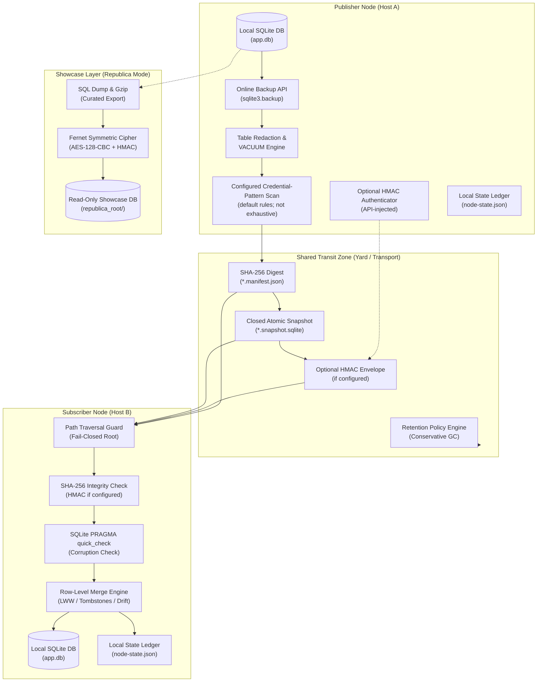

# sqlite-transit-sync


[](https://github.com/ellmos-ai/sqlite-transit-sync/actions/workflows/ci.yml)
[](CHANGELOG.md)
[](#tests)
[](#tests)
[](https://www.python.org/)
[](#)
[](#)
[](#governance-runtime-invariants-matrix)
[](SECURITY.md)
[](SECURITY.md)
[](CONTRIBUTING.md)
[](THIRD_PARTY_LICENSES.md)
[](THIRD_PARTY_LICENSES.txt)
[](NOTICE)
[](MARKETING-LOG.txt)
[](LICENSE)
[](https://github.com/ellmos-ai)
[](https://github.com/open-bricks)
[](llms.txt)

> [!NOTE]
> **LLM 与 AI Agent 上下文**：[`llms.txt`](llms.txt) 提供结构化、机器可读的站点地图、架构概览和 API 指南。

**🇬🇧 [English Version](README.md)** | **🇩🇪 [Deutsche Version](README_de.md)** | **🇪🇸 [Versión en español](README_es.md)** | **🇫🇷 [Version française](README_fr.md)** | **🇯🇵 [日本語版](README_ja.md)** | **🇨🇳 简体中文版** | **🇵🇹 [葡萄牙语版](README_pt.md)** | **🇷🇺 [俄语版](README_ru.md)** | **🤝 [贡献指南](CONTRIBUTING.md)** | **🛡️ [安全政策](SECURITY.md)** | **📝 [变更日志](CHANGELOG.md)** | **📋 [llms.txt](llms.txt)**

## 🧭 快速导航

1. [执行摘要与核心定位](#what-is-sqlite-transit-sync)
2. [可视化架构拓扑与解耦层](#system-architecture-topology)
3. [端到端快照与同步生命周期](#end-to-end-snapshot-synchronization-lifecycle)
4. [目标用户画像与高意向 SEO 搜索词](#marketing--target-personas)
5. [已实现行为与限制](#comparison-with-distributed-sql)
6. [治理与运行时不变量矩阵](#governance-runtime-invariants-matrix)
7. [核心能力与解耦功能](#what-it-provides)
8. [只读应用投影](#read-only-application-projections)
9. [安装与前置条件](#install)
10. [快速开始与多节点工作流](#quick-start)
11. [配置参考与凭据触发规则](#configuration)
12. [Republica 展示模式与加密方法](#republica-the-showcase-method)
13. [Python API 与扩展点](#python-api)
14. [安全性、威胁模型与运行限制](#safety-and-limits)
15. [第三方许可证清单](#third-party-licenses--transparency)
16. [生态系统、姊妹工具与工具包](#ecosystem--sibling-tools)
17. [测试、验证与 CI 矩阵](#tests)
18. [法定声明、责任限制与许可证（§ 521 BGB）](#license)

---

<a id="what-is-sqlite-transit-sync"></a><a id="core-identity"></a><a id="executive-summary--core-identity"></a>
## 1. 执行摘要与核心定位

版本、模块状态、可见性以及验证日期的权威来源由
[`METADATA_CONTRACT.md`](METADATA_CONTRACT.md) 定义；这些信息不构成
发布或公开上传批准。

该模块通过经完整性检查的快照和由应用选择的合并策略，为彼此独立的 SQLite 数据库提供本地优先同步。发送方身份验证为可选功能，通过由 API 注入的 HMAC authenticator 实现。它从
BACH ProSync 架构中提取而来，不依赖 BACH、OneDrive、主机名或用户路径。

这**不是分布式 SQL 服务器**。每个节点仅拥有并打开自己的
本地数据库。共享文件夹、对象存储挂载、可移动驱动器或其他
文件传输方式承载已关闭的快照及其清单。拉取时会先检查 SHA-256 和 SQLite `PRAGMA quick_check`，再在单个事务中将快照合并到本地数据库。仅当配置了 authenticator 时才会检查 HMAC 发送方身份验证。

它可与 [sync-master](https://github.com/dev-bricks/sync-master) 配合使用
（属于同一模块系列）：sync-master 的文件传输区可作为自然的承载位置——
将 `--transit` 指向该区域内由工具管理的 `db-transit/<namespace>/` 目录
（对应其协议规则 R9）。sync-master 负责承载文件，本模块负责数据库完整性与合并；二者保持独立。

---

<a id="system-architecture-topology"></a><a id="system-architecture"></a>
## 2. 可视化架构拓扑与解耦层

下图展示了多节点解耦拓扑：本地 SQLite 数据库只通过已关闭的快照包互连，并依据其清单检查完整性：



### ASCII 四视图架构投影

```text
+-------------------------------------------------------------------------------------------------------------------+
|                               SQLITE-TRANSIT-SYNC: FOUR-VIEW ARCHITECTURAL TOPOLOGY                               |
+-------------------------------------------------------------------------------------------------------------------+
| [VIEW 1: PUBLISHER NODE]               [VIEW 2: SHARED TRANSIT YARD]              [VIEW 3: SUBSCRIBER NODE]       |
|                                                                                                                   |
| +-------------------------+              +-----------------------------+            +---------------------------+ |
| | Local SQLite Database   |              |  Closed Transit Zone        |            | Path Traversal Guard      | |
| | (app.db - Exclusive RW) |              |  (Folder / Sync-Master / S3)|            | (Canonical Bounds Check)  | |
| +------------+------------+              +--------------+--------------+            +-------------+-------------+ |
|              |                                          ^                                         |               |
|              v (sqlite3.backup)                         |                                         v               |
| +------------+------------+                             |                           +-------------+-------------+ |
| | Online Consistent Backup|                             |                           | SHA-256 Integrity Check   | |
| | (Closed Rollback-Journal|                             |                           | Optional HMAC if set      | |
| +------------+------------+                             |                           +-------------+-------------+ |
|              |                                          |                                         |               |
|              v                                          |                                         v               |
| +------------+------------+                             |                           +-------------+-------------+ |
| | Redaction & VACUUM      |                             |                           | SQLite PRAGMA quick_check | |
| | (Exclude Sensitive Data)|                             |                           | (Integrity Verification)  | |
| +------------+------------+                             |                           +-------------+-------------+ |
|              |                                          |                                         |               |
|              v                                          |                                         v               |
| +------------+------------+                             |                           +-------------+-------------+ |
| | Pattern Scan            |                             |                           | Transactional Row Merge   | |
| | (default rules; limited) |                             |                           | (Row-Level LWW / Drift)  | |
| +------------+------------+                             |                           +-------------+-------------+ |
|              |                                          |                                         |               |
|              v                                          |                                         v               |
| +------------+------------+              +--------------+--------------+            +-------------+-------------+ |
| | Optional HMAC Adapter   |              |  *.snapshot.sqlite (Atomic) |            | Local SQLite Database     | |
| | (API-injected if set)   |- - - - - - ->|  *.manifest.json   (Digest) |----------->| (app.db - Merged State)   | |
| +-------------------------+              |  Retention Engine  (Scoped) |            +-------------+-------------+ |
|                                          +-----------------------------+                          |               |
|                                                                                                   v               |
|                                                                                     +-------------+-------------+ |
|                                                                                     | Local State Ledger        | |
|                                                                                     | (node-state.json)         | |
|                                                                                     +---------------------------+ |
+-------------------------------------------------------------------------------------------------------------------+
| [VIEW 4: REPUBLICA SHOWCASE / COURIER ENVELOPE (OPTIONAL ZERO-TRUST TRANSPORT)]                                   |
|                                                                                                                   |
| Local Database ----> Curated SQL Dump ----> Gzip Compression ----> AES-128-CBC (Fernet) ----> Encrypted Outpost   |
| (Source Node)       (FTS Rebuilt on Dest)   (53MB -> 11MB)         (Pre-Shared Key)          (republica_root/)    |
|                                                                                                                   |
| Single Secret File -> Fernet Cipher Envelope -> Courier Transit -> Destination Directory (Mode 0600, Transit Clr) |
+-------------------------------------------------------------------------------------------------------------------+
```

---

<a id="end-to-end-snapshot-synchronization-lifecycle"></a><a id="lifecycle"></a>
## 3. 端到端快照与同步生命周期

该工作流避免通过文件级同步传输正在使用的数据库文件。它会依据 SHA-256 清单检查快照字节，在启用时运行配置的凭据模式扫描（默认开启），并以事务方式合并通过检查的行。只有配置了由 API 注入的 HMAC authenticator 时，才提供发送方身份验证。只有成功完成 push/pull 交换后，对端才会看到变更：

```mermaid
sequenceDiagram
    autonumber
    participant App as Application / Node A
    participant CoreA as sqlite-transit-sync (Push)
    participant Shield as Credential-Pattern Scan (default on; configurable)
    participant Transit as Shared Transit (db-transit)
    participant CoreB as sqlite-transit-sync (Pull)
    participant Target as Local DB / Node B

    Note over App,CoreA: Phase 1: Local Online Snapshot & Redaction
    App->>CoreA: push(config, db)
    CoreA->>CoreA: Online Snapshot via SQLite Backup API
    CoreA->>CoreA: Drop Excluded Tables & VACUUM
    CoreA->>Shield: Scan Content for Secret Patterns (credential-triggers.json)
    Shield-->>CoreA: No configured pattern matched (if enabled)

    Note over CoreA,Transit: Phase 2: Snapshot Digest & File Publication
    CoreA->>CoreA: Calculate SHA-256 digest and size
    CoreA->>Transit: Write Temporary Snapshot & Atomic os.replace

    Note over CoreA,Transit: Phase 3: Optional Manifest Authentication & Publication
    CoreA->>CoreA: Optionally HMAC-sign manifest (if configured)
    CoreA->>Transit: Atomically write manifest with SHA-256; HMAC only if configured (*.manifest.json)

    Note over Transit,CoreB: Phase 4: Transit Ingestion & Boundary Guard
    CoreB->>Transit: Discover Manifests & Validate Path Bounds (Anti-Traversal)
    CoreB->>CoreB: Verify HMAC first if configured
    CoreB->>CoreB: Verify snapshot size and SHA-256 (integrity only)
    CoreB->>CoreB: Run PRAGMA quick_check on Isolated Snapshot

    Note over CoreB,Target: Phase 5: Transactional Row Merge & State Advance
    CoreB->>Target: BEGIN IMMEDIATE Transaction
    CoreB->>Target: Apply Row-Level Merge Policy (LWW per PK / Tombstones)
    CoreB->>Target: Reconcile Shared Column Schema Drift
    CoreB->>Target: COMMIT Transaction
    CoreB->>CoreB: Advance Local State Ledger (node-state.json)
    Note over Target: Peer state reflects successful exchange; no background convergence guarantee
```

---

<a id="marketing--target-personas"></a><a id="target-personas--discoverability-queries"></a><a id="target-personas"></a>
## 4. 目标用户画像与高意向 SEO 搜索词

面向模块化、去中心化生态，`sqlite-transit-sync` 服务于以下 4 类核心相关人员：

- **`[PERSONA-01]` 自主 AI Agent 工程师与多主机 Swarm 架构师：**
  - *挑战：* 在工作站、笔记本电脑和服务器上运行的多 Agent swarm 需要持久保存本地状态，同时避免文件锁冲突。
  - *方案：* 默认开启的扫描器在检测到配置的凭据模式时可阻止发布。这是一道安全网，并不证明快照中不含秘密。对端会在成功完成 push/pull 交换后收到变更。
- **`[PERSONA-02]` 多设备桌面与边缘应用开发者：**
  - *挑战：* 高级用户通过文件同步（例如 sync-master、Syncthing、Nextcloud）交换个人笔记和任务数据库时，会遇到数据库损坏和 `-wal` 锁定问题。
  - *方案：* SQLite backup API 与逐个文件发布机制使正在使用的 SQLite 数据库文件避开文件同步路径；该传输所交换的是 transit 中的快照。
- **`[PERSONA-03]` 本地优先与可配置传输工具的构建者：**
  - *挑战：* 对数据主权有要求的应用无法接受云服务锁定、持续的数据库托管费用或不受控的后台网络外传。
  - *方案：* 模块通过配置的文件系统路径交换快照文件。该路径可以是本地路径或可移动介质；共享或网络挂载传输不受模块控制。
- **`[PERSONA-04]` 企业安全、隐私与合规负责人：**
  - *挑战：* 严格的零信任要求禁止意外同步凭据、未经验证的二进制文件以及具备特权的后台服务。
  - *方案：* 默认开启的扫描器会在发布前检查配置的凭据模式；SHA-256 会依据清单检查快照完整性。可启用由 API 注入的 HMAC authenticator 来验证发送方身份。进程继承启动它的进程所具备的权限。

### 高意向搜索词（英语 EN 与德语 DE）

| 意图类别 | 英语（EN）搜索词 | 德语（DE）搜索词 |
|:---|:---|:---|
| **本地优先同步** | `sqlite synchronization python zero-dependency`, `local-first database snapshot sync`, `offline sqlite multi-device sync` | `lokale datenbank synchronisation offline snapshots`, `sqlite abgleich python ohne abhängigkeiten`, `lokale datenbank replikation dateibasiert` |
| **完整性与配置式凭据模式扫描** | `configured credential-pattern scan sqlite sync`, `configured filesystem transit sqlite sync`, `optional hmac sqlite snapshot manifest` | `konfigurierter credential musterscan sqlite sync`, `dateipfad transit sqlite sync`, `optional hmac snapshot manifest` |
| **行级合并与冲突** | `row level merge lww sqlite offline`, `sqlite last write wins schema drift tolerance`, `tombstone merge policy sqlite` | `row level merge lww sqlite offline`, `last-write-wins datenbank abgleich zeitstempel`, `schema drift toleranz sqlite merge` |
| **解耦架构** | `sqlite multi-node sync without distributed sql`, `sqlite over syncthing without corruption`, `sqlite transit yard architecture` | `sqlite synchronisation ohne verteilten server`, `sqlite über cloud sync ohne datenbankkorruption`, `transit yard sqlite synchronisation` |

关于用户画像、高意向搜索词和竞争定位的详细内容，请参阅 [MARKETING-LOG.txt](MARKETING-LOG.txt)。

---

<a id="comparison-with-distributed-sql"></a><a id="comparative-matrix--alternatives"></a><a id="comparative-matrix"></a>
## 5. 已实现行为与限制

本节记录项目已实现的行为和限制，并非对其他产品开展的最新横向对比审计。

| 维度 | 不变量 | 已实现行为 | 限制 / 边界 |
|:---|:---|:---|:---|
| **1. 本地处理与传输** | `INV-LOCAL-01` | 读取本地 SQLite 数据库，并将快照发布到配置的传输路径；无需中央数据库服务器。 | 配置路径可能是共享位置或网络挂载位置。该传输的访问方式和行为不受本模块控制。 |
| **2. 快照发布** | `INV-SNAP-02` | 创建在线备份，并使用临时文件和 `os.replace` 发布快照文件。 | 逐个文件替换并不构成快照和清单的多文件事务。 |
| **3. 旁路文件与进程范围** | `INV-ROLL-03` | 以 rollback-journal 模式关闭快照；若无法清理临时 SQLite 旁路文件，则 fail closed。 | 除非宿主应用另行添加进程锁，否则每个节点只运行一个同步进程。 |
| **4. 传输路径约束** | `INV-PATH-04` | 将清单与快照路径限制为规范传输根目录下的直接普通文件。 | 无法控制哪些主体可以写入该传输位置。 |
| **5. 完整性检查** | `INV-VERIFY-05` | 将快照字节与清单中的 SHA-256 比对，并运行 SQLite `PRAGMA quick_check`。 | 摘要匹配不能验证发送方或传输方身份。 |
| **6. 凭据模式扫描** | `INV-SHIELD-06` | 默认根据配置的模式检查快照内容；若匹配则中止发布，并报告 `table.column`，不报告匹配值。 | 厂商前缀规则是一道安全网，并非保证。扫描无匹配仅表示没有已知模式命中；定制或无前缀的秘密仍可能通过。 |
| **7. 发送方身份验证** | `INV-HMAC-07` | 应用可选择启用由 API 注入、针对规范清单的 HMAC-SHA256 身份验证。 | 未配置 authenticator 时不验证发送方身份。共享密钥 HMAC 不是新鲜度协议，也不是公钥签名。 |
| **8. 行合并** | `INV-MERGE-08` | 应用可配置行级合并策略；对于受支持的表，默认使用基于时间戳的 LWW。 | 集成应用负责处理时钟假设、删除语义、迁移和领域冲突规则。 |
| **9. 保留与删除范围** | `INV-RET-09` | 默认先进行 dry-run；除非显式启用跨节点授权，否则清理范围限于本地节点的产物。 | 保留清理不是备份或恢复服务。 |
| **10. 进程权限与安全政策** | `INV-SLA-10` | 进程使用启动它的进程所具备的权限。`SECURITY.md` 声明报告处理政策：48 小时内确认收到，并在 5 个工作日内完成分诊。 | 模块不强制使用标准用户权限，也不会请求提权。响应时限属于报告处理政策，不是运行时功能。 |

<a id="distributed-sql-detailed-comparison"></a>
### 处理模型与边界

| 方面 | `sqlite-transit-sync` 的行为 | 限制 / 边界 |
|---|---|---|
| 基本模型 | 每个节点拥有自己的本地 SQLite 数据库；快照通过配置的传输路径流转。 | 不存在单一的全局权威数据库。 |
| 写入 | 应用在本地写入；调用方通过运行 push 和 pull 来交换快照。 | 不提供自动后台同步。 |
| 可见性 | 成功完成交换并合并后，对端即可看到变更。 | 模块不承诺立即可见或全局一致的可见性。 |
| 全局事务 | 不提供。 | 应用无法在多个节点间提交一个事务。 |
| 离线运行 | 节点离线时仍可独立使用本地数据库。 | 快照交换需等到配置的传输路径可用。 |
| 冲突 | 配置的 `MergePolicy` 决定如何合并行；默认使用时间戳 LWW。 | 时钟、删除规则和领域语义仍由集成应用负责。 |
| 架构变更 | 共享列合并支持有限的 schema 漂移。 | 应用仍需负责迁移和 schema 兼容性。 |
| 故障处理 | 本地数据存储在 SQLite 中，传输快照是独立文件。 | 模块不提供自动复制、故障转移或传输备份。 |

### 优点、缺点与典型使用场景

| 系统 | 优点 | 缺点 | 适合的场景 | 不适合的场景 |
|---|---|---|---|---|
| `sqlite-transit-sync` | 本地占用小；无需中央数据库服务器；支持离线本地操作；文件传输可配置；可由应用选择合并策略。 | 变更需通过 push/pull 才能到达对端；没有全局事务或自动故障转移；时钟、删除、迁移和冲突都需要应用规则。 | 个人或任务数据库；本地 Agent 状态；间歇联网的笔记本电脑、工作站或边缘设备；研究笔记。 | 需要全局提交事务、即时共享状态、自动故障转移或许多并发写入方的工作负载。 |

### 快速决策指南

| 需求 | 适用性 |
|---|---|
| 节点离线时仍需继续使用各自的本地数据库 | `sqlite-transit-sync` |
| 更新可在显式 push/pull 交换后到达对端 | `sqlite-transit-sync` |
| 应用能够定义合并、时钟、删除和迁移规则 | `sqlite-transit-sync` |
| 每次写入都必须立即具备全局权威性 | 选择具有相应一致性契约的架构 |
| 需要全局事务、自动故障转移或许多并发写入方 | 评估能够提供这些行为的架构 |

对于少量间歇联网的设备，如果能够接受延迟交换以及由应用负责合并规则，本模块可能适用。如果工作负载要求全局事务、即时共享状态或自动故障转移，则应选择其文档契约明确提供这些行为的设计。

---

<a id="governance-runtime-invariants-matrix"></a><a id="governance--runtime-invariants"></a>
## 6. 治理与运行时不变量矩阵

下表记录项目的 10 项治理与运行时不变量，包括已实现行为及相关限制：

| # | 不变量 | 架构范围 | 文档记录的行为与限制 |
|---|---|---|---|
| 1 | **INV-LOCAL-01：本地 SQLite 处理与配置的传输路径** | 系统架构 | 读取本地 SQLite 数据库，并通过配置的传输路径发布快照。该路径可以是共享位置或网络挂载；主机与传输行为不受本模块控制。 |
| 2 | **INV-SNAP-02：离线快照原子性** | 传输发布 | 正在使用的数据库文件不会通过文件同步共享。在线快照通过 `sqlite3.backup` 获取，并通过 `os.replace` 原子替换发布。 |
| 3 | **INV-ROLL-03：回滚日志干净隔离** | 旁路文件防护 | 备份以 rollback-journal 模式关闭；创建清单前会 fail closed 地清理所有临时 SQLite 旁路文件（`-wal`、`-shm`、`-journal`）。 |
| 4 | **INV-PATH-04：严格的传输路径约束** | 文件系统边界 | 清单和快照必须是规范传输根目录内的直接普通文件。路径穿越（`../`）、符号链接和重解析点会触发 fail closed。 |
| 5 | **INV-VERIFY-05：两阶段完整性与合理性验证** | 合并前验证 | 每个接收的快照都必须先通过 SHA-256 摘要匹配和 SQLite `PRAGMA quick_check`，之后才会检查或合并数据。 |
| 6 | **INV-SHIELD-06：发布前凭据防护** | 内容检查 | 默认根据配置的凭据模式检查快照内容；匹配时中止发布，并报告 `table.column` 而不报告匹配值。厂商前缀模式是一道安全网，并非保证；无匹配不能证明快照不含秘密。 |
| 7 | **INV-HMAC-07：可选 HMAC 身份验证** | 发送方身份验证 | 可选的、由 API 注入的 HMAC-SHA256 信封用于验证规范清单负载（协议、命名空间、发送方 ID、文件名、SHA-256、大小、脱敏列表）。共享密钥 HMAC 不是新鲜度协议或公钥签名；未启用时，清单不会验证发送方身份。 |
| 8 | **INV-MERGE-08：确定性的行级合并** | 数据收敛 | 以事务方式进行行级合并（按主键使用 LWW、共享列联合以处理 schema 漂移、显式墓碑策略）。内容哈希打破平局，从而保证确定性收敛。 |
| 9 | **INV-RET-09：保守保留与权限范围** | 垃圾回收 | 快照清理默认先进行 dry-run，且严格限于本地节点的产物。跨节点删除（`--all-nodes`）需要管理员明确选择启用。 |
| 10 | **INV-SLA-10：进程权限与安全政策** | 运行时上下文 | 进程继承启动它的进程所具备的权限；模块不强制标准用户权限，也不会请求提权。`SECURITY.md` 声明收到报告后 48 小时内确认，并在 5 个工作日内完成分诊。 |

---

<a id="what-it-provides"></a><a id="core-capabilities"></a><a id="part-of-the-ellmos-stack-family"></a>
## 7. 核心能力与解耦功能

`sqlite-transit-sync` 是
[dev-bricks/sync-master](https://github.com/dev-bricks/sync-master) 的配套工具，
属于同一模块系列：sync-master 负责文件传输（`sync.files`），
本模块负责数据库完整性与合并（`sync.database`）。两者均可
独立运行，也可组合成
[ellmos-ai](https://github.com/ellmos-ai) 系列的工具栈——参见
[ellmos-ai/stacks](https://github.com/ellmos-ai/stacks) 目录。它在该
工具包中的职责是：不通过文件同步传输正在使用的 SQLite，只传输通过清单和 SQLite 完整性检查的快照，以及
由应用选择的合并策略。

### 核心能力

- 通过 SQLite backup API 创建一致的在线快照；
- 使用临时文件和 `os.replace` 原子发布；
- 以 rollback-journal 模式关闭快照，并在发布前 fail closed 地清理所有临时
  SQLite 旁路文件；
- 清单和快照路径被限制为规范传输目录中的直接普通文件，
  路径穿越、绝对路径、符号链接和重解析点
  会在哈希或合并前触发 fail closed；
- 验证 SHA-256 清单和 `PRAGMA quick_check`；
- 可选的、由 API 注入的 HMAC-SHA256 身份验证，适用于规范清单、
  发送方身份、协议版本和快照哈希，并使用明确的 key ID；
- 按节点记录本地拉取状态，并支持幂等重放；
- 对带时间戳的表，按主键逐行执行 last-write-wins；
- 可选的 `TombstoneMergePolicy` 参考适配器，用于显式删除；
- 通过共享列合并，对基础 schema 漂移提供容忍；
- 可配置表排除和快照脱敏，并在删除后运行 VACUUM；
- 默认开启内容扫描；当配置的凭据模式匹配时会中止发布
  （报告 `table.column`，绝不报告匹配值）。厂商前缀规则
  是一道安全网；扫描无匹配不能证明快照不含秘密；
- 支持自定义 `MergePolicy`，以实现领域规则、墓碑或 CRDT；
- 经过验证的快照清理，默认 dry-run，默认限于本地节点，
  并通过明确选择启用删除和管理其他节点；
- 支持选择性拉取待处理快照，使精简应用生命周期适配器无需重复实现合并或
  状态推进逻辑；
- 严格版本化的只读投影契约，具有精确的 schema/隐私允许列表、
  来源信息、检查点、循环和离线墓碑验证；
- 可选的 [Republica 展示模式](#republica-the-showcase-method)：将数据库
  作为加密负载单向分发，并在导入时生成独立的只读展示库，
  而非将数据合并到本地库；
- 无依赖的 Python API 和 JSON CLI（Republica 模式会额外使用 `cryptography`）。

---

<a id="read-only-application-projections"></a><a id="projections"></a>
## 8. 只读应用投影

`verify-projection` 可验证由应用拥有的已关闭 SQLite 投影，
不会复制、合并、迁移、安排任务或推进状态。应用需提供消费者身份和经过审查的最长离线时长；
验证器会拒绝循环依赖、过期检查点、不足的墓碑保留期、
未列出的表或列，以及非不透明的记录引用。

目前提供六种范围狭窄的契约：账户余额摘要、AboTracker
订阅状态、HausLagerist 补货日期、药品
到期/库存预警状态、日常事项到期/完成状态，以及保险
截止日期。AboTracker 契约仅提供
状态，因为导出 schema v1 尚无经过确认的下次到期日或续订日期；
它不会根据付款日期加计费周期来推算提醒。测试夹具
是合成 JSON 方案，领域身份或私人细节不会
进入允许列表。

内置契约名称为 `abotracker-subscription-status-projection.v1`、
`accounts-balance-projection.v1`、`hauslagerist-replenishment-projection.v1`、
`mediplaner-reminder-projection.v1`、
`routinika-reminder-projection.v1` 和
`versicherungsmanager-deadline-projection.v1`。
参见[只读投影契约](PROJECTION_CONTRACTS.md)和
[德语配套文档](PROJECTION_CONTRACTS_de.md)。

```bash
sqlite-transit-sync verify-projection \
  --contract mediplaner-reminder-projection.v1 \
  --database ./closed-projection.sqlite \
  --consumer-id reminder-consumer \
  --minimum-offline-seconds 2592000 \
  --previous-checkpoint 41
```

---

<a id="install"></a><a id="installation"></a>
## 9. 安装与前置条件

```bash
python -m pip install -e .
```

---

<a id="quick-start"></a><a id="quickstart"></a>
## 10. 快速开始与多节点工作流

在每个节点上创建配置。每个节点使用自己的数据库和状态文件，
但使用相同的传输目录和命名空间。

```bash
sqlite-transit-sync init \
  --config node.json \
  --database ./app.db \
  --transit ./shared-transit \
  --node-id laptop \
  --namespace my-app

sqlite-transit-sync push --config node.json
sqlite-transit-sync pull --config node.json --dry-run
sqlite-transit-sync pull --config node.json
sqlite-transit-sync status --config node.json
sqlite-transit-sync verify --config node.json
sqlite-transit-sync cleanup --config node.json
# Review the JSON plan, then explicitly apply it:
sqlite-transit-sync cleanup --config node.json --apply
```

应用的 schema 必须预先存在于每个节点上。默认关闭自动首次复制，
因为通用模块无法判断哪些 schema、
秘密、本地表或迁移属于特定应用。

### 可独立运行的 Python 快速入门（零外部依赖）

将 `sqlite-transit-sync` 直接集成到 Agent 框架、守护进程或后台工作进程的开发者，可运行这段自包含、可复制粘贴的脚本，以零外部依赖验证端到端多节点同步：

```python
import sqlite3
from contextlib import closing
import tempfile
from pathlib import Path
from sqlite_transit_sync import SyncConfig, TransitSync

with tempfile.TemporaryDirectory() as tmp:
    root = Path(tmp)
    transit = root / "transit"
    transit.mkdir()

    # 1. Initialize Node A and record local data
    db_a = root / "node_a.db"
    with closing(sqlite3.connect(db_a)) as conn, conn:
        conn.execute("CREATE TABLE notes (id INTEGER PRIMARY KEY, title TEXT, updated_at TEXT)")
        conn.execute("INSERT INTO notes VALUES (1, 'Hello from Node A', '2026-10-18T08:00:00Z')")

    # 2. Publish atomic snapshot from Node A to shared transit
    cfg_a = SyncConfig(database=db_a, transit=transit, state=root / "state_a.json", node_id="node_a", namespace="demo")
    snapshot = TransitSync(cfg_a).push()
    print(f"Node A published snapshot: {snapshot.path.name} (SHA-256: {snapshot.sha256[:8]}...)")

    # 3. Initialize Node B with schema and pull snapshot
    db_b = root / "node_b.db"
    with closing(sqlite3.connect(db_b)) as conn, conn:
        conn.execute("CREATE TABLE notes (id INTEGER PRIMARY KEY, title TEXT, updated_at TEXT)")

    cfg_b = SyncConfig(database=db_b, transit=transit, state=root / "state_b.json", node_id="node_b", namespace="demo")
    reports = TransitSync(cfg_b).pull()

    # 4. Verify converged state in Node B
    with closing(sqlite3.connect(db_b)) as conn, conn:
        rows = conn.execute("SELECT id, title, updated_at FROM notes").fetchall()
        print(f"Node B converged records: {rows}")
        assert rows == [(1, "Hello from Node A", "2026-10-18T08:00:00Z")]
```

---

<a id="configuration"></a><a id="configuration-reference"></a>
## 11. 配置参考与凭据触发规则

```json
{
  "database": "./app.db",
  "transit": "./shared-transit",
  "state": "./node-state.json",
  "node_id": "laptop",
  "namespace": "my-app",
  "timestamp_columns": ["updated_at", "modified_at", "created_at"],
  "exclude_tables": ["secrets", "sqlite_sequence"],
  "snapshot_exclude_tables": ["secrets"],
  "scan_snapshot_for_secrets": true,
  "secret_scan_skip_tables": [],
  "secret_scan_extra_patterns": [],
  "secret_patterns_file": null
}
```

相对路径以配置文件所在位置为基准。活动数据库绝不能
放在传输目录内，状态文件也必须位于
传输树之外。`SyncConfig`、`from_file`、`from_bytes` 和 CLI `init` 会拒绝
无效的状态路径，并会在创建传输或状态目录之前完成检查；不会
自动执行迁移。

如果应用需要为解析后的确切配置生成审计哈希，
可以只读取一次字节，并交给同一个基于源路径解析的解析器处理，不必二次读取
文件：

```python
import hashlib
from pathlib import Path

from sqlite_transit_sync import SyncConfig

config_path = Path("node.json").resolve()
payload = config_path.read_bytes()
config = SyncConfig.from_bytes(payload, source_path=config_path)
config_sha256 = hashlib.sha256(payload).hexdigest()
```

### 所有配置键及其默认值

| 键 | 默认值 | 含义 |
|---|---|---|
| `database` | *(必填)* | 此节点拥有的活动 SQLite 数据库 |
| `transit` | *(必填)* | 存放快照和清单的共享目录 |
| `state` | `./.sync-state.json` | 每节点的拉取状态文件；应放在传输目录外 |
| `node_id` | 机器主机名 | 标识快照文件名中的发布节点 |
| `namespace` | `"default"` | 在同一个传输位置内区分无关数据集 |
| `timestamp_columns` | `["updated_at","modified_at","created_at"]` | 用于 last-write-wins 的参考列 |
| `exclude_tables` | `["secrets","sqlite_sequence"]` | 永不合并到本地数据库的表 |
| `snapshot_exclude_tables` | `["secrets"]` | 发布前从快照中删除其行的表（之后运行 `VACUUM`） |
| `scan_snapshot_for_secrets` | `true` | 当快照内容匹配已配置的凭据模式时中止发布 |
| `secret_scan_skip_tables` | `[]` | 扫描时忽略的表；仅对单个噪声表使用此项，而不是关闭整个扫描 |
| `secret_scan_extra_patterns` | `[]` | 在触发规则文件基础上添加的正则表达式 |
| `secret_patterns_file` | `null`（使用内置文件） | 自定义触发规则文件路径；会**替换**内置模式 |
| `key_file` | `null`，否则为 `$SQLITE_TRANSIT_SYNC_KEY_FILE` | Republica 模式的 Fernet 密钥；必须放在传输目录外 |
| `republica_root` | `~/.republica` | 写入导入展示库的位置；必须放在传输目录外 |
| `allow_key_in_synced_folder` | `false` | 免除密钥不得位于云同步文件夹中的检查 |

本表中的 `state` 默认值适用于加载缺少该键的 JSON 配置。
`sqlite-transit-sync init` 则会写入
文件 `.<config-stem>-state.json`（若省略 `--state`；对于 `node.json`，
文件名为 `.node-state.json`）。

### 凭据扫描以及如何关闭它

`snapshot_exclude_tables` 只能删除你事先知道要排除的表。扫描器
回答的是该规则无法回答的问题：*凭据是否被粘贴进了
自由文本列*——例如便笺、日志行或会话摘要？它会在脱敏后、发布前扫描
快照副本。若匹配，则抛出 `SyncError`，
指出 `table.column`；不会包含匹配值，因此凭据不会出现在
日志、traceback 或 CI 输出中。不完整快照会被丢弃，
因此不会进入传输目录。

**关闭扫描是合理的选择**，并非权宜之计。如果传输位置由你控制且可信——例如
自己的服务器、合同范围内托管于欧盟的卷，或加密的可移动驱动器——并且你
*确实希望凭据随数据一起传输*，
则设置：

```json
{ "scan_snapshot_for_secrets": false }
```

如果只有一张表产生误报，优先使用 `secret_scan_skip_tables`：
只在该表跳过扫描，比全局关闭扫描更好。

### 调整触发规则

模式保存在数据文件中，而不是代码中——`sqlite_transit_sync/credential-triggers.json`——
因此可以逐步改进检测，而无需等待发布版本：

```json
{
  "version": 1,
  "patterns": [
    { "name": "github", "regex": "gh[pousr]_[A-Za-z0-9]{16,}", "prefilter": "gh" },
    { "name": "acme-internal", "regex": "ACME-[0-9]{4}", "prefilter": "ACME-" }
  ]
}
```

- `prefilter` 是可选的字面量，用作轻量 SQL `LIKE` 预筛选，以便大型
  快照仍能保持较快速度。它**必须**出现在正则表达式可能匹配的每个值中，
  否则可能漏报。如果不存在这样的固定字符串，就不要设置它——扫描器
  随后会完整读取该列以确保正确性。
- 将 `secret_patterns_file` 指向自定义副本，可完全替换默认模式；
  也可以使用 `secret_scan_extra_patterns` 在默认模式之外添加规则。

模式刻意使用厂商前缀。通用的“长十六进制字符串”规则
会误报校验和、UUID 和 git SHA 等合法数据库内容；而
误报率过高的扫描器会被关闭，起不到任何保护作用。
扫描干净只代表“没有已知模式匹配”，绝不能理解为“此快照不含
秘密”。

### 这不是密钥管理器

当配置的模式匹配时，扫描器可以阻止发布；但它不保证检测到每个凭据，也不会**分发**凭据。如果你真正要解决的问题是“我的几台机器需要共享相同的密码或 API 密钥”，
那么本模块并不适合——任何文档同步文件夹也不适合。可考虑专门的密钥管理工具，并审查其部署方式和信任模型：

| 方案 | 适用对象 | 说明 |
|---|---|---|
| **Vaultwarden**（自托管 Bitwarden） | 在多台机器上使用 CLI 的个人 | 在一台小型常开设备上运行；通过私有网络（WireGuard、Tailscale）访问，而不要公开暴露。官方 Bitwarden 客户端、浏览器扩展和 `bw` CLI 都可连接，因此脚本和 Agent 也能获取密钥。 |
| **SOPS + age** | 应与代码放在一起的密钥 | 加密文件可以安全提交，也可放进任何同步文件夹，因为传输的只有密文。支持按接收方设置密钥，也适合通过 git review 审查。 |
| **`pass`**（GPG）+ git | 偏好 Unix 的个人用户和小团队 | 每个密钥一个文件，使用普通 git 远端，无需服务器。 |
| **KeePassXC 数据库 + Syncthing** | 不需要服务器或云账户的用户 | 点对点文件同步；密码库本身始终是一个加密文件。 |
| **Infisical / OpenBao（Vault 分支）** | 团队、机器身份和密钥轮换 | 真正的密钥服务器，带审计日志和动态凭据；对家庭使用来说组件较多。 |
| **平台原生存储** | 一台机器、一个应用 | macOS Keychain、Windows DPAPI/Credential Manager、`systemd-creds` 或 CI 的密钥存储。无需同步，也就没有同步暴露。 |

无论选择哪种方案，关键在于：**数据走一个通道，
凭据走另一个通道。**本模块可在配置的模式匹配时阻止快照发布；
但不能保证检测到每一个秘密。

---

<a id="republica-the-showcase-method"></a><a id="republica-showcase"></a>
## 12. Republica 展示模式与加密方法

每台机器都会将数据库的**加密展示副本**放入共享文件区域。其他
机器可以查看，但不能修改。因此称为“重新发布”——
数据库只对持有密钥的人可读。

当 `push`/`pull` 不适用时，可使用 Republica：例如你想读取另一节点的数据而不将其合并到本地行中，或者各机器只有共享文件夹，没有服务器、开放端口或 Republica 专用的对等隧道；不过仍需要共享 Fernet 密钥，而且文件夹不能看到明文内容。

<a id="two-modes-deliberately-redundant"></a>
### 两种模式，共用一个已配置文件传输路径

在相同的 `SyncConfig` 下，`push`/`pull` 和 Republica 使用相同的已配置 `transit` 路径。`push`/`pull` 发布快照并将其合并到本地数据库；Republica 则在该传输位置下按节点子目录发布加密副本，并将其导入为 `republica_root` 下独立的只读数据库。它改变的是加密与合并行为，而不是传输方式。

| 条件 | 文件传输同步（`push`/`pull`） | Republica |
|---|---|---|
| 对端机器离线 | 节点可在对端离线时发布；`pull` 可合并已进入传输路径的快照。新数据需等其源节点发布后才可用。 | 发布方可暂存加密副本，留待之后导入。来自离线源的数据同样要等发布后才可用。 |
| VPN/SSH 隧道不可用 | 要求配置的文件路径仍可访问；`push`/`pull` 不会打开对等隧道。 | 同样依赖该传输路径；只有 VPN/SSH 导致配置路径不可用时才会影响它。 |
| 配置的传输路径不可用 | 无法通过不可用的配置路径发布或获取数据。 | 相同；Republica 没有备用传输方式。 |
| 密钥轮换或信任设置尚未完成 | HMAC 为可选项。若配置了 authenticator，密钥和信任设置必须匹配；否则 SHA-256 只检查完整性，不验证发送方身份。 | 发布和导入需要兼容的共享 Fernet 密钥；轮换时必须协调。 |
| 未配置应用专用的合并策略 | 使用配置的 `MergePolicy`，否则默认使用时间戳 LWW；若默认策略不适合，应选择领域专用策略。 | 导入到独立的只读数据库，不合并行。 |

当需要加密且彼此独立的只读副本时，Republica 很有用。它不提供传输故障转移；这需要另外配置彼此独立、可用性也独立的传输路径。

### 配置成本：传递一次密钥

共享密钥必须通过**不属于传输本身的某种通道**送到其他机器，
例如已有的加密隧道、密码管理器、U 盘，或电话口述。
只需传递一次。之后普通共享文件夹便足够，哪怕你并不信任
它。

```text
republica_root/
  laptop/my-app.sqlite      <- read-only showcase of laptop's database
  workstation/my-app.sqlite <- read-only showcase of workstation's database
```

```bash
# Once per key, on local disk - never inside the transit, never in a synced folder.
# Then copy this file to the other machines out of band; do NOT run keygen there.
sqlite-transit-sync keygen --key-file ~/.keys/republica.key

sqlite-transit-sync init --config node.json \
  --database ./app.db --transit ./shared-transit \
  --node-id laptop --namespace my-app \
  --key-file ~/.keys/republica.key

sqlite-transit-sync republica-publish --config node.json   # encrypt and publish
sqlite-transit-sync republica-list    --config node.json   # what other nodes offer
sqlite-transit-sync republica-import  --config node.json   # materialise them locally
```

需要安装可选加密依赖：`pip install 'sqlite-transit-sync[crypto]'`。

**传输的内容**不是数据库文件，而是经过筛选的 SQL dump，再用 gzip 压缩并通过
Fernet 加密。一次实测中，53.6 MB 的知识库经过处理后，在传输中的大小为 11.0 MB，因为
全文索引内部结构会在接收端重建，而不是随包发送（49636 条 dump
语句中有 35370 条）。发布仍需通过与合并快照相同的检查——脱敏，
凭据扫描、`quick_check` 和清单。

**它能保护什么：**传输方只能看到密文；Fernet 的 HMAC 还可检测蓄意
篡改，即使清单哈希被重新计算为与篡改内容匹配也一样。

**它不能保护什么：**Fernet 验证的是**密钥**，而非**发送方**——持有密钥的任何人
可以发布有效快照。这正是副本保持独立且绝不合并的原因。
密钥应保存在传输路径之外：密钥若位于传输目录中会被拒绝，
若位于看起来经过同步的文件夹中也会被拒绝（覆盖设置为
`allow_key_in_synced_folder`）。`republica_root` 也适用相同规则——解密后的
副本若位于传输路径中，就会以明文再次分发。

**限制：**如果全文索引没有自己的内容（`content=''`），就无法重建，
因为没有可用于重建的数据。此类表会在清单中标记为
`contentless_fts`，而不会悄悄以空内容到达。

### 密封信封：一个文件、同一通道，但绝不是数据库

初始化时会遇到一个问题：两台机器尚未共享安全通道，而这正是凭据必须跨机器传递的原因。
同一密钥和同一文件夹可以承载一个加密文件。

```bash
sqlite-transit-sync envelope-send    --config node.json --file ./api-token.txt --label api-token
sqlite-transit-sync envelope-receive --config node.json --into ~/credentials
```

文件以**文件**的形式到达（权限模式 `0600`），命名为 `<source-node>__<filename>`，且不会进入
数据库——数据库中的秘密会被每一份备份、索引和同步继续复制。
备注应记录秘密的存放位置，而不是秘密本身。

展示模式中的两条规则在此有意反转：**凭据扫描不适用**（否则会阻止正在传输的负载），
信封会在接收后从传输路径中**移除**，
以免秘密残留在共享文件夹中。将其解封到传输目录或看起来经过云同步的文件夹时，操作会被拒绝；
到达时还会重新净化文件名，
以防精心构造的清单将文件写到目标目录之外。

这是一个递送工具，不是密码管理器，也不是文件同步工具——信封应少而小。

---

<a id="python-api"></a><a id="api"></a>
## 13. Python API 与扩展点

```python
from sqlite_transit_sync import SyncConfig, TransitSync

sync = TransitSync(SyncConfig.from_file("node.json"))
snapshot = sync.push()
pending = sync.pending()
selected_reports = sync.pull_selected([pending[-1].path.name]) if pending else []
reports = sync.pull()
cleanup_plan = sync.cleanup()
print(
    snapshot.sha256,
    [report.as_dict() for report in reports],
    [report.as_dict() for report in selected_reports],
    cleanup_plan,
)
```

`pull_selected()` 只接受当前待处理且由调用方明确命名的快照，并复用
`pull()` 的验证、合并和状态门控。精简的生命周期适配器因此可以
选择一个符合条件的快照，而无需复制承载数据的机制。

### 可选的已认证清单与只读预检

集成应用可以使用非秘密的
`HMACKeyReference` 值来描述密钥。`load_hmac_authenticator()` 只会
通过注入的 `SecretResolver` 获取密钥字节；`OSKeyringSecretResolver` 是可选的
延迟加载适配器，适用于另行安装的 `keyring` 软件包。JSON 配置和
CLI 不会携带密钥材料：

```python
from sqlite_transit_sync import (
    HMACKeyReference,
    OSKeyringSecretResolver,
    load_hmac_authenticator,
    verify_authenticated_snapshot,
)

auth = load_hmac_authenticator(
    [HMACKeyReference(
        key_id="node-a-v2",
        service="ellmos-ocean-transit",
        account="node-a-v2",
        sender="node-a",
    )],
    active_key_id="node-a-v2",
    resolver=OSKeyringSecretResolver(),
    trusted_senders={"node-a"},
)
snapshot = verify_authenticated_snapshot(
    manifest_path,
    snapshot_path,
    authenticator=auth,
)
```

参考适配器使用共享密钥 HMAC-SHA256，而非具有不可否认性的公钥
签名。其规范负载包括协议、命名空间、节点、快照
名称、SHA-256、大小、脱敏列表，以及算法/密钥/发送方/信任来源标头。轮换期间，
请将旧密钥保留在验证器的密钥环中。已配置的验证器会拒绝
缺失、格式错误、来自其他来源或不匹配的签名。显式预检
还会在哈希前拒绝缺失文件和 SQLite 旁路文件；它不会打开
SQLite、合并行或读取/写入同步状态。验证成功仅能证明
指定文件的字节，不验证其 SQLite schema 或应用语义。
`TransitSync(..., authenticator=auth)` 仍可供现有调用方使用；
已拉取过的重放是由状态记录支持的空操作，不是新鲜度保证。
未配置的读取方不作真实性声明。新鲜度与密钥存储
仍由应用负责。

### 墓碑参考策略

需要处理删除的应用，应在自己的 schema 初始化时调用
`ensure_tombstone_table()` 并使用 `TombstoneMergePolicy`。保留表存储
`table_name`、规范的主键值 JSON 数组，以及作为删除版本的 `deleted_at`。
墓碑在版本相同时或面对更旧的行时优先；时间戳更新的后续行
可能恢复该键。适配器不会根据缺失行推断删除，
也不会清理墓碑，因此保留期必须覆盖最长离线时间。
未知表和 schema 不匹配的情况会受到保护或 fail closed；不会尝试
自动迁移。

时间戳 LWW 不够用时，可传入一个实现了 `MergePolicy.merge(local, remote, snapshot)` 的对象
给 `TransitSync`。

### 选择启用的快照保留

保留操作需要显式启用，默认执行 dry-run。它不会仅凭文件名判断是否可删除：
只有经过验证、属于配置命名空间并由当前节点拥有，
当前不再待处理，且经调用方的 `acknowledge`
回调接受的快照才可能符合条件。外来、未知、不完整、未验证和
未确认的产物会保留。年龄边界采用严格比较（`age >
max_age`）；`keep_latest` 和 `max_age` 可以组合使用。

```python
from datetime import timedelta
from sqlite_transit_sync import SnapshotRetentionPolicy

policy = SnapshotRetentionPolicy(
    max_age=timedelta(days=30),
    keep_latest=3,
    acknowledge=lambda snapshot: application_has_acked(snapshot),
)
report = sync.apply_retention(policy, dry_run=True, audit_path="retention-report.json")
# Apply only after reviewing exact planned paths and reasons:
report = sync.apply_retention(policy, dry_run=False, audit_path="retention-report.json")
```

该操作会重新读取并验证每一对计划文件，只删除准确对应的
快照和清单；不会进行宽泛清理，而是记录错误，并且可安全重复运行。
旁路文件和不完整产物会保留。这是中立的核心契约，
并非 BACH 的保留适配器。

### BACH 兼容性黄金对比

在开发任何 BACH 兼容适配器之前，先运行已提交的合成对比：

```bash
python scripts/compare_bach_golden.py --output golden/bach_compatibility_report.json
```

七个夹具涵盖关闭备份、清单/完整性失败、
脱敏/凭据中止、时间戳/schema 合并、pull 确认、
回滚和保留所有权。报告会有意保持为
`blocked_no_authorized_bach_golden`，直到每个情景都取得获准的 BACH 参考结果；
在全部情景获得授权结果前，不会推出适配器或兼容性声明。

---

<a id="safety-and-limits"></a><a id="threat-model"></a>
## 14. 安全性、威胁模型与运行限制

- 不要从网络或云同步文件夹直接打开正在使用的 SQLite 数据库。
- 将每节点状态文件放在共享传输路径之外；无效的同路径或子路径会在任何目录或状态写入之前
  被拒绝。
- 清单读取只接受一个相对快照文件名；路径约束以及链接/重解析点检查
会在 SHA-256、SQLite 验证或合并之前执行。
- SHA-256 用于检测损坏，但不能验证不可信传输方的身份。
- HMAC 身份验证是可选的共享密钥身份检查，不是密钥
  分发服务、新鲜度协议或公钥签名。
- 默认 LWW 假定时间戳可比较，并且不会推断删除。
- 墓碑保留期、时钟、密钥存储和应用迁移仍由
  集成方负责。
- 时间戳相同时，内容确定性平局判定可使结果收敛；这只是
  技术兜底，不能替代领域冲突规则。
- 没有主键或时间戳列的表会被跳过。
- 快照脱敏会删除已列出的表并对快照运行 VACUUM，但仍必须
  列出所有含凭据或私密数据的表；通用
  模块无法可靠发现领域专属秘密。
- 应用迁移、时钟政策、保留参数和冲突语义仍由
  集成应用负责。`cleanup` 只提供执行机制：它会验证每一对
  文件，默认执行 dry-run，每节点保留最新十个快照，并管理
  其他节点的清理仅在显式提供 `--all-nodes` 时执行。
- 除非宿主应用另行添加进程锁，否则每个节点只运行一个同步进程。

参见 [ARCHITECTURE.md](ARCHITECTURE.md)、[README_de.md](README_de.md) 和
[SECURITY.md](SECURITY.md)。

---

<a id="third-party-licenses--transparency"></a><a id="level-1-sbom"></a>
## 15. 第三方许可证清单

`sqlite-transit-sync` 是一个本地优先的 SQLite 同步软件包。它通过配置的文件系统传输路径交换快照；主机、挂载和传输行为不受本模块控制。核心操作没有外部运行时依赖。

- **零运行时依赖**：核心同步引擎只需要 Python 标准库（`>=3.10`）。
- **可选展示层**：Republica 加密展示模式可选使用 [`cryptography`](https://github.com/pyca/cryptography)（Apache-2.0 / BSD-3-Clause）。通过 OS keyring 可选查询 HMAC 密钥时，会使用 [`keyring`](https://github.com/jaraco/keyring)（MIT）。
- **项目维护的清单记录与安全政策**：项目维护的清单记录 MIT、Apache-2.0、BSD-3-Clause 和 PSF 许可证标识符，记录日期为 2026-10-02；这不是独立审计或认证。**INV-SLA-10** 指向安全报告处理政策（48 小时内确认，5 个工作日内分诊）；运行时权限遵循调用进程，未内置权限强制机制。
- **项目维护的许可证清单**：仓库在 [THIRD_PARTY_LICENSES.md](THIRD_PARTY_LICENSES.md) 中记录软件包许可证标识符及许可证文本。该记录不是独立审计或认证。
- **正式归属声明**：法律归属声明记录在 [NOTICE](NOTICE) 中。

---

<a id="ecosystem--sibling-tools"></a><a id="sibling-tools"></a>
## 16. 生态系统、姊妹工具与工具包

`sqlite-transit-sync` 属于 **ellmos-ai** 与 **open-bricks** 本地优先软件生态。它与姊妹仓库共同构成一组模块化工具，用于构建具备韧性的离线优先开发、文档与 Agent 编排工作流：

| 仓库 | 方向 / 领域 | 描述 |
|---|---|---|
| [dev-bricks/sync-master](https://github.com/dev-bricks/sync-master) | 文件同步传输区 | 强健的本地优先文件传输配套工具（`sync.files`），用于承载传输区域。 |
| [ellmos-ai/policy-registry](https://github.com/ellmos-ai/policy-registry) | 政策注册表 | 基于密码学的政策评估与能力边界约束型 Agent 执行。 |
| [ellmos-ai/system-gap-master](https://github.com/ellmos-ai/system-gap-master) | 系统拓扑 | 系统漂移检查、同步传输区健康审计与拓扑验证。 |
| [ellmos-ai/lock-master](https://github.com/ellmos-ai/lock-master) | 锁管理 | 多 Agent 并发协调器，支持协作式锁和死锁检测。 |
| [ellmos-ai/ticket-master](https://github.com/ellmos-ai/ticket-master) | 任务跟踪 | 无需外部服务器依赖的本地优先工单与里程碑跟踪。 |
| [ellmos-ai/clutch](https://github.com/ellmos-ai/clutch) | 进程桥接 | 为 LLM 工具管理子进程、隔离标准输入/输出并监督进程。 |
| [ellmos-ai/memoryhooker](https://github.com/ellmos-ai/memoryhooker) | 长期记忆 | 用于 LLM 交互的持久化记忆与上下文钩子。 |
| [ellmos-ai/workflowhooker](https://github.com/ellmos-ai/workflowhooker) | 工作流自动化 | 事件驱动的流水线拦截与自动化生命周期钩子。 |
| [ellmos-ai/ellmos-controlcenter-mcp](https://github.com/ellmos-ai/ellmos-controlcenter-mcp) | Control Center MCP | 面向工具、模型、工具栈和子 Agent 的统一编排网关。 |
| [ellmos-ai/ellmos-filecommander-mcp](https://github.com/ellmos-ai/ellmos-filecommander-mcp) | File Commander MCP | 具备审计日志和边界强制机制的安全、强化型文件系统操作。 |
| [ellmos-ai/ellmos-codecommander-mcp](https://github.com/ellmos-ai/ellmos-codecommander-mcp) | Code Commander MCP | 提供高级代码分析、AST 转换和导入诊断的 MCP 服务器。 |
| [dev-bricks/automation-master](https://github.com/dev-bricks/automation-master) | 自动化引擎 | 基于本地事件溯源的自动化流水线，采用投影式执行。 |
| [dev-bricks/DevCenter](https://github.com/dev-bricks/DevCenter) | 开发者工作台 | 用于管理项目、环境和多仓库工作流的桌面 GUI。 |
| [dev-bricks/CodeBox](https://github.com/dev-bricks/CodeBox) | 代码管理 | 本地优先的代码库与 AST 模式索引。 |
| [doc-bricks/PDFtoPDFocr](https://github.com/doc-bricks/PDFtoPDFocr) | 文档 OCR | 带 OCR 层的可搜索 PDF 转换；本指南不评估其网络或隐私行为。 |
| [open-bricks/open-bricks](https://github.com/open-bricks) | 伞形组织入口 | 面向所有开源 bricks 的元仓库与总览文档。 |
| [ellmos-ai/coma](https://github.com/ellmos-ai/coma) | Agent 作业与进程生命周期 | 管理本地作业文件并启动或检查 Agent 进程状态；这不同于 SQLite 快照验证与行级合并。 |

<!-- BEGIN GENERATED ELLMOS BUNDLE DISCOVERY -->

### Bundles and partners

Generated discovery projection for `module:sqlite-transit-sync` from `catalog:v4-bundles` (`546290dafbaafd810df1d59ef5a3d7183738472b48cd5a8a81f1e8f2b64d852e`).
Target repository visibility: `public`. Bundle manifests remain the membership authority; this section does not install or activate components.
Discovery approval: `public` module-registry record, explicit default-deny bundle allowlist.

#### `ellmos-sync-federation-bundle`

- Bundle recipe visibility: `private`; role: `declared-component`; requirement: `recommended`.
- module partners: `module:cloud-safe-exporter`, `module:direct-beam`, `module:receipt-validator`, `module:sync`, `module:system-explorer-export`, `module:system-gap-master`.
- skill partners: `skill:agent-config-sync`, `skill:mcp-config-sync`, `skill:system-onboarding`.

Composition and runtime details are intentionally omitted.

<!-- END GENERATED ELLMOS BUNDLE DISCOVERY -->

### 机器可读索引

面向 AI Agent、LLM 与自动化工具的结构化站点地图和 API 索引位于 [llms.txt](llms.txt)。

---

<a id="tests"></a><a id="testing--verification"></a>
## 17. 测试、验证与 CI 矩阵

```bash
python -m unittest discover -s tests -v
python -m pytest -q -ra
python -m pytest --collect-only -q
```

测试套件只使用合成数据库和临时传输目录。
CLI 帮助、保留契约、黄金对比以及 JSON
init/status/push/list/verify/pull 冒烟测试均在已验证的测试
收集中；不会使用真实数据库、BACH 运行时或外部传输。

---

<a id="license"></a><a id="statutory-notice--liability-limitation"></a><a id="license--statutory-liability-limitation"></a>
## 18. 法定声明、责任限制与许可证（§ 521 BGB）

### 法定免责声明（§ 521 BGB 的无偿赠与责任规则）

本开源软件作为《德国民法典》（BGB）§§ 516 及后续条款所指的**无偿赠与**提供。根据 **§ 521 BGB**，作者和贡献者的责任限于**故意行为和重大过失**。下文 MIT 许可证中的免责声明作为补充适用。

使用风险由使用者自行承担。没有维护义务、可用性保证，也不保证软件无错误或适用于任何特定用途。

### 补充摘要

本项目是无偿提供的开源软件。依据《德国民法典》（BGB）§ 521，责任严格限于故意不当行为和重大过失。MIT 许可证另行规定补充责任免责声明。

使用风险完全由使用者自行承担。不承诺维护或可用性，也不对适用于任何特定用途作出保证。

### 许可证与归属声明

依据 [MIT License](LICENSE) 的条款分发。<br>
版权所有 (c) 2026 Lukas Geiger。完整信息请参阅 [LICENSE](LICENSE) 和 [NOTICE](NOTICE)。<br>
项目维护的第三方依赖/许可证清单及纯文本副本见 [THIRD_PARTY_LICENSES.md](THIRD_PARTY_LICENSES.md) 和 [THIRD_PARTY_LICENSES.txt](THIRD_PARTY_LICENSES.txt)。

### 来源说明

该模块于 2026 年从 BACH `system/hub/db_sync.py`（ProSync）中提取。
独立模块以配置和政策接口替换 BACH 专属路径、处理器、秘密和表结构假设。
它还会按主键合并，
并添加经过验证的清单。
